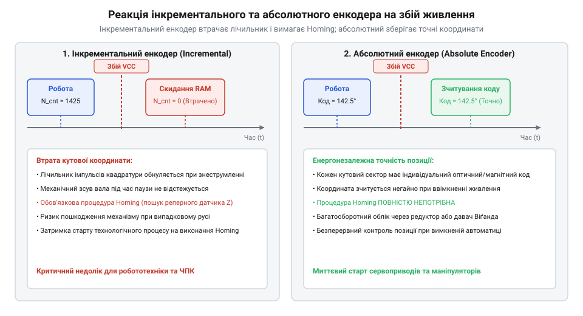
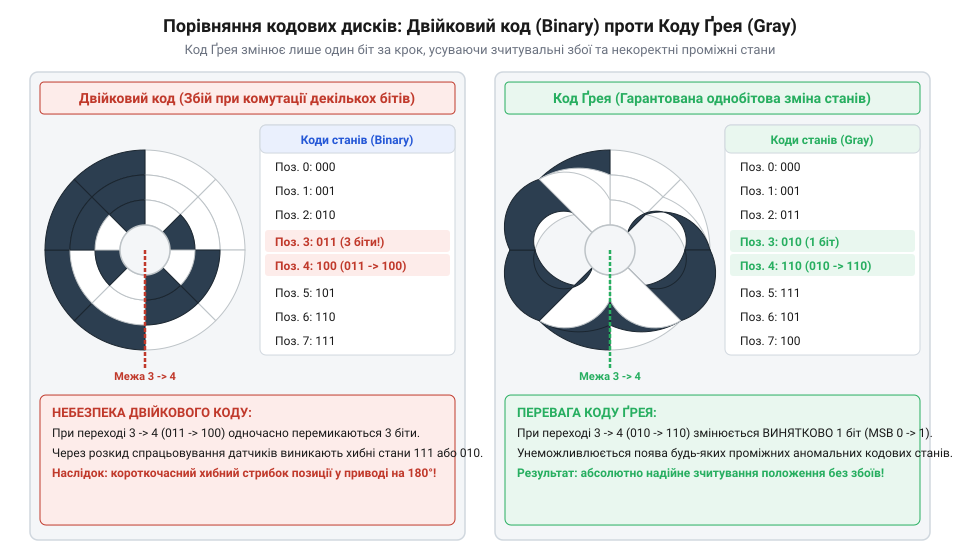
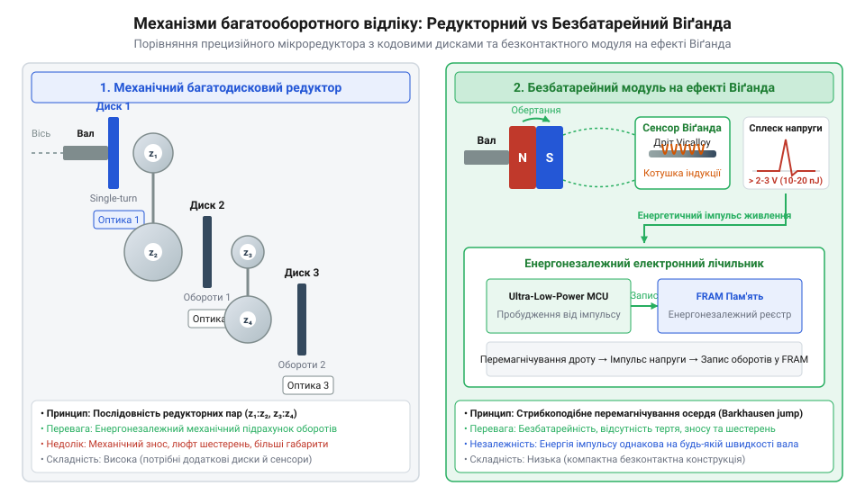
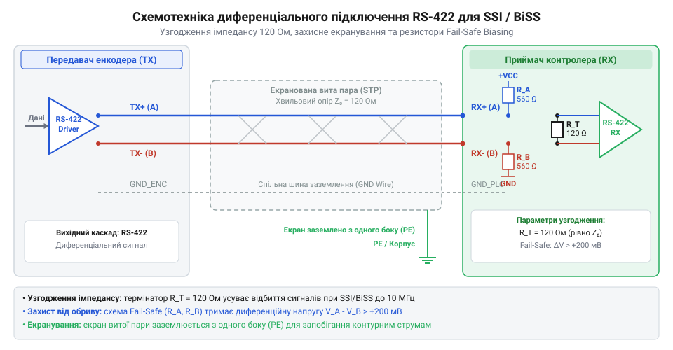

# Абсолютні поворотні енкодери: однооборотні та багатооборотні

<preknowlist>
- [Оптичні та механічні інкрементальні енкодери](root:cat-hw-controls/rotary-encoders-quadrature) — принципи квадратурного зчитування та концепція імпульсного відліку кутового переміщення
- [Поворотний потенціометр](root:cat-hw-controls/rotary-potentiometer) — принцип абсолютного аналогового вимірювання кута
</preknowlist>

## Втрата позиції та потреба базовування

Використання [інкрементальних енкодерів](root:cat-hw-controls/rotary-encoders-quadrature) пов'язане з суттєвим обмеженням: при знеструмленні системи накопичений підрахунок імпульсів втрачається. Після відновлення живлення маніпулятор змушений виконувати повільну процедуру базовування (від англ. @@en|homing procedure@@), шукаючи кінцевий вимикач чи індексну мітку. У сервосистемах ЧПК-верстатів та роботів таке механічне переміщення є ризикованим через загрозу зіткнення інструмента з деталлю. На відміну від них, [поворотний потенціометр](root:cat-hw-controls/rotary-potentiometer) зчитує абсолютний кут, але швидко зношується.

Абсолютні поворотні енкодери усувають потребу в гомінгу. Кожному кутовому положенню вала відповідає унікальний цифровий код, записаний на концентричних кодових доріжках. При повторному ввімкненні фотоприймачі чи магнітні сенсори миттєво зчитують поточну координату без жодного механічного обертання вала.

*Порівняння реакції інкрементального та абсолютного енкодера на аварійне відключення живлення.*

## Кодування кута та код Грея

Однооборотний абсолютний енкодер вимірює кут у межах 360°. Оптична маска або завадостійкі [індуктивні давачі положення](root:cat-hw-controls/optical-and-inductive-position-encoders) містять `N` паралельних розрядних доріжок, що визначають роздільну здатність у `2ⁿ` позицій на оберт (наприклад, 13 біт відповідають 8192 відлікам).

Якщо виводити кут у звичайному двійковому коді, при переході між сусідніми секторами (наприклад, `0111` в `1000`) через асинхронність фотодіодів виникають гонки сигналів (від англ. @@en|race condition@@). Вузьке часове вікно неузгодженості створює хибні міжкодові глітчі (від англ. @@en|glitches@@). Для їх усунення диск розмічають рефлексивним кодом Ґрея (від англ. @@en|Gray code@@), де при переході між сусідніми позиціями змінюється стан лише одного біта. Перетворення коду Ґрея у двійковий формат здійснюється послідовною операцією XOR: старший біт зберігається `B[N-1] = G[N-1]`, а молодші обчислюються як `B[i] = B[i+1] ⊕ G[i]`.

*Конструкція кодового диска та запобігання міжкодовим аномаліям за допомогою коду Ґрея.*

## Механізми відліку повних обертів

Для контролю ходу ходових гвинтів чи барабанів лебідок використовують багатооборотні енкодери, які додатково відлічують кількість повних обертів (від 4096 до 65536 обертів). Існує три основні технології підрахунку:

1. **Механічний редуктор** — каскад мікрозубчастих коліс із власними кодовими дисками. Система є повністю енергонезалежною й не вимагає живлення під час обертання.
2. **Безбатарейний модуль Віґанда** — спеціальний дріт на ефекті Віґанда (від англ. @@en|Wiegand effect@@) при кожному оберті магніту ротора генерує короткий електричний імпульс. Накопичена енергія живить електронний лічильник та записує стан у сегнетоелектричну пам'ять (від англ. @@en|Ferroelectric RAM@@, @@en|FRAM@@) навіть при вимкненій мережі.
3. **Батарейний лічильник** — використовує зовнішній літієвий елемент живлення для підтримки низькоспоживаючого мікроконтролера в режимі сну. Фізичні основи бістабільного перемагнічування сплаву Vicalloy та конструктивні особливості розкрито в окремому матеріалі про [дріт та сенсори на ефекті Віґанда](root:hw-sensing/wiegand-sensor-and-energy-harvesting).

*Принцип підрахунку повних обертів за допомогою прецизійного редуктора та генератора Віґанда.*

## Послідовні протоколи та схемотехніка RS-422

Передача багаторозрядних даних паралельними лініями вимагає громіздких кабелів. Тому абсолютні енкодери використовують завадостійкі послідовні протоколи SSI (від англ. @@en|Synchronous Serial Interface@@) та BiSS-C (від англ. @@en|Bidirectional Synchronous Serial@@). Зчитування кадру тактується імпульсами `CLK` від контролера, а енкодер виводить біти положення по лінії `DATA`.

Приймачі-передавачі працюють через парафазні диференціальні лінії RS-422 (від англ. @@en|Recommended Standard 422@@). Для пригнічення відбиття сигналів на кінцях ліній встановлюють термінуючі резистори 120 Ом, рівні хвильовому опору витої пари. У протоколі BiSS-C кадр доповнюється циклічною контрольною сумою (від англ. @@en|Cyclic Redundancy Check@@, @@en|CRC-8@@) та апаратними прапорами попередження `nWARN` і помилки `nERR`.

*Принципова схема підключення диференціальних парафазних ліній CLK та DATA з хвильовим термінуванням.*
