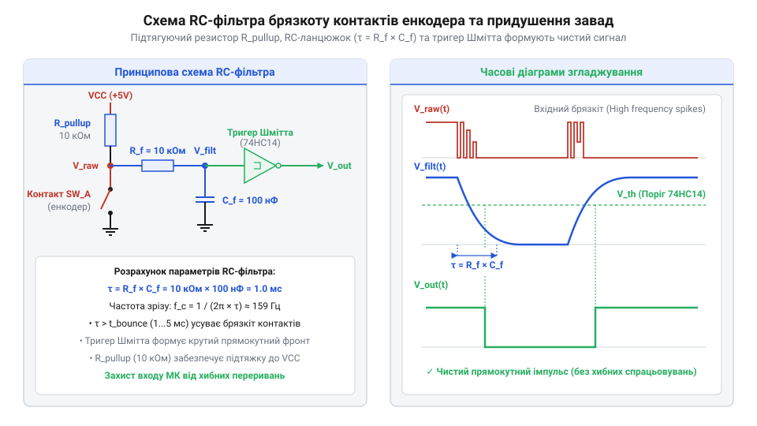

# Залізний інтерфейс, цокольовка та електричні рівні інкрементальних енкодерів

<preknowlist>
- [KY-040 — поворотний енкодер](root:cat-hw-controls/ky-040-encoder) — принципи формування прямокутних імпульсів на виходах A і B та вбудована тактова кнопка
- [Оптичні та індуктивні давачі положення органів вводу](root:cat-hw-controls/optical-and-inductive-position-encoders) — фізика формування фазових сигналів A і B
</preknowlist>

## Призначення сигнальних ліній та цокольовка

Підключення інкрементального енкодера до цифрової системи керування без розуміння призначення його провідників призводить до невірної обробки напрямку, втрати точки відліку або пошкодження вхідних портів мікроконтролера. На відміну від простих змінних опорів, апаратний інтерфейс енкодера складається з групи сигнальних ліній та ліній живлення.

Стандартна цокольовка інкрементального енкодера включає групу базових живильних і сигнальних провідників, а у прецизійних промислових виконаннях розширюється спеціалізованими лініями діагностики та скидання:

    VCC (Power Supply)        [лінія позитивного живлення, +3.3V, +5V або +24V]
    GND (Ground)              [спільний провідник маси та мінуса живлення]
    A / CLK (Channel A)       [основний квадратурний фазовий імпульсний канал]
    B / DT (Channel B)        [допоміжний квадратурний фазовий канал зі зсувом 90°]
    Z / Index / I (Zero Index)[канал нульової позначки, 1 імпульс на оберт 360°]
    SW (Switch)               [виводи інтегрованої механічної тактової кнопки]
    ALARM / ERR (Fault Output)[вихід апаратної діагностики збоїв та завад]
    RESET / SET (Zero Reset)  [вхід примусового апаратного скидання лічильника]
    SENSE (VCC_S / GND_S)     [обратні лінії компенсації падіння напруги в кабелі]
    SHIELD / PE               [захисний екранувальний провідник кабелю]

У високонадійних сервоприводах лінія аварійного стану `ALARM` (або `ERR`, англ. @@en|fault alarm output@@) активується внутрішнім компаратором при зниженні інтенсивності випромінювання світлодіода, забрудненні оптичного диска, перегріві чи перевищенні граничної кутової швидкості. Це дозволяє контролеру негайно зафіксувати апаратну несправність сенсора до втрати позиціонування. Входи апаратного скидання `RESET` та `SET` приймають зовнішній імпульс від кінцевого вимикача або промислового контролера для миттєвого обнулення поточного відліку без опитування каналу `Z`. Спеціалізовані виводи `SENSE` підключаються паралельно провідникам живлення безпосередньо у корпусі енкодера, забезпечуючи обратну компенсацію падіння напруги в довгих кабельних трасах.

    VCC (Power Supply)        [лінія позитивного живлення, +3.3V, +5V або +24V]
    GND (Ground)              [спільний провідник маси та мінуса живлення]
    A / CLK (Channel A)       [основний квадратурний фазовий імпульсний канал]
    B / DT (Channel B)        [допоміжний квадратурний фазовий канал зі зсувом 90°]
    Z / Index / I (Zero Index)[канал нульової позначки, 1 імпульс на оберт 360°]
    SW (Switch)               [виводи інтегрованої механічної тактової кнопки]
    SHIELD / PE               [захисний екранувальний провідник кабелю]

Канали `A` та `B` утворюють квадратурну пару, за допомогою якої цифровий декодер обчислює кутове зміщення та напрямок обертання вала. У бюджетних модулях, як-от у [поворотному енкодері KY-040](root:cat-hw-controls/ky-040-encoder), ці виводи часто маркують як `CLK` (Clock) та `DT` (Data).

Канал `Z` (англ. @@en|Index pulse@@) сформовано окремою прозорою міткою на кодовому диску. Він генерує один вузький імпульс за один повний оберт вала (`360°`), що дозволяє апаратному лічильнику прив'язатися до абсолютного фізичного нуля та компенсувати накопичений дрейф відліків. Вбудована кнопка `SW` механічно замикається при натисканні на приводний вал і працює як сухий контакт, незалежний від квадратурних фотоприймачів.

Для захисту від зовнішніх електромагнітних завад сигнальний кабель промислового енкодера покривають металевою braid-оболонкою `SHIELD`, яку заземлюють на боці шафи керування.

## Схемотехніка вихідних каскадів та логічні рівні

Пряме з'єднання виходів енкодера з мікроконтролером вимагає узгодження схемотехнічної топології вихідного транзисторного каскаду та логічних рівнів напруг. Використання невідповідного стандарту напруги викликає апаратне вигоряння входів або повну відсутність зчитування фронтів.

У промисловій та побутовій електроніці застосовують три основні топології вихідних каскадів.

*Схемотехнічні топології вихідних каскадів енкодера (відкритий колектор NPN, Push-Pull, RS-422) та діаграми узгодження логічних рівнів TTL й HTL.*

Вихід типу відкритий колектор NPN (англ. @@en|open collector@@) побудовано на одному транзисторі, колектор якого виведено назовні без внутрішнього підтягуючого резистора. При відкритті транзистор активує рівень `GND`, а при закритті вихід переходить у високоімпедансний Z-стан (англ. @@en|high-impedance state@@). Така схема вимагає зовнішнього підтягуючого резистора Pull-Up до лінії `VCC`. Топологія NPN дозволяє легко узгоджувати рівні напруг: енкодер із живленням `12V` можна підключити до порту мікроконтролера `3.3V`, підтягнувши відкритий колектор до шини `3.3V`.

Каскад Push-Pull (або Totem-Pole, англ. @@en|push-pull output@@) містить комплементарну пару верхнього PNP та нижнього NPN транзисторів. Вихід активно виставляє як високий рівень `VCC`, так і низький рівень `GND`. Ця топологія забезпечує круті фронти сигналів і не вимагає зовнішніх резисторів, проте напруга високого рівня суворо дорівнює напрузі живлення енкодера.

Для передачі даних у промислових умовах використовують диференціальний лінійний драйвер (англ. @@en|differential line driver@@) стандарту RS-422. Він формує інверсну пару сигналів для кожного каналу (`A` та `/A`, `B` та `/B`, `Z` та `/Z`), забезпечуючи високу завадостійкість.

За стандартами напруг енкодери поділяються на два класи:
1. `TTL` (Transistor-Transistor Logic) з живленням `5V`, де низький рівень `V_IL ≤ 0.8V`, а високий `V_IH ≥ 2.0V`.
2. `HTL` (High Threshold Logic) з живленням `10...30V` (найчастіше `24V`), де низький рівень `V_IL ≤ 5V`, а високий `V_IH ≥ 15V`.

При підключенні промислових HTL-виходів до мікроконтролера обов'язково застосовують дільники напруги, опторозв'язку або мікросхеми конвертерів рівнів. Найпростішим розв'язком є резистивний дільник напруги (англ. @@en|voltage divider@@), у якому вихідна напруга `V_out` визначається амплітудою вхідного сигналу `V_in` та опорами плечей `R1` і `R2`:

V_out = V_in × R2 ÷ (R1 + R2)         [розрахунок напруги резистивного дільника]

Для зниження сигналу з 24 В до безпечного рівня входів GPIO `3.3V` обирають `R2 = 3.3 kΩ` та `R1 = 22 kΩ`, що забезпечує напругу `V_out ≈ 3.13V`. Проте такий дільник не має електричної розв'язки й чутливий до завад. Для захисту низьковольтних мікроконтролерів від промислових сплесків напруги перевагу віддають оптичній розв'язці на швидкісній оптопарі (англ. @@en|optocoupler@@) або оптроні (англ. @@en|optoisolator@@). Струмообмежувальний резистор `R_LED` у колі анода світлодіода оптопари обчислюють за робочим струмом `I_F` (10 мА) та прямим падінням напруги `V_F` (1.2 В):

R_LED = (V_in - V_F) ÷ I_F            [розрахунок баластного резистора оптопари]
      = (24 - 1.2) ÷ 0.01 = 2280 Ω    [обчислення опору для живлення 24V]

Отримане значення округлюють до стандартного номіналу `2.4 kΩ`. Колектор вихідного фототранзистора підтягують резистором `1 kΩ` до шини живлення `3.3V`, що забезпечує повну гальванічну ізоляцію та чітку передачу фронтів імпульсів від [оптичних та індуктивних давачів](root:cat-hw-controls/optical-and-inductive-position-encoders).

## Розрахунок підтяжки та RC-фільтрація брязкоту

Механічні інкрементальні енкодери та виходи з відкритим колектором вимагають правильного розрахунку зовнішньої пасивної обв'язки. Відсутність фільтрації брязкоту контактів або помилка вибору опору підтяжки призводять до викривлення прямокутних імпульсів і хибного підрахунку координати при [дрейфі нуля та калібруванні](root:cat-hw-controls/stick-drift-mitigation).

Для виходу з відкритим колектором NPN опір підтягуючого резистора `R_pull` визначається компромісом між максимально допустимим струмом транзистора та тривалістю наростання фронту сигналів. Мінімальне значення резистора обмежує струм споживання:

    R_pull_min = (VCC - V_OL) / I_sink_max      [мінімальний опір підтяжки]

Де `V_OL` — напруга насичення відкритого транзистора (`≈ 0.2V`), а `I_sink_max` — граничний струм колектора. Максимальний опір обмежується паразитною ємністю кабелю `C_cable`:

    R_pull_max = t_rise / (3 × C_cable)          [максимальний опір для заданої частоти]

При довгих кабелях опір `R_pull` обирають у діапазоні `1 kΩ ... 4.7 kΩ`, а для коротких планарних кіл — `10 kΩ`.

*Принципова схема RC-фільтра придушення брязкоту механічних контактів із підтягуючим резистором та часовими діаграмами згладжування фронтів.*

У механічних енкодерах замикання пружних зчитувальних щіток спричиняє брязкіт тривалістю `t_bounce = 1 ... 5 ms`. Для його апаратного придушення застосовують пасивний низькочастотний RC-фільтр (англ. @@en|low-pass RC filter@@). Постійна часу фільтра `τ` вибирається так, щоб згладити високочастотні брязкові імпульси, але не спотворити максимально можливу робочу частоту енкодера:

    τ = R_f × C_f ≈ t_bounce / 3      [постійна часу RC-фільтра]

Типові значення для механічних енкодерів становлять `R_f = 10 kΩ` та `C_f = 100 nF` (`τ = 1 ms`). Вихід згладженого RC-кола підключають до входу мікроконтролера через тригер Шмітта (англ. @@en|Schmitt trigger@@), який відновлює круті фронти прямокутного сигналу та повністю усуває невизначеність у зоні логічного порогу.

## Диференційне підключення та термінування RS-422

У промислових умовах сигнальні кабелі енкодерів прокладають поруч із силовими кабелями частотних перетворювачів та електродвигунів. Напруга завад, індукована на довгих провідниках, перевищує логічні пороги однополярних сигналів, викликаючи пропуск відліків.

Для вирішення цієї проблеми у високоточних [оптичних та індуктивних давачах положення](root:cat-hw-controls/optical-and-inductive-position-encoders) застосовують диференціальну передачу сигналів за стандартом RS-422. Передавач енкодера формує прямий сигнал `A+` та інверсний сигнал `A-`. Напруга завади `V_noise`, наведена електромагнітним полем на кабелі, є синфазною (англ. @@en|common-mode noise@@) і наводиться однаково на обидва провідники крученої пари (англ. @@en|twisted pair@@).

На боці контролера встановлюють диференційний приймач (англ. @@en|line receiver@@, наприклад AM26LV32 або MAX3095), який обчислює різницю напруг:

    V_diff = V_(A+) - V_(A-)      [різницевий сигнал на вході приймача]

Оскільки `V_(A+) = V_sig + V_noise`, а `V_(A-) = -V_sig + V_noise`, різницева напруга становить `V_diff = 2 × V_sig`, а синфазна завада `V_noise` повністю віднімається і нейтралізується.

При довжині ліній понад 10 метрів і високих частотах перемикання кабель поводиться як лінія з розподіленими параметрами. Неузгодженість імпедансів викликає відбиття хвилі сигналу від кінців кабелю, створюючи хибні повторні фронти. Для компенсації відбитків на самому кінці крученої пари паралельно входам диференційного приймача підключають термувальний резистор (англ. @@en|terminating resistor@@):

    R_term = Z_0 ≈ 120 Ω      [узгодження з хвильовим опором крученої пари]

Опір `R_term` має точно відповідати хвильовому опору кабелю `Z_0` (`100 ... 120 Ω`). Таке термінування поглинає енергію падаючої електромагнітної хвилі, виключає хвильові відбитки та забезпечує передачу сигналів енкодера на відстані до 100 метрів.
