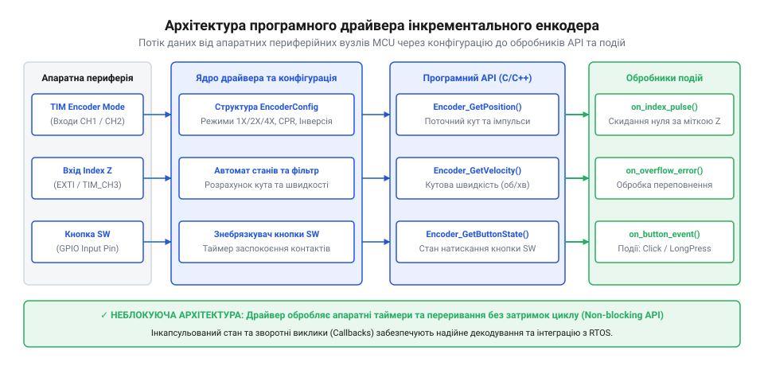
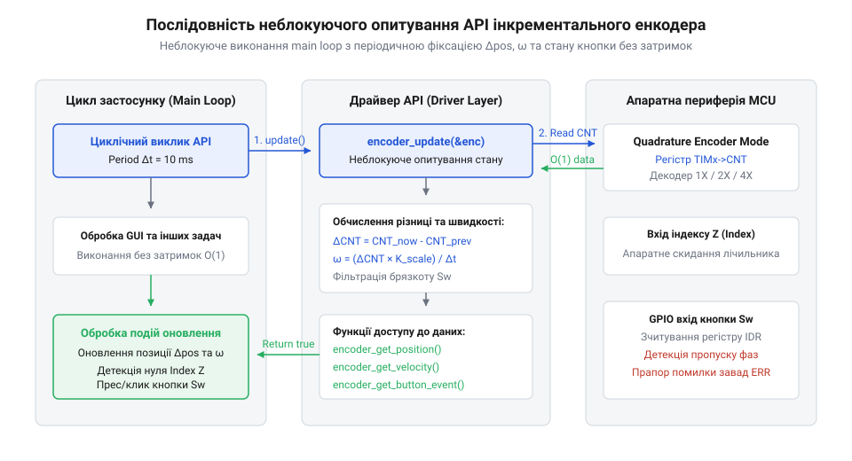

# Програмний API драйвера декодування квадратурного енкодера

<preknowlist>
- [KY-040 — поворотний енкодер](root:cat-hw-controls/ky-040-encoder) — розуміння конструкції механічного інкрементального енкодера та наявності вбудованої кнопки
- [Оптичні та індуктивні давачі положення органів вводу](root:cat-hw-controls/optical-and-inductive-position-encoders) — фізика формування фазових сигналів A, B та індексної мітки Z
</preknowlist>

## Архітектура та призначення програмного драйвера

Пряма робота з регістрами апаратних таймерів та опитування ліній вводу-виводу для квадратурних сигналів безпосередньо в основному циклі мікроконтролера створює жорстку зв'язаність коду і призводить до втрати кроків при високому завантаженні процесора. Програмний драйвер квадратурного енкодера (від англійського *application programming interface* — програмований інтерфейс застосунків; @@en|API@@) виступає в ролі захисного шару абстракції. Він приховує специфічні регістри апаратного декодера таймера чи контролера переривань, надаючи прикладній програмі уніфікований і завадостійкий інтерфейс для зчитування кутового переміщення, обчислення швидкості та обробки натискань вбудованої кнопки.

Архітектура драйвера розділена на три фундаментальні рівні: нижній рівень апаратних периферійних вузлів (від англ. @@en|hardware abstraction layer@@, скорочено @@en|HAL@@), середній рівень декодування та фільтрації сигналів фаз `A` і `B`, та верхній прикладний рівень неблокуючого зчитування і реєстрації зворотних викликів (від англ. @@en|callback@@, від @@en|call@@ — викликати, та @@en|back@@ — назад). Для гарантування стабільності системи драйвер реалізує суворий механізм ізоляції стеків пам'яті (від англ. @@en|stack isolation@@, від @@en|stack@@ — стос, та @@en|isolation@@ — відокремлення) між контекстом апаратного переривання та прикладним потоком виконання. Обробники нижнього рівня HAL виконуються в контексті апаратних переривань (англ. @@en|interrupt service routine@@, скорочено @@en|ISR@@) на відокремленому системному стеку переривань. Виконання важкої логіки зворотних викликів безпосередньо всередині ISR загрожує переповненням стека (англ. @@en|stack overflow@@) та затримками реального часу. Тому шар декодування передає накопичені дані до прикладного рівня через атомарні кільцеві буфери (від англ. @@en|ring buffer@@, від @@en|ring@@ — кільце, та @@en|buffer@@ — буфер) без застосування блокувальних м'ютексів. Це дозволяє прикладному коду працювати на власному стеку задачі, унеможливлюючи руйнування пам'яті при високочастотній генерації квадратних імпульсів від [давачів положення](root:cat-hw-controls/optical-and-inductive-position-encoders).


*Потік даних від апаратного таймера MCU та GPIO входу кнопки через конфігураційну структуру до функцій API та обробників подій.*

При використанні механічних пристроїв, таких як [поворотний енкодер KY-040](root:cat-hw-controls/ky-040-encoder), драйвер бере на себе задачу приглушення контактного брязкоту і розпізнавання напрямку обертання. У разі застосування високоточних [оптичних та індуктивних давачів положення](root:cat-hw-controls/optical-and-inductive-position-encoders) драйвер абстрагує апаратні квадратурні декодери таймера (англ. @@en|encoder mode@@) та відстежує проходження індексної мітки `Z`. Драйвер підтримує дві моделі взаємодії: періодичне опитування (англ. @@en|polling@@) поточної координати без зупинки системного циклу та асинхронне сповіщення про події через переривання. Для прямого підключення фазових сигналів до таймерних модулів мікроконтролера налаштовують [апаратний режим квадратурного декодера](root:sf-devices/encoder-hardware-timer-mode).

Для усунення помилок фізичного підключення, коли фази `A` та `B` переплутані при монтажі, драйвер виконує програмну інверсію напрямку обертання. Замість перепаювання провідників драйвер застосовує логічний множник напрямку `S = 1 - 2 × invert_direction`, де булевий прапорець `invert_direction` перетворює приріст відліків на від'ємний або додатний. На рівні таблиці переходів скінченного автомата інверсія математично еквівалентна побітовій перестановці місцями ефективних станів сигналів фази `A` та фази `B`, що змінює знак накопичуваного кута в [оптичних та індуктивних давачах](root:cat-hw-controls/optical-and-inductive-position-encoders) без додавання умовних розгалужень у критичний потік виконання.

## Конфігураційні структури та параметри ініціалізації

Перед початком зчитування координати драйвер необхідно ініціалізувати структурою конфігураційних параметрів, які задають фізичні властивості енкодера та електричні режими підключення. Конфігураційна структура визначає режим множення роздільної здатності (1X, 2X або 4X), кількість імпульсів на оберт (англ. @@en|pulses per revolution@@, PPR), наявність програмного реверсу напрямку, часове вікно фільтрації кнопки та ліміти програмного лічильника.

:::tabs
:::code api-quadrature-encoder-software-driver/c/esp-idf/encoder-handle-s.c
:::code api-quadrature-encoder-software-driver/cpp/arduino/encodermode.cpp
:::

Під час виклику функції ініціалізації драйвер перевіряє коректність переданих параметрів, налаштовує вхідні лінії GPIO з внутрішнім підтягуванням (англ. @@en|pull-up@@, від @@en|pull up@@ — підтягувати догори), конфігурує апаратний таймер мікроконтролера та скидає накопичений стан лічильника в нуль. Для збереження внутрішнього стану драйвер виділяє пам'ять під непрозору структуру дескриптора (англ. @@en|descriptor@@, від @@en|describe@@ — описувати), чий бюджет пам'яті розраховується як сума її полів: копія параметрів конфігурації займає `28` B, поточний стан позиції `int32_t` і метрика часу — `8` B, вирівняні фазові прапорці — `4` B, а м'ютекс синхронізації RTOS — `32` B, що формує чистий розмір структури у `72` B. При виборі динамічного виділення пам'яті (англ. @@en|dynamic allocation@@) через системний виклик `malloc()` купольний менеджер додає `16` B накладних витрат (англ. @@en|overhead@@, від @@en|overhead cost@@ — накладні витрати) на службовий заголовок блоку в купі (англ. @@en|heap@@ — купа), піднімаючи витрати оперативної пам'яті до `88` B на екземпляр, тоді як статичне виділення пам'яті (англ. @@en|static allocation@@) у заздалегідь оголошеному буфері `uint8_t storage[72]` вимагає точно `72` B і гарантує захист від фрагментації та відмов виділення. Завдяки цьому прикладний код отримує готовий дескриптор екземпляра [поворотного енкодера](root:cat-hw-controls/ky-040-encoder) без прямого звернення до регістрів процесора.

Вибір режиму множення роздільної здатності безпосередньо визначає баланс між точністю вимірювання кута та обчислювальним навантаженням на мікроконтролер. У режимі `1X` драйвер фіксує лише один фронт імпульсу (наприклад, зростання сигналу фази A), що забезпечує кількість відліків, яка точно дорівнює базовому числу імпульсів на оберт (англ. @@en|PPR@@). Режим `2X` враховує як фронт, так і спад фази A, подвоюючи дискретність вимірювання у відліках на оберт (англ. @@en|CPR@@, від @@en|counts per revolution@@ — відліки на оберт). Максимальну точність забезпечує режим `4X`, у якому апаратний таймер або обробник переривань фіксує всі чотири фазові переходи за кожен цикл (зростання та спад обох фаз A і B). Для енкодера на `360` PPR режим `4X` формує `1440` відліків на один оберт, підвищуючи кутову роздільну здатність до `0.25` градуса. Однак таке збільшення помножує частоту вхідних подій у чотири рази, тому для швидкохідних валів із частотою обертання понад `10000` об/хв доцільно обирати режими `1X` або `2X` для зниження навантаження на процесор, тоді як для прецизійного позиціонування та ручних маніпуляторів стандартно використовують режим `4X`. У поєднанні з оптичними системами відліку [оптичні та індуктивні давачі положення](root:cat-hw-controls/optical-and-inductive-position-encoders) режим `4X` дозволяє фіксувати найменші мікропереміщення вала без запізнення.

## Неблокуючий інтерфейс зчитування позиції

Для застосування у задачах реального часу інтерфейс зчитування даних описується неблокуючими функціями (англ. @@en|non-blocking API@@), які повертають значення координати, кутової швидкості та стану кнопки за сталий час О(1). Програма викликає ці функції в основному циклі виконання без очікування апаратних затримок.


*Послідовність неблокуючих викликів API зчитування кутового переміщення та швидкості в основному циклі виконання.*

Зчитування позиції повертає як абсолютний кут у градусах або радіанах, так і цілочисельну кількість накопичених відліків лічильника. Для обчислення кутової швидкості драйвер вимірює часовий інтервал між квадратурними подіями за допомогою апаратного захоплення входу (англ. @@en|input capture@@) та обробляє відсутність обертання за таймаутом.

:::tabs
:::code api-quadrature-encoder-software-driver/c/esp-idf/snippet-3.c
```cpp|arduino
// Отримання поточної кутової координати та швидкості
int32_t position = encoder.getPosition();
float rpm = encoder.getVelocityRPM();

// Опитування оброблених подій кнопки
if (encoder.isButtonClicked()) {
    // Реакція на коротке натискання
}
```
:::

Використання неблокуючого інтерфейсу гарантує стабільний період оновлення циклу керування. Драйвер самостійно обробляє програмне обмеження діапазону (англ. @@en|clamping@@) при досягненні параметрів min_position та max_position, запобігаючи неконтрольованому переповненню змінних координати в задачах розрахунку [дрейфу нуля та калібрування](root:cat-hw-controls/stick-drift-mitigation). Крім того, на 8-бітних архітектурах зчитування 32-бітного значення вимагає чотирьох окремих тактових операцій, під час яких апаратне переривання може оновити молодші байти й призвести до розриву даних. Для запобігання зчитуванню викривлених проміжних значень драйвер реалізує атомарний доступ (англ. @@en|atomic read@@, від @@en|atomic@@ — неділимий): обробник тимчасово маскує переривання на час копіювання байтів або застосовує цикл повторного опитування до збігу двох послідовних зчитувань.

## Обробка переривань та подій помилок

Крім періодичного опитування позиції, система керування має реагувати на критичні асинхронні події: проходження індексної мітки `Z` для прив'язки системи координат, переповнення апаратного таймера та виявлення заборонених фазових переходів (помилка `ERR`), спричинених високочастотними завадами чи фізичним обривом кабелю. Для цього драйвер надає механізм реєстрації обробників подій через зворотні виклики (англ. @@en|callback function@@).

:::tabs
```c|esp-idf
typedef enum {
    ENCODER_EVENT_INDEX_TRIGGERED = 0,
    ENCODER_EVENT_OVERFLOW,
    ENCODER_EVENT_INVALID_STATE
} encoder_event_t;

typedef void (*encoder_callback_t)(encoder_handle_t handle, encoder_event_t event, void *user_ctx);

// Реєстрація асинхронного обробника подій
int32_t encoder_register_callback(encoder_handle_t handle, encoder_event_t event, encoder_callback_t cb, void *user_ctx);
```
```cpp|arduino
// Прив'язка лямбда-функції або обробника до події індексної мітки
encoder.onEvent(EncoderEvent::IndexTriggered, [](void* ctx) {
    // Апаратна прив'язка до нульової позначки
});
```
:::

При фіксації забороненого фазового стану (наприклад, одночасна зміна каналів `A` і `B` з `00` у `11`) драйвер блокує інкремент лічильника, ініціює подію `ENCODER_EVENT_INVALID_STATE` та збільшує внутрішній лічильник помилок завадостійкості. Для відновлення коректного відліку після збою драйвер використовує кільцевий буфер (@@en|ring buffer@@, від англійського *ring buffer* — кільцевий буфер) затримки, який безперервно зберігає останню послідовність фазових станів. При виникненні помилки `ERR` скінченний автомат декодера затримує прийняття рішення та аналізує наступні відліки у буфері: якщо сплеск завади був короткочасним і фазові сигнали повертаються до валидного квадратурного коду Ґрея, драйвер повторно синхронізує автомат із поточним станом без накопичення похибки позиціонування. Якщо ж хибні стани виходять за межі глибини буфера, драйвер фіксує невідновлювану апаратну відмову. Це дозволяє прикладній програмі вчасно виявити пошкодження лінії зв'язку або перевищення граничної швидкості обертання та безпечно зупинити привід.
