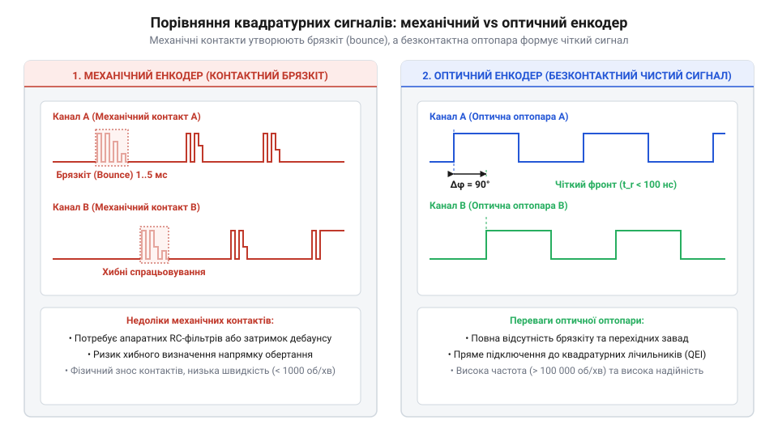
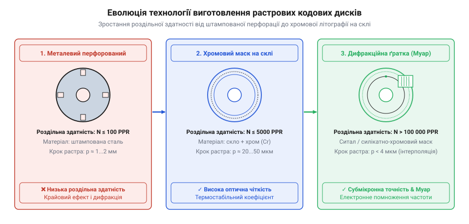

# Еволюція інкрементальних енкодерів: від механічних контактів до оптичних растрів

<preknowlist>
- [Багатопозиційні галетні перемикачі (Rotary Switches)](root:cat-hw-controls/rotary-selector-switches) — принцип роботи контактних роторних групових комутаторів
- [KY-040 — поворотний енкодер](root:cat-hw-controls/ky-040-encoder) — базова будова механічного квадратурного енкодера ручного вводу
- [Оптичні та індуктивні давачі положення органів вводу](root:cat-hw-controls/optical-and-inductive-position-encoders) — фізика оптичного та індуктивного зчитування кутового положення
</preknowlist>

## Проблема механічної поворотної комутації 1950-х років

У 1940–1950-х роках із бурхливим розвитком перших верстатів із числовим програмним керуванням (ЧПК) та радіолокаційних систем виникла гостра потреба у високточній вимірювальній техніці кутового переміщення валів. Для визначення положення спочатку застосовували @@en|rotary switches@@ ([багатопозиційні галетні перемикачі](root:cat-hw-controls/rotary-selector-switches)) та барабанні контактні групи. Конструкція таких механізмів спиралася на ковзний зв'язок металевої щітки з мідними або латунними ламелями. Утім, спроби збільшити роздільну здатність шляхом зменшення ширини контактних майданчиків наразилися на фундаментальні фізичні обмеження механіки.

Головним недоліком суто механічної комутації став @@en|contact bounce@@ (від лат. @@la|contactus@@, доторк) — контактний брязкіт. Під час переходу пружної щітки з одного сектора на інший виникає серія мікроскопічних відскоків контактних поверхонь, яка породжує пачку хибних електричних імпульсів замість одного чіткого фронту. Крім того, абразивне зношування матеріалів, окиснення мідних ламелей під дією електричної дуги та утворення струмопровідного пилу призводили до швидкого дрейфу електричного опору. Утилітарний механічний @@en|encoder@@ ([KY-040 поворотний енкодер](root:cat-hw-controls/ky-040-encoder)) досі використовує цей принцип у побутових приладах, проте для високошвидкісних промислових електроприводів механічні контакти виявилися непридатними через низький ресурс і часті збої позиціонування.

Додатковим ускладненням стало незворотне погіршення провідності внаслідок накопичення продуктів зношування. Дрібнодисперсний металевий пил від фрикційного стирання щіток змішувався з мастилом і нагаром від електричного дугового розряду, утворюючи гетерогенну струмопровідну суспензію. Цей шар створював паразитивні витоки струму між сусідніми ламелями та викликав хаотичні коливання омічного опору від часток ома до сотень ом. У високочутливих вимірювальних колах це призводило до викривлення рівнів напруги та похибок декодування, через що навіть стаціонарні закриті [ротаційні кодові DIP-перемикачі](root:cat-hw-controls/rotary-dip-switches) вимагали герметизації та спеціальних дорогоцінних покриттів контактної групи.

Окремою проблемою була відсутність детермінованого визначення напрямку руху при використанні одного вихідного сигналу. Один контактний канал дозволяв лише підраховувати кількість перетинів ламелей, але не давав змоги з'ясувати, у який саме бік обертається вал привідного двигуна. Спроби застосування складних механічних собак та допоміжних фрикційних важелів для блокування зворотного ходу суттєво збільшували момент тертя й ускладнювали конструкцію. Інженерний кут уперся у фізичну межу контактної механіки, що зробило неминучим пошук принципово нових безконтактних методів зчитування.

## Винайдення квадратурного зчитування та перші енкодери

Вирішальний прорив відбувся на початку 1950-х років, коли американський інженер Бернард Ліппель (Bernard Lippel) з армійського сигнального корпусу США (U.S. Army Signal Corps) та інші дослідники заклали основи теорії фазового розщеплення сигналів зчитування. Суть ідеї полягала у використанні двох незалежних сенсорних каналів, зсунутих між собою на кутову відстань у 90 електричних градусів, або чверть періоду растру. Таке геометричне розташування отримало назву @@en|quadrature@@ (від лат. @@la|quadratura@@, надання квадратної форми чи ділення на чотири частини) — квадратурне зчитування.

Перші фотоелектричні інкрементальні енкодери 1950–1960-х років об'єднали квадратурну схему з оптичними елементами. Джерелом світла слугували мініатюрні газорозрядні неонові індикатори або лампи розжарювання з лінзовими конденсорами, а фотоприймачами — вакуумні фотоелементи та сульфід-свинцеві (PbS) фоторезистори. Фізична будова PbS-сенсора спиралася на тонку полікристалічну плівку на скляній підкладці з зустрічно-штирьовими електродами: під дією світлового потоку в ній виникала внутрішня фотопровідність, яка змінювала електричний опір на кілька порядків. Коли кодовий диск із прорізами обертався між джерелом і приймачами, на виходах утворювалися дві синусоїдальні або прямокутні хвилі сигналів A та B, зсунуті за фазою на чверть циклу. Послідовність перепаду рівнів (який канал змінює стан першим — A чи B) однозначно визначала напрямок обертання вала, а підрахунок кількості фронтів давав точне переміщення у [оптичних та індуктивних давачах положення](root:cat-hw-controls/optical-and-inductive-position-encoders).

*Зіставлення шумового брязкіту механічних контактів із чистими фазово-зсунутими квадратурними сигналами оптичної оптопари.*

Впровадження квадратурного декодування дало змогу не лише безпомилково визначати напрямок обертання без застосування допоміжних механічних реле, а й підвищити дискретність зчитування в чотири рази завдяки фіксації кожного перепаду (фронту та спаду) обох сигналів A і B. Це усунуло проблему невизначеності на межі контактних секторів і сформувало базовий електричний стандарт, на якому й сьогодні будуються сучасні [оптичні та індуктивні давачі положення](root:cat-hw-controls/optical-and-inductive-position-encoders).

## Технологічний стрибок: від металу до фотолітографії

У 1960-х роках перші оптичні кодові диски виготовляли шляхом прецизійного фрезерування або фотохімічного травлення прямокутних пазів у тонких металевих пластинах із бронзи чи сталі. Проте товщина металевих перемичок обмежувала максимальну кількість штрихів на оберт — металевий диск фізично не міг мати більше ніж кілька сотень прорізів без втрати механічної жорсткості. Прагнення промисловості до підвищення точності верстатів вимагало створення дисків із тисячами растрових ліній на один оберт.

Технологічний стрибок відбувся на початку 1970-х років із перенесенням методів напівпровідникової фотолітографії (від грец. @@el|phos@@ — світло та @@el|lithos@@ — камінь) на скляні підкладки. Виробники почали наносити тонюсінький шар хрому на оптично поліроване дискове скло, після чого за допомогою ультрафіолетового експонування крізь еталонну маску та подальшого травлення формували мікроскопічні прозорі й непрозорі штрихи. Крок растру зменшився до одиниць мікрометрів, що дало змогу отримувати понад 10 000 імпульсів на один оберт диска помірного діаметра.

*Конструктивна еволюція растрових елементів: від грубої металевої перфорації до скляної фотолітографічної маски з сопряженою індикаторною ґраткою.*

Для подолання дифракційного розмивання світла на нанорозмірних щілинах інженери ввели в оптичну систему сопряжену непорушну індикаторну ґратку Меша (від @@en|mesh@@ — вічко, сітка). Коли світловий потік проходить крізь дві паралельні ґратки з однаковим кроком `w`, розвернуті одна відносно одної на малий кут `θ`, на поверхні виникає інтерференційний моаровий візерунок (від @@fr|moiré@@ — шовк із хвилястим відливом). Геометрія перекриття оптичних щілин формує макроскопічні світлі й темні смуги з оптичним періодом `W_m = w / (2 · sin(θ / 2)) ≈ w / θ`. Завдяки цьому кутовому масштабуванню фізичний зсув диска на мікроскопічну величину `w` спричиняє зміщення всієї моарової смуги на повний масштабний період `W_m`. Оптичний коефіцієнт підсилення `1 / θ` перетворює непомітні коливання світлового потоку на виразне широкомасштабне зміщення інтенсивності. Це дозволило звичайним @@en|photodiode@@ упевнено фіксувати проходження мікроскопічних растрових ліній, створивши основу для сучасних прецизійних [оптичних давачів положення](root:cat-hw-controls/optical-and-inductive-position-encoders) високого класу.

## Дифракційні ґратки, магніторезистивні матриці та обробники

Наприкінці 1980-х років промисловість вимагала подальшого підвищення точної роздільної здатності енкодерів без збільшення фізичних габаритів кодового диска. Відповіддю став перехід від простого перекриття світлового потоку до дифракційних оптичних схем і застосування аналогових сенсорних матриць. Оптичні головки почали будувати за схемою інтерферометрії (від лат. @@la|inter@@ — між та @@la|fero@@ — несу), де світлодіодний промінь розщеплюється дифракційною ґраткою на скляному диску, а фазовий зсув інтерференційних смуг зчитується інтегральною фотодіодною матрицею. Це дозволило отримувати високостабільні синусоїдальні квадратурні сигнали з роздільною здатністю в десятки тисяч періодів на оберт.

Паралельно з оптикою розвивався безконтактний магнітний принцип позиціонування. На початку 1990-х років у приводах з'явилися енкодери на базі анізотропного магніторезистивного ефекту (від англ. @@en|anisotropic magnetoresistance@@, далі — AMR) та гігантського магнітоопору (від англ. @@en|giant magnetoresistance@@, далі — GMR). Магніторезистивна матриця зчитує зміну напрямку векторів магнітного поля від багатополюсного барабана або диска. У той час як оптичні диски вразливі до пилу та конденсату, магнітні сенсори зберігають працездатність у брудному середовищі, хоч і мають дещо нижчу граничну точність. Сучасний [стік на давачах Холла](root:cat-hw-controls/hall-effect-gimbal-joystick) успішно використовує ці принципи для усунення контактного зношування.

Вирішальним кроком у надійності стало впровадження спеціалізованих цифрових мікросхем обробки — інтегральних інтерполяторів сигналів та цифрових сигнальних процесорів (DSP). Замість сухого підрахунку вихідних прямокутних імпульсів A та B, аналогово-цифрові перетворювачі (АЦП) обробника оцифровують вхідні синусоїдальні сигнали оптичних та магнітних сенсорів і за допомогою функції арктангенса розраховують кут із роздільною здатністю до кількох мільйонів відліків на оберт. Інтеграція алгоритмів [калібрування органів вводу](root:cat-hw-controls/stick-drift-mitigation) безпосередньо у прошивку контролера усунула дрейф нуля й дозволила компенсувати механічні ексцентриситети вала в реальному часі.

## Міфи першості та еволюційні компроміси енкодерів

Історія інкрементальних енкодерів багата на популяризовані міфи щодо одноосібного винайдення квадратурного зчитування. У технічній літературі часто трапляються твердження, що квадратурний принцип розробила конкретна компанія чи інженер (наприклад, W. & L. E. Gurley або Heidenhain). Утім, архівні патенти свідчать про паралельний і незалежний розвиток технології у 1950–1960-х роках у США, Німеччині та Великій Британії. У той час як Бернард Ліппель у США заклав теоретичний фундамент фазового розщеплення сигналів, німецькі інженери компанії Johannes Heidenhain розробили промислову технологію фотолітографічного нанесення ліній під назвою @@de|Diadur@@, а британські дослідники з National Physical Laboratory (NPL) розробили моарові дифракційні методики.

Іншим поширеним міфом є уявлення про абсолютну перевагу оптичних енкодерів над іншими типами. Насправді еволюція пристроїв зчитування позиції сформувала чіткі інженерні компроміси між надійністю, точністю та вартістю. Прецизійні скляні оптичні енкодери забезпечують найвищу роздільну здатність і кутову точність, проте вони крихкі до ударних навантажень та чутливі до запорошення. Механічний [KY-040 поворотний енкодер](root:cat-hw-controls/ky-040-encoder) суттєво поступається скляним растрам у ресурсі, проте лишається найдешевшим рішенням для панелей керування. Магнітні та сучасні [індуктивні давачі положення](root:cat-hw-controls/optical-and-inductive-position-encoders) посідають проміжне місце, забезпечуючи абсолютну стійкість до мастила й бруду в важкій промисловості та авіації.

Розуміння хронологічного шляху розвитку дозволяє інженеру тверезо оцінювати можливості кожного класу пристроїв. Сучасний ринок позиціонування спирається не на один «ідеальний» винахід, а на гармонійний спектр технологій: від найпростіших контактних дисків і [ротаційних DIP-перемикачів](root:cat-hw-controls/rotary-dip-switches) до скляних літографічних растрових матриць із цифрово-сигнальною інтерполяцією.
