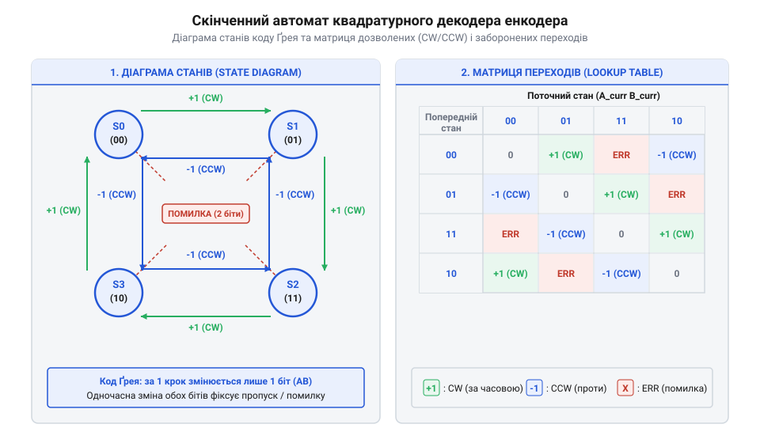
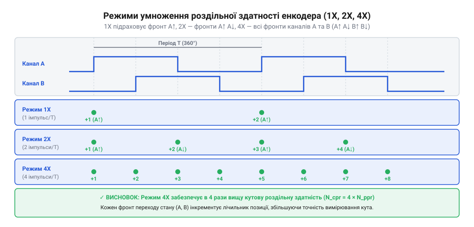

# Математика квадратурного декодування, автоматів станів та розрахунку роздільної здатності

<preknowlist>
- [Оптичні та індуктивні давачі положення органів вводу](root:cat-hw-controls/optical-and-inductive-position-encoders) — фізичний принцип переривання світлового потоку та формування імпульсів
- [Дрейф нуля та калібрування органів вводу](root:cat-hw-controls/stick-drift-mitigation) — механізми виявлення та компенсації зсуву початкової точки відліку
</preknowlist>

## Фазова геометрія квадратури та 90-градусний зсув

Визначення напрямку руху та точного положення вала за допомогою дискретного сенсора вимагає формування сигналів, які містять інформацію не лише про факт переміщення, а й про його знак. Одноканальний дисковий переривач генерує лише послідовність прямокутних імпульсів, що робить неможливим розрізнення обертання за годинниковою стрілкою від обертання проти неї. Для подолання цього обмеження в [оптичних та індуктивних давачах положення](root:cat-hw-controls/optical-and-inductive-position-encoders) застосовують двоканальне просторове кодування.

На кодовому диску або лінійній шкалі розміщено растрову сітку з періодичним чергуванням прозорих і непрозорих секторів з однаковою шириною. Просторовий крок растра `W_p` відповідає кутовому або лінійному періоду однієї повної кодової мітки. Щоб дістати фазовий зсув між електричними сигналами, два незалежні фотоприймачі розміщують уздовж траєкторії руху зі зсувом на чверть просторового періоду:

    Δx = W_p / 4      [фізичний просторовий зсув сенсорів]

Коли кодовий диск обертається зі сталою кутовою швидкістю, просторове переміщення секторів перетворюється у два прямокутні електричні сигнали `A(t)` та `B(t)`. Завдяки геометрії розташування сенсорів сигнали виявляються зсунутими у часі на чверть електричного періоду, що відповідає куту фазового зсуву `Δϕ = 90°` (`π / 2` рад). У тригонометричному представленні, якщо середня фаза руху описується змінною `ϕ(t)`, вихідні сигнали аналогово-дискретного перетворювача або компаратора описуються знаковими функціями:

    A(t) = sgn(sin(ϕ(t)))          [сигнал каналу A]
    B(t) = sgn(sin(ϕ(t) + π / 2)) = sgn(cos(ϕ(t)))    [сигнал каналу B зсунутий на 90°]

Для диска з кількістю ліній `N_lines` (або `LPR`) механічний кутовий крок однієї растрової лінії становить `θ_p = 360° / N_lines`. Отже, фотодетектори мають бути рознесені на кут `Δθ = θ_p / 4` (або `(k + 1 / 4) × θ_p`, де `k` — ціле число секторів).

У реальних конструкціях механічні допуски виготовлення диска, оптичне розюстування та ексцентриситет вала викликають кутову похибку фазового зсуву `ε_ϕ`. Фізичний механізм виникнення вищих гармонік зумовлений тим, що оптичний ексцентриситет (@@en|eccentricity@@, від грецького *ek* — з, поза та *kentron* — центр) вала спричиняє радіальне зміщення кодової доріжки відносно фотоприймачів, створюючи періодичну амплітудну та фазову модуляцію світлового потоку за один оберт. Водночас геометрична асиметрія ширини щілин растрової сітки спотворює симетрію прозорих та непрозорих секторів, через що Фур'є-розклад світлового потоку збагачується вищими гармонійними складовими. Замість ідеальної першої гармоніки світловий потік описується сумою `I(ϕ) = I_0 + A_1 · sin(ϕ) + A_2 · sin(2ϕ + δ_2)`, де друга гармоніка з амплітудою `A_2` та фазовим зсувом `δ_2` зміщує точки перетину порогу компарації. Це викликає асиметрію шпаруватості меандрів та спотворює тривалість квадрантів: замість рівних інтервалів по 90° виникають нерівні фазові стани `Δϕ_1 = 90° + ε_ϕ` та `Δϕ_2 = 90° - ε_ϕ`. Якщо реальний фазовий зсув `Δϕ = 90° ± ε_ϕ` виходить за межі допустимого інтервалу `45° < Δϕ < 135°`, тривалість одного з фазових станів стає занадто малою, що спричиняє пропуск відліків у цифровому обробнику при високих швидкостях обертання та породжує вимірювальний шум кутової швидкості. Гранична допустима просторова похибка установки фотоприймачів не повинна перевищувати `|Δx_err| < W_p / 8`, що вимагає ретельного юстування в [оптичних та індуктивних давачах положення](root:cat-hw-controls/optical-and-inductive-position-encoders).

## Алгебра автомата станів та коди Ґрея

Отримані прямокутні сигнали каналів `A` і `B` у будь-який момент часу утворюють двобітовий вектор фазового стану `S(t) = (A(t) << 1) | B(t)`. При неперервному обертанні вала цей вектор послідовно набуває чотирьох дискретних значень: `00₂` (0), `01₂` (1), `11₂` (3) та `10₂` (2). Послідовність переключення бітів підпорядковується циклічному коду Ґрея (англ. @@en|Gray code@@), у якому при кожному переході між сусідніми станами змінюється значення лише одного біта, що відповідає одиничній кодовій відстані Геммінга (англ. @@en|Hamming distance@@):

    d_H(S_k, S_k+1) = 1      [властивість послідовних квадратурних станів]

Завдяки цьому переходу порядок зміни станів однозначно визначає напрямок обертання. Якщо вал рухається за годинниковою стрілкою (англ. @@en|clockwise@@, від @@en|clock@@ — годинник та @@en|-wise@@ — у напрямку, CW), вектор станів циклічно змінюється за схемою `00 → 01 → 11 → 10 → 00`. При зміні напрямку обертання проти годинникової стрілки (англ. @@en|counter-clockwise@@, від @@en|counter-@@ — проти та @@en|clockwise@@ — за годинниковою стрілкою, CCW) послідовність інвертується: `00 → 10 → 11 → 01 → 00`.


*Графічна діаграма та матриця переходів скінченного автомата квадратурного коду Ґрея з позначенням допустимих і заблокованих переходів.*

Математично обробка фазових станів описується скінченним автоматом (англ. @@en|finite state machine@@, від @@en|finite@@ — скінченний та @@en|state machine@@ — автомат станів, FSM) із таблицею переходів (англ. @@en|look-up table@@, від @@en|look up@@ — шукати, LUT). Поточний двобітовий вектор `S_old = [A_k, B_k]ᵀ` та новий вектор `S_new = [A_k+1, B_k+1]ᵀ` утворюють 4-бітовий індекс `I = (S_old << 2) | S_new`, за яким із матриці переходів `M_trans` витягується приріст координатного лічильника `ΔN`. Векторна алгебра перехідних станів описується різницевим вектором зміщення `ΔS = S_new - S_old`. Для збереження коректної послідовності під час миттєвого реверсу напрямку руху використовується векторний псевдоскалярний добуток (англ. @@en|pseudoscalar product@@, від @@en|pseudo-@@ — несправжній та @@en|scalar product@@ — скалярний добуток) `v_dir = A_k · B_k+1 - B_k · A_k+1`. Алгебраїчне виведення цього добутку випливає з обчислення двовимірного косого добутку фазових векторів `v_k = [A_k, B_k]ᵀ` та `v_k+1 = [A_k+1, B_k+1]ᵀ` у фазовому просторі: детермінант матриці їхніх компонент `det([v_k, v_k+1]) = A_k · B_k+1 - B_k · A_k+1` визначає орієнтовану площу паралелограма між вектором поточного та наступного станів. Знак цього детермінанта миттєво змінюється з `+1` на `-1` при зміні орієнтації обертання, що дозволяє сигналізувати про напрямок обертання вала без втрати кроку. Проте при виникненні механічного брязкоту контактів (англ. @@en|contact bounce@@, від @@en|bounce@@ — відскок) або у разі надшвидкого руху, коли високочастотні дрижання механічних пелюсток спричиняють одночасний спад чи наростання двох сигналів за один період дискретизації, обидва біти змінюють значення (`00 ↔ 11` або `01 ↔ 10`). Модуль вектора різниці стає рівним `|ΔA| + |ΔB| = 2`, що відповідає відстані Геммінга (англ. @@en|Hamming distance@@, на честь @@en|Richard Hamming@@ — Річарда Геммінга) `d_H = 2`. У цьому разі кососкалярний добуток обнуляється `v_dir = 0`, оскільки фазові вектори стають колінеарними або нульовими, і математичний орієнтир напрямку втрачається. Векторний аналізатор автомата станів розпізнає такий заборонений перехід з кодовою відстанню `d_H = 2` як втрату послідовності й повертає код `ERR`, який виключає хибне підсумовування кроків і придушує помилкові імпульси від брязкоту в [поворотному енкодері KY-040](root:cat-hw-controls/ky-040-encoder).

    M_trans =
    |  0  | +1  | ERR | -1  |   [для S_old = 00 (0)]
    | -1  |  0  | +1  | ERR |   [для S_old = 01 (1)]
    | ERR | -1  |  0  | +1  |   [для S_old = 11 (3)]
    | +1  | ERR | -1  |  0  |   [для S_old = 10 (2)]

Елементи матриці зі значенням `+1` та `-1` відповідають коректному крок за кроком переміщенню. Значення `0` вказує на відсутність руху. Особне значення `ERR` позначає заблокований або заборонений перехід, при якому одночасно змінюються обидва біти (`d_H = 2`, наприклад `00 ↔ 11` або `01 ↔ 10`). У фізичній системі такий перехід неможливий при плавному обертанні вала і свідчить про наявність контактного брязкоту, високочастотної завади або проскакування кроку через перевищення граничної швидкості опитування. Застосування автомата станів забезпечує апаратну фільтрацію хибних спрацьовувань у [поворотному енкодері KY-040](root:cat-hw-controls/ky-040-encoder), блокуючи зміну координати при виникненні `ERR`.

## Моделі множення роздільної здатності 1X, 2X, 4X

Для точного узгодження дискретності позиціонування з вимогами системи керування необхідно чітко розрізняти три фундаментальні параметри роздільної здатності квадратурного сенсора. Кількість ліній на оберт `LPR` (англ. @@en|Lines Per Revolution@@, від @@en|line@@ — лінія та @@en|revolution@@ — оберт) вимірює число фізичних растрових секторів на кодовому диску. Кількість імпульсів на оберт `PPR` (англ. @@en|Pulses Per Revolution@@, від @@en|pulse@@ — імпульс та @@en|revolution@@ — оберт) описує число повних періодів прямокутного сигналу на одному каналі за один оберт вала (`PPR = LPR`). Число відліків на оберт `CPR` (англ. @@en|Counts Per Revolution@@, від @@en|count@@ — відлік та @@en|revolution@@ — оберт) визначає підсумкову кількість дискретних змін лічильника положення, яка залежить від алгоритму обробки фронтів сигналів у цифровому декодері.

Залежно від конфігурації апаратного або програмного декодера застосовують три класичні режими множення роздільної здатності: `1X`, `2X` та `4X`.


*Часова діаграма обробки фронтів у режимах 1X, 2X та 4X із показом точок інкременту лічильника відносно фаз сигналів A і B.*

У режимі `1X` декодер реагує лише на наростаючі фронти одного каналу (наприклад, `0 → 1` на каналі `A`). Стан каналу `B` у момент переходу використовується виключно для визначення знаку напрямку. У цьому випадку підсумкове число відліків дорівнює кількості імпульсів:

    CPR_1X = PPR      [роздільна здатність у режимі 1X]

У режимі `2X` декодер фіксує як наростаючі, так і спадні фронти сигналу `A` (`0 → 1` та `1 → 0`). Це подвоює кількість зчитаних подій за один період растрової сітки:

    CPR_2X = 2 × PPR      [роздільна здатність у режимі 2X]

Найвищу точність забезпечує режим `4X`, у якому декодер підраховує кожен перехід будь-якого з двох сигналів `A` чи `B` (усі 4 фронти за один квадратурний період). Кількість відліків досягає чотириразового значення від кількості імпульсів:

    CPR_4X = 4 × PPR      [роздільна здатність у режимі 4X]

Кутовий дискрет позиціонування `Δθ_res` для кожного режиму обчислюється як ділення повного оберту на відповідний параметр `CPR`:

    Δθ_res = 360° / CPR      [кутовий крок квантування]

Перехід від режиму `1X` до `4X` зменшує кутовий крок квантування в 4 рази без зміни фізичної конструкції растрового диска. При цьому максимальна похибка квантування (англ. @@en|quantization error@@, від @@en|quantize@@ — квантувати та @@en|error@@ — похибка), яка становить `e_quant = ± Δθ_res / 2`, пропорційно знижується, зменшуючи дисперсію цифрового шуму позиціонування при розрахунках у задачах [дрейфу нуля та калібрування](root:cat-hw-controls/stick-drift-mitigation). Проте при тривалому обертанні без періодичного скидання лічильника за допомогою індексного каналу `Z` сумарна похибка накопичення координати `Δθ_accum` невпинно зростає. Систематичний фазовий зсув `δ_rev` за один оберт дає лінійний накопичений зсув `Δθ_sys = K_rev · δ_rev` після `K_rev` обертів, а випадкові пропуски кроків із ймовірністю `p_err` на відлік утворюють стохастичне блукання з середньоквадратичним відхиленням `σ_accum = √(K_rev · CPR) · Δθ_res · √(p_err)`. Підсумковий граничний дрейф координати `Δθ_max = K_rev · δ_rev ± 3 · σ_accum` підтверджує, що відсутність корекції за індексною міткою призводить до необмеженого накопичення похибки позиціонування.

## Обчислення кутової швидкості та прискорення

При визначенні динаміки обертання органу вводу, наприклад у пристроях на кшталт [KY-040 поворотного енкодера](root:cat-hw-controls/ky-040-encoder), кутове переміщення вимірюється неперервно через лічбу квадратурних імпульсів. Однак для обчислення миттєвої кутової швидкості `ω` необхідно перейти від дискретної зміни координати до похідної по часу. В апаратних таймерах мікроконтролерів для цього застосовують режим захоплення входу (@@en|input capture@@, від англійського *capture* — схоплювати), який фіксує значення лічильника з частотою квантування `f_clk` у момент зміни фазового стану.

Кутова швидкість `ω` описується різницевим співвідношенням через дискретний кутовий крок `Δθ_res` (обчислений з параметрів `CPR` в залежності від режимів декодування 1X, 2X або 4X) та тривалість часового інтервалу `Δt` між двома послідовними фронтами квадратурного сигналу:

```
Δθ_res = (2 · π) ÷ CPR                   [кутовий крок однієї квадратурної події]
Δt = N_ticks ÷ f_clk                     [тривалість інтервалу за відліками таймера]
ω = Δθ_res ÷ Δt                          [формула дискретної кутової швидкості]
= (2 · π · f_clk) ÷ (CPR · N_ticks)      [підстановка часового кванта таймера]
```

тут `N_ticks` — кількість відліків таймера між подіями, а `f_clk` — частота тактування таймера. З обчисленої формули видно, що при високих швидкостях обертання кількість відліків `N_ticks` зменшується, що призводить до зростання похибки квантування часу (@@en|quantization error@@, від латинського *квантум* — скільки).

Для обчислення кутового прискорення `α(t)` застосовують метод скінченних різниць (@@en|finite difference@@, від латинського *диференціа* — відмінність) другого порядку. Прискорення є похідною від швидкості, тому вимірюється за двома суміжними часовими інтервалами `Δt₁` та `Δt₂`:

```
Δω = ω₂ - ω₁                             [приріст кутової швидкості]
Δt_avg = (Δt₁ + Δt₂) ÷ 2                 [усереднений часовий інтервал]
α = Δω ÷ Δt_avg                          [дискретне кутове прискорення]
= (2 · (ω₂ - ω₁)) ÷ (Δt₁ + Δt₂)          [формула кутового прискорення через інтервали]
```

Оскільки чисельне диференціювання підсилює високочастотні складові, діючи подібним до високочастотного фільтра чином, дискретні похибки вимірювання часу `N_ticks` породжують значний квантовий шум (@@en|quantization noise@@). Без додаткової обробки вирахувані значення прискорення містять фальшиві сплески амплітуди, що ускладнює роботу контурів керування. Для усунення цього ефекту застосовують цифрову фільтрацію (@@en|digital filtering@@) — зокрема фільтр ковзного усереднення (@@en|moving average filter@@) або дискретний КІХ-фільтр (@@en|FIR filter@@, від англійського *finite impulse response* — скінченна імпульсна характеристика). Ці фільтри пригнічують високочастотні шумові піки, проте ціною цього є додаткова фазова затримка (@@en|phase delay@@) в оцінці прискорення, яка знижує запас стійкості динамічної системи, що вимагає ретельного компромісного вибору ширини вікна фільтрації.

```
Δω = ω₂ - ω₁                             [приріст кутової швидкості]
Δt_avg = (Δt₁ + Δt₂) ÷ 2                 [усереднений часовий інтервал]
α = Δω ÷ Δt_avg                          [дискретне кутове прискорення]
= (2 · (ω₂ - ω₁)) ÷ (Δt₁ + Δt₂)          [формула кутового прискорення через інтервали]
```

Отриманий вираз дозволяє оцінити динамічний відгук системи та відфільтрувати високочастотні шумні сплески при швидкій зміні напрямку обертання вала.

## Часові затримки та частотні межі контролера

Реальні вихідні сигнали [оптичних та індуктивних давачів положення](root:cat-hw-controls/optical-and-inductive-position-encoders) мають скінченну швидкість наростання фронту (@@en|slew rate@@, від англійського *slew* — повертати) через паразитну ємність кабелів та обмежену швидкодію фототранзисторів. При зростанні кутової швидкості обертання `ω` тривалість одного фазового стану `t_state` зменшується. Якщо час наростання фронту `t_rise` стає порівнянним із тривалістю фазового стану, фронти сигналів A і B накладаються, викликаючи спотворення фазового зсуву 90° та злиття квадратних імпульсів.

Для повного декодування режим 4X вимагає розпізнавання чотирьох фазових станів за один електричний період `T_elec = 1 ÷ f_signal`. Найкоротша тривалість фазового стану `t_state_min` при максимальній кутовій швидкості `ω_max` (в радіанах за секунду) або `n_max` (в обертах за хвилину) обчислюється як:

```
f_signal = (n_max ÷ 60) · PPR            [максимальна частота сигналів фаз]
t_state_min = T_elec ÷ 4                 [тривалість найкоротшого фазового стану]
= 1 ÷ (4 · f_signal)                     [підстановка частоти сигналів]
= 15 ÷ (n_max · PPR)                     [формула мінімальної тривалості стану]
```

тут `PPR` — кількість імпульсів на оберт. Для запобігання втраті фазових станів вимагається виконання нерівності `t_state_min > t_rise + t_prop`, де `t_prop` — апаратна затримка поширення сигналу у колах узгодження рівнів.

При опитальному декодуванні (@@en|polling@@, від англійського *poll* — опитування) портом мікроконтролера чи ПЛК виникає обмеження за теоремою Котельникова — Найквіста — Шеннона (@@en|Nyquist-Shannon sampling theorem@@, від імені науковців). Щоб надійно зафіксувати кожен фазовий стан без виникнення ефекту накладання частот (@@en|aliasing@@, від англійського *alias* — викривлене ім'я), частота дискретизації контролера `f_sample` повинна як мінімум удвічі перевищувати максимальну частоту зміни фазових станів `f_state = 4 · f_signal`:

```
f_state_max = 4 · f_signal               [максимальна частота зміни квадратурних станів]
f_sample_min = 2 · f_state_max           [теоретична межа за критерієм Котельникова]
= 8 · f_signal                           [мінімальна частота опитування портів]
= (8 · n_max · PPR) ÷ 60                 [розрахункова частота дискретизації ПЛК]
```

Крім геометричних відхилень, суттєвий внесок у вимірювальні похибки робить апаратний часовий джиттер (@@en|clock jitter@@, від англійського *jitter* — тремтіння) тактового генератора таймера `Δt_jitter`, який додає випадкову часову нестабільність до значення захоплених відліків `N_ticks`. За періоду тактування `T_clk = 1 ÷ f_clk` відносна похибка вимірювання частоти `e_freq` внаслідок тремтіння тактового сигналу обчислюється як:

```
Δt_total = (N_ticks · T_clk) ± Δt_jitter   [сумарна тривалість виміряного інтервалу]
e_freq = Δt_jitter ÷ (N_ticks · T_clk)     [відносна похибка обчислення частоти]
= (Δt_jitter · f_clk) ÷ N_ticks            [підстановка частоти тактування таймера]
```

При малих значеннях `N_ticks` (під час високих швидкостей обертання) відносна похибка від апаратного джиттеру `Δt_jitter` стрімко зростає, провокуючи флуктуації обчисленої кутової швидкості. Тому в практичних системах для компенсації апаратного джиттеру тактування таймера, дрейфу фазового растра та нерівномірності обертання беруть коефіцієнт запасу `k_safe ≈ 3–5`, що гарантує відсутність пропусків кроків і хибних оцінок частоти при реверсі та прискореннях.
