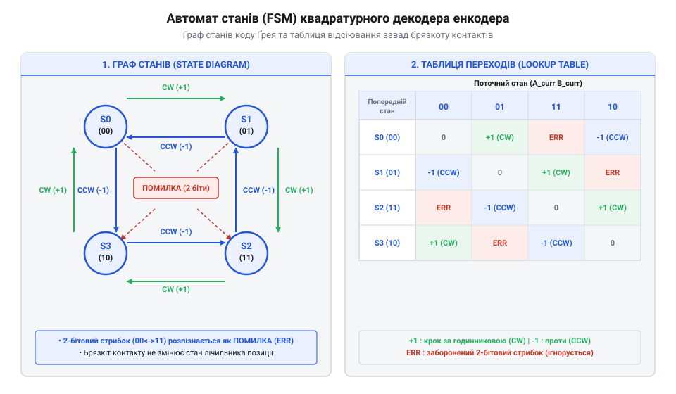
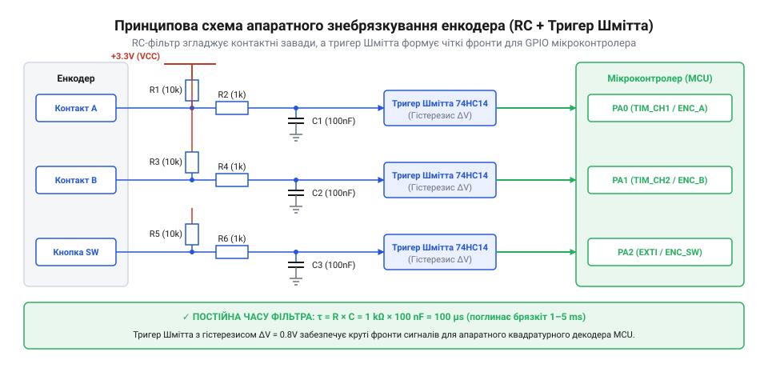

# Проєкт апаратного фільтра та мікроконтролерного драйвера механічного енкодера

<preknowlist>
- [KY-040 — поворотний енкодер](root:cat-hw-controls/ky-040-encoder) — будова механічного енкодера та фазовий зсув 90 градусів між сигналами A і B
- [Оптичні та індуктивні давачі положення органів вводу](root:cat-hw-controls/optical-and-inductive-position-encoders) — відмінності механічних контактних енкодерів від безконтактних давачів
</preknowlist>

## Проблема контактного брязкоту та хибних спрацьовувань

Механічний інкрементальний квадратурний енкодер (від англ. @@en|incremental encoder@@) використовує групу рухомих скользячих контактів для формування двох послідовностей прямокутних імпульсів — фази A та фази B, зсунутих за фазою на 90 градусів. У момент повертання рукоятки до наступного фіксатора (від англ. @@en|detent@@) пружні металеві пелюстки перемикача замикають або розмикають електричне коло. Через пружність матеріалу, вібрацію та поверхневе зношення контакти не замикаються миттєво: вони зазнають серії мікроскопічних соударінь, розмикаючись і знову замикаючись протягом 1–5 мілісекунд. Це явище називають контактним брязкотом (від англ. @@en|contact bounce@@ або @@en|chattering@@).

```
V_raw (сигнал із брязкотом):
5V  |---\_/\_/\--------------------
0V  |            \/\_/\------------
    0ms   1ms   2ms   3ms   4ms
```

Якщо сигнальні лінії фаз A та B підключити безпосередньо до вхідних портів мікроконтролера (від англ. @@en|microcontroller GPIO@@) з налаштованими обробниками переривань за фронтом, один фізичний крок клацання генерує десятки хаотичних імпульсів. Замість впорядкованого фазового зсуву мікроконтролер фіксує псевдопереходи, що спричиняють тремтіння лічильника позиції, пропуски обертів або хибний зворотний відлік. Сплески переривань із частотою до десятків кілогерців створюють так звану лавину переривань (від англ. @@en|interrupt storm@@), яка монополізує процесорний час CPU та затримує виконання основних задач системного циклу. Постійне збереження й відновлення контексту в обробниках переривань порушує квантування часу системного таймера та викликає дрейф таймінгів операційної системи реального часу RTOS. Аналогічний деструктивний брязкіт виникає під час натискання та відпускання вбудованої тактової кнопки енкодера.

Для усунення механічного брязкоту в низькобюджетних виробах, як-от [модуль KY-040](root:cat-hw-controls/ky-040-encoder), нерідко покладаються лише на програмне затримування. Проте програмне відсіювання забирає процесорний час і ускладнює переривання, тоді як [безконтактні оптичні давачі положення](root:cat-hw-controls/optical-and-inductive-position-encoders) позбавлені брязкоту за своєю фізичною природою. У професійній радіоелектроніці брязкіт механічних контактів ліквідують на апаратному рівні ще до входу в мікроконтролер.

Процес деградації механічних контактів суттєво прискорюється через фізику електричної ерозії (англ. @@en|electrical erosion@@). У момент мікроскопічного розмикання пелюсток під напругою в надмалому повітряному зазорі виникає висока напруженість електричного поля, що спричиняє мікродугові розряди (англ. @@en|micro-arcing@@). Ці точкові високотемпературні спалахи викликають місцеве плавлення та випаровування металу контактних площадок, утворюючи раковини й оксидні плівки. Зі зростанням кількості робочих циклів шорсткість поверхні збільшується, перехідний опір (англ. @@en|contact resistance@@) зростає, а тривалість та інтенсивність контактного брязкоту пропорційно збільшується, перетворюючи зношений енкодер на джерело безперервних завад для мікроконтролера.


*Граф станів та матриця переходів скінченного автомата для фільтрації хибних квадратурних стрибків.*

## Розрахунок апаратного RC-фільтра та тригерів Шмітта

Апаратне приглушення брязкоту основане на застосуванні пасивного низькочастотного RC-фільтра (від англ. @@en|low-pass RC filter@@). Конденсатор фільтра акумулює заряд і згладжує високочастотні сплески напруги, перетворюючи імпульсний брязкіт на плавну експоненційну криву. Основним параметром фільтра є постійна часу (від грецького τ — тау; від англ. @@en|time constant@@):

```
τ = R_f · C_f
```

Значення `τ` вибирають таким чином, щоб воно перевищувало тривалість контактного брязкоту (`t_bounce ≈ 1...2 мс`), але не спотворювало прямокутні фронти при максимальній швидкості обертання вала. Для стандартних ручних енкодерів із частотою обертання до 2–3 обертів на секунду оптимальна постійна часу становить `τ = 1 мс`. Розрахунок номіналів опору `R_f = 10 кОм` та ємності `C_f = 100 нФ`:

```
τ = R_f · C_f
= 10000 Ом · 0.000000100 Ф
= 0.001 с = 1 мс
```

Гранична частота зрізу фільтра (від англ. @@en|cutoff frequency@@) `f_c` обчислюється за формулою:

```
f_c = 1 / (2 · π · R_f · C_f)
= 1 / (2 · 3.14159 · 10000 · 100 · 10⁻⁹)
≈ 159.15 Гц
```

Однак повільно наростаюча експоненційна напруга створює нову проблему: під час проходження через порогів зони невизначеності цифрового входу мікроконтролера (`V_IL ... V_IH`) внутрішній пороговий компаратор під впливом наводок може високочастотно збуджуватися. Для перетворення плавної напруги на чистий прямокутний цифровий сигнал використовують тригер Шмітта (від прізвища винахідника Отто Шмітта; від англ. @@en|Schmitt trigger@@).

Тригер Шмітта має апаратний гістерезис (від грецького ὕστερησις — запізнення; від англ. @@en|hysteresis@@) — два роздільних пороги спрацьовування: Верхній поріг `V_T+` (увімкнення при зростанні напруги) та нижній поріг `V_T-` (вимкнення при падінні). Ширина вікна гістерезису `ΔV_H = V_T+ - V_T-` повністю блокує повторні хибні спрацьовування.

При виборі номіналів RC-фільтра важливо дотримуватися балансу між глибиною приглушення брязкоту та збереженням часових співвідношень квадратури. Якщо обрати занадто велику постійну часу (наприклад, τ = 10 мс за занадто великої ємності C_f), аналогове коло створює значне запізнення фази (від англ. @@en|phase shift@@) та завалювання прямокутних фронтів. При високошвидкісному обертанні вала енкодера амплітуда вихідної напруги RC-ланки не встигає досягати порогів спрацьовування тригера Шмітта V_T+ та V_T-, а кутовий фазовий зсув у 90 градусів між сигналами A та B розмивається. У результаті декодер втрачає квадратурну фазову різницю, що призводить до пропуску імпульсів або хибної зміни зареєстрованого напрямку обертання.

Додатковим чинником стабільності постійної часу `τ` є температурна залежність ємності керамічного конденсатора `C_f` (англ. @@en|temperature coefficient of capacitance@@, @@en|TCC@@). У разі використання конденсаторів із нестабільними діелектриками класу 2 чи 3 (наприклад, типів `Y5V` або `Z5U`), ємність може зменшуватися до 50–80% при виході температур за межі кімнатних у промислових чи вуличних умовах. Пропорційне зменшення `τ` нижче часу заспокоєння контактів призводить до того, що низькотемпературне падіння ємності починає пропускати механічний брязкіт на вхід тригера Шмітта. Для збереження розрахованої частоти зрізу у всьому робочому діапазоні температур обирають керамічні конденсатори класу 1 з діелектриком `C0G` (`NP0`) чи термостабільний тип `X7R`.

## Схематехніка вузла узгодження та підключення до MCU

Повний апаратний модуль узгодження механічного енкодера містить три ідентичні канали: для фази A, фази B та вбудованої тактової кнопки. Кожен канал складається з підтягувального резистора (від англ. @@en|pull-up resistor@@), обмежувального RC-ланцюга та інвертуючого тригера Шмітта, наприклад інтегральної мікросхеми 74HC14.


*Принципова електрична схема апаратного фільтра контактного брязкоту фаз A, B та кнопки на мікросхемі 74HC14.*

Схемотехнічна логіка роботи каналу:
1. У розімкненому стані контакту резистор `R_pullup = 4.7 кОм` підтягує лінію до шини живлення `+5V`, утримуючи високий рівень.
2. При замиканні контакту конденсатор `C_f` розряджається через обмежувальний резистор `R_f = 1 кОм`, що запобігає підгорянню контактних площадок від надмірного струму короткого замикання.
3. Згладжена напруга з конденсатора надходить на вхід инвертуючого тригера Шмітта 74HC14, який формує круті фронти цифрового сигналу та інвертує рівень для подачі на GPIO входи мікроконтролера.

Щоб аналогова `RC`-ланка ефективно придушувала не лише низькочастотний брязкіт механічних контактів, а й високочастотні імпульсні наводки та радіозавади, конденсатор `C_f` обирають керамічним типу `MLCC` (від англ. @@en|multilayer ceramic capacitor@@) із низьким еквівалентним послідовним опором (англ. @@en|Equivalent Series Resistance@@, @@en|ESR@@). На відміну від електролітичних ємностей, чий високий власний опір та паразитна індуктивність створюють значний імпеданс для високочастотних гармонік, багатошарова кераміка зберігає мінімальний опір у діапазоні десятків мегагерців. Це дозволяє ємності `C_f` миттєво шунтувати короткочасні сплески напруги на спільну шину `GND`, запобігаючи проходженню фальшивих імпульсів на вхід тригера Шмітта та перешкоджаючи наведенню завад на сусідні GPIO-лінії мікроконтролера.

Для промислових систем подібне апаратне узгодження комбінують із програмним автоматома станів, що дає 100% захист від збоїв при будь-якому зносі механіки. На відміну від простих перемикачів режимів, таких як [багатопозиційні галетні перемикачі](root:cat-hw-controls/rotary-selector-switches), квадратурний енкодер із правильно розрахованим RC-фільтром та тригером Шмітта забезпечує безпомилковий ввід даних протягом усього терміну експлуатації пристрою.

Під час розробки друкованих плат (англ. @@en|PCB layout@@) надійність вузла узгодження додатково визначається якістю трасування сигнальних трас (англ. @@en|trace routing@@) фаз A і B. Для запобігання міжпровідниковим перехресним завадам (англ. @@en|crosstalk@@) та ємнісним наводкам від суміжних силових або високочастотних імпульсних ліній, провідники фаз A та B прокладають паралельною парою однакової довжини над суцільним шаром заземлення (англ. @@en|ground plane@@). Компоненти `RC`-фільтра та тригер Шмітта розташовують якомога ближче до вхідного роз'єму енкодера, що зменшує площу невідфільтрованого контуру та запобігає перетворенню довгих доріжок на ефективні приймальні антени для електромагнітних завад.

## Реалізація декодера квадратури на скінченних автоматах

Просте підрахування фронтів сигналів через переривання безпорадне перед високочастотним брязкотом контактів, адже кожен хибний сплеск викликає серію помилкових спрацьовувань лічильника. Для надійного зчитування квадратури у [механічних енкодерах](root:cat-hw-controls/ky-040-encoder) використовують детермінований скінченний автомат станів (@@en|Finite State Machine@@, @@en|FSM@@). Сигнали двох фаз утворюють 2-бітний стан `(A << 1) | B`, який під час обертання вала послідовно змінюється за кодом Ґрея: `00 → 01 → 11 → 10 → 00`.

Ідея автоматизованого декодування полягає в тому, що поточний стан порівнюється з попереднім. Поєднуючи попередній стан `S_prev` та новий стан `S_curr`, ми отримуємо 4-бітний індекс `(S_prev << 2) | S_curr` у діапазоні від 0 до 15. Цей індекс слугує адресою в таблиці пошуку (@@en|Lookup Table@@, @@en|LUT@@), яка вертає `+1` для кроку за годинниковою стрілкою, `-1` для протилежного напрямку та `0` для відсутності руху або недозволених діагональних переходів:

:::code proj-hardware-debounced-encoder-driver/c/src/quad_encoder_driver.c 8-25

Табличний підхід природно відсіює брязкіт: якщо фізичний контакт здригається й повертається в попередній стан (наприклад, `00 → 01 → 00`), автомат спершу додає `+1`, а потім одразу віднімає `-1`, повністю зберігаючи точність підсумкової позиції. У разі виникнення забороненого переходу (одночасна зміна обох фаз `00 → 11`), LUT повертає `0`, а функція оновлення вирівнює внутрішній стан без хибного приросту лічильника:

:::code proj-hardware-debounced-encoder-driver/c/src/quad_encoder_driver.c 44-60

На відміну від програмного опитування (@@en|polling@@) чи програмної обробки переривань (@@en|ISR@@), сучасні мікроконтролери мають вбудовані апаратні квадратурні декодери в таймерах. Вони підраховують імпульси фаз A та B на рівні цифрової логіки без залучення процесорного ядра, що звільняє ресурси МК у порівнянні з безконтактними [оптичними давачами](root:cat-hw-controls/optical-and-inductive-position-encoders) високої роздільної здатності. Специфіка налаштування апаратного режиму енкодера (англ. @@en|Encoder Mode@@) полягає у виборі роздільної здатності підрахунку імпульсів: у режимі `X2` таймер реагує на обидва фронти лише одного сигналу (фази A), подвоюючи кількість відліків на оберт, а у режимі `X4` логіка фіксує наростання та спади на обох лініях A і B. Це чотириразово підвищує точність вимірювання кутового переміщення й дозволяє апаратно визначати напрямок обертання та оновлювати лічильний регістр таймера без жодної затримки на виконання програмного коду.

## Розробка завадостійкого C/C++ драйвера енкодера

Практична реалізація вузла керування вимагає не лише зчитування кута обертання, а й обробки вбудованої тактової кнопки, яка також схильна до механічного брязкоту. Щоб драйвер не блокував виконання основної програми у системному циклі чи операційній системі реального часу (@@en|RTOS@@), його архітектура будується на неблокуючих обробниках із періодичним опитуванням часу.

Модуль обробки кнопки фіксує момент зміни сирого стану і запускає відлік таймера затримки (зазвичай 20 мс). Тільки після стабілізації сигналу стан вважається підтвердженим. Для розрізнення короткого та довгого натискання драйвер вимірює тривалість утримання кнопки: якщо час перевищує поріг (наприклад, 1000 мс), генерується подія утримання, а наступна подія відпускання блокується. Це дозволяє організувати зручну навігацію у меню поруч із [галетними перемикачами](root:cat-hw-controls/rotary-selector-switches) чи [потенціометрами](root:cat-hw-controls/rotary-potentiometer). Для розширення функціональності інтерфейсу драйвер також реалізує обробку подій подвійного натискання (англ. @@en|Double Click@@) та автоповтору (англ. @@en|Auto-repeat@@): після першого відпускання запускається очікування у часовому вікні (наприклад, 300 мс), і за повторного замикання контактів видається подія подвійного кліка замість поодинокого. Механізм автоповтору під час тривалого утримання періодично ґенерує повторні події з вибраним інтервалом (наприклад, 100 мс), забезпечуючи швидку прокрутку списків чи інкремент параметрів без фізичного перезапускання кнопки.

Нижче наведено ідіоматичні реалізації драйвера на мовах C та C++17 із використанням об'єктно-орієнтованого підходу та зворотних викликів (@@en|callback@@):

:::tabs
@tab C
:::code proj-hardware-debounced-encoder-driver/c/include/quad_encoder_types.h 10-46
:::code proj-hardware-debounced-encoder-driver/c/src/quad_encoder_driver.c 62-100
@tab C++
:::code proj-hardware-debounced-encoder-driver/cpp/include/quadrature_encoder.hpp 13-35
:::code proj-hardware-debounced-encoder-driver/cpp/src/quadrature_encoder.cpp 34-69
:::

Така двошарова структура забезпечує миттєвий відгук на обертання вала через апаратні чи табличні FSM та гарантує надійне розпізнавання команд користувача без пропусків кроків і деструктивного дрейфу.
