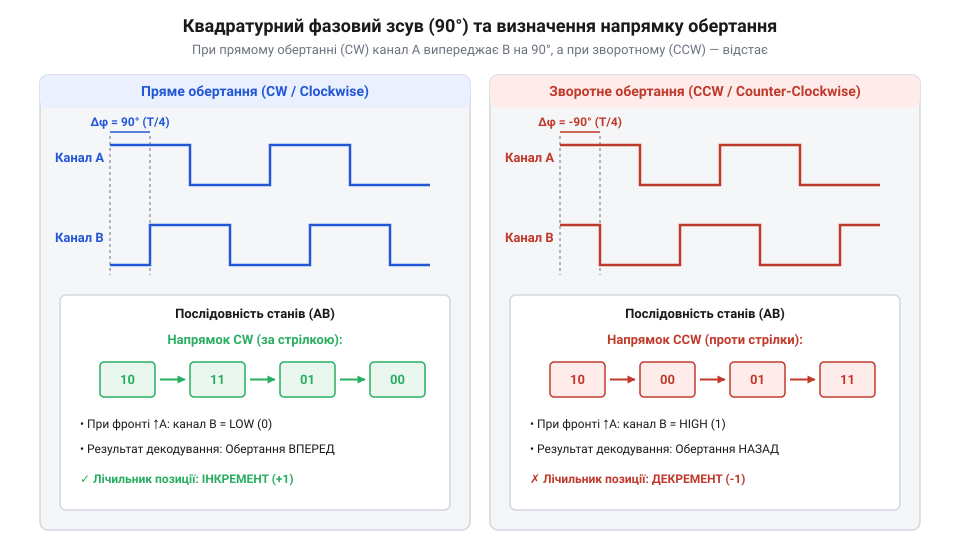
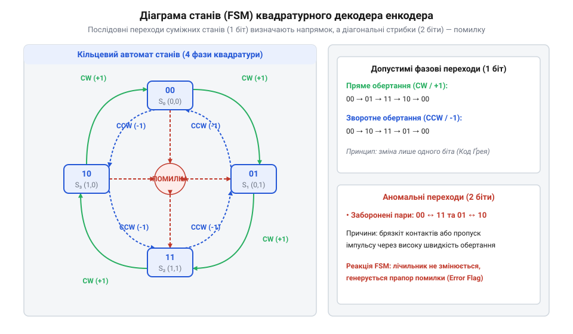
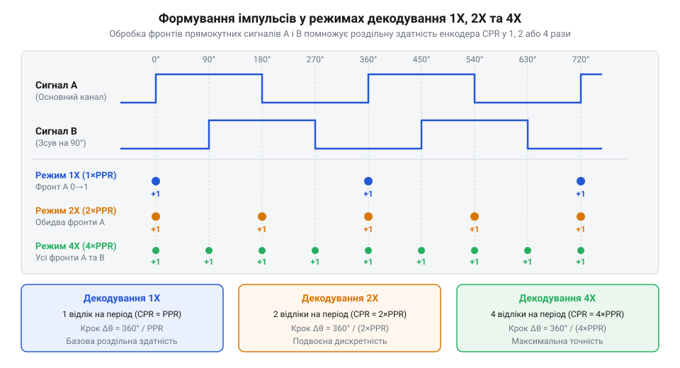
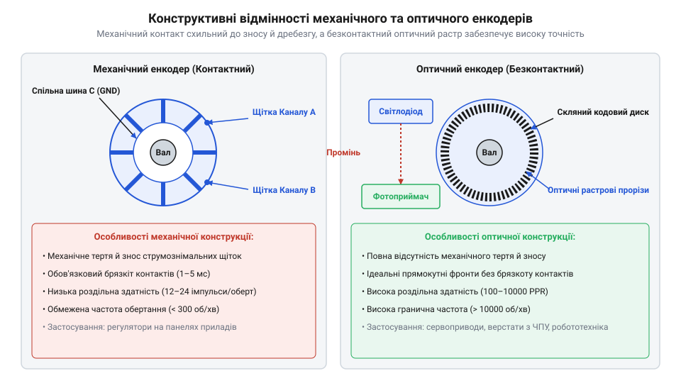
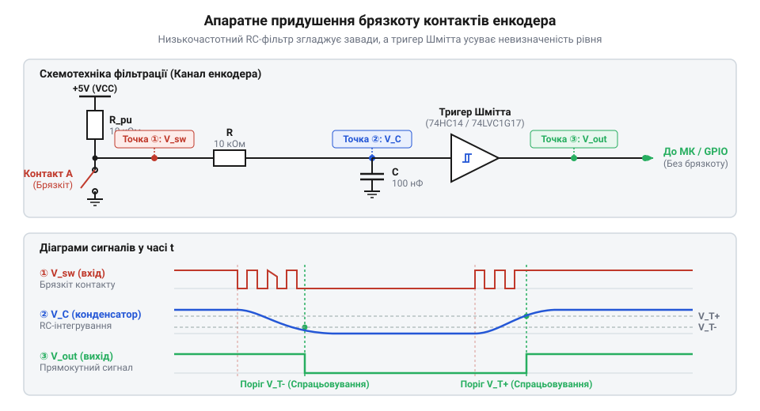

# Оптичні та механічні інкрементальні енкодери

<preknowlist>
- [Поворотний потенціометр](root:cat-hw-controls/rotary-potentiometer) — принцип вимірювання кутового положення через аналогову напругу та його обмеження за кутом обертання
- [KY-040 — поворотний енкодер](root:cat-hw-controls/ky-040-encoder) — базове уявлення про модуль механічного енкодера з вбудованими підтягувальними резисторами
- [Оптичні та індуктивні давачі положення органів вводу](root:cat-hw-controls/optical-and-inductive-position-encoders) — фізичний принцип оптичного переривання світлового потоку фототранзистором
</preknowlist>

## Проблема вимірювання обертання та квадратура

При спробі виміряти кутове переміщення вала двигуна чи рукоятки керування за допомогою одного дискретного датчика виникає фундаментальне обмеження. Звичайний [одноканальний оптичний переривач](root:cat-hw-controls/optical-and-inductive-position-encoders) світлового потоку або одноконтактний перемикач формує послідовність електричних імпульсів при проходженні кожного зуба чи щілини кодового диска. Для диска з кількістю щілин `N_slots = 60`, що обертається зі швидкістю `v_rot = 1200` RPM, частота вихідного сигналу обчислюється як `f_pulse = (v_rot × N_slots) ÷ 60 = (1200 × 60) ÷ 60 = 1200 Гц`. Така схема дозволяє легко обчислити швидкість обертання та пройдений кутовий шлях, але вона принципово не здатна визначити напрямок руху. Якщо вал зупиниться на межі прозорого та непрозорого сектора й зазнає механічних вібрацій з частотою 50 Гц, одноканальний сенсор згенерує 50 хибних імпульсів на секунду. Цифровий лічильник сприйме ці коливання за безперервне обертання в один бік і накопичить похибку у 3000 хибних кроків лише за одну хвилину спокою. Фізична побудова оптичної системи спирається на геометрію розташування елементів: при радіальному розміщенні (англ. @@en|radial placement@@) фотосенсори мостують дві окремі концентричні доріжки диска уздовж радіального променя, що спрощує виготовлення растра, проте збільшує загальний діаметр диска та робить фазовий зсув чутливим до радіального биття вала; натомість при осьовому або тангенціальному розміщенні (англ. @@en|axial placement@@) фотосенсори орієнтують уздовж дуги єдиної кодової доріжки зі зміщенням у чверть періоду, що дозволяє суттєво зменшити габарити енкодера, але вимагає прецизійного мікронного юстування фотоприймальної матриці відносно осі обертання.

На відміну від аналогового пристрою, яким є [поворотний потенціометр](root:cat-hw-controls/rotary-potentiometer), що дає абсолютний рівень напруги, але обмежений кутом повертання (зазвичай 270°–300°) і схильний до зносу ковзного контакту, інкрементальний енкодер (від англ. @@en|incremental encoder@@, від лат. @@la|incrementum@@ — приріст) має працювати необмежено у двох напрямках без втрати точки відліку. Для усунення невизначеності напрямку в конструкцію датчика вводять другий вимірювальний канал, зміщений у просторі відносно першого. Точна величина просторового рознесення світлочутливих зон елементів визначається геометрією кодового диска та повинна відповідати електричному фазовому зсуву 90°. Фізична довжина дуги одного оптичного періоду `w_period` розраховується через радіус кодової доріжки `R_disk` та кількість штрихів `N_slots`, а необхідне лінійне зміщення між фотоприймачами `d_shift` становить чверть цього періоду.

Рівняння геометричного розрахунку просторового зсуву фотоприймачів мають вигляд:

    w_period
    = (2 × π × R_disk) ÷ N_slots      [довжина дуги одного повного періоду растра]

    d_shift
    = w_period ÷ 4                     [лінійне зміщення для електричного фазового зсуву 90°]
    = (π × R_disk) ÷ (2 × N_slots)     [згортання виразу через радіус та кількість штрихів]

**Приклад розрахунку лінійного зсуву для радіуса диска `R_disk = 15 мм` та кількості штрихів `N_slots = 500`:**

    w_period
    = (2 × 3.14159 × 15) ÷ 500                         [підстановка радіуса та кількості секцій]
    = 94.2478 ÷ 500                                    [обчислення довжини кола растрової доріжки]
    = 0.1885 мм                                        [ширина одного повного оптичного періоду]

    d_shift
    = 0.1885 ÷ 4                                       [обчислення чверті періоду растра]
    = 0.0471 мм                                        [підсумковий лінійний крок між фотоприймачами]
    = 47.1 мкм                                         [переведення значення в мікрометри]

Отримане мікронне значення `47.1 мкм` демонструє високу точність прецизійного виготовлення та юстування оптичної системи енкодера.

Ідея квадратурного знеособлення полягає у формуванні двох прямокутних сигналів — каналу `A` та каналу `B`, які зсунуті один відносно одного на 90 електричних градусів (тобто на чверть повного періоду сигналу). Таке просторове рознесення фотоприймачів або контактних груп забезпечує постійну фазову різницю. При обертанні вала за годинниковою стрілкою фронт сигналу каналу `A` випереджає фронт каналу `B` на 90°. При зміні напрямку обертання на протилежний порядок переключення змінюється: канал `B` починає випереджати канал `A`. Проте на практиці механічні допуски збирання, температурне розширення корпусу чи вибраційне розюстування фотоприймальної матриці відносно растрового диска викликають лінійне зміщення `Δd` відносно номінального кроку `d_shift`. Оскільки електрична фаза прямо пропорційна просторовому положенню, похибка зсуву фотоелементів `Δd` викликає кутове відхилення фази `Δϕ = 360° × (Δd ÷ w_period)`. Коли фазовий зсув `90° ± Δϕ` через розюстування наближається до 0° або 180°, тривалість одного з чотирьох квадратурних станів скорочується до нуля. Внаслідок цього фронти каналів `A` та `B` зливаються, а декодувальний автомат фіксує заборонені подвійні переходи й втрачає напрямок обертання.

Історично шлях від перших контактних кодових дисків до високоточних фотоелектричних систем описано у вставці про [еволюцію інкрементальних енкодерів](root:cat-hw-controls/rotary-encoders-quadrature/hist-incremental-encoder-evolution.md).


*Часові діаграми сигналів каналів A та B під час обертання за та проти годинникової стрілки: фазовий зсув на 90° визначає напрямок руху.*

Завдяки квадратурному зсуву вимірювальний пристрій не лише визначає напрямок обертання за співвідношенням рівнів у момент зміни стану одного з каналів, але й повністю ігнорує вібрації на межі одного контакту, оскільки для відліку кроку потрібна послідовна зміна станів обох ліній.

## Автомат станів квадратурних сигналів і індекс

Об'єднання логічних рівнів двох каналів `A` та `B` у кожен момент часу дає двобінарне значення, яке приймає один із чотирьох фазових станів: `00`, `01`, `11` або `10`. Цей кодовий послідовний ряд побудований за принципом коду Ґрея (англ. @@en|Gray code@@), де при переході між двома сусідніми кроками змінюється стан лише одного каналу. Оскільки ця чотирикрокова послідовність циклічно повторюється на кожному періоді растрової доріжки або контактного диска, інкрементальний (від лат. @@la|incrementum@@ — приріст) енкодер фіксує лише відносні прирости кута, а не абсолютне положення вала. Через це у разі раптового збою живлення чи перезавантаження мікроконтролера вміст внутрішніх лічильників імпульсів повністю втрачається. Після відновлення живлення керівна система зчитує поточний фазовий стан ліній `A` та `B` (наприклад, `01`), проте цей код вказує лише на поточну чверть електричного періоду й не містить жодної інформації про те, у якому саме з сотень чи тисяч фізичних растрових періодів перебуває вал. За відсутності додаткового індексного імпульсу (англ. @@en|index pulse@@, або канал `Z`), який генерується один раз за оберт, контролер позбавлений можливості прив'язати зчитаний квадратурний стан до фіксованої базової позначки. У такій ситуації система змушена або приймати поточний випадковий кут за умовний нуль (що призводить до втрати абсолютного калібрування обладнання), або виконувати тривалий вихід у нуль (англ. @@en|homing@@) за допомогою зовнішніх механічних чи індуктивних кінцевих вимикачів.

При обертанні вала в прямому напрямку стани каналів послідовно змінюються за цикли:

```
00 → 01 → 11 → 10 → 00
```

При реверсі (обертанні у зворотний бік) послідовність переходів стає суворо зворотною:

```
00 → 10 → 11 → 01 → 00
```

Коректна робота квадратурного кодера передбачає зміну лише одного біта за один крок, що забезпечується властивостями коду Ґрея. Якщо мікроконтролер фіксує одночасну зміну двох бітів (наприклад, прямий стрибок із `00` у `11` або з `01` у `10`), це свідчить про невизначений стан або апаратний збій декодування. Математично алгоритм перевірки будується на 4×4 матриці фазових переходів `M_trans`, де рядками є попередній стан, а стовпчиками — поточний. Елементи матриці приймають значення `+1` (інкремент), `-1` (декремент), `0` (відсутність зміни) та `ERR` (заблокований некоректний перехід).

Матриця переходів скінченного автомата для квадратних станів (`00`, `01`, `11`, `10`) має вигляд:

    M_trans =
      |  0, +1, ERR, -1 |      [попередній стан 00]
      | -1,  0, +1, ERR |      [попередній стан 01]
      | ERR, -1,  0, +1 |      [попередній стан 11]
      | +1, ERR, -1,  0 |      [попередній стан 10]

**Приклад обробки подій для послідовностей переходів:**

    послідовність 00 → 01 → 11 → 10
    = (+1) + (+1) + (+1)                              [інкремент трьох послідовних кроків]
    = +3 відліки                                       [підсумкове переміщення вперед]

    перехід 00 → 11
    = ERR                                              [фіксація некоректного подвійного перемикання]

Фізичною першопричиною таких заблокованих подвійних переходів `ERR` є один із кількох чітких факторів: перевищення граничної швидкості обертання вала, коли частота подій `f_evt` перевищує половину частоти опитування мікроконтролера `f_s` (і проміжний стан пропускається між двома вибірками); синхронний контактний брязкіт (від англ. @@en|contact bounce@@) у механічних кодерах, коли пружні контактори обох каналів вібрують у межах одного інтервалу зчитування; або високочастотні імпульсні електромагнітні завади на довгих лініях зв'язку, що викликають одночасне наведення напруги на обох входах. У растрових оптичних енкодерах подвійні переходи виникають при оптичному розюстуванні фотоприймальної матриці, коли фазовий зсув між каналами `A` та `B` зміщується від номінальних 90° до 0° або 180°, спричиняючи злиття фронтів перемикання. Формальний математичний апарат та обчислювальні матриці переходів описано у вставці про [математику квадратурного декодування](root:cat-hw-controls/rotary-encoders-quadrature/math-quadrature-decoding-and-resolution-models.md).


*Діаграма станів скінченного автомата квадратурного декодування: напрямок обертання визначається послідовністю фазових переходів.*

Оскільки інкрементальний енкодер відстежує лише відносне зміщення від моменту ввімкнення живлення, при вимкненні пристрою поточна координата втрачається. Для прив'язки відносного відліку до абсолютної механічної позиції у промислових енкодерах використовують третій вихідний канал — індексний імпульс (англ. @@en|index pulse@@, або канал `Z`).

Канал `Z` генерує один вузький імпульс за один повний оберт вала на 360°. Цей імпульс використовується при процедурі виходу в нуль (англ. @@en|homing@@) для скидання лічильника координат у точне початкове положення. Для досягнення прецизійної точності позиціонування імпульс каналу `Z` піддають апаратній синхронізації (англ. @@en|gating@@) з квадратурними станами ліній `A` та `B`. Залежно від конструкції оптичного штриха, ширина неузгодженого індексного сигналу може становити 180° або 360° електричних градусів, що охоплює два або чотири послідовні квадратурні стани. Якщо скидання відбудеться на межі такого довгого імпульсу, механічна вібрація чи зміна напрямку руху спричинить похибку прив'язки в 1–3 відліки. При апаратній стробоскопічній синхронізації сигнал `Z` логічно об'єднується з вхідними каналами (наприклад, `Z_sync = Z ∧ A ∧ B`), формуючи активний рівень лише під час одного конкретного фазового стану `11` тривалістю 90° електричних градусів (чверть періоду). Це повністю виключає невизначеність моменту виходу в нуль та забезпечує однозначне скидання лічильника з точністю до одного квадратурного відліку.

Електричні рівні та схема виходів каналів `A`, `B` та `Z` деталізовані у довіднику з [залізничного інтерфейсу та цокольовки](root:cat-hw-controls/rotary-encoders-quadrature/api-encoder-hardware-interface-and-pinout.md), а алгоритми обробки індексних позначок у коді мікроконтролера подано в [програмному API драйвера](root:cat-hw-controls/rotary-encoders-quadrature/api-quadrature-encoder-software-driver.md). Практичним прикладом доступного ручного органу вводу з квадратурним виходом та додатковою тактовою кнопкою є модуль [KY-040](root:cat-hw-controls/ky-040-encoder).

## Режими декодування 1X, 2X, 4X та розрахунок PPR

Фізична кількість прозорих секцій на оптичному диску або контактних виступів на колесі визначає базову роздільну здатність енкодера. Цю параметр називають кількістю імпульсів на оберт (англ. @@en|pulses per revolution@@, PPR). Проте електронне обчислювальне коло дозволяє помножити ефективну роздільну здатність пристрою без зміни його механічної конструкції.

Ефективну роздільну здатність вимірюють у кількості відліків на оберт (англ. @@en|counts per revolution@@, CPR). Залежно від алгоритму обробки фронтів сигналів у каналах `A` та `B`, розрізняють три основні режими квадратурного декодування:

1. **Режим 1X**: Лічильник змінює значення лише за наростаючим фронтом (англ. @@en|rising edge@@) одного з каналів (наприклад, каналу `A`). У цьому режимі один фізичний період сигналу дає один лічильний імпульс: `CPR = 1 × PPR`.
2. **Режим 2X**: Лічильник фіксує як наростаючий, так і спадаючий фронти (англ. @@en|falling edge@@) каналу `A`. Це подвоює кількість відліків за оберт: `CPR = 2 × PPR`.
3. **Режим 4X**: Обробляються всі чотири фронти (наростаючі й спадаючі) в обох каналах `A` та `B`. Оскільки у квадратурному циклі присутні чотири зміни стану (`00`, `01`, `11`, `10`), цей режим забезпечує максимально можливу точність: `CPR = 4 × PPR`.


*Порівняння режимів декодування 1X, 2X та 4X: обробка кожного фронту обох каналів чотирикратно збільшує роздільну здатність.*

Для розрахунку кутового дискрета розрізнення `θ_res` при відомому `CPR` використовується вираз: проте теоретичне значення `θ_res` визначає лише середню роздільну здатність за повний оберт. На практиці механічні допуски фотолітографії кодового диска, радіальне биття вала та нерівномірність кроку растрових секцій викликають технологічне відхилення фазового кута `Δϕ_raster`. У режимі `4X` це призводить до того, що тривалість окремих чотирьох квартальних станів у межах одного періоду відхиляється від ідеальних 90° електричних градусів. Внаслідок фазової похибки растра миттєвий кутовий інтервал між сусідніми відліками плаває навколо номінального `θ_res`, створюючи пульсації при вимірюванні миттєвої кутової швидкості та обмежуючи реальну точність мікрокрокового позиціонування.

```
θ_res = 360° ÷ CPR
```

**Приклад розрахунку:** Якщо оптичний енкодер має фізичну роздільну здатність `PPR = 1000` імпульсів/оберт, то в режимі декодування `4X` ефективна кількість відліків становитиме:

```
CPR = 4 × 1000
    = 4000 відліків/оберт
```

При цьому мінімальний вимірюваний кут становить:

```
θ_res = 360° ÷ 4000
      = 0.09°
```

При високих швидкостях обертання вала виникають високі частоти проходження сигналів. Гранична частота сигналів одного каналу `f_sig` розраховується через частоту обертання `N` (у обертах за хвилину, RPM) та значення `PPR`:

```
f_sig = (N × PPR) ÷ 60
```

У режимі декодування `4X` мікроконтролер повинен встигати обробляти вхідні події з частотою `f_evt = 4 × f_sig`. Проте гранична частота роботи системи визначається не лише швидкістю виконання переривань, а й фізичною тривалістю наростання фронту сигналу `t_rise` (від англ. @@en|rise time@@). Коли сигнал переходить між логічними рівнями, тривалість квазінеперервної фази `t_rise` накладає жорсткі обмеження на тривалість найкоротшого квадратурного стану `t_state`. Якщо час наростання фронту через паразитну ємність кабелю чи підтягувальний резистор наближається до тривалості стану `t_state`, виникає перекриття фаз і викривлення квадратури. Для збереження чіткої фазової межі час наростання `t_rise` не повинен перевищувати чверті тривалості стану (`t_rise ≤ 0.25 × t_state`). Оскільки тривалість стану зв'язана з частотою сигналу як `t_state = 1 ÷ (4 × f_sig)`, це визначає гранично допустиму частоту сигналу енкодера `f_sig_max`:

    f_sig_max
    = 1 ÷ (16 × t_rise)    [гранична частота сигналу за затримкою фронту]

Для уникнення пропуску фронтів та невизначеності логічних рівнів частота опитування вхідних ліній `f_poll` повинна задовольняти критерій дискретизації відносно частоти подій `f_evt`.

Залежність тривалості квадратурного стану `t_state` та мінімальної частоти опитування `f_poll` від параметрів сигналу описується виразами:

    t_state
    = 1 ÷ f_evt            [тривалість квадратурного стану через частоту подій]
    = 1 ÷ (4 × f_sig)      [зв'язок із частотою одного каналу енкодера]

    f_poll
    = 2 × f_evt            [найменша частота опитування за критерієм Котельникова]
    = 8 × f_sig            [визначення необхідної частоти дискретизації]

**Приклад розрахунку при частоті каналу `f_sig = 50 кГц` (частота подій `f_evt = 200 кГц`):**

    t_state
    = 1 ÷ 200000
    = 0.000005 с
    = 5 мкс                [мінімальний інтервал між змінами станів A і B]

Для стабільного зчитування час наростання фронту повинен задовольняти умову `t_rise ≤ 0.2 × t_state` (тобто `t_rise ≤ 1 мкс`), а необхідна частота опитування становить:

    f_poll
    = 8 × 50000
    = 400000 Гц
    = 400 кГц              [мінімальна частота дискретизації вхідних портів]

Якщо час наростання `t_rise` занадто тривалий, цифровий вхід без гістерезису зчитує хибні переходи. Детальні математичні доведення та рівняння часових інтервалів наведено у вставці про [математику квадратурного декодування](root:cat-hw-controls/rotary-encoders-quadrature/math-quadrature-decoding-and-resolution-models.md).

## Механічні контактні та оптичні растрові енкодери

Фізичний метод формування квадратурних імпульсів розбиває інкрементальні енкодери на два великі класи: механічні контактні та оптичні растрові. Експлуатаційна надійність механічних контактних пристроїв суттєво залежить від умов довкілля — робочої температури (типово від `-10 °C` до `+70 °C`) та відносного рівня вологості (від англ. @@en|relative humidity@@, зазвичай `30...85% RH` без утворення конденсату). Температурні коливання спричиняють нерівномірне теплове розширення матеріалу металевих щіток і пластикового корпусу, що змінює притискне зусилля контактів та прискорює окиснення струмопровідних доріжок. Водночас висока вологість створює мікроскопічну водну плівку, яка у поєднанні з накопиченим металевим пилом формує струмопровідні містки між сусідніми сегментами диска, а низька вологість підсилює фрикційне зношення й фреттінг-корозію, через що контактний опір нестабільно коливається ще до появи суттєвого механічного випрацювання.

**Механічні контактні енкодери** побудовані на основі рухливого металевого диска з контактними доріжками та пружних зчитувальних щіток. При обертанні рукоятки щітки почергово замикають лінії `A` та `B` на загальний провідник `GND`. Типовим прикладом такого пристрою для інтерфейсів користувача є модуль [KY-040](root:cat-hw-controls/ky-040-encoder). Надійність цього вузла прямо обмежена незворотним механічним зносом щіток та фізико-хімічним окисненням контактних поверхонь. Тертя ковзання витирає струмопровідне покриття доріжок, утворюючи тонкий металевий пил, який частково замикає суміжні ізоляційні проміжки й створює витоки струму. Одночасно під дією вологості повітря та мікродугових розрядів при комутації на бронзових або мідних щітках виникає плівка оксидів, яка підвищує перехідний опір контакту `R_contact` від чистих `0.1 Ом` до десятків кілоом (`10 кОм`). Напруга на вихідній лінії `V_out` розраховується за формулою дільника між опором контакту `R_contact` та підтягувальним резистором `R_pull`:

    V_out
    = VCC × R_contact ÷ (R_pull + R_contact)      [рівняння напруги на сигнальній лінії енкодера]

**Приклад розрахунку напруги замкненого стану при `VCC = 3.3 В` та `R_pull = 10 кОм`:**

    V_out_clean
    = 3.3 × 0.1 ÷ (10000 + 0.1)                        [підстановка параметрів нового чистого контакту 0.1 Ом]
    = 0.33 ÷ 10000.1                                   [обчислення чисельника дільника]
    = 0.000033 В                                       [падіння напруги на чистому контакті]
    = 0.033 мВ                                         [ідеальний рівень логічного нуля LOW]

    V_out_oxidized
    = 3.3 × 10000 ÷ (10000 + 10000)                    [підстановка опору окисненого контакту 10 кОм]
    = 33000 ÷ 20000                                    [співвідношення плечей дільника напруги]
    = 1.65 В                                           [падіння напруги на зношеному контакту]

Зростання напруги до `1.65 В` перевищує поріг логічного нуля вхідного буфера мікроконтролера `V_IL_max = 0.99 В` (`0.3 × VCC`), через що вихідний рівень перестає фіксуватися як `0`. Внаслідок цього тривалість брязкоту контактів (від англ. @@en|contact bounce@@) зростає від кількох мікросекунд до десятків мілісекунд, а мікроконтролер починає фіксувати пропуски кроків і хаотичні хибні спрацьовування.

Головна перевага механічних енкодерів — низька вартість, компактність і відсутність потреби у постійному живленні сенсорного елемента. Проте їм притаманний фундаментальний недолік: брязкіт контактів (англ. @@en|contact bounce@@). Під час механічного замикання пружних пластин виникають мікроскопічні переривання струму тривалістю від 1 до 10 мікросекунд. Для системи декодування в режимі `4X` ці високочастотні імпульси виглядають як сотні швидких хаотичних обертів назад і вперед. Крім того, механічне тертя обмежує ресурс пристрою (зазвичай до 100 000 обертів) і граничну швидкість обертання (до 300 RPM).

**Оптичні растрові енкодери** позбавлені механічного контакту у вимірювальному вузлі. У них на валу закріплено скляний або прозорий пластиковий диск із прецизійною фотолітографічною сіткою непрозорих штрихів. З одного боку диска розташовано інфрачервоний випромінювач, а з протилежного — масив фотодіодів. Фізичний принцип оптичного переривання світлового потоку детально розглянуто у матеріалі про [оптичні та індуктивні давачі положення](root:cat-hw-controls/optical-and-inductive-position-encoders). Проте стабільність оптичної системи обмежена часовим та температурним старінням випромінювального світлодіода. Під дією тривалого струмового навантаження та підвищеної температури напівпровідникового кристала квантовий вихід світлодіода незворотно знижується, що призводить до зменшення інтенсивності світлового потоку. Зниження випромінюваної оптичної потужності прямо пропорційно зменшує амплітуду генерованого фотоструму `I_photo` у фотодіодному масиві. Якщо вихідний фотострум падає нижче порогового значення спрацьовування компаратора, шпаруватість сигналів `A` та `B` відхиляється від ідеальних 50%, тривалість квадратурних станів спотворюється, а при критичному падінні інтенсивності мікроконтролер повністю втрачає фронти перемикання.


*Конструктивна різниця: механічний скользячий контакт викликає брязкіт і знос, а оптичний растровий диск забезпечує чистоту сигналів і довговічність.*

Оптичні енкодери забезпечують ідеальну прямокутну форму сигналів без брязкоту, працюють на частотах обертання до 10 000 RPM і мають ресурс у сотні мільйонів обертів, обмежений лише терміном служби шарикопідшипників. Для промислового обладнання та сервоприводів випускаються альтернативні безконтактні рішення, як-от [абсолютні поворотні енкодери](root:cat-hw-controls/rotary-encoders-absolute-single-multi-turn) або [магнітні поворотні енкодери](root:hw-sensing/hall-magnetic-encoders). Для позиціонування прямолінійних робочих органів верстатів з ЧПК використовують [оптичні та магнітні лінійні шкали](root:hw-sensing/linear-optical-and-magnetic-scales).

Для надійного підключення механічних енкодерів до цифрових схем обов'язково застосовують додаткову фільтрацію, практичний проєкт якої розкрито у матеріалі про [проєкт апаратного фільтра енкодера](root:cat-hw-controls/rotary-encoders-quadrature/proj-hardware-debounced-encoder-driver.md).

## Схемотехніка придушення брязкоту та диференційні лінії

Високочастотний контактний брязкіт механічних енкодерів спотворює квадратурний автомат станів і призводить до хибних відліків. Для усунення цього ефекту застосовують двоступеневе апаратне фільтрування.

Першим ступенем є аналоговий фільтр низьких частот (англ. @@en|low-pass filter@@), побудований на резисторі `R` та конденсаторі `C`. Резистор послідовно вмикається в сигнальну лінію, а конденсатор підключається між виходом та спільною шиною `GND`. Стала часу `τ = R × C` підбирається таким чином, щоб поглинати високочастотні сплески брязкоту тривалістю 1–10 мікросекунд, але пропускати корисні зміни рівнів при обертанні вала.

Проте загладження сигналу RC-ланцюгом перетворює крутий прямокутний фронт на повільний експоненційний схил. Якщо подати такий сигнал безпосередньо на цифровий вхід мікроконтролера, то при проходженні порогової напруги вхідний буфер потрапляє в нестійку зону, що знову викликає серію генерацій переривань.

Другим ступенем є тригер Шмітта (англ. @@en|Schmitt trigger@@, від прізвища винахідника @@de|Schmitt@@). Це електронна схема з гістерезисом (англ. @@en|hysteresis@@, від грец. @@el|ὑστέρησις@@ — відставання), яка має два окремі пороги перемикання: верхній `V_T+` для наростаючого сигналу та нижній `V_T-` для спадаючого. Завдяки цій різниці порогових напруг тригер Шмітта повністю ігнорує дрібні шумові коливання на повільному схилі та відновлює круті прямокутні фронти.


*Схемотехніка захисту від брязкоту: RC-ланцюг згладжує високочастотні сплески, а тригер Шмітта відновлює круті прямокутні фронти.*

Детальний розрахунок номіналів елементів, монтажну схему та принципову розводку друкованої плати подано у матеріалі про [проєкт апаратного фільтра енкодера](root:cat-hw-controls/rotary-encoders-quadrature/proj-hardware-debounced-encoder-driver.md).

У промислових умовах та при довжині кабельних ліній понад 2–3 метри виникає проблема електромагнітних завад. Для захисту від наведених перешкод сигнальні лінії виконують диференційними (від англ. @@en|differential line@@) за стандартом RS-422. Замість одного провідника на кожен канал передається пара протифазних сигналів: `A+` / `A-`, `B+` / `B-`, `Z+` / `Z-`. Приймач на боці контролера вимірює різницю напруг між провідниками пари, завдяки чому спільна синфазна завада повністю взаємознищується. Проте на високих частотах комутації довгий кабель поводиться як лінія передачі з хвильовим опором `Z₀` (зазвичай 100–120 Ом). Якщо на кінці лінії немає узгодження, прямокутний фронт сигналу відбивається від високого вхідного опору приймача, викликаючи дзвін і спотворення квадратури. Щоб поглинути енергію відбитої хвилі, безпосередньо між диференціальними входами приймача підключають узгоджувальний термінальний резистор (від англ. @@en|terminating resistor@@) `R_t = 120 Ом`, номінал якого дорівнює хвильовому опору кабелю (`R_t = Z₀`). Необхідна потужність розсіювання `P_Rt` та струм навантаження `I_t` розраховуються за виразами через диференціальну напругу виходу `V_diff`:

    P_Rt
    = (V_diff)² ÷ R_t      [електрична потужність розсіювання на термінаторі]

    I_t
    = V_diff ÷ R_t          [струм споживання термінального резистора]

Отриманий вираз показує, що електрична потужність розсіювання квадратично залежить від диференціальної напруги, що визначає мінімально допустимий габаритний типорозмір термінального резистора та струмове навантаження на драйвер лінії. Для ефективного поглинання відбитої хвилі термінальний резистор `R_t` повинен встановлюватися строго на фізичному кінці кабельної лінії, безпосередньо біля вхідних виводів диференціального приймача. Встановлення термінатора у проміжній точці лінії або на боці передавача залишає неузгоджений відрізок кабелю, де виникають повторні відбитки та дзвін напруги. Водночас монтування додаткових термінаторів на проміжних вузлах не допускається, оскільки їхнє паралельне з'єднання небезпечно знижує еквівалентний опір навантаження (наприклад, до `60 Ом`), що викликає струмове перевантаження та перегрів вихідних каскадів драйвера RS-422.

    P_Rt
    = (V_diff)² ÷ R_t      [електрична потужність розсіювання на термінаторі]

    I_t
    = V_diff ÷ R_t          [струм споживання термінального резистора]

**Приклад розрахунку для диференціальної напруги `V_diff = 2.4 В` та опору `R_t = 120 Ом`:**

    P_Rt
    = (2.4)² ÷ 120                                    [підстановка значення напруги та опору]
    = 5.76 ÷ 120                                      [обчислення квадрата напруги]
    = 0.048 Вт                                        [розсіювана потужність на канал]
    = 48 мВт                                          [переведення в мілівати]

    I_t
    = 2.4 ÷ 120                                       [підстановка параметрів для струму]
    = 0.02 А                                          [амперне значення струму]
    = 20 мА                                           [струм навантаження диференціальної пари]

Визначена потужність `48 мВт` дозволяє використовувати стандартні поверхнево-монтовані резистори типорозміру 0805 із допустимою потужністю 0.125 Вт. Електричні специфікації та стандарти вихідних каскадів деталізовано у [залізничному інтерфейсі та цокольовці](root:cat-hw-controls/rotary-encoders-quadrature/api-encoder-hardware-interface-and-pinout.md).

## Апаратне та програмне декодування на мікроконтролері

Після того як квадратурний сигнал очищено від шуму та зведено до чітких логічних рівнів, настає етап обробки даних у прошивці мікроконтролера. Існує два основні підходи до зчитування інкрементального енкодера: програмне декодування через переривання (англ. @@en|interrupt@@) та апаратне декодування за допомогою спеціалізованих периферійних таймерів.

Програмне декодування реалізують шляхом налаштування зовнішніх переривань по зміні стану на пінах `A` та `B`. У підпрограмі обробки переривання (ISR) зчитуються поточні рівні входів та порівнюються з попередніми значеннями за допомогою таблиці станів автомата:

:::tabs
:::code rotary-encoders-quadrature-d/c/esp-idf/encoder-isr-handler.c
:::code rotary-encoders-quadrature-d/cpp/arduino/encoderdecoder.cpp
:::

Програмний метод чудово підходить для низькошвидкісних механічних органів керування, таких як модуль [KY-040](root:cat-hw-controls/ky-040-encoder). Проте при високих частотах імпульсів оптичних енкодерів (понад 50–100 кГц) постійний виклик переривань перевантажує центральний процесор і призводить до пропуску відліків.

Для високошвидкісних задач сучасні мікроконтролери мають апаратний режим енкодера (від англ. @@en|encoder mode@@). Спеціалізований апаратний таймер-лічильник напряму підключається до вхідних ніжок `A` та `B`, автоматично аналізує фазовий зсув та інкрементує чи декрементує внутрішній 16- або 32-бітний регістр лічильника (від англ. @@en|counter register@@; `CNT`) без участі центрального процесора. Процесор у будь-який момент може зчитати готове значення координати з регістра з нульовим накладними витратами. Однак при використанні 16-бітного таймера малий діапазон відліків від `0` до `65535` (`0xFFFF`) швидко вичерпується при тривалому обертанні. При перевищенні межі `65535` у напрямку вперед регістр `CNT` скидається в `0` (від англ. @@en|overflow@@ — переповнення), а при русі назад нижче `0` перескокує на `65535` (від англ. @@en|underflow@@ — недоповнення). Для розширення діапазону до повного 32-бітного значення позиціонування `pos_32` застосовують два методи. Перший розширює відліки через апаратне переривання оновлення таймера (Update Interrupt): при зафіксованому переповненні вгору лічильник старшого слова `overflow_count` збільшують на одиницю, а при недоповненні донизу — зменшують на одиницю, збираючи підсумкову координату виразом `pos_32 = ((int32_t)overflow_count << 16) | CNT`. Другий метод базується на періодичному опитуванні таймера з обчисленням різниці залишків (від англ. @@en|delta polling@@): програма зчитує `curr_cnt` та за рахунок приведення різниці `(int16_t)(curr_cnt - prev_cnt)` до знакового 16-бітного типу автоматично обробляє перехід через межу `0/65535` без переривань, за умови що зміна відліків за період опитування не перевищує `ΔCNT_max = 32767`. Граничний інтервал опитування `T_poll_max` для уникнення втрати координати при заданій частоті подій `f_evt` розраховується за формулою:

    T_poll_max
    = ΔCNT_max ÷ f_evt     [максимальний інтервал між опитуваннями]
    = 32767 ÷ (4 × f_sig)  [зв'язок із частотою сигналу одного каналу]

Якщо інтервал між опитуваннями перевищує `T_poll_max`, різниця відліків виходить за межі діапазону `[-32768, 32767]`, що призводит до викривлення напрямку обертання та втрати точної координати.

Для задач високочастотного профілювання руху та запису траєкторії позиціонування обчислювальне навантаження усувають шляхом підключення прямого доступу до пам'яті (англ. @@en|direct memory access@@, DMA). Замість опитування регістрів у циклі або виклику підпрограм обробки переривань, контролер DMA налаштовують на автоматичне перенесення поточного значення з регістра `CNT` у циклічний буфер оперативної пам'яті за подією системного таймера або зовнішнього тригера. Апаратний транзит даних відбувається повністю без участі центрального процесора, що гарантує сувору часову детермінованість вибірок координати, запобігає затримкам обробки на високих швидкостях та звільняє процесорні ресурси для виконання алгоритмів регулювання.

Повну специфікацію функцій, готових бібліотек та інтерфейс програмного драйвера наведено у довіднику [програмного API драйвера](root:cat-hw-controls/rotary-encoders-quadrature/api-quadrature-encoder-software-driver.md).
