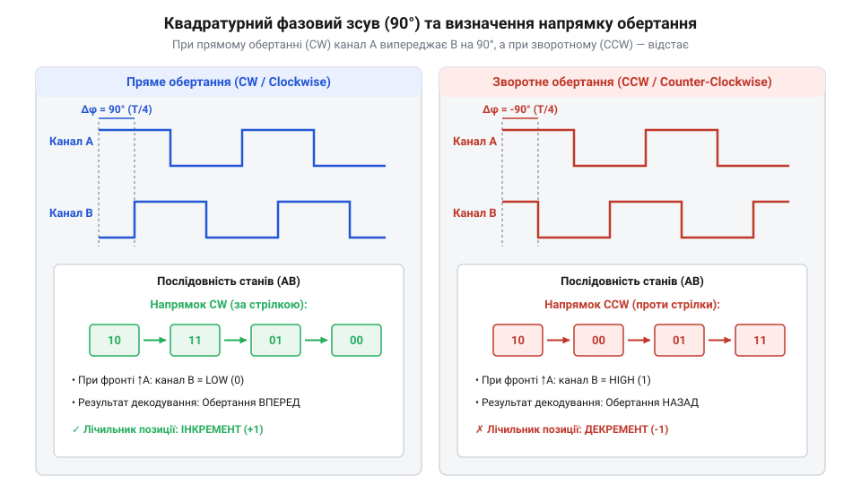
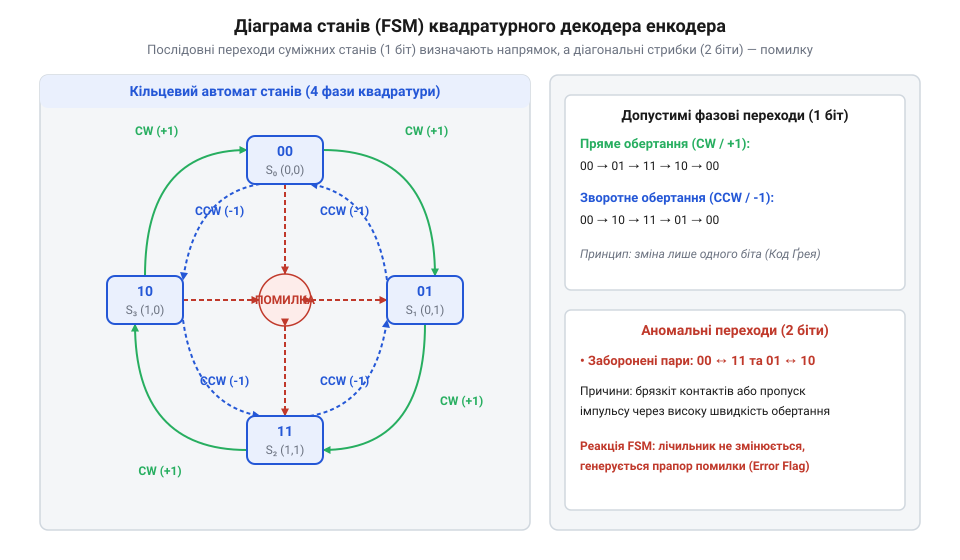
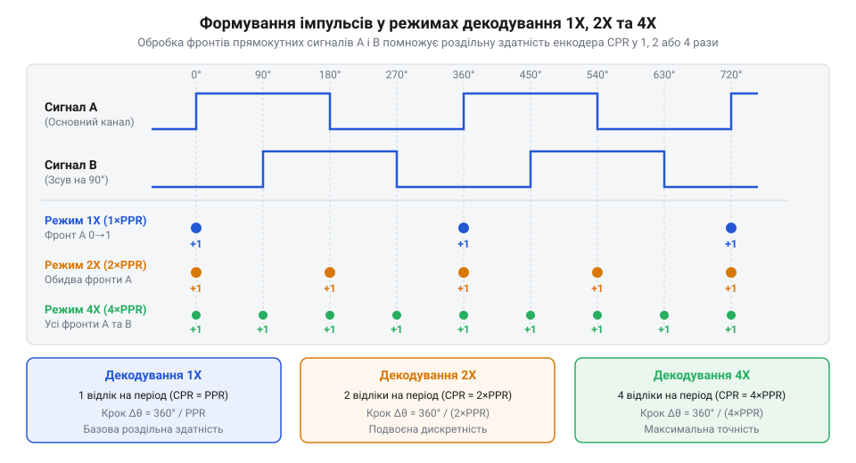
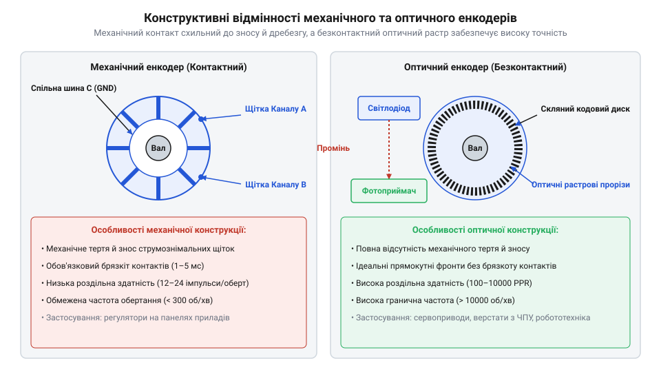

# Оптичні та механічні інкрементальні енкодери

<preknowlist>
- [Поворотний потенціометр](root:cat-hw-controls/rotary-potentiometer) — принцип аналогового зчитування кутового положення та обмеження потенціометрів за кутом обертання й зносостійкістю.
- [KY-040 — поворотний енкодер](root:cat-hw-controls/ky-040-encoder) — базове уявлення про модуль механічного енкодера з вбудованими підтягувальними резисторами.
- [Оптичні та індуктивні давачі положення органів вводу](root:cat-hw-controls/optical-and-inductive-position-encoders) — фізичний принцип оптичного переривання світлового потоку фототранзистором.
</preknowlist>

## Проблема вимірювання обертання та квадратура

Одноканальний оптичний чи індуктивний давач здатний рахувати імпульси переривання світла при обертанні вала, але не може визначити напрямок руху: при маятникових вібраціях вала біля однієї позначки одноканальна система помилково накопичує імпульси. Для визначення напрямку застосовують два вимірювальні канали `A` та `B`, розміщені з просторовим зсувом на чверть растрового періоду. Це створює два прямокутні сигнали, зсунуті на 90° один відносно одного (квадратурні сигнали — від англ. @@en|quadrature signals@@). Порядок випередження фронтів визначає вектор обертання: коли канал `A` випереджає `B`, вал обертається за годинниковою стрілкою, а коли `B` випереджає `A` — проти годинникової стрілки, на відміну від обмежених за кутом [поворотних потенціометрів](root:cat-hw-controls/rotary-potentiometer).

*Квадратурні імпульси каналів A та B, що демонструють зміну послідовності випередження фронтів при реверсі вала.*

## Квадратурний автомат станів та індекс

Пара каналів `A` та `B` утворює 2-бітовий код Ґрея (від англ. @@en|Gray code@@), де в кожному переході змінюється стан лише одного біта: `00 → 01 → 11 → 10 → 00`. Цифровий декодер обробляє ці переходи через скінченний автомат станів (від англ. @@en|finite state machine@@). Одночасна зміна двох бітів (наприклад, `00 → 11`) означає недійсний перехід і розпізнається як помилка від сміття чи перевищення швидкості. Оскільки інкрементальний енкодер втрачає відносну координату після вимкнення живлення, його оснащують третім індексним каналом `Z` (або `Index` / `Reference`). Канал `Z` генерує один короткий імпульс за повний оберт 360°, що використовується для точної апаратної прив'язки координати під час процедури виходу в нуль (від англ. @@en|homing@@).

*Колові переходи автомата станів квадратурного декодера для відстеження кроків за й проти годинникової стрілки.*

## Режими декодування та роздільна здатність

Базова роздільна здатність енкодера визначається кількістю імпульсів на оберт (від англ. @@en|pulses per revolution@@ — PPR). Проте мікроконтролер може декодувати квадратурні сигнали у трьох режимах:
- `1X`: відстежується лише спадаючий фронт каналу `A` (кількість відліків `CPR = PPR`);
- `2X`: відстежуються спадаючий та наростаючий фронти каналу `A` (`CPR = 2 · PPR`);
- `4X`: відстежуються всі фронти перемикання обох каналів `A` та `B` (`CPR = 4 · PPR`).

Режим `4X` помножує точність вимірювання в чотири рази без заміни кодера. Гранична частота обертання вала обмежується смугою пропускання фотоприймачів та максимальною частотою опитування входів мікроконтролера, на відміну від [абсолютних поворотних енкодерів](root:cat-hw-controls/rotary-encoders-absolute-single-multi-turn), які передають готовий код через послідовні інтерфейси.

*Формування лічильних імпульсів у режимах 1X, 2X та 4X залежно від перепадів рівнів каналів A і B.*

## Механічні та оптичні енкодери

За конструкцією інкрементальні енкодери поділяють на дві групи:
- Механічні контактні перемикачі (наприклад, модуль [KY-040](root:cat-hw-controls/ky-040-encoder)): використовують ковзні контакти на платі. При розмиканні виникає контактний брязкіт (від англ. @@en|contact bounce@@), який придушують аналоговими RC-фільтрами та тригерами Шмітта або програмними затримками;
- Оптичні безконтактні енкодери (на основі растрових систем, про які детально описано у статті про [оптичні давачі положення](root:cat-hw-controls/optical-and-inductive-position-encoders)): використовують скляний чи металевий диск із прорізами й фотопари. Вони працюють без брязкоту на високих обертах, а для пригнічення завад у промисловості застосовують дифпари RS-422 з термінаторами 120 Ом.

*Будова механічного енкодера з контактами та оптичного енкодера з растровим диском і фотоприймачем.*
