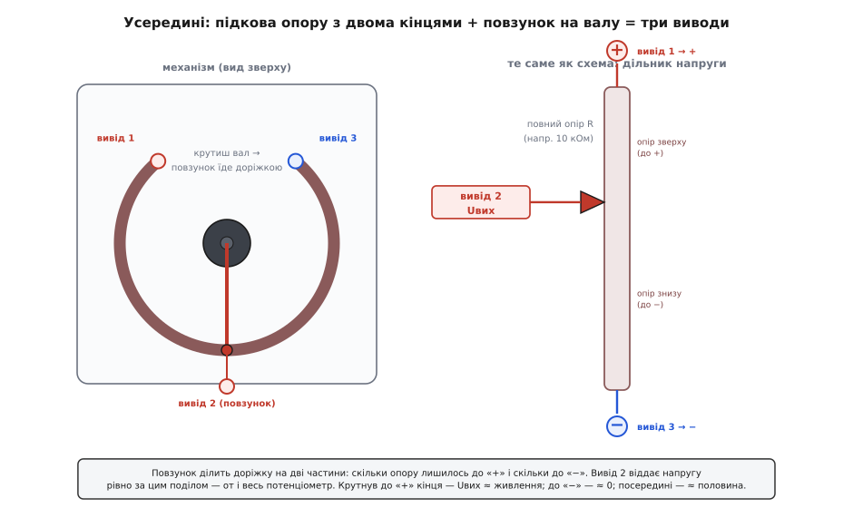
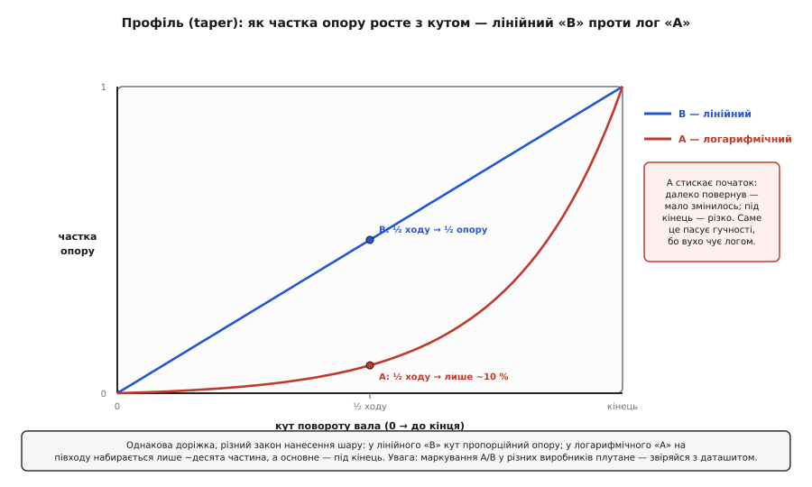
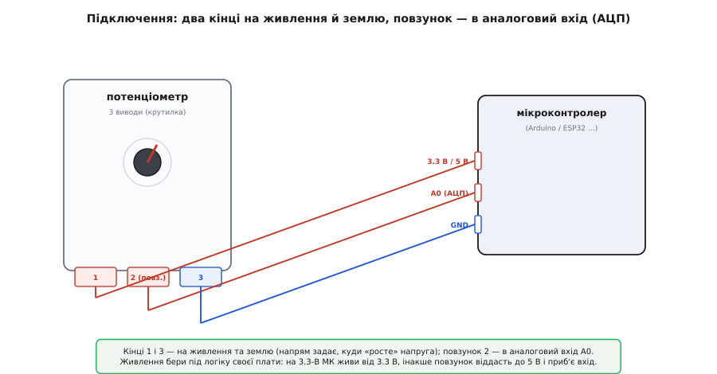

# Поворотний потенціометр

## Що це і навіщо

Коли ви крутите ручку гучності чи яскравості, пальці відчувають чіткий початок і кінець ходу: повернули ліворуч до упору — мінімум, праворуч — максимум. @@la|потенціометр@@ (від лат. *potentia* — сила, та гр. *métron* — міра, «вимірювач потенціалу») задає пристрою одне плавне аналогове значення за кутом повороту ручки. Його головна властивість — збереження **абсолютного положення**: де ручку залишили, там значення й стоїть, навіть після вимкнення пристрою.

На відміну від [поворотного енкодера](root:cat-hw-controls/ky-040-encoder), який повідомляє лише про відносний крок повороту й не має країв ходу, @@en|поворотний потенціометр@@ зберігає фізичний стан. Використовуйте його там, де людині зручно бачити налаштування за кутом ручки й мати фізичні упори: для регулювання гучності, яскравості чи порогу спрацьовування.

## Три виводи та поділ напруги

Усередині деталі лежить резистивна @@en|доріжка@@ (англ. *track*) з вугільного шару чи провідного пластику. Краї цієї доріжки виведені на перший і третій контакти, між якими вимірюють повний опір компонента.

По доріжці ковзає рухомий контакт — @@en|повзунок@@ (англ. *wiper*), з'єднаний із валом та виведений на другий контакт. Повзунок ділить доріжку на дві частини, утворюючи регульований @@en|дільник напруги@@.


*Три виводи потенціометра. Кінці доріжки (виводи 1 і 3) — це повний опір деталі, а повзунок (вивід 2) торкається доріжки й ділить її на дві частини, задаючи вихідну напругу.*

Коли до кінців доріжки прикладено живлення, струм тече від плюса до землі. Повзунок знімає напругу з точки дотику, яку визначають за формулою дільника:

```
U_вип = U_жив · R_низ / R_повний
```

У крайньому лівому положенні вихідна напруга `U_вип` дорівнює нулю, у крайньому правому — напрузі живлення `U_жив`. Оскільки важить відношення опорів плечей, вихідний сигнал залежить лише від частки повороту ручки, а не від повного опору доріжки.

## Лінійний та логарифмічний профілі опору

Спосіб змінення опору під час повороту вала називають @@en|профілем опору@@ (англ. *taper*). За цією характеристикою потенціометри поділяють на два основних типи.

**Лінійний профіль** (маркування «B») забезпечує пряму пропорційність між кутом повороту й опором: половина ходу ручки відповідає половині вихідної напруги. Його застосовують для регулювання яскравості, налаштування порогів та вимірювання положення.

**Логарифмічний профіль** (маркування «A») нарощує опір повільно на початку й різко наприкінці ходу.


*Залежність опору від кута повороту. У лінійного профілю (B) кут пропорційний опору, а в логарифмічного (A) опір зростає повільно на початку й різко під кінець.*

Логарифмічний профіль обирають для регулювання гучності, оскільки людське вухо сприймає інтенсивність звуку логарифмічно. Такий профіль компенсує особливості слуху й забезпечує рівномірне відчуття приросту гучності. Оскільки маркування виводів у різних виробників може відрізнятися, реальний профіль доцільно перевіряти даташитом або вимірюванням опору.

## Підключення до плати та зчитування

Для підключення компонента кінці доріжки приєднують до ліній живлення та землі, а повзунок з'єднують з аналоговим входом мікроконтролера.


*Підключення виводів потенціометра. Кінці доріжки приєднані до живлення й землі, а повзунок віддає сигнал на аналоговий вхід A0.*

Переставляння місцями контактів живлення й землі лише інвертує напрямок зміни сигналу під час повороту. Для захисту входу @@en|АЦП@@ подавайте на потенціометр напругу, яка відповідає логічному рівню вашої плати: 3.3 В або 5 В.

Мікроконтролер зчитує напругу аналоговим входом у вигляді цифрового числа. Через незначні наведення й похибку перетворювача молодші розряди зчитаного значення можуть дрижати; для стабілізації сигналу в коді застосовують згладжування відліків або мертву зону.
