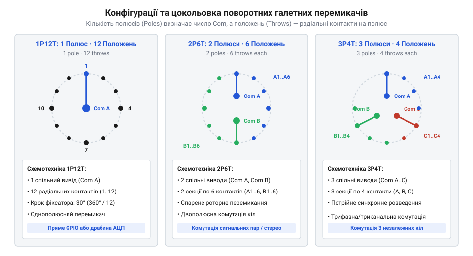
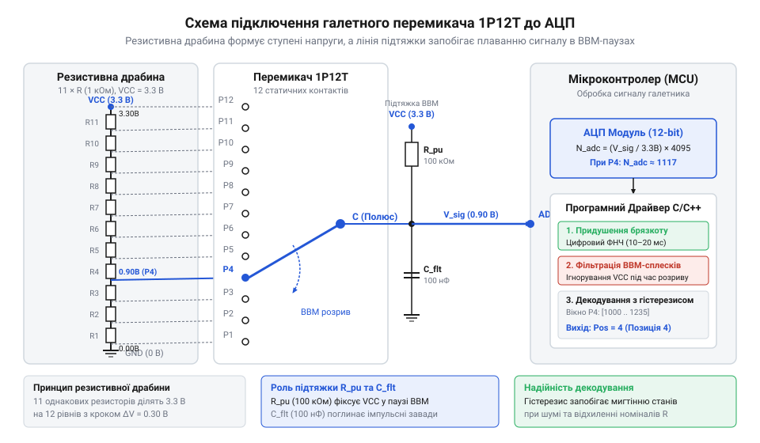
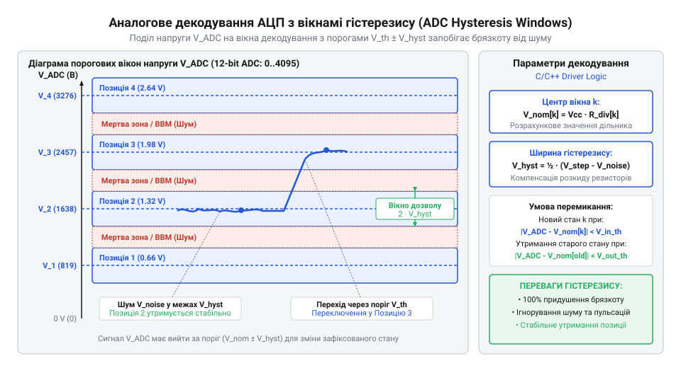
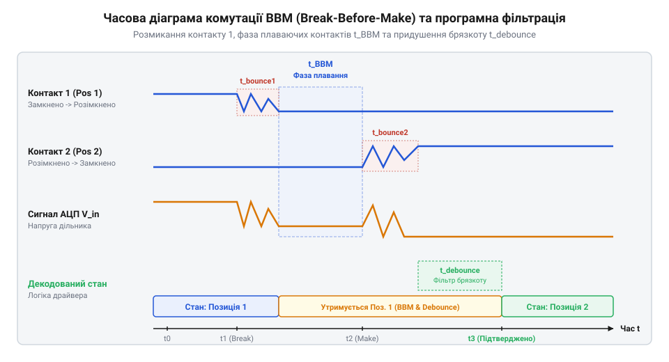

# Апаратний та програмний інтерфейс опитування багатопозиційних галетних перемикачів

<preknowlist>
- [Поворотний потенціометр](root:cat-hw-controls/rotary-potentiometer) — розрахунок аналогового дільника напруги та зчитування АЦП
- [KY-040 — поворотний енкодер](root:cat-hw-controls/ky-040-encoder) — принципи програмної обробки брязкоту контактів у поворотних органах вводу
</preknowlist>

## Обмеження GPIO та потреба перемикання

Пряме підключення багатопозиційного галетного перемикача до цифрових виводів мікроконтролера швидко вичерпує доступні ресурси @@en|GPIO@@. При використанні перемикача на 12 позицій класичне паралельне з'єднання вимагає 12 окремих сигнальних ніжок, що є неприпустимим марнотратством для компактних мікроконтролерів. Поряд із дефіцитом ніжок виникає паразитне струмове навантаження: при підтяжці всіх 12 ліній резисторами `R_pull = 10 кОм` замкнений контакт постійно споживає струм `I = V_CC / R_pull = 3.3 В / 10 кОм = 0.33 мА`, що створює зайве витрачання енергії у батарейних пристроях. До того ж довгі провідники плати або виносного джгута володіють паразитною ємністю `C_line ≈ 20..50 пФ/м`, яка у високоімпедансному стані High-Z (англ. @@en|high-impedance state@@; від англ. *high* — високий, *impedance* — імпеданс, та *state* — стан) розімкнених пелюсток утворює з опором витоку `R_leak ≈ 10 МОм` ланцюжок із постійною часу `τ = R_leak · C_line ≈ 0.2..0.5 мс`. Упродовж цього інтервалу накопичений на паразиційній ємності заряд повільно стікає, утримуючи плаваючу напругу в зоні невизначеності логічних порогів `V_IL..V_IH` і роблячи лінію вразливою до зовнішніх наводок. Для зниження струмових втрат виникає спокуса суттєво збільшити опір підтяжки `R_pull` (наприклад, до `100 кОм`), проте це уповільнює перезаряджання ємності `C_line`. Верхня межа опору розраховується з вимоги до максимального часу наростання фронту `t_rise = 2.2 · R_pull · C_line`: щоб фронт напруги встигав підніматися до логічної одиниці `V_IH` швидше за критичний поріг `t_rise_max = 10 мкс`, максимальний припустимий опір обмежується значенням `R_pull_max = t_rise_max / (2.2 · C_line) ≈ 10 мкс / (2.2 · 50 пФ) ≈ 90 кОм`. Вибір компромісного номіналу `R_pull ≈ 22..47 кОм` дає п'ятикратне зменшення струму споживання до `0.07 мА` без втрати крутизни фронту та стійкості до завад.

Окрім дефіциту виводів, виникає фундаментальна схемотехнічна проблема — плаваючий стан (@@en|floating state@@) під час перемикання. Переважна більшість галетних механізмів працює за принципом BBM (@@en|Break-Before-Make@@, від англ. *break-before-make* — розмикання перед замиканням): рухомий контакт повністю розмикає поточне коло перед тим, як замкнути наступне. У той момент, коли ручка перебуває між клацаннями фіксатора, центральний вивід роз'єднаний із усіма контактами. За швидкого перемикання ця пауза триває кілька мілісекунд (1–5 мс), однак при повільному або плавному повертанні ручки вивід зависає у високоімпедансному стані High-Z (@@en|high-impedance state@@, від англ. *high* — високий, *impedance* — імпеданс, та *state* — стан) на десятки чи навіть сотні мілісекунд (від 10 до 500 мс). Упродовж цього інтервалу непідтягнута лінія працює як антена: вона ловить високовольтний електромагнітний шум, мережеві наведення 50/60 Гц та наводки від сусідніх кіл, викликаючи хибні спрацьовування, цифровий шум та брязкіт контактів (@@en|contact bounce@@). На відміну від [поворотних потенціометрів](root:cat-hw-controls/rotary-potentiometer), де контакт не розривається, або [сучасних енкодерів](root:cat-hw-controls/ky-040-encoder), галетний перемикач вимагає спеціального апаратно-програмного інтерфейсу для обробки неозначених станів.

## Топології та цокольовка контактних груп

Конструктивно галетні перемикачі випускають у кількох базових топологіях контактних груп, які визначаються кількістю незалежних полюсів (англ. @@en|pole@@; від англ. *pole* — полюс, поверхня контакту) та кількістю фіксованих позицій (англ. @@en|throw@@; від англ. *throw* — хід, перекидання). Важливим геометричним параметром механізму є кут обертання між сусідніми фіксованими позиціями `θ_step`, який визначається кроком зубців внутрішнього фіксатора. За повного оберту вала на `360°` стандартні галети розбивають коло на фіксовані кутові сектори: кут `θ_step = 30°` забезпечує 12 позицій (`360° / 30° = 12`), кут `θ_step = 45°` дає 8 позицій (`360° / 45° = 8`), кут `θ_step = 60°` формує 6 позицій (`360° / 60° = 6`), а для кута `θ_step = 90°` доступно 4 робочі позиції (`360° / 90° = 4`). Вибір конкретного кута обертання визначає механічне відчуття клацання, тактильний хід ручки та максимальну кількість радіальних пелюсток, які фізично вміщуються на керамічному чи гетинаксовому диску перемикача. Конструктивно ці диски виконують однобічними або двобічними: в однобічних одношарових галетах усі контакти розміщені в одній площині, де багатополюсність досягається фізичним розбиттям єдиного кільця на ізольовані кутові сектори зі зменшенням кількості позицій на полюс, тоді як у двобічних чи двоповерхових платах контактні групи розташовані на протилежних боках ізолятора чи на паралельних дисках. Це гарантує повну електричну розв'язку між полюсами, виключає міжполюсні пробої при комутації різних потенціалів та дозволяє розмістити більше контактних груп у компактному об'ємі.

*Схема показує розташування центральних виводів спільного контакту (Com) та радіальних нерухомих пелюсток для різного числа полюсів.*

Розрізняють три найпоширеніші конфігурації:
- 1P12T (@@en|1P12T@@, 1 Pole, 12 Throws): один центральний спільний вивід Com комутується по черзі на один із 12 радіальних контактів.
- 2P6T (@@en|2P6T@@, 2 Poles, 6 Throws): два незалежні ізольовані виводи Com A та Com B одночасно перемикаються між двома групами по 6 позицій.
- 3P4T (@@en|3P4T@@, 3 Poles, 4 Throws): три ізольовані контактні групи комутують три незалежні лінії на 4 позиції кожна.

На цокольовці (від італ. *zoccolo* — цоколь, основа) центральні виводи Com розташовані ближче до осі обертання, тоді як радіальні контакти розміщені по периферії диска. Більшість промислових галетних перемикачів мають під кріпильною гайкою механічне обмежувальне кільце зі стопорним виступом, що входить у відповідний проріз на лицьовій панелі корпусу. Переставляючи цей фіксатор у певний проріз перед монтажем, інженер може жорстко обмежити кут обертання вала й штучно зменшити кількість робочих положень під конкретну задачу — наприклад, перетворити стандартний перемикач 1P12T на 1P8T чи 1P5T без зміни фізичної конфігурації контактної галети.

## Схемотехніка GPIO та резистивної драбини

Для зчитування стану галетного перемикача застосовують дві схемотехнічні топології. Перша — пряме паралельне підключення до 12 цифрових ніжок GPIO із зовнішніми підтягувальними резисторами (англ. @@en|pull-up resistor@@) або внутрішньою підтяжкою `INPUT_PULLUP`. Вона проста програмно, але вимагає надто багатьох виводів. Друга топологія використовує послідовний ланцюжок із 11 однаковісіньких резисторів `R`, де еквівалентний вихідний опір Тевеніна `R_eq` зміщується залежно від позиції вала `k ∈ {0, 1, ..., 11}` за формулою `R_eq(k) = (k · (11 - k) / 11) · R`. У крайніх положеннях `k = 0` та `k = 11` опір `R_eq` дорівнює нулю, а свого максимуму `R_eq_max = (30 / 11) · R ≈ 2.727 · R` досягає у середніх позиціях `k = 5` та `k = 6`. Для відсутності динамічних похибок зчитування та стабільного перезаряджання вибіркової ємності АЦП величину `R_eq_max` обирають значно меншою за вхідний імпеданс АЦП `R_adc`, тому номінал `R = 1 кОм` є оптимальним: він дає `R_eq_max ≈ 2.73 кОм` та гарантує точність без додаткового операційного підсилювача при споживанні струму не більше `VCC / (11 · R)`. Окрім номіналу, критичним є температурний коефіцієнт опору ТКС (англ. @@en|temperature coefficient of resistance@@, TCR; від англ. *temperature* — температура, *coefficient* — коефіцієнт, та *resistance* — опір): при зміні температури середовища `ΔT` дрейф опору окремих резисторів `ΔR = R_0 · α_T · ΔT` при однакових коефіцієнтах `α_T` теоретично зберігає співвідношення дільника `k / 11`. Проте асиметричне нагрівання платформи або технологічний розкид ТКС між компонентами (наприклад, `±100 ppm/°C` проти `±25 ppm/°C`) викликають температурний зсув напруги (англ. @@en|temperature drift@@), який при `ΔT = 50 °C` здатний змістити вузлові пороги дільника на `1..2%`. На відміну від однорідних джерел із [калібруванням дрейфу нуля](root:cat-hw-controls/stick-drift-mitigation), у 12-позиційній драбині це суттєво звужує допуск вікна розпізнавання (9.09% на ступінь), що вимагає використання тонкоплівкових прецизійних резисторів (англ. @@en|thin-film resistor@@) із низьким ТКС `α_T ≤ ±25 ppm/°C`.

Друга, набагато ефективніша топологія — аналогове зчитування через єдиний аналоговий вивід АЦП (@@en|ADC pin@@, від англ. *analog-to-digital converter*) за допомогою послідовної резистивної драбини (@@en|resistor ladder@@). Між сусідніми радіальними контактами перемикача 1P12T впаюють 11 однакових прецизійних резисторів R однакового номіналу (наприклад, 1 кОм), а верхній і нижній виводи підключають до VCC та GND. Вибір допуску резисторів тут є критичним: у 12-позиційній драбині крок між сусідніми ступенями напруги становить приблизно 9.09% від VCC, що дає порогову півширину вікна розпізнавання лише близько 4.54%. Звичайні резистори з допуском 5% через кумулятивне накопичення похибок у ланцюжку викличуть відхилення напруги у вузлах понад ±5%, що перекриє пороговий інтервал і призведе до хибного розпізнавання сусідніх положень. Використання прецизійних резисторів із допуском 1% обмежує максимальний дрейф вузлової напруги в межах ±1%, залишаючи достатній гарантований запас для програмного гістерезису та дрейфу компонентів.

*Резистивна драбина формує 12 рівномірних ступенів напруги, що дозволяє визначити положення перемикача за допомогою лише одного аналогового виводу АЦП.*

У результаті утворюється 12-ступеневий дільник напруги. Залежно від позиції $k \in \{0, 1, \dots, 11\}$, вихідна напруга $V_{out}$ на центральному виводі Com становить:

$$V_{out}(k) = V_{CC} \cdot \frac{k}{11}$$

*Діапазон вимірювання АЦП розбивається на порогові вікна з проміжними зонами гістерезису для запобігання дрейфу та шумам.*

Для стабільного зчитування в умовах розкиду опорів та шумів живлення діапазон напруг ділять на порогові вікна із зонами гістерезису (від грец. *ὑστέρησις* — запізнення, відставання), що гарантує точне визначення вибраного режиму.

## Алгоритми придушення брязкоту та BBM

Механічні контакти поворотних галетних перемикачів зазнають брязкоту (англ. @@en|contact bounce@@; від англ. *bounce* — відскок, брязкіт) під час замикання та переходять у тимчасовий плаваючий стан у фазі розриву перед замиканням (англ. @@en|Break-Before-Make@@, @@en|BBM@@; від англ. *break* — розрив та *make* — замикання). На відміну від прямоточних цифрових кнопок або [поворотного енкодера KY-040](root:cat-hw-controls/ky-040-encoder), де брязкіт усувається простим запізненням, галетні перемикачі розмикають попередню лінію до з'єднання з наступною. У цей короткий часовий інтервал (зазвичай 2–15 мс) центральний рухомий контакт від'єднується від попереднього виводу, але ще не торкнувся наступного. Якщо опитувати мікроконтролером прямоточні цифрові виводи @@en|GPIO@@ без програмної обробки, підтягувальні резистори зчитують логічні одиниці на всіх входах, що викликає хибні спрацьовавання та мерехтіння станів. Для точного розрізнення фази розриву та апаратного брязкоту застосовують математичну модель ковзного вікна (англ. @@en|sliding window@@) на основі кільцевого буфера (англ. @@en|ring buffer@@ — від англ. *ring* — кільце та *buffer* — тимчасова пам'ять) або суматора вибірок (англ. @@en|sample accumulator@@ — від лат. *accumulare* — накопичувати). У цій моделі зберігається послідовність останніх `N` дискретних вибірок стану ліній: якщо суматор показує хаотичне чергування активного й неактивного рівнів на конкретному виводі (сума вибірок `0 < ∑ xᵢ < N`), алгоритм класифікує це як апаратний брязкіт контактів і очікує стабілізації сигналу. Якщо ж суматор фіксує неперервну відсутність з'єднання на всіх каналах одночасно (`∑ xᵢ = 0` для кожного виводу протягом усього вікна `N`), математична модель однозначно ідентифікує фазу розриву @@en|BBM@@, що дозволяє драйверу заблокувати оновлення та надійно утримувати попереднє значення позиції до завершення механічного переходу. При інтенсивному або швидкому прокручуванні важеля через кілька позицій поспіль механічні пелюстки зазнають підвищеної вібрації, яка подовжує час відскоку контактів. Для запобігання пропуску чи хибного дублювання кроків алгоритм застосовує динамічне розширення таймерного вікна фільтрації (англ. @@en|adaptive debounce window@@): при виявленні серії швидких перемикань із часовим інтервалом між ними `Δt < T_burst` драйвер тимчасово збільшує вікно фільтрації `T_debounce` з базових `15 мс` до адаптивних `30–40 мс`. Після відновлення паузи й заспокоєння контактного вузла (коли час спокою перевищує `T_idle`) алгоритм автоматично скидає затримку до початкового значення `15 мс`, зберігаючи швидку реакцію при поодиноких клацаннях.

Для усунення брязкоту та плавання використовують цифровий таймерний фільтр із утриманням попереднього дійсного стану. Драйвер опитує фізичні лінії з фіксованим періодом (наприклад, що1 мс) і змінює зареєстроване значення позиції лише тоді, коли новий стабільний бітовий код утримується неперервно впродовж заданого інтервалу фільтрації `T_debounce`. Під час фази розриву @@en|BBM@@, коли жоден контакт не замкнений, алгоритм розпізнає недійсний код і продовжує утримувати останню підтверджену позицію, запобігаючи генерації хибних імпульсів. Вибір конкретної тривалості `T_debounce` напряму залежить від стану механіки: якщо для нових перемикачів достатньо затримки 10–15 мс, то для зношених контактів із ослабленими пружинами, оксидними плівками та підвищеною механічною вібрацією інтервал доводиться збільшувати до 30–50 мс. Це дозволяє надійно відфільтрувати тривалі повторні мікровідскоки пелюсток без відчутного для людини запізнення реакції інтерфейсу.

*Часова діаграма процесів усунення брязкоту та плавання контактів під час перемикання BBM. Графік ілюструє затримку утримання стабільної позиції таймерним фільтром T_debounce та ігнорування інтервалу високоімпедансного розриву.*

:::tabs
:::code api-rotary-switch-hardware-and-adc-decoding/c/esp-idf/decode-raw-gpio.c
:::code api-rotary-switch-hardware-and-adc-decoding/cpp/arduino/rotaryswitchbbm.cpp
:::

## Декодування АЦП з вікнами гістерезису

При використанні аналогової резистивної драбини (англ. @@en|resistor ladder@@; від англ. *ladder* — драбина) кожен крок поворотного перемикача формує відповідний рівень напруги на аналогово-цифровому перетворювачі (англ. @@en|ADC pin@@; від англ. *Analog-to-Digital Converter*). Подібно до [поворотного потенціометра](root:cat-hw-controls/rotary-potentiometer), через пульсації живлення, високочастотні наводки та температурний дрейф (англ. @@en|temperature drift@@; від англ. *drift* — зсув, відхилення) опору резисторів реальне виміряне значення АЦП флуктує. Для адаптації драйвера під різні мікроконтролери алгоритм розраховує порогові центри вікон динамічно за розрядністю АЦП `N_bits` (10, 12 або 14 біт): крок між позиціями визначається як `S = (2ⁿ - 1) / (M - 1)` для `M` позицій, формуючи центральні значення `V_center(i) = i · S` (від `0` до `1023` для 10-бітного, `4095` для 12-бітного та `16383` для 14-бітного АЦП). Для усунення помилок рекомендується виконувати [калібрування органів вводу](root:cat-hw-controls/stick-drift-mitigation). Якщо декодувати позицію за жорсткими пороговими значеннями без автоматичного перерахунку ступенів та гістерезису, на межі двох ступенів виникає постійне хитання (мерехтіння) розпізнаної позиції.

Для запобігання хитанню станів застосовують табличне віконне декодування з програмним гістерезисом (англ. @@en|hysteresis window@@; від грец. *hysteresis* — запізнення, відставання). Гістерезис створює розрив між порогом переходу вгору та порогом переходу вниз. Позиція вважається зміненою лише тоді, коли аналоговий сигнал перетинає зовнішню межу вікна з урахуванням захисного інтервалу `ΔADC`. Величина `ΔADC` прямо масштабується відповідно до розрядності АЦП та кількості позицій: для 12-позиційного перемикача з 11 однаковими ступенями крок напруги становить 1/11 від повного діапазону шкали. У 10-бітному АЦП (`0–1023`) крок між сусідніми позиціями дорівнює приблизно 93 відлікам LSB з теоретичною півшириною вікна 46.5 LSB, а захисний інтервал гістерезису `ΔADC` обирають на рівні 12–15 LSB (близько 30% від півширини). У 12-бітному АЦП (`0–4095`) той самий крок складає вже 372 LSB з півшириною 186 LSB, тож пропорційний інтервал `ΔADC` збільшується до 35–45 LSB. Якщо дільник збирають із резисторів ряду E24 із нерівними номіналами чи використовують нелінійну резистивну драбину, ступені напруги `ΔVᵢ` між сусідніми позиціями стають нерівномірними. Для таких схем застосовують алгоритм нелінійного розподілу порогових вікон: драйвер обчислює індивідуальні центральні значення `V_center(i)` для кожної позиції `i`, а міжпозиційні порогові межі розраховує як середнє арифметичне сусідніх центрів `V_th(i, i+1) = (V_center(i) + V_center(i+1)) / 2`. Індивідуальний інтервал гістерезису `ΔADC(i)` масштабується адаптивно — пропорційно до локальної півширини конкретного ступеня (25–30% від локального інтервалу `ΔVᵢ`), що гарантує однакову стійкість до шумів у всьому діапазоні нелінійного дільника. Додатково перевіряються граничні діапазони: якщо значення АЦП виходить за межі допустимого вікна дільника (наприклад, падає нижче `50` або перевищує `4040` для 12-бітного АЦП), драйвер фіксує обрив лінії або коротке замикання.

:::tabs
:::code api-rotary-switch-hardware-and-adc-decoding/c/esp-idf/decode-adc-with-hysteresis.c
:::code api-rotary-switch-hardware-and-adc-decoding/cpp/arduino/rotaryadcdecoder.cpp
:::

## Обробка збоїв і граничних станів

Вузол підключення галетного перемикача піддається механічним навантаженням та впливу зовнішніх завад, що може викликати апаратні аварії (англ. @@en|fault state@@; від англ. *fault* — дефект, пошкодження). Найпоширенішими несправностями є обрив спільного проводу `GND` або `VCC`, коротке замикання сигнальної лінії на шину живлення та деградація резистивної драбини. На відміну від безконтактних органів вводу, як-от [стік на давачах Холла](root:cat-hw-controls/hall-effect-gimbal-joystick), де вимірюється магнітне поле, галетні дільники покладаються на цілісність замкненого кола резисторів. Щоб компенсувати апаратний зсув рівнів через корозію контактів чи температурне розширення, застосовують математичний алгоритм фільтрації вибірок: у кожному фіксованому положенні `i` драйвер накопичує серію з `N` замірів АЦП `V_adc[k]`, відсікає імпульсні завади медіанним фільтром і розраховує усереднений коефіцієнт точки `V_cal[i] = (1 / N) · ∑ V_adc[k]`. Отриманий масив порогових центрів розширюється вікном гістерезису `ΔV` і зберігається в неенергозалежну пам'ять (від англійського @@en|non-volatile storage@@ — збереження без живлення; англ. @@en|NVS@@ чи @@en|EEPROM@@) у вигляді структури з контрольною сумою @@en|CRC32@@, що захищає налаштування від спотворення при раптовому вимкненні живлення.

Для діагностики апаратних збоїв у розрахунок резистивної драбини навмисно вводять граничні захисні діапазони АЦП. Якщо виміряна напруга падає нижче найнижчої допустимої межі (`V_ADC < 0.05 · V_CC`) або перевищує верхню межу (`V_ADC > 0.95 · V_CC`), драйвер не намагається декодувати позицію, а негайно переходить у заблокований стан аварії `FAULT_STATE`. Це дозволяє відрізнити тимчасову фазу розриву @@en|BBM@@ від фізичного обриву кабелю чи корозії контактних накладок. У разі часткової деградації контактів, коли підвищений опір окисленої поверхні створює додатковий перехідний опір в одиниці чи десятки ом і системно зсуває вихідну напругу ступенів, застосовують процедуру автокалібрування. Під час автокалібрування пристрій послідовно зчитує реальні зсунуті значення АЦП у кожному з фіксованих положень і зберігає нову карту центральних точок у стабільну пам'ять, що дає змогу адаптувати порогові вікна декодування до поточного зносу механіки й запобігти передчасним аварійним відмовам.

:::tabs
:::code api-rotary-switch-hardware-and-adc-decoding/c/esp-idf/evaluate-rotary-adc-diagnostics.c
:::code api-rotary-switch-hardware-and-adc-decoding/cpp/arduino/switchfault.cpp
:::
