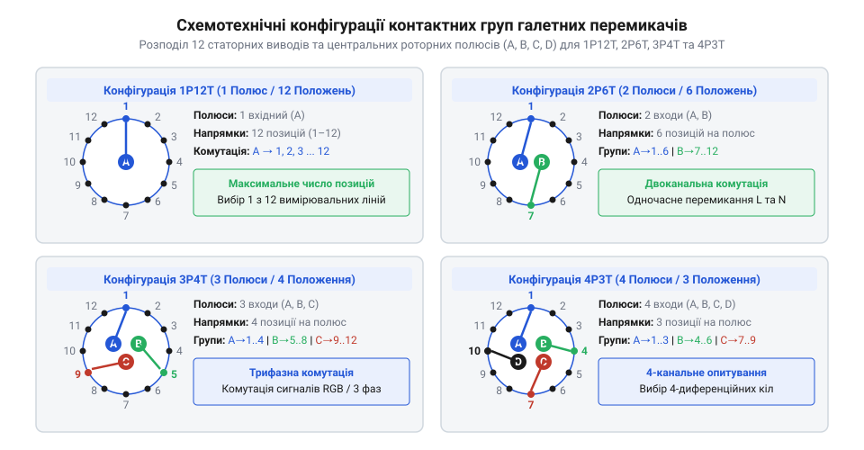
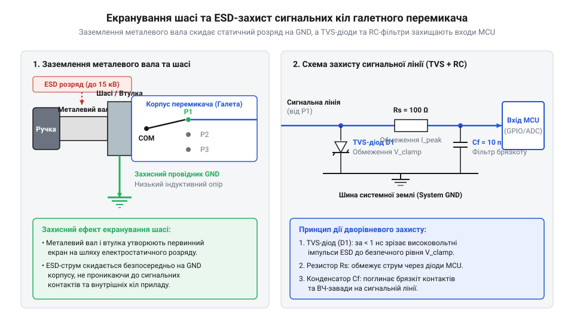

# Залізний інтерфейс, цокольовка та методи електричного підключення галетних перемикачів

<preknowlist>
- [Поворотний потенціометр](root:cat-hw-controls/rotary-potentiometer) — принципи вимірювання опору та підключення трививідних дільників
- [KY-040 — поворотний енкодер](root:cat-hw-controls/ky-040-encoder) — різниця між вихідним імпульсним кодом та прямою ламельною комутацією
</preknowlist>

## Призначення та геометрична конфігурація ламелей

Галетні поворотні перемикачі (від французького galette — коржик, диск; @@en|rotary selector switches@@) призначені для надійної дискретної комутації електричних кіл шляхом повороту центрального вала. На відміну від аналогових компонентів, де працює ковзний контакт на коловій доріжці як у [поворотному потенціометрі](root:cat-hw-controls/rotary-potentiometer), галетні вимикачі формують фіксовану групу жорстких металевих ламелей (від латинського lamella — пластинка; @@en|stator lugs@@), розташованих по колу на нерухомому ізоляційному диску (статорі). У центрі диска обертається роторний ніж, який послідовно замикає центральний спільний контакт із відповідними пелюстками статора.

Конструкція галетного вузла визначається трьома параметрами: кількістю полюсів `P` (@@en|poles@@), кількістю положень `T` (@@en|positions/throws@@) та кількістю фізичних дискових галет у блоці (@@en|wafers@@). Геометрія ізоляційного диска спирається на повне коло 360°, поділене на 12 фізичних статорних позицій. Кутовий крок між сусідніми ламелями обчислюють як `α = 360° / 12 = 30°`. Кількість полюсів `P` визначає число незалежних роторних секторів на статорі. Кутовий розмір сектора для одного полюса становить `360° / P`. Число положень `T` у межах одного сектора є відношенням його кута до кроку: `T = (360° / P) / 30°`. Геометричне спрощення дає залежність `T = 12 / P`, де кожен новий полюс пропорційно зменшує доступний кутовий сектор для виходів. При одному полюсі `P = 1` сектор становить 360° з 12 положеннями, а при `P = 4` диск ділиться на чотири сектори по 90° із 3 положеннями на полюс. Базова формула розподілу показує, що добуток полюсів на положення для однієї галети є константою:

Для гнучкого налаштування кількості активних положень без зміни внутрішньої контактної групи галетні перемикачі оснащують регульованим стопорним кільцем (@@en|stop ring@@; від англ. *stop ring* — обмежувальне кільце з штифтом). Під монтажною гайкою на різьбовій втулці вимикача розташовано лицьовий диск із радіальними отворами для кожного кутового кроку (від 1 до 12). Оператор вставляє внутрішній виступ шайби-обмежувача у гніздо, що відповідає потрібній крайній позиції (наприклад, у позицію 4 для перетворення 1P12T на 1P4T), після чого механічний упор вала фізично блокує подальше обертання ротора. Це дозволяє уніфікувати складські деталі й використовувати один універсальний перемикач для різних режимів комутації, на відміну від безперервного обертання, яке має [поворотний енкодер](root:cat-hw-controls/ky-040-encoder).

P · T = 12      [для однієї стандартної галети з кроком 30°]

Завдяки цьому одна фізична галета може конфігуруватися як 1P12T (один полюс на 12 напрямків), 2P6T (два полюси на 6 напрямків), 3P4T (три полюси на 4 напрямки) або 4P3T (чотири полюси на 3 напрямки). Якщо система вимагає більшої кількості незалежних комутаційних кіл, кілька галет монтуються на спільному гранчастому валу одна за одною, утворюючи багатопакетну систему.

## Цокольовка та кодування контактних груп

Правильна ідентифікація виводів (@@en|pinout@@) галетного перемикача вимагає розрізнення виводів спільного контакту ротора (@@en|common pin@@) та виводів статорних пелюсток (@@en|stator pins@@). На друкованих платах та паяльних корпусах центральні спільні виводи зазвичай маркуються буквами `A`, `B`, `C`, `D` відповідно до номера полюса, тоді як статорні контакти нумеруються цифрами від `1` до `12` за годинниковою стрілкою відносно орієнтовного паза корпусу.

*Конфігурація контактних груп галетного перемикача визначає співвідношення між кількістю спільних ножів та статорних пелюсток.*

У конфігурації 1P12T один спільний контакт `A` послідовно підключається до пелюсток `1...12`. У конфігурації 2P6T ротор має два протилежні ножі `A` та `B`, кожен з яких обслуговує свій сектор із 6 статорних пелюсток (`A` до `1...6`, `B` до `7...12`). Схема 4P3T містить чотири спільні контакти `A, B, C, D`, які одночасно комутують чотири незалежні трифазні або трипозиційні лінії. За характером спрацьовування контактів перемикачі поділяються на типи «коротке замикання перед розмиканням» (від англійського @@en|make-before-break@@, MBB або @@en|shorting@@) та «розмикання перед замиканням» (від англійського @@en|break-before-make@@, BBM або @@en|non-shorting@@). Динаміка замкненості контактних груп при переході між сусідніми позиціями `k` та `k+1` описується комутаційною таблицею:

| Режим комутації | Стан у позиції `k` | Стан у момент переходу (між `k` та `k+1`) | Стан у позиції `k+1` | Схемотехнічний ефект переходу |
| :--- | :--- | :--- | :--- | :--- |
| **BBM** (@@en|non-shorting@@) | `A-k` замкнено `A-(k+1)` розімкнено | `A-k` розімкнено `A-(k+1)` розімкнено | `A-k` розімкнено `A-(k+1)` замкнено | Повний розрив кола (обрив), запобігання міжконтактному короткому замиканню |
| **MBB** (@@en|shorting@@) | `A-k` замкнено `A-(k+1)` розімкнено | `A-k` замкнено `A-(k+1)` замкнено | `A-k` розімкнено `A-(k+1)` замкнено | Тимчасове паралельне перекриття, безперервність струму без клацань |

Тип MBB застосовують у звукових трактах, щоб уникнути клацань від розриву кола, а тип BBM — у силових колах для запобігання короткому замиканню між сусідніми позиціями.

## Електричні параметри та комутаційна здатність

Електрична надійність галетного перемикача визначається трьома основними паспортними характеристиками: початковим опором контактів (@@en|contact resistance@@), електричною міцністю ізоляції (від латинського insula — острів; @@en|dielectric strength@@) та допустимим комутаційним навантаженням (@@en|switching capacity@@). Перехідний опір замкненого контакту для нових посріблених або позолочених ламелей становить від 10 до 30 мОм. Збільшення цього опору понад 100 мОм свідчить про ерозію або окислення поверхні.

При виборі режиму комутації розрізняють струм протікання в замкненому стані (@@en|carry current@@, до 5 А) та допустимий струм розриву під напругою (@@en|switching current@@, зазвичай 0.1...0.5 А при 110 В змінного або 28 В постійного струму). Для суто активного опору максимальна комутована потужність розриву становить `P_max = U · I`. При роботі з індуктивним навантаженням допустима потужність `P_ind` стрімко падає через виникнення самоіндукції під час розмикання ламелей. ЕРС самоіндукції `e = -L · (di/dt)` викликає перенапругу й підтримує палання дугового розряду. У колах змінного струму граничну потужність знижують пропорційно коефіцієнту потужності `cos φ` за співвідношенням `P_ind = P_res · cos φ`. При типовому значенні коефіцієнта `cos φ = 0.4` допустима потужність становить лише 40% від номінальної активної. У колах постійного струму при постійній часу індуктивності `τ = L / R` понад 7 мс допустимий струм розриву знижують удвічі. У малосигнальних вимірювальних колах, на відміну від імпульсних пристроїв типу [поворотного енкодера](root:cat-hw-controls/ky-040-encoder), застосовують «сухі контакти» (@@en|dry contacts@@) з позолоченим покриттям (товщиною 3...5 мкм), оскільки золотий шар не утворює діелектричної плівки оксидів і забезпечує стабільну комутацію мікровольтних сигналів без підпалювання контактної дуги. Напруга пробою ізоляції між сусідніми ламелями та металевим корпусом становить від 500 до 1500 В ефективного значення (@@en|RMS@@).

## Схемотехнічне підключення та екранування шасі

Використання галетного перемикача у чутливих вимірювальних та звукових трактах вимагає спеціальних заходів завадозахисту. Оскільки металевий поворотний вал виходить на зовнішнє панельне роз'єднання і безпосередньо контактує з руками оператора, він є потужною антеною для наведення електромагнітних завад (@@en|EMI@@) та первинним каналом пробою електростатичного розряду (від грецького електрон та статикос — той, що стоїть; @@en|electrostatic discharge@@, ESD).

*Заземлення різьбової втулки та установка баластних фільтрів захищають сигнальні канали від статичних розрядів і ємнісних завад.*

Для захисту від ESD та ємнісних завад металеву різьбову втулку (@@en|bushing@@) та сталеве шасі галетного блоку обов'язково з'єднують із заземленим корпусом або шиною `GND` за допомогою контактної зубчастої шайби (@@en|star washer@@). У прецизійних трактах це розведення виконують через паралельну RC-ланку (від англ. *RC network*; далі — @@en|RC network@@). Високовольтний керамічний конденсатор ємністю 10...100 нФ на робочу напругу 1...2 кВ створює шлях із низьким імпедансом для високочастотних завад і розрядів ESD. Паралельно підключений резистор опором 1 МОм безпечно стікає статичний заряд та розриває низькочастотні земляні петлі між шасі й сигнальною шиною `GND`. Сигнальні лінії, що відходять від статорних пелюсток, шунтують керамічними конденсаторами ємністю 100...1000 пФ та TVS-діодами біля входу в електронну плату, а тривалі непідключені ламелі заземлюють, щоб запобігти наведенню на них перехресних завад (@@en|crosstalk@@).

## Правила монтажу та розводки PCB

При проектуванні посадового місця (@@en|PCB footprint@@) під галетний перемикач необхідно враховувати дуговий розподіл отворів із радіальним кроком відповідно до геометрії ламелей. Отвори під паяльні виводи мають утворювати кільцевий зазор 0.2...0.3 мм відносно товщини пелюстки для вільного затікання припою, а центральні отвори кріплення розраховують під механічні фіксувальні штифти (@@en|locating pins/lugs@@), які сприймають обертальний момент і запобігають прокручуванню корпуса на платі.

Під час автоматизованого паяння хвилею припою (@@en|wave soldering@@) або ручного паяння існує ризик капілярного всмоктування рідкого флюсу всередину закритої галетної секції через зазори виводів. Забруднення контактних поверхонь флюсом спричиняє обвуглення, окислення та втрату контакту. Для захисту застосовують перемикачі із запечатаною базою (@@en|sealed terminals@@) або монтують галетні блоки за допомогою знімних роз'ємних колодок. При відмиванні залишків флюсу в ультразвуковій ванні для герметизованих перемикачів суворо контролюють параметри кавітації. Промивання здійснюють у спеціальних ізопропілових розчинниках при температурі ванни 40...50 °C та високочастотному ультразвуку 40...80 кГц. Низькі частоти до 28 кГц або тривалість обробки понад 3 хвилини викликають кавітаційне руйнування епоксидного герметика. Розгерметизація корпуса призводить до затікання забрудненого розчинника всередину деки та утворення плівки на ламелях. Після відмивання плату обов'язково сушать примусовим обдувом гарячим повітрям при 60...70 °C протягом 30 хвилин до першого механічного перемикання. Монтажні гайки на передній панелі затягують з нормованим моментом (не більше 0.8...1.2 Н·м), щоб не деформувати ізоляційні керамічні чи гетинаксові деки перемикача.
