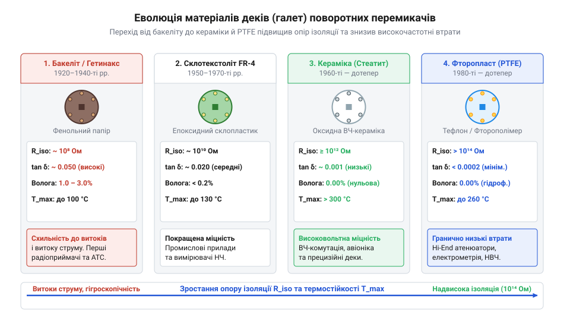
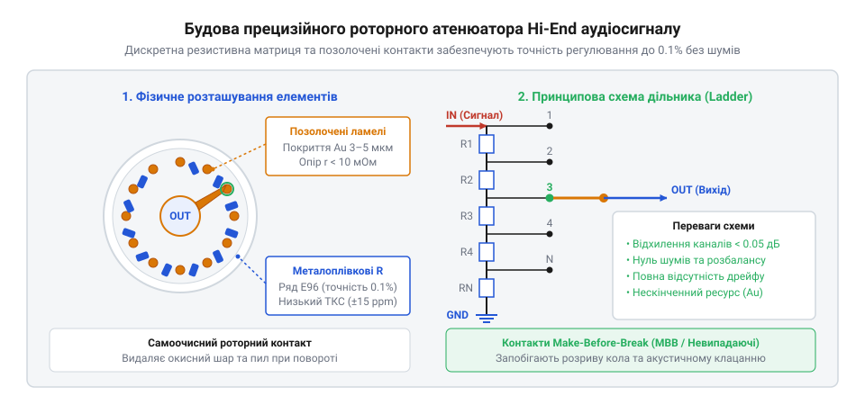

# Еволюція галетних перемикачів від телеграфних комутаторів до прецизійних аудіоатенюаторів

<preknowlist>
- [Поворотний потенціометр](root:cat-hw-controls/rotary-potentiometer) — пристрій резистивного дільника та принципи плавної зміни опору
- [KY-040 — поворотний енкодер](root:cat-hw-controls/ky-040-encoder) — відмінність імпульсного цифрування від прямої механічної комутації
</preknowlist>

## Комутація багатопровідних ліній XIX століття

У 1870–1880-х роках швидке розширення телеграфних мереж та поява перших ручних телефонних станцій створили гостру інженерну проблему комутації багатопровідних кіл. Перші комутаційні шафи базувалися на матрицях штекерних панелей, де оператор вручну з'єднував абонента з потрібною лінією за допомогою гнучких кабелів із латунними штекерами. При зростанні кількості каналів до кількох десятків така система призводила до хаосу з дротів, повільного обслуговування та високої ймовірності людської помилки — випадкового короткого замикання двох незадіяних ліній при помилковому встановленні штекера. Першою спробою подолати цю ваду стали роторні маніпулятори Томаса Едісона (англ. *Thomas Edison*), у яких підпружинена зубчаста заскочка вимушено зупиняла контактну стрілку точно над пелюсткою статора. Згодом у 1889 році американський винахідник Алмон Строуджер (англ. *Almon Strowger*) застосував у своєму автоматичному кроковому комутаторі храповий механізм фіксації (від німецького *Krapfen* — гак, зачіп; від англ. @@en|ratchet mechanism@@), де пружинна заскочка силою стискання утримувала роторний ніж у фіксованому кутовому положенні після кожного кроку. Саме поєднання обертового контакту з пружинним дискретним фіксатором усунуло недоводки важеля й лягло в основу перших надійних роторних перемикачів.

Розв'язанням проблеми стало створення механічного роторного перемикача (від англійського @@en|rotary switch@@). Його конструкція перенесла комутаційну матрицю в єдиний плоский вузол: центральний рухомий контактний ніж — ротор (від латинського *rotare* — обертатися, @@en|rotor@@) — послідовно ковзає по дузі колового масиву нерухомих контактних пелюсток — статора (від латинського *stator* — нерухомий, @@en|stator@@). Головною перевагою цього механізму стала жорстка механічна взаємовиключність: роторний ніж фізично спроможний замкнути лише один обраний канал у кожен момент часу. Це усунуло ризик випадкового паралельного з'єднання кіл та забезпечило швидкий вибір потрібного каналу повертанням єдиної ручки.

## Перехід до пакетних галетних деків

Перші роторні перемикачі кінця XIX століття виготовлялися на основах із важкої та крихкої радіотехнічної порцеляни або ебоніту, а на початку XX століття — з товстого бакеліту (від німецького @@de|Bakelit@@). Вони мали великі габарити й дозволяли комутувати лише одну електричну лінію в межах одного плоского диска. Проте розквіт багатокаскадної радіоприймальної та вимірювальної апаратури у 1920–1930-х роках висунув вимогу одночасного перемикання десятків незалежних кіл — наприклад, синхронного переналаштування вхідних контурів, гетеродина та кіл зворотного зв'язку при зміні діапазону хвиль.

Для запобігання недоводці контактів та самовільному зсуву вала від вібрацій інженери розробили механізм дискретної фіксації позицій (від англ. *detent mechanism*, від латинського *detentio* — утримання; далі — @@en|detent mechanism@@). У цій системі дві підпружинені сталеві кульки або вигнуті пружинні заскочки з силою притискалися до радіальних заглиблень металевої зірочки-фіксатора, жорстко закріпленої на центральному валу. Під час повороту ручки кулька силою витискалася з паза, накопичувала пружну деформацію пружини й миттєво западала в наступну позицію, забезпечуючи чітке тактильне клацання та унеможливлюючи зупинку ротора в невизначеному проміжному стані.

Проривом у конструкції стало створення пакетного модульного перемикача, де окремі ізоляційні пластини назвали галетами (від французького @@fr|galette@@ — плоский коржик) або деками (від англійського @@en|deck@@ — шар, палуба). Конструктори об'єднали декілька незалежних галет уздовж єдиного металевого вала гранчастого або D-подібного перерізу. Повертання однієї ручки викликало синхронний поворот роторних контактів на всіх галетах одночасно, дозволяючи керувати складними багатовузловими схемами з одного органу вводу.

*Еволюція матеріалів галетних деків від ранніх фенольних смол до високочастотної кераміки та фторопласту.*

Паралельно змінювалася матеріалоємність деків. Початковий бакеліт та гетинакс (від німецького @@de|Pertinax@@) легко піддавалися штампуванню, але гігроскопічність та високі діелектричні втрати робили їх непридатними для високочастотних кіл. Для радіочастотних застосувань розробили деки зі стеатитової кераміки, які володіли мізерними втратами й опором ізоляції понад `10¹² Ом`. У прецизійній та авіаційній техніці другої половини XX століття почали застосовувати фторопласт (від англійського @@en|PTFE@@ / @@en|Teflon@@), який поєднав найвищий опір ізоляції (`10¹⁴ Ом`), мінімальний коефіцієнт тертя та хімічну інертність. На відміну від [поворотного потенціометра](root:cat-hw-controls/rotary-potentiometer), де знос вугільної доріжки обмежує ресурс, керамічні та фторопластові галети зберігали геометрію протягом десятиліть.

## Еволюція благородних металів у контактах

Ранні галетні перемикачі мали контакти з незахищеної латуні або фосфористої бронзи. У високовольтних або потужних струмових кола́х дуговий розряд та відносно висока напруга самостійно пробивали тонкі оксидні плівки на поверхні металу. Проте з розвитком малосигнальної вимірювальної техніки та високоточного звукового обладнання виникла проблема так званого «сухого кола» (від англійського @@en|dry circuit@@) — режимів комутації, де напруга на контактах не перевищує `20 мВ`, а струм становить мікроампери.

За таких умов на латунних та мідних контактах під дією кисню й вологи повітря утворювався шар оксидів зі напівпровідниковими властивостями. Без достатньої напруги для електричного пробою цієї плівки перехідний опір (від англійського @@en|contact resistance@@) контакту хаотично зростав від часток ома до сотень ом, викликаючи тріск, шуми та втрату сигналу. На відміну від [поворотного енкодера](root:cat-hw-controls/ky-040-encoder), де послідовність цифрових імпульсів зчитується контролером і мала завада відфільтровується програмно, галетний перемикач аналогового сигналу вимагає чистого металевого контакту безпосередньо в лінії передачі.

Дотримання стабільного перехідного опору досягли шляхом переходу на благородні метали та їхні сплави. Покриття контактних пелюсток сріблом усунуло стійкі оксиди, оскільки оксид срібла (Ag₂O) легко руйнується механічним тертям ротора, хоча срібло залишалося чутливим до сірководню в повітрі. Для протидії електрохімічній фретінг-корозії (від англійського @@en|fretting corrosion@@, де fretting — стирання, а corrosion — корозія від латинського @@la|corrosio@@ — роз'їдання), яка виникає через мікрозсуви контактів при вібрації й термічних деформаціях і призводить до накопичення ізолюючих оксидних продуктів зносу у «сухих колах», розробили технологію твердого золочення та паладіювання. Оскільки чисте золото є занадто м'яким металом і швидко стирається роторними ламелями, легування золота `0.1...0.5 %` нікелю у складі сплаву золото-нікель (від англійського @@en|gold-nickel alloy@@) зростило мікротвердість покриття понад дворазово (до `150...200 HV`). Золоте покриття завтовшки `3...5 мкм` цим твердим сплавом забезпечило повну відсутність пасивації (від латинського *passivus* — пасивний, @@en|passivation@@), унеможливило фретінг-зношування контактних ламелей, знизило перехідний опір до стабільних `2...5 мОм` і гарантувало мільйони циклів перемикань без деградації малосигнального тракту.

## Стійкість у критичній та аудіоапаратурі

Попри бурхливий розвиток мікроконтролерів та напівпровідникової елементної бази, галетні перемикачі зберегли домінуючі позиції у двох протилежних галузях: авіаційно-космічній техніці й вимірювальних приладах критичного призначення та у прецизійному Hi-End аудіообладнанні. В авіаційних бортових радіолокаторах, військовій зв'язковій апаратурі та кіл управління високовольтними випробуваннями ключовим вимогою залишається гальванічна розв'язка (від грецького @@el|galvanik|гальванічний@@ — на честь Луїджі Гальвані, @@en|galvanic isolation@@) та абсолютна стійкість до електромагнітних завад (від англійського @@en|electromagnetic interference@@, EMI) і ядерного електромагнітного імпульсу. Механічний розрив контактних пелюсток на керамічній галеті забезпечує повітряний проміжок із пробійною напругою понад `500...1000 В`, нульовим струмом витоку (`0 пА`) та нульовою паразитною ємністю між незадіяними каналами.

*Схема будови прецизійного роторного атенюатора Hi-End аудіосигналу з послідовним набором металоплівкових резисторів та позолоченими ламелями.*

У високоякісному аудіообладнанні галетні перемикачі стали основою дискретних ступенчатих регуляторів гучності — прецизійних атенюаторів (від латинського *attenuare* — послаблювати, @@en|attenuator@@). На відміну від [поворотного потенціометра](root:cat-hw-controls/rotary-potentiometer), де графітовий шар спричиняє розбаланс стереоканалів до `1...3 дБ` та вносить шум ковзання, дискретний галетний атенюатор перемикає сигнал між окремими металоплівковими резисторами з точністю до `0.1%`. Позолочені роторні контактори забезпечують ідеальну ідентичність коефіцієнта передачі каналів (відхилення менше `0.05 дБ`) та повну відсутність власних шумів і спотворень у лінійному тракті.

Критичним аспектом функціонування прецизійних роторних атенюаторів є механіка часового узгодження перемикання контактної групи. Застосування контактів типу «розмикання перед замиканням» (від англійського @@en|break-before-make@@, BBM або @@en|non-shorting@@) у високоомних аудіоколах призводить до короткочасного розриву сигналу під час переходу ножа між сусідніми ламелями. Момент нескінченно великого вхідного імпедансу викликає перехідний кидок напруги та гучний клацальний шум (@@en|transient pop@@) у гучномовцях. Для усунення цього ефекту в регуляторах гучності застосовують конфігурації типу «коротке замикання перед розмиканням» (від англійського @@en|make-before-break@@, MBB або @@en|shorting@@), де роторний ніж тимчасово перекриває дві сусідні пелюстки, розмикаючи попередню тільки після встановлення контакту з наступною та зберігаючи постійний опір кола.

## Розвінчання міфу про напівпровідникові мультиплексори

У 1970–1980-х роках поява КМОН аналогових ключів (на кшталт серії CD4051) породила поширений інженерний міф про те, що механічні роторні перемикачі є застарілим реліктом і будуть повністю витіснені мікросхемами. Проте практика експлуатації швидко виявила фундаментальні фізичні обмеження напівпровідникових комутаторів. Аналоговий мультиплексор (від латинського *multiplex* — складний, @@en|analog multiplexer@@) виявився непридатним для багатьох задач через нелінійність внутрішнього опору каналу відносно миттєвого рівня напруги сигналу. Ця нелінійність вносить у чисто аналоговий сигнал нелінійні спотворення (від англійського @@en|total harmonic distortion@@, THD), яких принципово немає в металевих контактах галет.

Крім того, напівпровідникові ключі суворо обмежені напругою живлення мікросхеми (зазвичай `±15 В` або `0...5 В`) і не здатні комутувати високовольтні сигнали або працювати у знеструмлених кола́х. Подача напруги поза межами живлення призводить до засувки каналу (англ. *latch-up* — паразитна засувка КМОН-структури) або пробою напівпровідникового переходу. Специфічним бар'єром на високих частотах виступає паразитна ємність (@@en|parasitic capacitance@@; від англ. *parasitic capacitance* — небажана ємність між провідниками): у зачиненому КМОН-каналі ємність сток-витік та ємність відносно землі становлять `5...50 пФ`, що викликає шунтування високочастотного сигналу та просачування завад через закритий ключ. Натомість керамічні галети завдяки повітряному проміжку між відкритими контактами й низькій діелектричній проникності керамічного диска забезпечують міжканальну ємність менше ніж `0.5 пФ`, що гарантує розв'язку сигналу на частотах у десятки мегагерц. Завдяки цьому механічний перемикач не потребує джерела живлення, є стійким до електростатичних розрядів, іонізуючого випромінювання та високочастотного витоку.

Тому в сучасній інженерній практиці проведено чітку межу доцільності: якщо для побудови цифрового інтерфейсу користувача ідеально підходить мікроконтролер із [поворотним енкодером](root:cat-hw-controls/ky-040-encoder), то для безаварійної комутації силових, високовольтних та чистих малосигнальних аналогових трактів роторний галетний перемикач залишається єдиним безкомпромісним рішенням.
