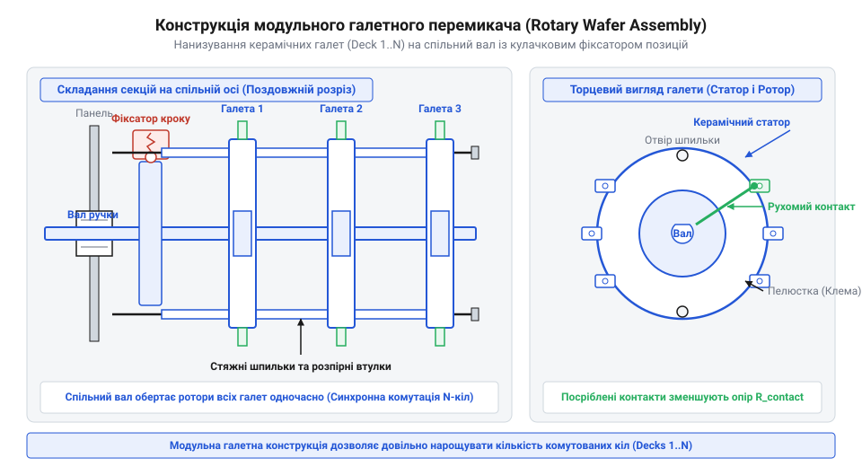
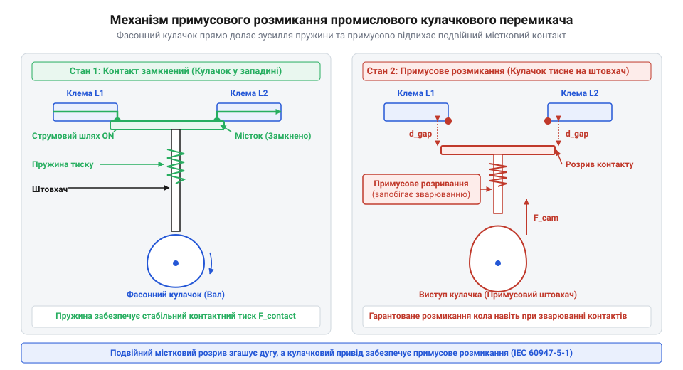

# Еволюція галетних перемикачів від вимірювальних приладів до промислової автоматики

<preknowlist>
- [Поворотний потенціометр](root:cat-hw-controls/rotary-potentiometer) — Принципи кругового механічного обертання та відмінність дискретної комутації від аналогового опору.
- [KY-040 — поворотний енкодер](root:cat-hw-controls/ky-040-encoder) — Фізика дискретного позиціонування та порівняння механічних контактів із цифровим імпульсним кодуванням.
</preknowlist>

## Проблема багатоколової комутації

На початку XX століття стрімкий розвиток бездротового телеграфу, перших радіопередавачів та вимірювальних лабораторних стендів зіштовхнувся з жорстким технічним бар'єром. Електричні схеми того часу вимагали постійного перемикання десятків незалежних кіл: відводів котушок індуктивності, батарей конденсаторів та вимірювальних шунтів. Наявні на той момент однополюсні вимикачі та ножові рубильники (@@en|knife switch@@) абсолютно не відповідали новим вимогам. Вони займали величезну площу на передніх панелях приладів, а кожне перемикання режиму вимагало від оператора послідовного ручного маніпулювання кількома важелями. Зокрема, у детекторних радіоприймачах для точного налаштування резонансної частоти контуру потрібно було одночасно вибирати секцію вхідної котушки й підключати відповідну ємність, а також змінювати коефіцієнт індуктивного трансформаторного зв'язку між антеною та коливальним контуром (англ. @@en|antenna coupling transformer@@) задля запобігання втратам чутливості й шунтуванню резонансного кола низьким опором антени. У лабораторних вимірювальних містках Вітстона (англ. @@en|Wheatstone bridge@@, названих на честь британського фізика Чарльза Вітстона) зміна десятичних декад опору вимагала узгодженого перемикання чотирьох плечей без розриву струму в чутливому гальванометрі. Поетапне перекладання окремих рубильників у таких схемах призводило до збоїв настройки, тривалого пробою високою напругою та пошкодження вимірювальних головок.

Такий підхід не лише уповільнював роботу, а й призводив до фатальних помилок. Випадковий пропуск одного важільного вимикача чи помилкова послідовність замикання спричиняли короткі замикання, вигорали вимірювальні прилади та зривали зв'язок. Виник гострий тупик: інженерія потребувала компактного централізованого органу керування, здатного одним рухом синхронно й безпомилково перемикати складні комбінації електричних кіл. На відміну від [поворотних потенціометрів](root:cat-hw-controls/rotary-potentiometer), де опір змінюється плавно, тут вимагалася суворо дискретна й багатоканальна комутація.

## Винайдення модульної галетної структури

Конструктивний прорив відбувся у 1920–1930-х роках із появою поворотних галетних перемикачів (@@en|rotary switch@@). Назва «галетній» походить від форми ізоляційних дисків (від нім. *Galette* — коржик, галета), виготовлених із гетинаксу або текстоліту. Інженери запропонували геніальне модульне рішення: нанизати кілька плоских дисків-галет (@@en|wafer deck@@) на спільний центральний поворотний вал. На кожному диску закріплювали нерухомі пелюсткові контакти (@@en|stator contact@@), а на центральній обертовій частині — рухомий роторний ніж (@@en|rotor contact@@). Для виразного відчуття позицій на вал встановлювали фіксатор положень (від фр. *détente* — ослаблення, спуск; англ. @@en|detent mechanism@@), у якому підпружинені сталеві кульки або ролики взаємодіяли з профільною зірочкою. У плоских галетниках застосовували листові (плоскі) пружини із загартованої сталі, а у важких промислових — радіальні спіральні (гвинтові) пружини. Механічний утримувальний момент `M_detent` прямо залежить від сили стискання пружини `F_spring`, радіуса зірочки `r_star` та кута скосу зуба `α`:

        M_detent = F_spring · r_star · tan α      [утримувальний момент фіксатора вала]

Під час повороту вала кулька витискається на вершину зуба `α`, стискаючи пружину й створюючи піковий момент зриву, після чого пружина різко заштовхує кульку в наступну западину, даючи чітке тактильне клацання й жорстку фіксацію ножа на ламелі. Однак тисячі циклів повторюваного тертя між загартованою сталевою кулькою та вершинами зубів зірочки спричиняють абразивне зношування (@@en|fretting wear@@) й згладжування профілю `α`, а циклічне навантаження пружини призводить до її механічної втоми (@@en|spring fatigue@@) та падіння сили притиску `F_spring`. Зі зміною геометричного профілю кулачка та ослабленням пружини утримувальний момент `M_detent` з часом неминуче знижується, чіткість тактильного позиціонування втрачається, а виникнення механічного люфту може спричинити недоведення роторного ножа до ламелі й підвищений брязкіт контактів (@@en|contact chatter@@) під дією вібрацій.

*Нанизування окремих керамічних або текстолітових галет на спільну вісь дозволяє одночасно комутувати десяток рознесених кіл єдиним поворотом вала.*

Щоб оператор чітко відчував перехід між положеннями, вал оснастили кулачковим фіксатором положень — фіксатором (@@en|detent mechanism@@, від фр. *détente* — спуск, ослаблення). Підпружинені сталеві кульки або фасонні кулачки западали в пази профільної шестерні, забезпечуючи виразне механічне клацання та точне суміщення контактних пелюсток. Для потужної промислової автоматики пізніше розробили кулачкові селектори (@@en|cam switch@@), де поворотний вал із кулачками примусово розмикав місткові контакти.

*Фасонний кулачок примусово розмикає подвійний містковий контакт, забезпечуючи високу розривну потужність у промислових колах.*

Завдяки такій кінематиці один поворот ручки зміг виконувати складні комутаційні програми, замінивши цілу панель рубильників і започаткувавши еру компактної радіоапаратури.

## Металургія контактів та військова радіотехніка

Масове розгортання військової короткохвильової радіоапаратури у 1940-х роках виявило нове слабке місце галетних перемикачів — матеріалознавче. Перші вироби виготовляли зі звичайної латуні (@@en|brass@@) та бронзи. У польових умовах під впливом вологи й кисню на поверхні пелюсток швидко утворювалася окисна плівка. Вона викликала нестабільний перехідний опір (@@en|contact resistance@@), що призводило до появи шумів, згасання слабких сигналів та зриву генерації у високочастотних гетеродинах радіоприймачів. Проблему пасивації розв'язали впровадженням гальванічного сріблення (англ. @@en|electroplating@@): на контактувальні поверхні наносили шар технічного срібла товщиною від 3 до 15 мікронів, оксидна плівка якого зберігає високу провідність і легко стирається завдяки механічному самоочищенню роторного ножа. Водночас у високочастотних колах виявилася критична вада гетинаксових галетних плат: під дією ВЧ-поля високий тангенс кута діелектричних втрат (англ. @@en|dielectric loss@@) паперово-фенольного матеріалу спричиняв термічний розігрів діелектрика, дрейф ємності між контактами та розлагодження контурів. Заміна гетинаксу на стеатитову кераміку з тангенсом втрат менше ніж `0.001` повністю усунула термічний розігрів та зміщення частоти під час тривалої роботи.

Вирішенням проблеми стала металургійна модернізація контактних груп. Інженери впровадили покриття контактів технічним сріблом (@@en|silver plating@@) та використання берилієвої бронзи (від назви хімічного елемента берилію, англ. *beryllium*) для пружинних пелюсток. Оксид срібла зберігає високу електропровідність і легко руйнується при терті роторного ножа. Для роботи на високих частотах гетинакс замінили на стеатитову кераміку (@@en|steatite ceramic@@, від грец. *στέαρ* — жир, сало, за мильну на дотик текстуру), яка володіє мізерними діелектричними втратами (@@en|dielectric loss@@).

Ці вдосконалення забезпечили колосальну надійність військових радіостанцій і лабораторій. Сформована тоді металургійна й геометрична база галетних перемикачів залишалася основою вимірювальних приладів аж до появи [сучасних енкодерів](root:cat-hw-controls/ky-040-encoder).

## Селектори промислової автоматики й стандартизація

У другій половині XX століття з бурхливим розвитком важкого машинобудування й промислової автоматики виникла потреба перенести концепцію багатопозиційного поворотного вибору з тендітних радіоприймачів у суворі умови заводських цехів. Тендітні керамічні й гетинаксові галети з відкритими пелюстками не витримували струмів у десятки ампер і високих напруг 380 В, а також швидко виходили з ладу через пил, масло й вібрацію верстатів. Головною фізичною перешкодою ставав дуговий розряд (англ. @@en|electric arc@@), який виникав під час розмикання силових контактів під навантаженням і спричиняв абразивну ерозію або зварювання пелюсток. Якщо в колах змінного струму (англ. @@en|AC@@) електрична дуга згасає природно при переході синусоїди через нуль, то при комутації постійного струму (англ. @@en|DC@@ або @@en|direct current@@) дуга горить безперервно, миттєво руйнуючи контактні вузли. Для вирішення цього завдання в силових кулачкових селекторах розробили системи дугогасіння (англ. @@en|arc suppression@@) із додатковими дугогасними камерами (англ. @@en|arc chute@@). Усередині цих камер розміщують дугогасні пластини та магніти для видування дуги: магнітне поле виштовхує електричну дугу з місткового контакту в решітку, де вона подовжується, охолоджується та розбивається на сегменти, миттєво розмикаючи коло без пошкодження перемикача.

Промислова відповідь полягала у створенні силових кулачкових селекторів (@@en|cam switch@@, від англ. *cam* — кулачок, фасонний виступ). Замість відкритих плоских галет інженери розробили закриті термостійкі камери, у кожній з яких розмістили подвійний містковий контакт (@@en|double-break contact@@). Обертовий центральний вал оснастили профільними кулачками з міцного карболіту чи поліаміду: під час повороту вала кулачок примусово відтискав підпружинений важіль і розмикав контакти з високим зусиллям. Таке кулачкове розмикання унеможливило зварювання контактів при коротких замиканнях і дозволило комутувати силові навантаження до 16 А. Герметичний корпус дав захист рівня @@en|IP65@@, що зробило ці кулачкові перемикачі стандартом у щитах керування верстатами й енергетичних розподільчих шафах. У сучасній автоматиці ці громіздкі силові кулачки поступово поступаються місцем електронним органам введення — таким як [поворотні енкодери](root:cat-hw-controls/ky-040-encoder) чи [джойстик-модулі](root:cat-hw-controls/ky-023-joystick).

## Розвінчання міфів про походження роторних блоків

У популярній технічній літературі досі трапляються міфи, які помилково атрибутують винайдення багатосекційних роторних перемикачів авіаційній індустрії 1940-х років або першим електронно-обчислювальним машинам (ЕОМ). Стверджується, нібито галетно-дискова будова з'явилася в кабінах винищувачів для швидкої зміни радіочастот або на ракетобудівних випробувальних стендах. Проте первинний патентний слід роторного комутаційного механізму сягає розробок американського винахідника Алмона Строуджера (англ. @@en|Almon Brown Strowger@@, патент США №447,918 від 1891 року), який створив обертовий кроковий шукач для автоматичних телефонних станцій. У 1920-х роках ця конструкція була принципово вдосконалена компаніями Centralab (підрозділ Globe-Union) та Oak Grigsby (пізніше Oak Industries), які запатентували класичну плоску галетно-дискову структуру (англ. @@en|wafer rotary switch@@) із ламелями для масових радіоприймачів.

Історико-патентний аналіз спростовує ці уявлення. Концепція обертового роторного розподільника електричних кіл народилася ще наприкінці XIX століття у сфері залізничної сигналізації та автоматичних телефонних станцій (АТС). Багатосекційна ж галетно-дискова конструкція була запатентована й розроблена в 1920-х роках виключно для потреб масового побутового радіомовлення та вимірювальних містків. Авіація та комп'ютерна галузь 1940–1950-х років лише запозичили вже цілком зрілі радіотехнічні рішення, піддавши їх суворій стандартизації за військовими нормами надійності.
