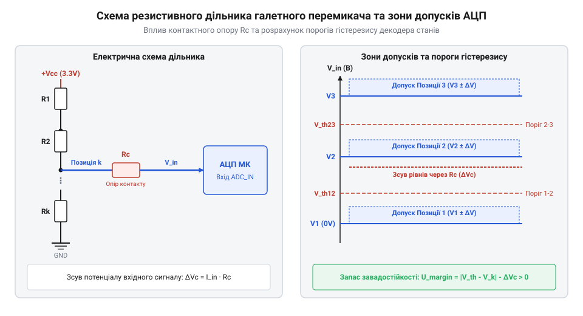

# Розрахунок резистивного дільника АЦП та контактного опору галетних перемикачів

<preknowlist>
- [Поворотний потенціометр](root:cat-hw-controls/rotary-potentiometer) — Конструкція резистивного треку та виникнення контактного опору в рухомих контактах.
</preknowlist>

## Проблема аналогового опитування багатьох позицій

У панелях керування промисловим обладнанням та вимірювальними приладами часто застосовують багатопозиційний галетний перемикач (від французького *galette* — пласка пластина; англ. @@en|rotary selector switch@@) для вибору режимів роботи. Якщо перемикач має 6, 8 або 12 фіксованих позицій, підключення кожного окремого контакту до виділеної цифрової лінії мікроконтролера вимагає значної кількості ніжок `GPIO`, що створює критичний дефіцит виводів у компактних проєктах. Математичне вирішення цієї проблеми полягає у виборі топології резистивної сітки. Послідовний лінійний дільник напруги (англ. @@en|voltage divider ladder@@) використовує ланцюжок із `N - 1` однакових резисторів номіналом `R`, забезпечуючи рівномірний крок потенціалу `ΔV = V_ref / (N - 1)` для `N` позицій. Кількість компонентів у ньому зростає лінійно `O(N)`, а рухомий контакт комутує відповідний вузол безпосередньо на аналоговий вхід. Натомість двійкова схема `R-2R` (англ. @@en|R-2R ladder@@) забезпечує логарифмічне співвідношення між кількістю розрядів та позицій `O(log₂ N)`, використовуючи лише номінали `R` та `2R` і зберігаючи сталий вихідний опір `R_out = R`. Проте математична компактність `R-2R` для великої кількості позицій вимагає складної багатодискової комутації для формування двійкового коду, а похибки номіналів у старших розрядах викликають ризик немонотонності напруги при переході між сусідніми станами (наприклад, від `0111` до `1000`), що робить однодисковий лінійний дільник значно стійкішим рішенням для прямого опитування через АЦП.

Для подолання цього дефіциту використовують один аналогово-цифровий перетворювач (від латинського *analogus* — пропорційний, *digitus* — палець, та *convertendo* — перетворення; англ. @@en|ADC@@ або @@en|Analog-to-Digital Converter@@) та ланцюжковий резистивний дільник напруги (від латинського *resisto* — опиратися; англ. @@en|voltage divider ladder@@). Перемикач комутує рухомий контакт між вузлами резистивної сітки, подаючи на аналоговий вхід унікальний потенціал `V_out(k)` для кожної з `N` позицій. На відміну від гладкого регулювання напруги в [поворотному потенціометрі](root:cat-hw-controls/rotary-potentiometer), галетний орган утворює дискретні рівні потенціалів.

Математична задача проєктування такого дільника полягає у виборі номіналів резисторів, які забезпечують рівномірні кроки напруги `ΔV = V_ref / (N - 1)` уздовж усього діапазону шкали. Наївний розрахунок припускає ідеальність елементів, проте в реальних умовах на точність вимірювання впливають чотири джерела похибок: контактний опір рухомих точок, технологічний допуск опору резисторів, нестабільність опорної напруги `V_ref` та шум квантування АЦП.

Додатковим динамічним чинником, що обмежує вибір верхньої межі номіналів резисторів, є паразитна ємність (англ. @@en|parasitic capacitance@@) вхідного каналу АЦП. Вхідний аналоговий каскад мікроконтролера має власну ємність вибірки `C_in` (у каскаді @@en|sample and hold@@), яка разом із еквівалентним вихідним опором дільника `R_eq` утворює `RC`-фільтр нижніх частот. Під час механічного повороту перемикача потенціал на цій ємності змінюється за експоненційним законом із постійною часу `τ = R_eq · C_in`. Для того щоб напруга встановилася з точністю до половини молодшого значущого розряду (англ. @@en|LSB@@ або @@en|least significant bit@@) `n`-розрядного АЦП, час встановлення (англ. @@en|settling time@@) `t_settle` мусить задовольняти нерівність `t_settle ≥ τ · ln(2ⁿ⁺¹)`. Якщо для економії енергії обрати надто великий опір дільника, постійна часу `τ` зросте до мілісекунд, і при швидкому обертанні вала АЦП опитає незавершений перехідний процес, що призведе до хибного розпізнавання обраної позиції.

## Розрахунок дільника та контактного опору

Розглянемо схему дільника для `N`-позиційного галетного перемикача (де позиції нумеруються як `k = 0, 1, ..., N - 1`), утвореного послідовним з'єднанням `N - 1` однакових резисторів номіналом `R`. Нижній кінець ланцюжка підключено до землі `0 В`, а верхній — до опорної напруги `V_ref`. Сумарний опір усього дільника `R_total` становить `(N - 1) · R`, що визначає постійний статичний струм споживання (англ. @@en|static current@@, `I_stat`) схемою:

I_stat
= V_ref / R_total                         [закон Ома для сумарного опору ланцюжка]
= V_ref / ((N - 1) · R)                   [вираження через кількість ступенів N та номінал R]

Вибір вихідного опору `R` вимагає компромісу між енергоефективністю та завадостійкістю: занадто малий номінал `R` (наприклад, `100 Ом`) спричиняє непотрібне розряджання акумулятора й паразитно розігріває дільник струмом `I_stat`, тоді як надто великий опір `R` (понад `100 кОм`) робить високомутний вхід чутливим до наведених електромагнітних завад та вхідного струму витоку АЦП `I_adc`. Практичним оптимумом для більшості мікроконтролерів є вибір загального опору дільника в межах `10..50 кОм`, що забезпечує струм споживання `I_stat` на рівні сотень мікроампер при збереженні низького вихідного опору. Для обраної позиції `k` вихідна напруга ідеального дільника обчислюється за правилом пропорційного розподілу:

Окрім вибору статичного струму, вихідний опір дільника визначає рівень флуктуацій напруги, зумовлених тепловим шумом Джонсона — Найквіста (@@en|thermal noise@@, або @@en|Johnson-Nyquist noise@@). Для обраної позиції `k` еквівалентний вихідний опір `R_eq` з боку центрального контакту Com формується паралельним з'єднанням верхнього та нижнього плечей дільника і становить `R_eq(k) = R · k · (N - 1 - k) / (N - 1)`. Максимальне значення еквівалентного опору досягається посередині ланцюжка і становить чверть від сумарного опору дільника `R_total / 4`. Середньоквадратична спектральна щільність напруги теплового шуму `e_n` обчислюється через сталу Больцмана (від власної назви австрійського фізика Людвига Больцмана; `k_B = 1.38 · 10⁻²³ Дж/К`) та абсолютну температуру `T`:

    e_n
    = √(4 · k_B · T · R_eq)                  [формула спектральної щільності напруги теплового шуму]

Інтегрування цієї щільності у смузі частот АЦП `B` визначає повну напругу шуму `V_n = e_n · √B`. При еквівалентному опорі `R_eq = 10 кОм` та кімнатній температурі `T = 298 К` спектральна щільність становить `12.8 нВ/√Гц`, що у смузі вимірювання `10 кГц` створює шум рівня `1.28 мкВ` — величину, значно меншу за крок молодшого розряду 12-бітового АЦП.

V_out(k)
= V_ref · (k / (N - 1))                   [формула дільника з однаковими резисторами]

Різниця потенціалів між сусідніми позиціями визначає крок квантування дільника `ΔV`:

ΔV
= V_ref / (N - 1)                         [рівномірний крок напруги між сусідніми позиціями]

У реальному механічному вимикачі в коло додається контактний опір (від латинського *contactus* — дотик; англ. @@en|contact resistance@@, `R_c`) рухомого ротора та ламелей. З часом під дією вологи й кисню виникає окиснення контактів (від грецького *oxys* — кислий; англ. @@en|contact oxidation@@), що призводить до зростання `R_c` від одиниць міліом до десятків і сотень ом.

*Принципова схема дільника напруги з еквівалентним контактним опором Rc та зонами допусків напруги АЦП.*

При протіканні вхідного струму АЦП `I_adc` крізь замкнений контакт виникає додаткове зсунення напруги `ΔV_Rc`:

ΔV_Rc
= I_adc · R_c                             [падіння напруги на контактному опорі]

V_actual(k)
= V_out(k) - ΔV_Rc                        [реальний потенціал на вході АЦП з урахуванням зсуву]

Зростання `R_c` при окисненні відхиляє зчитану напругу `V_actual(k)` від розрахункового значення `V_out(k)`, що може приганяти рівень потенціалу до межі сусіднього стану.

## Завадостійкість, допуски та пороги гістерезису

Для забезпечення надійної роботи аналогового каналу необхідно оцінити завадостійкість (англ. @@en|noise immunity@@) системи та розрахувати інтервал невизначеності (англ. @@en|uncertainty interval@@). Технологічний допуск резисторів `δ_R` (наприклад, `±1%` для металоплівкових опорів) створює розкид вихідної напруги `ΔV_tol`, який разом із завадами визначає мінімально необхідну розрядність АЦП (англ. @@en|ADC resolution@@, `b` у бітах) для гарантованого розрізнення `N` позицій перемикача. Оскільки крок між сусідніми позиціями становить `ΔV = V_ref / N`, а сумарна похибка `V_err` звужує корисне вікно розрізнення до `ΔV - 2 · V_err`, ціна молодшого розряду АЦП `V_LSB = V_ref / 2^b` повинна бути меншою за цей захисний інтервал із урахуванням коефіцієнта запасу завадостійкості `k_margin ≥ 1`. Звідси мінімальна розрядність АЦП обчислюється за формулою `b = ⌈log₂(k_margin · V_ref / (ΔV - 2 · V_err))⌉ = ⌈log₂(k_margin · N / (1 - 2 · V_err / ΔV))⌉`. Якщо обрана розрядність `b` недостатня, квантування АЦП накладається на шуми та розкид опорів, що спричиняє помилки декодування навіть за ідеально нерухомого вала перемикача.

ΔV_tol
≈ V_ref · δ_R                             [максимальне відхилення напруги через допуск резисторів]

Сумарне вікно похибки `V_err` враховує допуск опорів, зміщення від контактного опору `ΔV_Rc` та високочастотні наведення `V_noise`:

V_err
= ΔV_tol + ΔV_Rc + V_noise                [сумарна похибка аналогового потенціалу]

Програмний декодер мікроконтролера визначає поточну позицію перемикача шляхом порівняння зчитаного коду з пороговими значеннями `V_th(k)`. Оптимальний пороговий рівень між позиціями `k` та `k + 1` вибирається посередині між їхніми номінальними напругами:

V_th(k)
= (V_out(k) + V_out(k + 1)) / 2           [порогове значення декодера між сусідніми позиціями]

Щоб відсунути вплив дребезгу та завад під час механічного перемикання, застосовують гістерезис (від грецького *hysteresis* — відставання; англ. @@en|hysteresis threshold@@, `V_hyst`). Максимально допустима ширина зони гістерезису обмежена запасом завадостійкості:

V_hyst
< (ΔV - 2 · V_err) / 2                    [умова завадостійкого визначення позиції]

Якщо сумарна похибка сягає `V_err ≥ ΔV / 2`, інтервали сусідніх позицій перекриваються, і аналоговий метод втрачає здатність однозначно визначати стан. Для усунення температурного дрейфу застосовують методики, подібні до тих, що описані в [дрейфі нуля та калібруванні органів вводу](root:cat-hw-controls/stick-drift-mitigation). Цифровою альтернативою без проблем контактного опору є [KY-040 поворотний енкодер](root:cat-hw-controls/ky-040-encoder).
