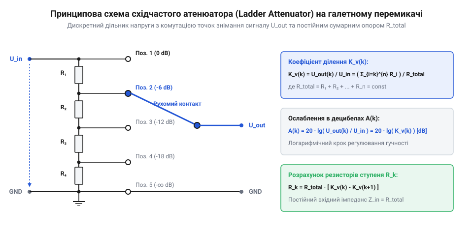

# Математика резистивних матриць та дільників для галетних перемикачів

<preknowlist>
- [Поворотний потенціометр](root:cat-hw-controls/rotary-potentiometer) — розуміння принципу аналогового дільника напруги та лінійних і логарифмічних залежностей опору
</preknowlist>

## Потреба точного ступенчатого регулювання сигналу

Плавнорегульовані резистивні дільники напруги, такі як планарний [поворотний потенціометр](root:cat-hw-controls/rotary-potentiometer) (від латинського potentia — сила та грецького метрон — вимірювати), мають низку неусувних фізичних обмежень. Механічний знос струмопровідної резистивної доріжки під рухомим контактом, температурний дрейф опору та нестабільність перехідного контакту призводять до шумів і розбалансу каналів. У стереофонічних та багатоканальних вимірювальних трактах розбіжність опору двох секцій звичайного потенціометра досягає 10–20 %, що робить неможливим точне й повторюване налаштування коефіцієнта передачі.

Для подолання цих недоліків застосовують атенюатор (від французького atténuer — послаблювати, зменшувати; @@en|attenuator@@) на основі багатопозиційного галетного перемикача з матрицею дискретних прецизійних резисторів. Перехід від ковзного контакту до дискретного перемикання усуває знос доріжки та забезпечує абсолютну відтворюваність встановлених коефіцієнтів ділення. На відміну від аналогових важелів, де виникає [дрейф нуля та зсув нейтралі](root:cat-hw-controls/stick-drift-mitigation), дискретна резистивна матриця на контактах галетного вимикача формує фіксовану сітку напруг із точністю, яка визначається лише допуском обраних резисторів.

Проте на високих частотах дискретна структура галетного перемикача зазнає впливу паразитної ємності монтажу (від латинського capacitas — місткість; @@en|stray capacitance@@), яка виникає між сусідніми пелюстками контактів, провідниками друкованої плати та заземленим металевим шасі. Ця паразитність `C_p`, що зазвичай становить від 1 до 5 пФ на один контактний вузол, створює паралельні шунтувальні шляхи для змінного струму. Оскільки реактивний опір ємності `Z_C` зменшується з ростом частоти `f` за залежністю `Z_C = 1 / (2 · π · f · C_p)`, на високих частотах струм починає протікати в обхід високоомних резисторів дільника. Математичний зв'язок між еквівалентним опором дільника `R` та паразитною ємністю `C_p` визначає верхню граничну частоту зрізу `f_3dB` (за рівнем -3 дБ), вище якої амплітудно-частотна характеристика (@@en|frequency response@@) починає спадати:

```
f_3dB = 1 / (2 · π · R · C_p)
      = 1 / (2 · 3.1416 · 100000 · 5 · 10⁻¹²)    [підстановка опору R = 100 кОм та ємності C_p = 5 пФ]
      = 1 / (3.1416 · 10⁻⁶)                       [перемноження констант та параметрів знаменника]
      ≈ 318310                                    [обчислення граничної частоти в герцах]
```

Отримане значення `f_3dB ≈ 318.3` кГц демонструє, що при високоомній матриці `R = 100` кОм навіть мала паразитність `C_p = 5` пФ істотно обмежує смугу пропускання. Це викликає спадання АЧХ і фазовий зсув на високочастотних складових сигналу, що змушує обмежувати верхню межу опорів дільника або застосовувати ємнісну компенсацію контактних груп.

Математичне проектування дискретного дільника полягає у розрахунку опорів резисторів для кожної позиції перемикача під заданий крок ослаблення сигналу, імпеданс джерела та навантаження.

## Послідовні дільники напруги та логарифмічна шкала

Найпростішою топологією дискретного дільника є ланцюгова резистивна матриця @@en|ladder attenuator@@. Вона складається з послідовно з'єднаних резисторів `R₁`, `R₂`, …, `Rₙ`, приєднаних до контактних пелюсток галетного перемикача. Безпосереднє відведення сигналу з відповідного контакту формує потрібний коефіцієнт передачі напруги `K_v` для позиції `k`:

        K_v(k) = U_out(k) / U_in
        = R_ground(k) / R_total      [законом Ома для послідовного кола]

де `U_in` — вхідна напруга, `U_out(k)` — вихідна напруга на позиції `k`, `R_total` — повний опір ланцюга від входу до землі, а `R_ground(k)` — сумарний опір від контакту `k` до загального проводу.

Для людського слуху та більшості вимірювальних шкал сприйняття інтенсивності є логарифмічним. Тому крок ослаблення визначають у децибелах (від латинського decimus — десятий та прізвища винахідника Белла; @@en|decibel@@). Зв'язок між коефіцієнтом передачі напруги `K_v` та ослабленням `A_dB` виражається співвідношенням:

        A_dB(k) = 20 · log₁₀(U_out(k) / U_in)
        = 20 · log₁₀(K_v(k))         [означення децибела для відношення напруг]

Для обчислення необхідного коефіцієнта передачі `K_v(k)` за заданим рівнем ослаблення `A_dB(k)` формулу перетворюють до показниковій формі:

        K_v(k) = 10^(A_dB(k) / 20)      [показникова форма логарифмічного рівняння]


*Ланцюгова резистивна матриця типу Ladder на контактах галетного перемикача.*

Для заданого повного опору ланцюга `R_total` еквівалентний опір нижнього плеча `R_ground(k)` для кожної ступени обчислюють за формулою:

Вибір базового значення повного опору `R_total` визначає компроміс між навантажувальною здатністю джерела сигналу та завадостійкістю дільника. Якщо обрати `R_total` занадто малим, низький вхідний опір матриці створить надмірний струмовий відбір і спричинить просідання амплітуди на внутрішньому опорі джерела (від англ. @@en|source impedance@@, де source — джерело, а impedance — імпеданс від латинського @@la|impedire@@ — перешкоджати). Якщо ж обрати `R_total` занадто великим (понад 100 кОм), коло стане чутливим до наведення мережевих завад та паразитної ємності монтажу, а також виникне похибка від паралельного підключення вхідного опору навантаження (від англ. @@en|loading effect@@). Оптимальним інженерним вибором вважається значення `R_total`, яке щонайменше в 10–50 разів перевищує вихідний опір джерела сигналу й водночас становить не більше 1/10 від вхідного імпедансу наступного каскаду.

Для математичного врахування шунтувального впливу вхідного опору навантаження `R_L` обчислюють еквівалентний опір паралельно з'єднаного нижнього плеча `R_ground_eq`, де `R_ground` — опір нижнього плеча ненавантаженого дільника. При підключенні навантаження `R_L` паралельно до `R_ground` паралельний опір та скоригований коефіцієнт передачі напруги `K_v_loaded` для верхнього плеча `R_top` знаходять за співвідношеннями:

```
R_ground_eq = (R_ground · R_L) / (R_ground + R_L)
            = (5000 · 20000) / (5000 + 20000)            [підстановка опору нижнього плеча 5 кОм та навантаження 20 кОм]
            = 100000000 / 25000                         [обчислення добутку та суми паралельних гілок]
            = 4000                                      [еквівалентний опір паралельного з'єднання в омах]

K_v_loaded = R_ground_eq / (R_top + R_ground_eq)
           = 4000 / (5000 + 4000)                       [підстановка опорів верхнього плеча та паралельного еквівалента]
           = 4000 / 9000                                [додавання опорів повного завантаженого ланцюга]
           ≈ 0.4444                                     [підсумковий коефіцієнт передачі під навантаженням]
```

Зниження коефіцієнта передачі з номінального значення `K_v = 0.5` (-6 дБ) до `K_v_loaded ≈ 0.4444` (-7.04 дБ) показує, що при співвідношенні `R_L` до `R_ground` як 4 до 1 виникає додаткова похибка ослаблення понад 1 дБ. Це підтверджує необхідність дотримання правила 10-кратного перевищення імпедансу навантаження над опором дільника або попереднього розрахунку матриці з урахуванням відомого номіналу `R_L`.

        R_ground(k) = R_total · K_v(k)      [опір від відводу k до землі]

Значення окремого резистора `R_step(k)`, включеного між контактами `k` та `k-1`, знаходять як різницю опорів сусідніх щаблів:

        R_step(k) = R_ground(k) - R_ground(k+1)      [різниця опорів суміжних позицій]

Розрахуємо номінали для трьохпозиційного атенюатора з загальним опором `R_total = 10000` Ом для ступенів ослаблення 0 дБ, -6 дБ та -12 дБ.

**Розрахунок номіналів трьохпозиційного ланцюгового атенюатора 10 кОм:**

        K_v(1) = 10^(0 / 20) = 1.0              [коефіцієнт передачі на 0 дБ]
        R_ground(1) = 10000 · 1.0 = 10000 Ом    [повний опір]

        K_v(2) = 10^(-6 / 20) ≈ 0.5012          [коефіцієнт передачі на -6 дБ]
        R_ground(2) = 10000 · 0.5012 = 5012 Ом  [опір нижнього плеча]

        K_v(3) = 10^(-12 / 20) ≈ 0.2512         [коефіцієнт передачі на -12 дБ]
        R_ground(3) = 10000 · 0.2512 = 2512 Ом  [опір нижнього плеча]

        R_step(3) = 2512 - 0 = 2512 Ом          [опір першого резистора від землі]
        R_step(2) = 5012 - 2512 = 2500 Ом       [опір другого резистора]
        R_step(1) = 10000 - 5012 = 4988 Ом      [опір верхнього резистора]

Отже, для формування логарифмічних ступенів ослаблення у 6 дБ потрібні дискретні резистори з номіналами 2512 Ом, 2500 Ом та 4988 Ом. Сума цих трьох опорів дає вихідний опір ланцюга 10000 Ом.

## Топології з постійним вхідним опором

При підключенні атенюаторів до джерел та навантажень із чутливими імпедансними характеристиками (наприклад, у вимірювальних трактах або лініях зв'язку) зміна позиції звичайного ланцюгового дільника змінює його вхідний і вихідний опір. Це порушує узгодження імпедансів (від англійського impedance — повний опір; @@en|impedance matching@@), що спричиняє відбиття сигналу та викривлення амплітудно-частотної характеристики.

Для утримання постійного вхідного та вихідного опору `Z₀` незалежно від вибраної сходинки затухання на контактах галетного перемикача комутують спеціалізовані осередки:

1. Г-подібна ланка @@en|L-pad attenuator@@ складається з двох резисторів: послідовного `R₁` та паралельного `R₂`. При коефіцієнті передачі `K_v = U_out / U_in` номінали розраховують за співвідношеннями:

        R₁ = Z₀ · (1 - K_v)                  [послідовний опір плеча]

        R₂ = Z₀ · (K_v / (1 - K_v))          [паралельний опір шунта]

2. Т-подібна ланка @@en|T-pad attenuator@@ забезпечує двостороннє симетричне узгодження імпедансу `Z₀`. Вона має два однакові послідовні резистори `R₁` та один шунтувальний резистор `R₂`:

Математичне виведення опору шунта `R₂` випливає з умови рівності вхідного імпедансу навантаженого осередку заданій величині `Z₀`. Оскільки вхідний опір Т-подібного кола при підключенні навантаження `Z₀` дорівнює послідовному сумуванню плеча `R₁` та еквівалентного паралельного з'єднання шунта `R₂` з гілкою `(R₁ + Z₀)`, вираз для `Z_in` набуває вигляду:

        Z_in = R₁ + (R₂ · (R₁ + Z₀)) / (R₂ + R₁ + Z₀) = Z₀      [умова узгодження імпедансу]

Прирівнюючи `Z_in` до `Z₀` та виконуючи алгебраїчні перетворення, виражаємо шунтувальний опір через `Z₀` та `R₁`:

        Z₀ - R₁ = (R₂ · (R₁ + Z₀)) / (R₂ + R₁ + Z₀)             [перенесення R₁ у ліву частину]
        (Z₀ - R₁) · (R₂ + R₁ + Z₀) = R₂ · (R₁ + Z₀)             [множення на знаменник]
        Z₀² - R₁² = 2 · R₂ · R₁                                [спрощення виразу]
        R₂ = (Z₀² - R₁²) / (2 · R₁)                            [опір шунта через R₁ та Z₀]

Підставляючи в це співвідношення раніше знайдене значення послідовного плеча `R₁ = Z₀ · ((1 - K_v) / (1 + K_v))`, після розкриття дужок і скорочення чисельника дістаємо підсумкову формулу `R₂ = Z₀ · ((2 · K_v) / (1 - K_v²))`, яка гарантує стабільність вхідного опору атенюатора на кожній позиції галетного перемикача.

        R₁ = Z₀ · ((1 - K_v) / (1 + K_v))    [послідовні опори симетричного Т-моста]

        R₂ = Z₀ · ((2 · K_v) / (1 - K_v²))   [поперечний опір центрального шунта]

3. Н-подібна ланка @@en|H-pad attenuator@@ є симетричною мостовою модифікацією Т-моста для збалансованих двопровідних ліній. У ній послідовні опори `R₁` ділять навпіл і розміщують симетрично у верхньому та нижньому провідниках сигналу.

**Розрахунок номіналів Т-подібного атенюатора T-pad на 50 Ом зі зсувом -6 дБ:**

Для обчислення номіналів послідовних резисторів `R₁` та поперечного шунта `R₂` при заданому системному імпедансі `Z₀ = 50` Ом та ослабленні `A_dB = -6` дБ спочатку знаходять коефіцієнт передачі напруги `K_v`, після чого послідовно розраховують опори плечей:

```
K_v = 10^(-6 / 20)
    ≈ 0.5012                                    [переведення рівня ослаблення -6 дБ у коефіцієнт передачі]

R₁ = Z₀ · ((1 - K_v) / (1 + K_v))
   = 50 · ((1 - 0.5012) / (1 + 0.5012))         [підстановка Z₀ = 50 Ом та K_v = 0.5012]
   = 50 · (0.4988 / 1.5012)                    [обчислення різниці та суми коефіцієнтів]
   = 50 · 0.3323                                [ділення чисельника на знаменник]
   ≈ 16.61                                      [опір кожного з двох послідовних резисторів R₁ в омах]

R₂ = Z₀ · ((2 · K_v) / (1 - K_v²))
   = 50 · ((2 · 0.5012) / (1 - 0.5012²))        [підстановка значень K_v та Z₀ у формулу шунта]
   = 50 · (1.0024 / (1 - 0.2512))               [обчислення подвоєного K_v та квадрата коефіцієнта]
   = 50 · (1.0024 / 0.7488)                     [різниця у знаменнику]
   = 50 · 1.3387                                [ділення чисельника на знаменник]
   ≈ 66.93                                      [опір центрального шунтувального резистора R₂ в омах]
```

Отримані значення `R₁ ≈ 16.61` Ом та `R₂ ≈ 66.93` Ом показують, що для збереження 50-омного узгодження вхідного й вихідного імпедансів при зменшенні напруги вдвічі (-6 дБ) Т-подібний осередок вимагає симетричного включення двох резисторів по 16.61 Ом у сигнальну лінію та шунта 66.93 Ом на землю.


*Еквівалентні топологічні структури атенюаторів L-pad, T-pad та симетричного H-pad.*

Завдяки комутації таких осередків галетним перемикачем джерело сигналу завжди бачить стабільне навантаження `Z₀`, що усуває викривлення сигналу при переході між ступенями.

## Похибки номіналів та вибір стандартних рядів

Теоретичний розрахунок дільників дає дробові значення опорів (наприклад, 2512 Ом для ослаблення -6 дБ). Промислові резистори виготовляють за стандартизованими рядами допусків (від латинського tolerantia — терпіння, допустиме відхилення; @@en|tolerance series@@) E24 (допуск ±5 %) та E96 (допуск ±1 %).

При виборі найближчого реального номінала з ряду виникає похибка коефіцієнта передачі напруги `δK_v`. Для дійсних опорів `R_ground,act(k)` та `R_total,act` фактичний коефіцієнт передачі `K_v,act(k)` становить:

Окрім вихідного допуску виготовлення, на точність коефіцієнта передачі суттєво впливає температурний дрейф (від англійського @@en|drift@@ — зсув; температурна зміна опору). Відносну зміну опору `ΔR / R₀` визначають через температурний коефіцієнт опору (від латинського *coefficiens* — той, що сприяє, та *resistere* — протистояти; @@en|temperature coefficient of resistance@@, TCR), який вимірюють у мільйонних частках на градус Цельсія (від англійського @@en|parts per million@@; `ppm/°C`). При зміні температури від кімнатної `25 °C` до робочої `75 °C` (перепад `ΔT = 50 °C`) порівняємо металоплівкові резистори (від англійського @@en|metal film resistor@@) серії E96 з `TCR = 50 ppm/°C` та дешевші вуглецеві резистори (від англійського @@en|carbon film resistor@@) серії E24 з `TCR = 500 ppm/°C`. Відносну температурну деформацію опору обчислюють за формулою:

        ΔR / R₀ = TCR · ΔT                              [відносна зміна опору]
        (ΔR / R₀)_E24 = 500 · 10⁻⁶ · 50 = 0.025         [дрейф вуглецевого резистора: 2.5 %]
        (ΔR / R₀)_E96 = 50 · 10⁻⁶ · 50 = 0.0025         [дрейф металоплівкового резистора: 0.25 %]

У разі градієнта температур між плечима дільника зміна опору вуглецевих резисторів E24 на `2.5 %` спричиняє додатковий дрейф ослаблення `δA_dB ≈ 20 · log₁₀(1 + 0.025) ≈ 0.215 дБ`, що повністю перекреслює точність прецизійного атенюатора. Застосування металоплівкових резисторів E96 обмежить температурне відхилення згасання величиною `δA_dB ≈ 20 · log₁₀(1 + 0.0025) ≈ 0.0217 дБ ≤ ±0.02 дБ`, гарантуючи стабільність метрологічних характеристик пристрою у всьому діапазоні робочих температур.

        K_v,act(k) = R_ground,act(k) / R_total,act      [фактичний коефіцієнт передачі]

Відхилення фактичного ослаблення в децибелах `A_dB,act(k)` від цільового `A_dB,target(k)` знаходять як різницю:

        A_dB,act(k) = 20 · log₁₀(K_v,act(k))            [фактичне ослаблення у децибелах]

        δA_dB(k) = A_dB,act(k) - A_dB,target(k)         [абсолютна похибка ступеня ослаблення]

**Приклад оцінки похибки для ряду E24:**
Для теоретичного значення `R_step(3) = 2512` Ом найближчим номіналом E24 є `2400` Ом (відхилення -4.4 %). Для розрахункового `R_step(1) = 4988` Ом найближчим з E24 є `5100` Ом (+2.2 %).

        K_v,act(2) = (2400 + 2500) / (2400 + 2500 + 5100)
        = 4900 / 10000      [сума номіналів E24]
        = 0.49               [фактичний коефіцієнт передачі]

        A_dB,act(2) = 20 · log₁₀(0.49)
        ≈ -6.195 дБ          [фактичне ослаблення]

        δA_dB = -6.195 - (-6.0) = -0.195 дБ      [похибка ослаблення]

Для побудови вимірювальних дільників використання рядів E24 дає неприпустиме відхилення майже 0.2 дБ. Застосування резисторів ряду E96 (з найближчими номіналами 2490 Ом та 4990 Ом) зменшує похибку ослаблення до менш ніж ±0.02 дБ, що забезпечує високу точність та рівномірність кроку ступенчатого регулювання.

Для повного обліку технологічного розкиду оцінюють граничну накопичувану похибку за методом найгіршого випадку (від англ. @@en|worst-case analysis@@), коли виробничі відхилення опорів верхнього та нижнього плечей дільника додаються у найнесприятливішому напрямку. При номінальному допуску резисторів `ε` найгірший випадок відхилення коефіцієнта передачі `K_v` виникає при збільшенні опору нижнього плеча `R_g` на `+ε` та одночасному зменшенні опору верхнього плеча `R_s` на `-ε`. Гранична похибка ослаблення в децибелах `δA_dB,max` обчислюється через відношення відхилень:

        δA_dB,max = 20 · log₁₀((1 + ε) / (1 - ε))       [гранична похибка за методом найгіршого випадку]
        = 20 · log₁₀(1.01 / 0.99)                        [підстановка допуску ε = 0.01 для ряду E96]
        ≈ 20 · log₁₀(1.0202)                            [обчислення відношення верхньої і нижньої меж]
        ≈ 0.172 дБ                                      [максимальне відхилення ослаблення]

Для прецизійних металоплівкових резисторів серії E96 із допуском `ε = ±1 %` граничне розходження згасання в найгіршому випадку не перевищує `0.172 дБ`, тоді як для вуглецевих резисторів E24 з допуском `ε = ±5 %` накопичена похибка сягає `0.87 дБ`, що робить E96 єдиним прийнятним вибором для вимірювальних атенюаторів.
