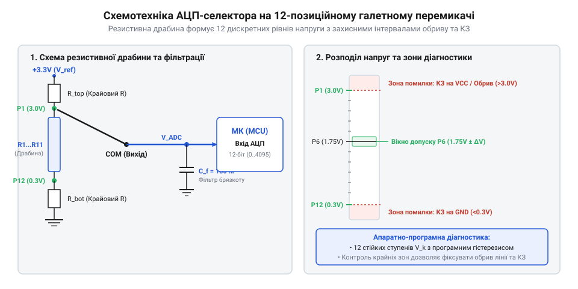

# Практичний модуль зчитування 12-позиційного галетного перемикача через один аналоговий вхід

<preknowlist>
- [Поворотний потенціометр](root:cat-hw-controls/rotary-potentiometer) — Принцип роботи аналогового дільника напруги та зчитування потенціалу за допомогою АЦП.
- [Дрейф нуля та калібрування органів вводу](root:cat-hw-controls/stick-drift-mitigation) — Вплив температурного дрейфу та шуму АЦП на стабільність виміряних значень.
</preknowlist>

## Проблема дефіциту GPIO та ідея резистивного дільника

При спроєктуванні інтерфейсів панелей керування часто виникає потреба зчитувати стан багатопозиційних селекторів режиму. Класичний 12-позиційний галетний перемикач (від французького Класичний 12-позиційний галетний перемикач (від французького @@fr|galette@@ — «коржик», через форму ізоляційних дисків-секцій) у разі прямого підключення вимагає 12 окремих цифрових ліній вводу-виводу (від англ. @@en|GPIO@@). У малогабаритних мікроконтролерах виділення 12 виводів під єдиний орган керування є неприпустимою розкішшю, адже це вичерпує ресурс пінів, ускладнює розводку друкованої плати та збільшує кількість дротів у з'єднувальному шлейфі.

Паралельне зчитування також вимагає підтягувальних резисторів на кожній лінії та збільшує ймовірність відмови через обрив одного з численних провідників. Раціональним розв'язком є перетворення 12 дискретних механічних станів перемикача на 12 відповідних рівнів напруги. Для цього застосовують прецизійну резистивну драбину, з'єднану послідовно між джерелом живлення та землею. 

Рухомий контакт-повзунок галетного селектора під'єднується до єдиного входу аналого-цифрового перетворювача (від англ. @@en|ADC@@; далі — АЦП). У кожній фіксованій позиції повзунок підключається до відповідного вузла дільника, формуючи унікальний аналоговий потенціал. Такий підхід дає змогу реалізувати аналогове зчитування положення, подібне до принципів роботи [поворотного потенціометра](root:cat-hw-controls/rotary-potentiometer), але з чіткими механічними фіксаторами позицій.

Під час фізичного повороту ручки селектор переходить між сусідніми позиціями, і поведінка напруги на аналоговому вході суттєво залежить від механічної конструкції контактної групи перемикача. У перемикачах із розмиканням перед замиканням (від англ. @@en|break-before-make@@; далі — BBM) рухомий контакт спочатку повністю від'єднується від поточного вузла дільника і лише потім торкається наступного. У цей проміжний момент (тривалістю від 1 до 10 мс) сигнальна лінія короткочасно перебуває у високоімпедансному підвішеному стані, через що потенціал на вході АЦП може довільно дрейфувати або підтягуватися до крайніх значень. У перемикачах із замиканням перед розмиканням (від англ. @@en|make-before-break@@; далі — MBB) повзунок спочатку закорочує два сусідні вузли резистивної драбини, тимчасово шунтуючи міжпозиційний резистор, і лише потім розмикає попередній контакт. При MBB-конфігурації проміжний потенціал завжди лишається строго в діапазоні між двома сусідніми робочими напругами, унеможливлюючи вихід сигналу в аварійні зони АЦП, тоді як імпульсні сплески BBM-перемикачів легко усуваються медіанним фільтром та апаратною ємністю.

Основними перевагами аналогового селектора є економія 11 цифрових ліній МК та скорочення шлейфу до 3 провідників (живлення `V_CC`, земля `GND` та сигнал `V_signal`). Обмеженнями методу є чутливість до шуму живлення, температурного дрейфу опору та брязкоту контактів під час перемикання, що вимагає апаратно-програмного захисту.

## Розрахунок резистивної драбини та температурна стабільність

Для забезпечення максимальної завадостійкості 12-позиційного аналогового селектора резистивну драбину розраховують так, щоб кроки напруги між сусідніми позиціями були однаковими. Якщо використати 11 однакових міжпозиційних резисторів з однаковим номіналом `R`, то напруга на $k$-й позиції (де $k = 0 \dots 11$) розраховується за формулою:

V_k = V_CC · (k ÷ 11)      [рівномірний розподіл напруг на 12 позиціях]

Для 12-бітного АЦП із розмахом від 0 до 4095 відліків ідеальній $k$-й позиції відповідає код:

ADC_k = 4095 · (k ÷ 11)      [розрахунок еталонного відліку АЦП]

Крок між сусідніми рівноважними значеннями становить приблизно 372 відліки АЦП (близько 300 мВ при живленні 3.3 В). Однак реальні резистори мають допуск відхилення опору. При використанні 5% резисторів накопичена похибка ланцюга з 11 елементів може змістити рівні напруги на $\pm 2.5\%$, звужуючи завадозахисний зазор. Застосування прецизійних прецизійних SMD-резисторів із допуском 1% гарантує відхилення потенціалів у межах $\pm 0.5\%$.

Важливим фактором є температурний коефіцієнт опору (від англ. @@en|TCR@@). Якщо всі резистори драбини виконані за єдиною технологією на спільній підкладці, їхній опір дрейфує синхронно. Оскільки коефіцієнт ділення залежить від відношення $R_{bottom} / R_{total}$, пропорційна зміна опору не змінює вихідну напругу. Виклики дрейфу виникають лише при витоках струму або зміні вхідного опору АЦП, що вимагає застосування методів, описаних у матеріалах про [дрейф нуля органів вводу](root:cat-hw-controls/stick-drift-mitigation). 

При виборі абсолютного номіналу резисторів драбини `R` інженер шукає компроміс між стаціонарним енергоспоживанням та вхідним опором АЦП. Занадто малий опір (наприклад, `R = 100 Ом`, що дає загальний опір драбини близько 1.3 кОм) призводить до безперервного струму споживання понад 2.5 мА при живленні `V_CC = 3.3 В`. Для пристроїв із батарейним живленням таке паразитне споживання є неприпустимим, а самонагрів елементів створює локальні температурні градієнти. З іншого боку, надто високий опір (`R = 100 кОм`, загальний опір понад 1.2 МОм) формує високий еквівалентний вихідний опір дільника (до 300 кОм у середніх позиціях). Оскільки АЦП послідовного наближення (від англ. @@en|SAR ADC@@) використовує внутрішню ємність вибірки-зберігання `C_sample` (близько 5...15 пФ), високий опір джерела затягує час її заряджання `t_sample`. Якщо час вибірки АЦП закороткий, ємність не встигає зарядитися до реального потенціалу, викликаючи грубі похибки вимірювання. Оптимальним вибором для більшості мікроконтролерів є номінали `R` від 1 кОм до 10 кОм, що забезпечують струм споживання на рівні 25...250 мкА та гарантують точне зчитування АЦП без використання додаткових операційних підсилювачів.

Межі вирішальних інтервалів (пороги декодування) встановлюють точно посередині між сусідніми еталонними значеннями. Це забезпечує максимальний захисний інтервал $\pm 186$ відліків АЦП відносно центру кожної позиції.

## Схемотехніка модуля та апаратний захист ліній

Пряме підключення першої позиції до `GND` (0 В), а останньої — до `V_CC` створює апаратну невизначеність: відлік АЦП 0 не дає змоги відрізнити валідну позицію 0 від короткого замикання (КЗ) шлейфу на землю, а значення 4095 не відрізняється від обриву сигнального провідника чи замикання на VCC.

Еквівалентний вихідний опір дільника `R_out` змінюється залежно від вибраної позиції і досягає максимуму в середньому положенні ручки. Для драбини з номіналами міжпозиційних резисторів `R = 1 кОм` (загальний опір `R_total ≈ 13 кОм`) найвищий вихідний опір становить `R_out ≈ R_total ÷ 4 ≈ 3.25 кОм`. При використанні фільтруючого конденсатора `C_f = 100 нФ` стала часу RC-фільтра (від англ. @@en|time constant@@) обчислюється як:

τ = R_out · C_f = 3.25 кОм · 100 нФ = 325 мкс      [стала часу RC-фільтра]

Перехідний процес встановлення напруги на рівні 99% від кінцевого значення триває близько 5τ, що становить `t_settle ≈ 1.6 мс`. Така затримка є абсолютно непомітною для людини при ручному перемиканні (де час повороту ручки становить понад 50 мс), але повністю відсікає високочастотні імпульсні завади. Для підбору ємності за критерієм частоти зрізу використовують формулу f_c = 1 / (2 * pi * R_out * C_f). Щоб забезпечити частоту зрізу вище 100 Гц (f_c > 100 Гц) і без запізнень відстежувати ручне обертання селектора, критична ємність для R_out = 3.25 кОм становить C_f < 1 / (2 * pi * 3250 * 100) ≈ 489 нФ. Обираючи стандартний керамічний конденсатор C_f = 100 нФ, отримують частоту зрізу f_c ≈ 490 Гц, яка впевнено перевищує поріг 100 Гц і зберігає високу динаміку розпізнавання позицій. Проте безпідставне збільшення ємності (наприклад, до `C_f = 10 мкФ` при `R = 10 кОм`) розганяє сталу часу до `τ ≈ 325 мс` (що знижує частоту зрізу до всього f_c ≈ 0.49 Гц), внаслідок чого напруга встановлюється понад 1.5 секунди. Це викликає «повільність» сигналу, коли при швидкому обертанні ручки АЦП зчитує запізнілі проміжні рівні напруги, зумовлюючи хибні спрацьовування селектора.

*Принципова схема 12-позиційного аналогового селектора з захисними крайовими резисторами та діаграмою розподілу відліків АЦП на робочі діапазони й аварійні зони.*

Паралельно сигнальній лінії та землі встановлюють керамічний фільтруючий конденсатор $C_f$ ємністю 10...100 нФ. Завдяки вихідному опору резистивної драбини утворюється аналоговий фільтр низьких частот, який згладжує високочастотні імпульсні наводки та поглинає мікрокороткі сплески при перемиканні контактів.

τ = R_out · C_f = 3.25 кОм · 100 нФ = 325 мкс      [стала часу RC-фільтра]

Перехідний процес встановлення напруги на рівні 99% від кінцевого значення триває близько 5τ, що становить `t_settle ≈ 1.6 мс`. Така затримка є абсолютно непомітною для людини при ручному перемиканні (де час повороту ручки становить понад 50 мс), але повністю відсікає високочастотні імпульсні завади. Проте безпідставне збільшення ємності (наприклад, до `C_f = 10 мкФ` при `R = 10 кОм`) розганяє сталу часу до `τ ≈ 325 мс`, внаслідок чого напруга встановлюється понад 1.5 секунди. Це викликає «повільність» сигналу, коли при швидкому обертанні ручки АЦП зчитує запізнілі проміжні рівні напруги, зумовлюючи хибні спрацьовування селектора.

## Програмна обробка з гістерезисом та антибрязкотом

Програмний алгоритм опитування аналогового селектора виконує три послідовні етапи: фільтрацію шуму, перевірку аварійних зон та декодування позиції з гістерезисом і придушенням брязкоту.

Першим етапом є медіанна фільтрація трьох послідовних відліків АЦП, яка повністю усуває поодинокі викиди напруги (спайки), не розмиваючи фронт переходу між позиціями. Далі перевіряються крайні аварійні зони: якщо відфільтроване значення менше за `min_valid_adc` (менше 100), фіксується КЗ на землю (`ROTARY_STATUS_ERR_SHORT_GND`); якщо більше за `max_valid_adc` (більше 4000) — обрив лінії (`ROTARY_STATUS_ERR_OPEN_CIRCUIT`).

Для усунення миготіння стану на межі діапазонів застосовують цифровий гістерезис (від грец. @@el|hysteresis@@ — «запізнення»). Для поточно підтвердженої позиції розрахована відстань до еталонного рівня зменшується на ширину вікна гістерезису `hysteresis_window`, що створює зональне затримання і виключає перемикання при дрібних пульсаціях АЦП.

При фізичному повороті ручки виникає брязкіт контактів (від англ. @@en|contact bounce@@). Програмний антибрязкіт вимагає, щоб нова визначена позиція утримувалася неперервно протягом часу `m_debounceMs` (наприклад, 30 мс). Лише після завершення цього інтервалу оновлюється підтверджена позиція та генерується подія для системи.

Управління обробкою сигналів будується на базі кінцевого автомата станів (англ. *finite-state machine*; далі — @@en|FSM@@), що запобігає передачі хибних даних при пошкодженні кабельної лінії. При виявленні аварійних відліків АЦП (короткого замикання `ROTARY_STATUS_ERR_SHORT_GND` чи обриву `ROTARY_STATUS_ERR_OPEN_CIRCUIT`) автомат негайно переходить у відповідний фатальний стан, обнуляє підтверджену позицію `current_position = -1` та скидає таймери часової фільтрації. Обробка аварійних станів виконується з найвищим пріоритетом без очікування інтервалу антибрязкоту, що дає змогу вищій програмній логіці миттєво зреагувати на відмову селектора та перевести систему в безпечний режим.

Структуру інтерфейсу драйвера та базову конфігурацію на мові C визначено у заголовному файлі:

:::code proj-rotary-adc-selector/c/include/rotary_adc_selector.h 20-48

Алгоритм неблокуючого оновлення стану з медіанною фільтрацією та перевіркою аварійних зон реалізовано у C-файлі:

:::code proj-rotary-adc-selector/c/src/rotary_adc_selector.c 61-104

Об'єктно-орієнтований клас-декодер для C++ з обробкою антибрязкоту та генерацією подій реалізовано наступним чином:

:::tabs
@C++
:::code proj-rotary-adc-selector/cpp/RotarySelector.h 9-23
:::code proj-rotary-adc-selector/cpp/RotarySelector.cpp 57-120
@Arduino
:::code proj-rotary-adc-selector/cpp/sketch.ino 36-43
:::
