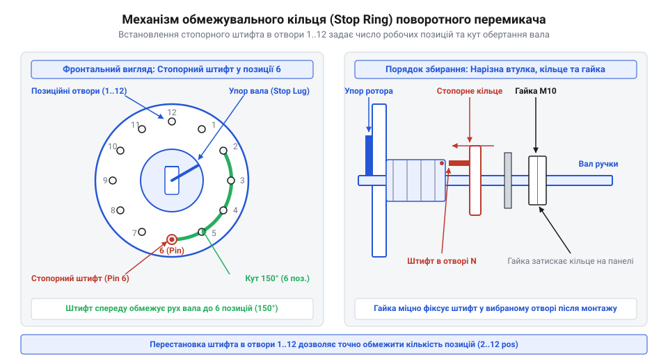
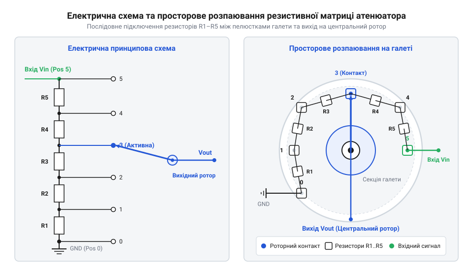

# Розробка та збирання багаторежимного аудіоселектора або декадного прецизійного перемикача

<preknowlist>
- [Поворотний потенціометр](root:cat-hw-controls/rotary-potentiometer) — принцип дільника напруги та плавного регулювання опору
- [KY-040 — поворотний енкодер](root:cat-hw-controls/ky-040-encoder) — відмінність дискретної цифрової комутації від аналогового галетного перемикача
</preknowlist>

## Проблема наводок і обмеження позицій

Під час комутації аналогових звукових сигналів низького рівня першорядним завданням є збереження чистоти тракту. Використання стандартного багатопозиційного галетного перемикача (від фр. *galette* — плаский диск/корж; далі — @@fr|galette@@) у звукових ланцюгах без попереднього налаштування призводить до виникнення трьох основних проблем.

Перша проблема — виникнення надлишкових незадіяних позицій. Серійні поворотні перемикачі (@@en|rotary switch@@) зазвичай мають 12 фізичних положень фіксації вала. Якщо розроблюваний аудіоселектор має лише 4 вхідні канали (наприклад, CD-плеєр, ЦАП, вініловий програвач та AUX), то під час повернення ручки у положення з 5 по 12 вхідний контакт підсилювача залишається підключеним до «висячого» виводу галети. Ненавантажений високоімпедансний вхід працює як антена, яка вловлює електромагнітні завади та наведення мережевого гулу 50 Гц від трансформаторів живлення.

Друга проблема — перехідні завади та акустичні клацання під час перемикання. Конструкція контактної групи визначає порядок комутації: у механізмах розмикання перед замиканням (від англ. *break-before-make*; далі — @@en|break-before-make@@) рухомий контакт повністю залишає попередню пелюстку до торкання наступної, через що ланцюг на частку мілісекунди опиняється у відкритому стані. Вхід підсилювача на цей час стає високоімпедансним вузлом, що накопичує статичний заряд і спричиняє різкий стрибок постійної складової напруги — гучний акустичний «поп-шум» у динаміках. Натомість у механізмах замикання перед розмиканням (від англ. *make-before-break*; далі — @@en|make-before-break@@) рухомий контакт мостом перекриває дві сусідні пелюстки, короткочасно шунтуючи їх між собою. Для регуляторів гучності та атенюаторів це гарантує безперервність кола заземлення та відсутність клацань, оскільки опір дільника змінюється плавно без обриву сигналу. Докладніше про порівняння контактних груп та динаміку перехідних процесів читайте у матеріалі про [комутаційні механіки MBB та BBM](root:cat-hw-controls/make-before-break-switches).

Третя проблема — паразитна міжканальна наводка. Внутрішні виводи контактних галет розташовані на близькій відстані один від одного. За відсутності надійного екранування високочастотні складові з сусідніх неактивних джерел через паразитну ємність проникають у робочий канал звуку.

Для усунення цих завад формуються чіткі технічні вимоги до прецизійного пристрою:
1. Механічне обмеження кута обертання вала строго під кількість активних каналів за допомогою стопорного кільця (від англ. *stop ring* — обмежувальне кільце; далі — @@en|stop ring@@).
2. Застосування дискретної резистивної матриці — ступенчастого атенюатора (від лат. *attenuare* — зменшувати, послаблювати; далі — @@lat|attenuator@@) замість вуглецевого доріжкового елемента.
3. Екранування всього галетного блоку в металевому корпусі з єдиною точкою заземлення.

На відміну від [плавного поворотного потенціометра](root:cat-hw-controls/rotary-potentiometer), дискретний галетний атенюатор забезпечує ідеальну симетрію стереоканалів (з точністю до 0.1 дБ) і відсутність зношування протирального контакту. Водночас, порівняно з [поворотним цифровим енкодером KY-040](root:cat-hw-controls/ky-040-encoder), галетний перемикач є повністю пасивним елементом, який не створює цифрових завад і не потребує мікроконтролерного живлення.

## Конфігурація позицій стопорним кільцем

Щоб механічно обмежити хід поворотного вала відповідно до обраної кількості робочих позицій (наприклад, звузити 12-позиційну галету до 4 положень), у конструкції галетного перемикача передбачено механізм регульованого стопоріння.

Основою механізму є фіксувальна шайба зі @@en|stop ring@@ та кульковий пружинний фіксатор. На лицьовій частині металевого корпусу перемикача навколо центральної втулки розташовано кільце з фіксувальних отворів, пронумерованих від 1 до 12. 

Механізм обмеження кута працює так:
1. Усіредині корпусу на поворотному валу закріплено профільний кулачок із пружинними кульками, які забезпечують чіткі дискретні клацання.
2. Металевий штифт стопорного кільця виступає всередину корпусу крізь один із пронумерованих отворів лицьової панелі.
3. Під час обертання вала за годинниковою стрілкою внутрішній упор кулачка доходить до вставленого штифта й фізично блокує подальший поворот.
Максимальна кількість фіксованих положень визначається кутовим кроком позиціонування фіксувальної шайби: при стандартному кроку 30° кожна позиція відповідає одному з 12 отворів по колу 360°, тоді як використання прецизійних шайб із кутовим кроком 15° дає змогу розмістити 24 отвори, подвоюючи роздільну здатність перемикання при збереженні діаметра корпусу.

Для переконфігурації кількості позицій виконують такі дії:
1. Знімають зовнішню фіксувальну гайку з різьбової втулки вала.
2. Знімають пружинну шайбу та дістають стопорне кільце з позиціонувальним штифтом.
3. Встановлюють вихідний контакт у положення 1 (крайнє проти годинникової стрілки).
4. Суміщають штифт @@en|stop ring@@ з отвором, номер якого відповідає необхідній кількості робочих каналів $N$ (наприклад, отвір 4 для чотирьохпозиційного селектора).
5. Надягають шайбу назад на втулку та затягують гайку.


*Порядок встановлення позиціонувального штифта стопорного кільця у відповідні отвори фіксувальної шайби для обмеження кута обертання вала.*

Після цього вал перемикача чітко фіксується у діапазоні позицій від 1 до $N$, виключаючи прокручування на непідключені контакти.

## Розрахунок і монтаж резистивної матриці

Дискретний ступенчастий @@lat|attenuator@@ регулює амплітуду сигналу шляхом перемикання між прецизійними резистивними дільниками напруги на кожному кроці.

Наприклад, при розрахунку L-подібного ступеня згасання на `-6 дБ` для дільника з номінальним вхідним опором `Z_in = 10 кОм` цільовий коефіцієнт передачі напруги становить `K = 10^(-6 / 20) ≈ 0.5012`. За формулами L-pad ідеальний опір послідовного плеча дорівнює `R_s = 10000 · (1 - 0.5012) = 4988 Ом` (або `4.988 кОм`), а паралельного — `R_p = 10000 · 0.5012 = 5012 Ом` (або `5.012 кОм`). При доборі номіналів зі стандартного ряду E24 обидва опори апроксимуються близьким значенням `5.1 кОм`, що дає коефіцієнт передачі `K = 0.5000` і фактичне згасання `-6.02 дБ`, тоді як використання прецизійного ряду E96 дозволяє вибрати номінали `4.99 кОм` для `R_s` та `5.11 кОм` для `R_p`, забезпечуючи високу точність узгодження імпедансу та мінімальну похибку амплітуди.

```
K = V_out / V_in
  = 10^(A_dB / 20)      [переведення децибел у коефіцієнт напруги]
```

Для класичної Г-подібної ланки (від англ. *L-pad*; далі — @@en|L-pad@@) з фіксованим вхідним опором $Z_{\text{in}}$ опори послідовного плеча $R_s$ та паралельного плеча $R_p$ обчислюються за формулами:

```
R_p = Z_in · K          [розрахунок паралельного опору]
R_s = Z_in · (1 - K)    [розрахунок послідовного опору]
```

Оскільки теоретично розраховані значення опорів є ідеальними числами, під час практичної збірки їх апроксимують найближчими номіналами зі стандартних виробничих рядів E24 (допуск 5%) або прецизійного ряду E96 (допуск 1%).

Наприклад, при розрахунку L-подібного ступеня згасання на $-6\text{ дБ}$ для дільника з номінальним вхідним опором $Z_{\text{in}} = 10\text{ кОм}$ цільовий коефіцієнт передачі напруги становить $K = 10^{-6 / 20} \approx 0.5012$. За формулами L-pad ідеальний опір послідовного плеча дорівнює $R_s = 10000 \cdot (1 - 0.5012) = 4988\text{ Ом}$ (або $4.988\text{ кОм}$), а паралельного — $R_p = 10000 \cdot 0.5012 = 5012\text{ Ом}$ (або $5.012\text{ кОм}$). При доборі номіналів зі стандартного ряду E24 обидва опори апроксимуються близьким значенням $5.1\text{ кОм}$, що дає коефіцієнт передачі $K = 0.5000$ і фактичне згасання $-6.02\text{ дБ}$, тоді як використання прецизійного ряду E96 дозволяє вибрати номінали $4.99\text{ кОм}$ для $R_s$ та $5.11\text{ кОм}$ для $R_p$, забезпечуючи високу точність узгодження імпедансу та мінімальну похибку амплітуди.

Монтаж резистивної матриці виконується методом об'ємного 3D-розпаювання безпосередньо на пелюстках галетного блоку (далі — @@en|deck@@):
1. **Формування центральної шини землі**: З лудженого мідного дроту діаметром 1.0–1.2 мм вигинається кільцеве заземлювальне коло, яке приюється до центрального виводу спільного контакту галети.
2. **Монтаж резистивної драбини**: Послідовні резистори запаюються між сусідніми бічними пелюстками по колу галети. Паралельні резистори розпаюються радіально від кожної бічної пелюстки до центральної шини землі.
3. **Термокомпенсація**: Виводи резисторів формуються з невеликим вигином (компенсаційною петлею) для запобігання механічному напруженню на керамічну основу галети під час паяння.


*Підключення вхідних резисторів до виводів галетного блоку та центральної вихідної шини.*

Нижче наведено програмні модулі мовами C та C++ для автоматизованого обчислення опорів резистивної матриці атенюатора та підбору оптимальних номіналів з рядів E24/E96.

:::tabs
@tab C
:::code proj-rotary-decade-attenuator-or-selector/c/attenuator_calc.h
:::code proj-rotary-decade-attenuator-or-selector/c/attenuator_calc.c 88-134
:::code proj-rotary-decade-attenuator-or-selector/c/main.c 28-37
@tab C++
:::code proj-rotary-decade-attenuator-or-selector/cpp/include/attenuator_calculator.hpp 20-43
:::code proj-rotary-decade-attenuator-or-selector/cpp/src/attenuator_calculator.cpp 74-128
:::code proj-rotary-decade-attenuator-or-selector/cpp/src/main.cpp 6-17
:::

## Екранування та корпусний монтаж блоку

Під час проходження низькорівневих аналогових сигналів крізь високоомні резистивні кола дільника будь-які зовнішні електромагнітні поля від трансформаторів живлення чи бездротових мереж наводять завади у чутливих вузлах.

Для повної ізоляції галетного блоку застосовують комплексний екранований монтаж:
1. **Металевий заземлений корпус (Клітка Фарадея)**: Галетний блок у зборі монтується всередину герметичного алюмінієвого або фрезерованого металевого корпусу. Металева оболонка виконує роль клітки Фарадея (від англ. *Faraday cage*; далі — @@en|Faraday cage@@), що блокує проникнення зовнішніх електричних полів до внутрішнього розпаювання. Для ефективного екранування не лише електричної, а й низькочастотної магнітної складової завад (наприклад, мережевого гулу 50 Гц від силових трансформаторів) товщина стінок корпусу має становити щонайменше 2–3 мм, оскільки тонка фольга чи тонколистовий метал неефективні проти магнітних полів через малу глибину скін-шару.
2. **Точкове заземлення та розводка шини землі**: Спільний заземлювальний провід резистивної матриці з'єднується з металевим корпусом строго в одній точці — біля вхідних роз'ємів. Для запобігання утворенню земляних петель роз'єми ізолюють від корпусу текстолітовими або нейлоновими шайбами, повертаючи струми завад по центральній заземлювальній шині.
3. **Механічне ущільнення поворотного вала**: У приладах із підвищеними вимогами до надійності втулка поворотного вала оснащується кільцевим ущільнювачем — @@de|O-Ring@@ (від нім. *O-Ring* — кільце ущільнення круглого перерізу; далі — @@de|O-Ring@@). Еластомірне кільце закладається у канавку різьбової втулки перед встановленням на передню панель. Затягування монтажної гайки стискає ущільнювач, забезпечуючи захист класу IP65 від пилу та вологи без погіршення плавності обертання. Правила побудови зіркоподібної топології заземлення та екранування чутливих вузлів описано у статті про [екранування та заземлення аналогових аудіокіл](root:hw-pcb/audio-shielding-grounding).

У результаті збирання утворюється механічно міцна, повністю екранована конструкція, готова до тривалої експлуатації.

## Інструментальне випробування та вимірювання характеристик

Після завершення корпусного монтажу зібраний дискретний @@lat|attenuator@@ піддається інструментальній перевірці для підтвердження розрахованого згасання та перевірки надійності контактних груп.

**Методика вимірювань**:
1. На вхідні гнізда атенюатора від генератора сигналів подається синусоїдальний тестовий імпульс амплітудою 1.0 В (RMS) на частоті `f = 1 kHz`.
2. До виходу підключається еквівалент навантаження `R_L = 100 kOhm` та двоканальний осцилограф (від лат. *oscillare* — коливатися та грец. *skopeo* — дивитися; далі — @@en|oscilloscope@@) або високоточний мілівольтметр змінного струму.
3. Послідовно перемикаючи ручку від позиції 1 (0 дБ) до крайнього положення, фіксують вихідну напругу `V_out` та обчислюють фактичне ослаблення:

```
A_meas_dB = 20 · log10(V_out / V_in)    [обчислення фактичного згасання]
```

**Перевірка контактних параметрів**:
- **Перехідний опір контактів (`R_contact`)**: Вимірюється мікроомметром за чотирипровідною схемою. У якісному перемикачі зі срібними або золоченими покриттями `R_contact < 15 mOhm`. Стрибки опору свідчать про забруднення пелюсток флюсом або слабкий притиск пружини.
- **Відсутність перехідних розривів**: На екрані осцилографа під час швидкого обертання вала контролюють формоутворення сигналу. Відсутність хаотичних сплесків підтверджує правильну роботу контактної групи.
- **Міжканальне проникання (@@en|crosstalk@@)**: На частоті `f = 20 kHz` подається максимальний сигнал на сусідній неактивний канал. Згасання завади між суміжними контактами галети (від англ. *crosstalk*; далі — @@en|crosstalk@@) має бути не гіршим за -80 дБ.

Після завершення пайки та первинних вимірювань контактну групу піддають хімічному очищенню ізопропіловим спиртом або спеціалізованим аерозолем для промивки контактів (Contact Cleaner), щоб повністю видалити залишки каніфольного флюсу та жирові забруднення, які з часом викликають окислення. Для оцінки зносостійкості пристрій піддають циклічному тестуванню — виконують серію з 10 000–25 000 повних перемикань вала з наступним повторним контролем $R_{contact}$. Якщо покриття контактів (срібло або золото) не витерлося до латунної основи, перехідний опір зберігається у межах початкових 15 мОм, підтверджуючи ресурсну надійність механізму. Детальні поради щодо хімічного видалення оксидів та вибору розчинників викладено у інструкції про [сервісне обслуговування та очищення галетних контактів](root:cat-hw-controls/contact-cleaners-maintenance).

Нижче наведено фрагмент програмного модуля розрахунку, що генерує підсумкову таблицю порівняння ідеальних та фактичних характеристик дільника:

:::tabs
@tab C
:::code proj-rotary-decade-attenuator-or-selector/c/main.c 5-23
@tab C++
:::code proj-rotary-decade-attenuator-or-selector/cpp/src/main.cpp 35-55
:::

Інструментальні випробування підтверджують відповідність зібраного пристрою розрахованим параметрам і гарантують високу якість звукового тракту.
