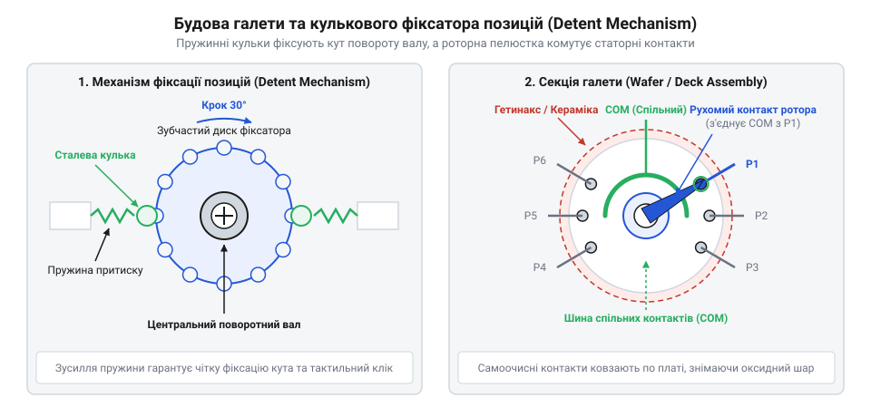
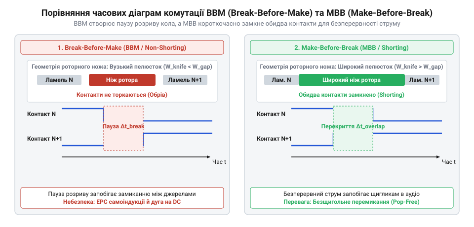
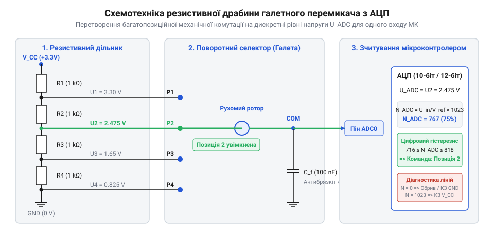

# Багатопозиційні галетні перемикачі (Rotary Switches)

<preknowlist>
- [Поворотний потенціометр](root:cat-hw-controls/rotary-potentiometer) — Конструкція роторних контактних систем та побудова резистивних дільників напруги.
- [KY-040 — поворотний енкодер](root:cat-hw-controls/ky-040-encoder) — Принципи механічної фіксації положень (detent) та фільтрація брязкоту контактів.
</preknowlist>

## Проблема комутації багатьох аналогових режимів

У складних вимірювальних приладах, лабораторних джерелах живлення та звуковому обладнанні часто виникає потреба вибирати один чіткий режим роботи з десятка можливих — наприклад, перемикати діапазони вимірювання напруги або підключати різні фільтри частот. Якщо спробувати реалізувати такий вибір за допомогою панелі окремих кнопок або тумблерів, системний проект одразу стикається з критичною загрозою: оператор може випадково натиснути кілька кнопок одночасно або забути ввімкнути жодної. В силових та вимірювальних колах це призводить до короткого замикання обмоток трансформатора, згоряння чутливих датчиків або непередбачуваного стану пристрою. Крім того, у темряві, в операторських рукавицях чи в умовах сильної вібрації тумблерні панелі не дають змоги швидко оцінити поточний стан наосліп — вони вимагають візуального контролю кожного тумблера окремо.

Аналогові регулятори, такі як [поворотний потенціометр](root:cat-hw-controls/rotary-potentiometer), теж не вирішують цієї задачі, оскільки вони змінюють опір плавно і не мають чітких дискретних засічок, що робить неможливим точне встановлення фіксованого коефіцінта підсилення чи діапазону. Цифрові рішення на зразок [поворотного енкодера](root:cat-hw-controls/ky-040-encoder) вимагають постійної роботи мікроконтролера та програмного обробника, що неприпустимо у чистих аналогових трактах або у колах безаварійного апаратного захисту.

Для надійного утримання вибраного стану в умовах вібрації критичне значення має кінематичний зв'язок між утримувальним моментом фіксатора та геометричними й матеріалознавчими параметрами ручки керування — кноба (англ. @@en|knob@@). Крутний момент повороту (від англ. @@en|operating torque@@), що передається на вал, прямо залежить від зовнішнього діаметра кноба та коефіцієнта тертя його поверхні. Збільшення діаметра полегшує перемикання пальцями за рахунок довшого плеча сили, проте масивний кноб із важкого металу (наприклад, суцільної латуні) має високий момент інерції (англ. @@en|moment of inertia@@). Під дією промислової вібрації чи поштовхів спецтехніки власні інерційні коливання важкої ручки можуть перевищити поріг утримання фіксатора, спричиняючи самовільний проскок ротора на суміжну позицію. Застосування легких матеріалів — анодованого алюмінію або термопласту з рифленим чи ґумованим покриттям — мінімізує обертальну інерцію при збереженні високого зчеплення з пальцями оператора, що ґарантує стабільне перебування перемикача у заданому режимі без хибних перескоків.

Розв'язком цієї проблеми стала роторно-дискова конструкція, яка на апаратному рівні усуває можливість взаємного накладання режимів та забезпечує східчастий тактильний відгук. Цей механізм дістав назву галетний перемикач (від франц. *galette* — плаский круглий диск; англ. @@en|rotary switch@@). Його основа — це один або кілька плоских ізоляційних дисків (галет), на яких радіально розміщено нерухомі контакти, а по центру обертається роторний контактний диск. Механічний принцип взаємної виключності спирається на жорстку геометричну прив'язку роторного ножа до центрального вала: при випадкових рвучких або швидких поворотах вала рухомий контакт фізично не здатний перескочити через ламелі чи підключити кілька несуміжних кіл паралельно. Жорсткий кутовий крок радіальних секцій гарантує, що при будь-якій швидкості обертання ніж ротора механічно залишає попередній статорний контакт перед або під час замикання наступного, унеможливлюючи виникнення хаотичних перехідних станів. Ергономіка та точність позиціонування перемикача визначаються кінематичним крутним моментом (від англ. @@en|operating torque@@) подолання пружинного фіксатора (зазвичай `0.1–0.5 Н·м`), який вимагає від оператора виразного зусилля пальців для виведення ротора з механічної засувки. Для точного вибору режиму наосліп на вал надягають фасонну ручку керування — кноб (від англ. @@en|knob@@ — набалдашник, ручка) з вказівним дзьобом (англ. @@en|pointer knob@@): асиметрична форма кноба діє як кутовий важіль, а її просторова орієнтація напомацки передає пальцям поточний кут повороту без візуального контролю лицевої панелі, запобігаючи помилковому проскоку суміжних позицій при сильних вібраціях. Детальний огляд того, як перші телефонні комутатори XIX століття трансформувалися у сучасні вузли, викладено в [історії галетних перемикачів](root:cat-hw-controls/rotary-selector-switches/hist-rotary-switch-evolution.md).

## Конструкція галети та механізм фіксації

Щоб розібратися, як галетний перемикач забезпечує надійну комутацію, необхідно розглянути будову його поодинокого секційного елемента — галети або дека (англ. @@en|deck@@, також @@en|wafer@@). Галета складається з двох основних частин: нерухомої круглої платформи із кераміки або гетинаксу — статора (від лат. *stator* — той, що стоїть; англ. @@en|stator@@), та внутрішнього рухомого диска — ротора (від лат. *rotare* — обертатися; англ. @@en|rotor@@). На статорі по колу закріплено пелюсткові або контактні стійки, а на роторі розміщено пружні металеві ножі або містки. При обертанні ротора ножевий контакт насувається на статорну пелюстку, стискаючи її з двох боків, що створює високий питомий тиск і самоочищення контактних поверхонь від оксидної плівки. Кожен такий контакт створює моментовий опір тертя `M_deck`, тому при пакетуванні кількох деків на єдиному центральному валу довжиною `L` сумарний крутний момент зростає. Обертання вала з полярним моментом інерції перерізу `J_p = π · d_shaft⁴ ÷ 32` під дією загального моменту `M_total = M_detent + N_deck · M_deck` спричиняє пружне кутове скручування металу:

```
M_total = M_detent + N_deck · M_deck           [сумарний крутний момент усіх секцій]
θ_twist = (M_total · L) ÷ (G · J_p)            [кут скручування вала на дальній галеті]
N_max_deck = floor(((G · J_p · Δθ_max ÷ L) - M_detent) ÷ M_deck) [гранична кількість деків]
```

де `G` — модуль зсуву матеріалу вала, а `Δθ_max` — критичний кут розозгодження (зазвичай не більше `2°–3°`). Якщо кількість деків `N_deck` перевищує `N_max_deck`, кутове відставання дальній контактних груп викликає розозгодження фаз комутації, зависання ножів на краю ламелей та небезпеку механічного заклинювання вала.

Для точного збігу роторних контактів зі статорними використовують механізм фіксації положень (англ. @@en|detent mechanism@@, від лат. *detentio* — утримання). Найпоширенішим є кульково-пружинний фіксатор: пружина із зусиллям `F_spring` тисне на одну або дві сталеві кульки, які при обертанні вала проскакують по фігурній зірочці радіуса `r_star`. Геометрія профілю зірочки розраховується за кутом нахилу западини `α` (зазвичай від 30° до 60°), який вибирають із компромісу між зусиллям повертання та чіткістю тактильного відгуку, а глибина зачеплення `h_groove = r_ball · (1 - cos(α))` розраховується так, щоб кулька радіуса `r_ball` опускалася на більшу частину свого радіуса, забезпечуючи суворе самоцентрування ножів ротора по центру статорних ламелей. Утримувальний момент фіксатора `M_detent` розраховується за формулою:

```
M_detent = F_spring · r_star · tan(α)      [утримувальний момент кулькового фіксатора]
```

де `α` — кут нахилу профілю западини зірочки. Проскакування кульки у западину створює чіткий тактильний клік і надійно утримує вал у фіксованому кутовому положенні (зазвичай через кожні 30°, 36°, 45° або 60°). Проте в процесі тривалої експлуатації внаслідок циклічних навантажень виникає втома матеріалу пружини та механічний знос зубців зірочки, що зменшує притискне зусилля `F_spring` на 20–30%. Падіння утримувального моменту призводить до того, що вал недовертається до дна западини й зависає в проміжному стані на похилому профілі. Це спричиняє мікроскопічні коливання роторного ножа відносно пелюстки статора та викликає тривалий брязкіт контактів (англ. @@en|contact bounce@@) при зовнішніх вібраціях, а при комутації під навантаженням — виникнення нестабільної електричної дуги й ерозію контактних поверхонь.

```
M_detent = F_spring · r_star · tan(α)      [утримувальний момент кулькового фіксатора]
```

де `α` — кут нахилу профілю западини зірочки. Проскакування кульки у западину створює чіткий тактильний клік і надійно утримує вал у фіксованому кутовому положенні (зазвичай через кожні 30°, 36°, 45° або 60°). Якщо зусилля пружини недостатнє або вал недбало зупиняється на вершині зубця між засічками, виникає небезпека зависання контактів у проміжному стані: ножі ротора лише частково торкаються ламелей, що викликає підвищений перехідний опір, брязкіт і небезпеку виникнення електричної дуги при комутації струму.


*Конструкція ротора, статорних контактів та кулькового фіксатора положень галети, з якої видно механічний принцип утримання позицій.*

Головна перевага роторної архітектури полягає в можливості нанизувати кілька галетних деків на єдиний гранчастий або D-подібний вал. Це дає змогу одним поворотом ручки синхронно комутувати десятки незалежних електричних кіл. Залежно від з'єднання контактів на роторі, конфігурація перемикача описується кількістю полюсів (рухомих вхідних контактів, позначуваних як `P` від англ. @@en|pole@@) та кількістю напрямків (фіксованих вихідних позицій, позначуваних як `T` від англ. @@en|throw@@). Наприклад, позначення `1P12T` відповідає однополюсному перемикачу на 12 позицій, а `2P6T` — двополюсному на 6 позицій. Повні електричні характеристики, параметри ізоляції та геометричні розміри корпусів деталізовано в довіднику з [залізного інтерфейсу перемикачів](root:cat-hw-controls/rotary-selector-switches/api-rotary-switch-hardware.md).

## Таймінги комутації та запобігання дугам

Під час обертання вала багатопозиційного галетного перемикача (@@en|rotary switch@@, від англійського *rotary* — поворотний) рухомий ніж ротора послідовно переміщується між статорними ламелями. Геометрична форма та кутова ширина контактної пелюстки ротора визначають часову динаміку комутації, розділяючи галетні перемикачі на два фундаментальні типи: з розривом кола перед замиканням та з короткочасним замиканням суміжних позицій.

Перший тип — комутація з розривом кола (@@en|Break-Before-Make@@, BBM, від англійського *break* — розривати, *make* — замикать) або без замикання (@@en|non-shorting@@). У цьому разі кутова ширина ножа ротора менша за проміжок між сусідніми статорними ламелями. Під час повороту ніж повністю розмикає початковий контакт N до того, як торкнеться ламелі N+1. На мить коло розривається. Такий механізм є обов'язковим при комутації незалежних джерел живлення, сигналів із різними амплітудами чи полярностями, де короткочасне з'єднання сусідніх позицій призвело б до короткого замикання. Однак під час вимкнення індуктивних навантажень (обмоток реле, трансформаторів, котушок) раптовий розрив струму створює сплеск ЕРС самоіндукції, викликаючи електричну дугу (@@en|arcing@@) та прискорений знос контактів. Особливо критичною дугова ерозія є у колах постійного струму (DC), оскільки, на відміну від змінного струму (AC), де напруга природно переходить через нуль двічі за період і сприяє гасінню дуги за час `t_AC ≤ 10 мс`, постійний струм підтримує стійкий дуговий розряд до розходження контактів на значну відстань. У результаті енергія дуги при розмиканні DC-кола виявляється в 5–10 разів вищою:

```
E_arc_DC = V_arc · I_DC · t_arc_DC               [енергія дуги постійного струму без переходу через нуль]
E_arc_AC ≈ 0.5 · V_arc · I_peak · (1 ÷ (2 · f))  [енергія дуги змінного струму з самогасінням у нулі]
E_arc_DC ÷ E_arc_AC ≈ 5 ÷ 10                     [кратно вищий термічний знос контактів при DC]
```

Для придушення таких комутаційних сплесків паралельно індуктивному навантаженню або контактній групі підключають захисний @@en|RC-демпфер@@ (англ. @@en|RC snubber@@, від @@en|to snub@@ — глушити, придушувати). Ємність демпферного конденсатора `C_s` та опір демпферного резистора `R_s` розраховують виходячи з індуктивності навантаження `L_load`, струму розмикання `I_0` та допустимої амплітуди перенапруги `V_max`. Ємність конденсатора вибирають із умови повного поглинання запасеної в індуктивності магнітної енергії `W_L = L_load · I_0² / 2` без перевищення допустимої напруги на контактах, після чого опір резистора обчислюють для забезпечення критичного згасання коливального контуру:

```
R_s = 2 · √(L_load / C_s)      [критичне демпфування резонансного контуру]
```

При такому значенні опору `R_s` енергія самоіндукції розсіюється у вигляді тепла на резисторі за один напівперіод без високочастотного резонансного розгойдування напруги, що повністю ліквідує умови для виникнення дугового розряду й захищає поверхню контактів від ерозії.

Другий тип — комутація з перекриттям (@@en|Make-Before-Break@@, MBB, від англійського *make* — замикати, *break* — розривати) або із замиканням (@@en|shorting@@). У цьому варіанті розширена пелюстка ротора торкається ламелі N+1 ще до того, як зійде з ламелі N. У проміжному положенні обидва суміжні контакти виявляються короткочасно замкненими між собою. Це незамінно при комутації вторинних обмоток трансформаторів струму, де розрив кола неприпустимий, а також у звукових трактах, оскільки запобігає гучним щигликам і клацанням (@@en|pop noise@@).


*Часові діаграми замикання й розмикання контактів MBB та BBM при обертанні ротора.*

Вибір матеріалу контактів безпосередньо залежить від комутованих струмів та напруг. Позолочені контакти застосовують у малосигнальних «сухих» колах з напругою нижче 20 мВ та струмами менше 10 мА, оскільки при таких потенціалах електричне пробивання оксидної плівки неможливе і лише чисте золото усуває проблему пасивації. Для силових кіл зі струмами в кілька амперів використовують суцільносрібні або посріблені контакти, стійкі до теплової ерозії електричної дуги. Для запобігання зварюванню контактних поверхонь допустима потужність розриву `P_break` обчислюється як:

```
P_break = V_sw · I_sw      [допустима потужність розриву контактної групи]
```

Якщо комутована напруга перевищує поріг горіння дуги `V_sw > 12 В`, а струм `I_sw > 0.4 А`, потужність розриву `P_break` повинна суворо обмежуватися паспортним значенням `P_max_contact`, щоб енергія дугового розряду не спричинила локальне розплавлення та механічне зварювання контактів.

Витоки застосування роторних контактних систем для комутації багатоканальних ліній зв'язку розкрито в [історії розвитку галетних комутаторів](root:cat-hw-controls/rotary-selector-switches/hist-rotary-switch-evolution.md). Розрахунок параметрів комутаційної здатності та рівнів ізоляції подано у [характеристиках комутаційної здатності](root:cat-hw-controls/rotary-selector-switches/api-rotary-switch-hardware.md), а застосування MBB-перемикачів у прецизійних схемах висвітлено в [математичних розрахунках прецизійних атенюаторів](root:cat-hw-controls/rotary-selector-switches/math-rotary-attenuator-divider.md).

Отже, практичний вибір конфігурації галетного перемикача вимагає комплексного узгодження типу навантаження з часовою динамікою комутації. При використанні типу BBM для вимикання індуктивних кіл необхідно додатково передбачати апаратні дугогасні кола (RC-демпфери чи захисні діоди), щоб поглинати сплески самоіндукції й запобігати руйнуванню контактів. У малосигнальних аналогових вимірювачах та звукових трактах доцільно застосовувати MBB-перемикачі з позолоченими контактами, що одночасно усуває клацання й пасивацію контактних поверхонь. На відміну від [механічних інкрементальних енкодерів](root:cat-hw-controls/rotary-encoders-quadrature), правильно підібраний галетний перемикач забезпечує безпосередню апаратну комутацію кіл без потреби у проміжних цифрових обробниках.

## Схеми зчитування та завадостійке опитування

Для інтеграції багатопозиційного галетного перемикача у цифрові системи керування застосовують кілька схемотехнічних підходів. Пряме паралельне зчитування, де кожна ламель статора підключається до окремого цифрового входу мікроконтролера, вимагає значної кількості виводів. Для 12-позиційної галети це потребує 12 ліній GPIO, що є недоцільним.

Ефективнішим рішенням є побудова резистивної драбини (@@en|resistor ladder@@, від англійського *ladder* — драбина), яка перетворює вибране положення галети на дискретний рівень напруги для одного аналогово-цифрового перетворювача (@@en|analog-to-digital converter@@, АЦП). Послідовно з'єднані резистори однакового номіналу підключають до статорних контактів, а роторний ніж виводять на аналоговий вхід. Допуск опору резисторів `δ_R` безпосередньо визначає граничну похибку напруги `ΔV_err = V_ref · δ_R · (k ÷ N)`, тому для 12-позиційної галети з кроком напруги `V_step = V_ref ÷ N` використання резисторів із допуском 5% спричиняє перекриття сусідніх інтервалів. Застосування 1% прецизійних металоплівкових резисторів забезпечує похибку `ΔV_err < V_step ÷ 4`, що при розрядності АЦП `n ≥ 10` біт (де на одну позицію припадає близько 85 відліків) ґарантує надійне й однозначне розпізнавання кожної позиції. Важливим чинником є також температурний коефіцієнт опору (від англійського @@en|temperature coefficient of resistance@@, TCR): якщо резистори в драбині мають різний або високий TCR (понад `±100 ppm/°C`), температурне нагрівання спричиняє нерівномірне зміщення проміжних потенціалів та вихід рівнів за межі допусків. Використання компонентів з одного виробничого партіону зі строго вирівняним TCR (`±25...50 ppm/°C`) забезпечує симетричний дрейф усього дільника, завдяки чому коефіцієнт ділення напруги залишається стабільним у широкому діапазоні температур від `-40 °C` до `+85 °C`. Крім того, схемотехнічне обмеження крайніх рівнів напруги (додавання обмежувальних резисторів зверху й знизу драбини для формування робочого вікна, наприклад від `0.05 · V_ref` до `0.95 · V_ref`) дозволяє реалізувати функцію самодіагностики. Якщо відбудеться обрив з'єднувального кабелю або галета застрягне в міжконтактній проміжній позиції, підтягувальний резистор на аналоговому вході змістить потенціал за межі нормованого діапазону (`V_adc < 0.05 · V_ref` або `V_adc > 0.95 · V_ref`), що дасть змогу алгоритму мікроконтролера миттєво ідентифікувати аварійну відмову або перехідний стан.


*Принципова схема резистивного дільника напруги на контактах галети.*

Вихідна напруга дільника `V_adc` для `k`-ї позиції з загальної кількості `N` позицій обчислюється за формулою:

```
V_adc(k) = V_ref · (k ÷ N)      [напруга дільника для k-ї позиції]
ADC_code = floor((V_adc ÷ V_ref) · (2ⁿ - 1))  [цифровий код n-розрядного АЦП]
```

Під час повороту вала кульково-пружинний механічний фіксатор (@@en|detent mechanism@@) викликає брязкіт контактів (@@en|contact bounce@@, від англійського *bounce* — брязкіт, відскок). Крім того, при використанні BBM-галети в моменти переходу між ламелями вихідний контакт на кілька мілісекунд опиняється у стані високого опору (обриву). Для усунення цих завад паралельно аналоговому входу підключають апаратний фільтруючий конденсатор, а в програмі застосовують алгоритм усереднення та вікна гістерезису. На відміну від [інкрементальних енкодерів](root:cat-hw-controls/ky-040-encoder), опитаний через АЦП галетний перемикач миттєво дає абсолютне положення ротора навіть після подачі живлення, подібно до [поворотного потенціометра](root:cat-hw-controls/rotary-potentiometer).

:::tabs
:::code rotary-selector-switches-d/c/esp-idf/get-rotary-position.c
:::code rotary-selector-switches-d/cpp/arduino/rotaryadcselector.cpp
:::

Практичну реалізацію зчитування 12-позиційної галети подано у [модулі зчитування 12-позиційного перемикача](root:cat-hw-controls/rotary-selector-switches/proj-rotary-adc-selector.md). Алгоритми квадратурного декодування для безконтактних селекторів розкрито у довіднику з [механічних інкрементальних енкодерів](root:cat-hw-controls/rotary-encoders-quadrature).
