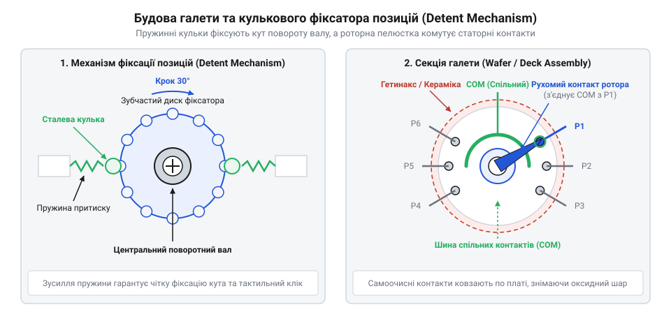
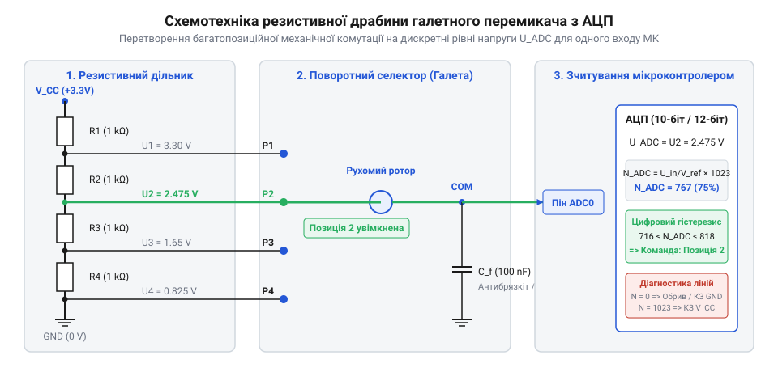

# Багатопозиційні галетні перемикачі (Rotary Switches)

<preknowlist>
- [Поворотний потенціометр](root:cat-hw-controls/rotary-potentiometer) — Конструкція роторних контактних систем та принципи роботи аналогових резистивних дільників.
- [KY-040 — поворотний енкодер](root:cat-hw-controls/ky-040-encoder) — Принципи механічної фіксації положень (detent) та способи фільтрації брязкоту контактів.
</preknowlist>

## Проблема вибору багатьох аналогових режимів

У вимірювальній апаратурі та аудіотехніці вибір діапазону вимірювання чи сигналу вимагає суворого ввімкнення лише одного конкретного кола. Набір окремих кнопок або тумблерів створює ризик випадкового одночасного натискання кількох клавіш, що спричиняє міжфазне коротке замикання чи спотворення вимірювань. Безперервний [поворотний потенціометр](root:cat-hw-controls/rotary-potentiometer) не забезпечує дискретних засічок для фіксації точних коефіцієнтів ділення, а [поворотний енкодер](root:cat-hw-controls/ky-040-encoder) потребує працюючого мікроконтролера та програмного обробника. Розв'язанням є галетний перемикач (від фр. *galette* — коржик, диск; далі — @@fr|galette@@, або англ. @@en|rotary switch@@) — механічний роторний орган вводу, який фізично гарантує взаємне виключення конфліктних режимів і дає виразний тактильний відгук у кожному фіксованому положенні.

## Конструкція деків та механізм фіксації

Основою галетного перемикача є секційні диски — деки, що складаються з нерухомого ізоляційного статора з пелюстковими контактами та центрального ротора з контактними ножами. Для чіткого перемикання використовують кульково-пружинний механізм фіксації (від лат. *detentio* — затримання; далі — @@en|detent mechanism@@), де пружина утримує сталеву кульку у засічках фіксаторного диска. Це створює тактильне клацання та самоцентрує контактний ніж точно на пелюстці, запобігаючи небезпечному зависанню у проміжному стані. 

*Будова секційної галети та механізму кулькової фіксації положень*

Конфігурацію визначено кількістю полюсів (англ. *pole*, позначення `P`) та напрямків (англ. *throw*, позначення `T`): наприклад, маркування `1P12T` означає один вхідний полюс на 12 позицій, а `4P3T` — чотири незалежні групи на 3 положення. Кілька деків осяжно пакетують на єдиному центральному валу, що дозволяє одночасно комутувати десятки роз'єднаних електричних кіл.

## Динаміка комутації BBM та MBB

За геометрією роторних ножів галетні перемикачі поділяють на два класи комутації: з попереднім розривом кола (від англ. *break* — розмикати, *make* — замикати; далі — @@en|Break-Before-Make@@ або @@en|BBM@@) та з попереднім замиканням (від англ. *make* — замикати, *break* — розмикати; далі — @@en|Make-Before-Break@@ або @@en|MBB@@). Схема `BBM` розмикає поточний контакт до доторкання до наступного, унеможливлюючи коротке замикання між сусідніми лініями. Схема `MBB` перекриває контакти ширшим ножем до розриву попередньої лінії, запобігаючи обриву струму в індуктивних колах та первинних обмотках трансформаторів. Під час розмикання індуктивних кіл утворюється високовольтна ЕРС самоіндукції, яка спричиняє електричну дугу; для її гасіння паралельно контактам підключають захисний RC-демпфер (від англ. *snub* — гасити; далі — @@en|snubber@@). Для сигнальних слабострумових кіл застосовують позолочені контакти, що захищають від окиснення, тоді як силові кола вимагають масивних срібних накладок для стійкості до ерозії.

## Схема підключення резистивної драбини до АЦП

Підключення багатопозиційного галетного перемикача до мікроконтролера зазвичай потребує багатьох цифрових виходів вводу-виводу. Для економії виводів використовують резистивну драбину (від англ. *resistor ladder*; далі — @@en|resistor ladder@@): між суміжними контактами статора послідовно впаюють прецизійні резистори однакові за номіналом, формуючи багатоступеневий дільник напруги.

*Схема резистивного дільника напруги на галетному перемикачі для зчитування одним входом АЦП*

Рухомий контакт рокера знімає відповідний рівень напруги й подає його на один вхід аналого-цифрового перетворювача (АЦП). Паралельно входу АЦП встановлюють фільтруючий керамічний конденсатор ємністю 10–100 нФ, який згладжує брязкіт контактів під час перемикання. На відміну від енкодера, ця схема гарантує миттєве зчитування абсолютного положення вала одразу після ввімкнення живлення без потреби шукати нульову мітку чи обробляти переривання.
