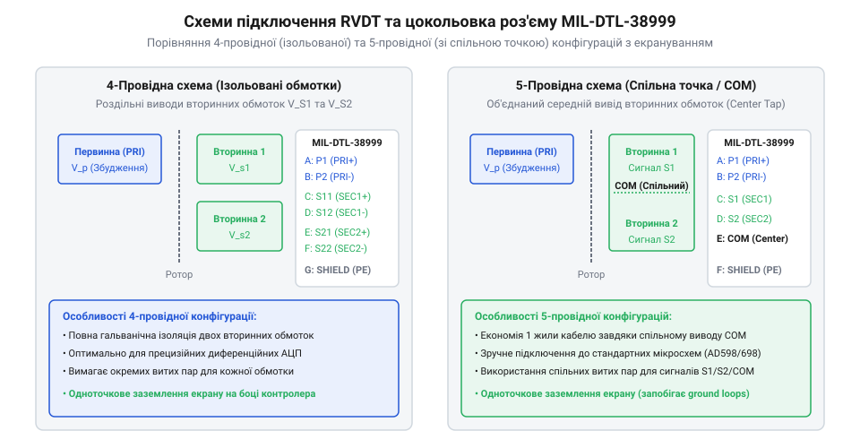
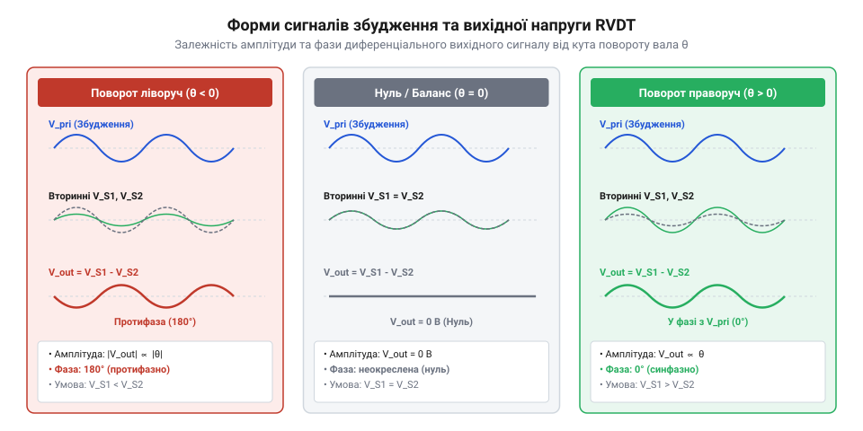

# Апаратний інтерфейс RVDT: цокольовка, виводи обмоток, збудження та узгодження

<preknowlist>
- [Принцип роботи та конструкція давача RVDT](root:cat-hw-controls/rvdt-operating-principles) — Конструкція, фізичні принципи індуктивного вимірювання та лінійний діапазон кута.
- [Дрейф нуля та калібрування органів вводу](root:cat-hw-controls/stick-drift-mitigation) — Методи алгоритмічного калібрування зсуву нуля та обробки сигналів.
</preknowlist>

## Проблема узгодження індуктивних давачів кута

Вимірювання кутового положення в аерокосмічних сервоприводах, авіаційних штурвалах та промислових роботах відбувається в умовах вібрацій, високих температур і пилу. Ззвичайний [поворотний потенціометр](root:cat-hw-controls/rotary-potentiometer) з ковзним контактом швидко зношується, а оптичний енкодер вимагає чистоти оптичного шляху. Для забезпечення надійності використовують ротаційний змінний диференціальний трансформатор — @@en|RVDT@@ (англ. @@en|Rotary Variable Differential Transformer@@, ротаційний змінний диференціальний трансформатор). Цей безконтактний індуктивний датчик не має механічного зносу електричних кіл, проте його зчитування вимагає подачі синусоїдного зміннострумового збудження та точного апаратного узгодження вихідних сигналів.

На відміну від цифрових давачів, @@en|RVDT@@ повертає не готовий код, а диференціальні амплітудно-модульовані напруги на вторинних обмотках. Конструктивно роторний магнітопровід @@en|RVDT@@ має профільоване кулачково-ексцентричне феромагнітне осердя, яке обертається у повітряному зазорі статора, на відміну від прямолінійного циліндричного плунжера лінійного давача @@en|LVDT@@ (англ. @@en|Linear Variable Differential Transformer@@, лінійний змінний диференціальний трансформатор), що переміщується зворотно-поступально вздовж осі котушок. Обертання кулачкового ротора безперервно перерозподіляє магнітний потік і змінює магнітну провідність зазору між первинною та вторинними обмотками, створюючи суворо лінійну залежність диференціальної індукції від кута повороту вала. Будь-який паразитний зсув фази між збудженням і відгуком, падіння амплітуди через нагрів мідного дроту чи фазові завади від сусідніх силових ліній викривляють обчислену координату вала. Некоректно спроєктоване коло живлення первинної обмотки призводить до зсуву нуля, що критично для систем, де вимірюються [оптичні та індуктивні давачі](root:cat-hw-controls/optical-and-inductive-position-encoders) положення органів керування. Тільки суворе дотримання вимог до генерації синусоїдного збудження, симетричного трасування обмоток та апаратного захисту ліній дозволяє досягти заявленої точності вимірювання кута.

## Параметри синусоїдного збудження первинної обмотки

Первинна обмотка @@en|RVDT@@ потребує живлення чистою синусоїдною напругою без постійної складової та з мінімальним рівнем гармонічних спотворень. Промислові та авіаційні специфікації передбачають діюче значення напруги збудження в діапазоні від 3 до 26 `V_RMS` (англ. @@en|Volts Root Mean Square@@, середньоквадратичні вольти) на несучих частотах від 400 Гц до 10 кГц. Вибір робочої частоти визначається індуктивністю магнітопроводу та необхідною динамікою оновлення кутових даних.

Повний електричний імпеданс первинної обмотки залежить від активного опору мідного дроту та частоти збудження:

Z_pri = R_pri + j · 2 · π · f_exc · L_pri
|Z_pri| = √((R_pri)² + (2 · π · f_exc · L_pri)²)      [абсолютний модуль імпедансу первинної обмотки]

Зі зростанням частоти збудження `f_exc` реактивна складова імпедансу збільшується, що зменшує струмове навантаження на генератор:

I_exc = V_exc ÷ |Z_pri|      [розрахунок струму збудження первинної обмотки]

Низька частота збудження змушує джерело віддавати більший струм `I_exc`, що викликає джоулів розігрів обмотки:

P_heat = (I_exc)² · R_pri      [потужність теплових втрат у первинній обмотці]

Температурний розігрів змінює активний опір `R_pri`, що призводить до зміщення фази струму відносно напруги та спричиняє температурний дрейф нуля. Щоб уникнути викривлення вихідного сигналу, генератор збудження повинен мати високу стабільність амплітуди й низький коефіцієнт нелінійних спотворень — @@en|THD@@ (англ. @@en|Total Harmonic Distortion@@, коефіцієнт нелінійних спотворень, менше ніж 0.5%). Наявність вищих гармонік у живленні створює паразитно наведені напруги у вторинних обмотках, які не компенсуються під час диференціальної демодуляції.

Для досягнення високої чистоти синусоїди з коефіцієнтом `THD < 0.5%` у вимірювальних трактах застосовують схемотехнічні рішення на базі аналогових генераторів із мостом Віна (англ. @@en|Wien bridge oscillator@@) або цифрових генераторів прямого синтезу (англ. @@en|DDS@@, від @@en|Direct Digital Synthesis@@) у поєднанні з підсилювачем потужності класу D чи вихідними операційними підсилювачами (ОП). Генератор на мості Віна використовує кола автоматичного регулювання підсилення (англ. @@en|AGC@@, від @@en|Automatic Gain Control@@) для стабілізації амплітуди, що усуває гармонійні сплески та запобігає нелінійному насиченню. У сучасних цифрових модулях збудження синусоїдальний сигнал генерується цифро-аналоговим перетворювачем із послідовним активним фільтром Баттерворта другого або четвертого порядку, що гарантує високу стабільність фази й амплітуди у всьому робочому діапазоні температур.

## Схеми підключення та цокольовка обмоток

Фізичне з'єднання @@en|RVDT@@ із платою узгодження виконується за 4-провідною, 5-провідною або 6-провідною схемою. У 4-провідній конфігурації первинна обмотка підключається двома провідниками, а дві вторинні обмотки з'єднані послідовно-зустрічно всередині корпусу давача, виводячи назовні лише два сигнальні дроти диференціальної різниці. 5-провідна схема об'єднує один із виводів кожної вторинної обмотки в спільний середній провідник, що зменшує кількість жил у кабелі, проте створює ризик паразитного падіння напруги на спільному опорі заземлення. У 6-провідній конфігурації кожна з двох вторинних обмоток та первинне коло живлення виводяться повністю ізольованими витими парами із власною середньою точкою чи окремими зворотними лініями. Такий повний гальванічний розв'язок закриває шлях вирівнювальним струмам між збудженням та вимірювальним трактом, запобігає синфазному зсуву потенціалів аналогового вхідного каскаду — @@en|AFE@@ (англ. @@en|Analog Front-End@@, аналоговий вхідний тракт) та надає оцифровувачу змогу незалежно контролювати цілісність кожного з двох сигнальних каналів при виявленні обриву чи замикання.

В відповідальних аерокосмічних і промислових вузлах для підключення застосовують герметичні циліндричні роз'єми серії @@en|MIL-DTL-38999@@. Кожен канал збудження та сигнальний канал вторинних обмоток прокладається окремою витою парою з нормованим хвильовим опором (зазвичай 100–120 Ом). Для відсікання зовнішніх електромагнітних завад використовується спільний або індивідуальний плетений екран.

_Схема цокольовки роз'єму MIL-DTL-38999 та екранування обмоток RVDT з одноточковим заземленням._

Критичною вимогою для запобігання утворенню замкнених контурів заземлення та паразитного зсуву фази є одноточкове заземлення екранів (англ. @@en|single-point grounding@@, одноточкове заземлення). Екран кабелю підключається до захисного заземлення шафи чи плати збирання даних лише з одного боку — на стороні демодулятора. З боку корпуса давача @@en|RVDT@@ екран залишають ізольованим або підключають через високочастотний керамічний конденсатор, щоб запобігти протіканню вирівнювальних струмів заземлення через сигнальну оболонку.

## Апаратна обробка та діагностика ліній

При подачі синусоїдної напруги на первинну обмотку у вторинних обмотках індукуються змінні напруги `V_sec1` та `V_sec2`. Амплітуда цих сигналів пропорційна куту повороту ротора `θ`, а фаза відносно первинного збудження вказує на напрямок відхилення від нульового положення.

_Форми напруг збудження та вторинних обмоток RVDT при різних кутах повороту вала._

Зв'язок між амплітудами вихідних сигналів і кутом повороту описується через коефіцієнт трансформації — @@en|TR@@ (англ. @@en|transformation ratio@@, коефіцієнт трансформації):

V_sec1(θ) = V_exc · TR · (1 + k · θ)      [амплітуда першого вторинного сигналу]
V_sec2(θ) = V_exc · TR · (1 - k · θ)      [амплітуда другого вторинного сигналу]

У межах робочого лінійного діапазону (зазвичай ±40° або ±60°) сума амплітуд вторинних сигналів залишається постійною величиною:

V_sum = V_sec1 + V_sec2 ≈ const      [інваріант суми амплітуд вторинних обмоток]

Цей інваріант є основою для апаратної діагностики стану ліній та самого давача спеціалізованими мікросхемами @@en|RDC@@ (англ. @@en|Resolver-to-Digital Converter@@, конвертер резольвер-цифра):

1. Обрив або коротке замикання обмотки (англ. @@en|loss of signal@@, втрата сигналу) фіксується, коли сумарна амплітуда падає нижче мінімального порогу: `V_sec1 + V_sec2 < V_min_threshold`.
2. Втрата захоплення фази (англ. @@en|loss of lock@@, втрата захоплення) розпізнається, якщо зсув фази між напругою збудження та вторинним сигналом виходить за припустиме часове вікно через деградацію магнітопроводу або витікання струму.
3. Вихід за межі лінійного діапазону виявляється за викривленням співвідношення різниці до суми сигналів `(V_sec1 - V_sec2) ÷ (V_sec1 + V_sec2)`.

Коли в системі виконується [калібрування дрейфу нуля](root:cat-hw-controls/stick-drift-mitigation), апаратна діагностика дає змогу розрізнити механічний зсув вала від аварійного стану кабельної лінії, забезпечуючи безперервний контроль цілісності вимірювального тракту.

Для апаратної автоматизації діагностики в промисловості та авіації застосовують спеціалізовані мікросхеми конвертерів @@en|RDC@@, такі як @@en|AD2S1210@@. Архітектурно цей чіп містить вбудоване ядро стеження за фазою та аналогові компаратори, які в реальному часі формують статусні прапорці регістру помилок. При виникненні обриву чи замикання обмотки спрацьовує прапорець втрати сигналу — @@en|DOS@@ (англ. @@en|Degradation of Signal@@, деградація сигналу) або @@en|LOS@@ (англ. @@en|Loss of Signal@@, втрата сигналу), коли сума квадратів напруг падає нижче відсічки. У разі надмірного фазового зсуву чи перевищення граничної кутової швидкості привода активується прапорець втрати стеження — @@en|LOT@@ (англ. @@en|Loss of Tracking@@, втрата стеження). Читання цих прапорців через шину @@en|SPI@@ (англ. @@en|Serial Peripheral Interface@@) дає змогу керуючому мікроконтролеру миттєво відрізнити механічний дрейф вала від відмови кабельної лінії та перевести привід у безпечний аварійний стан.
