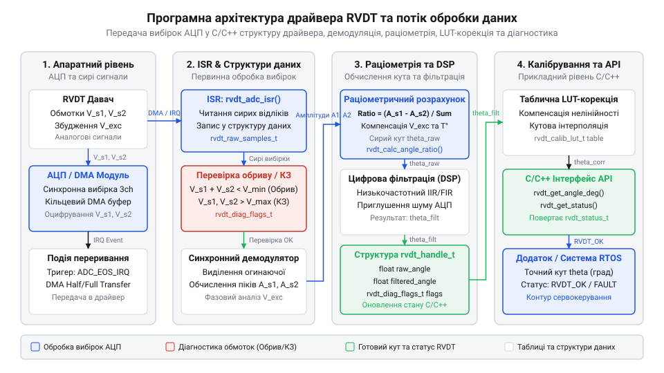
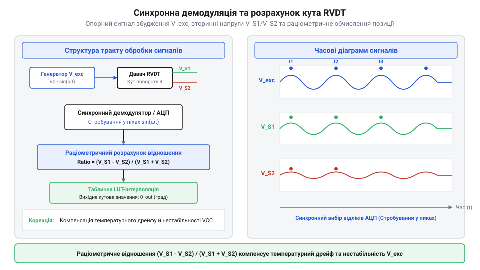
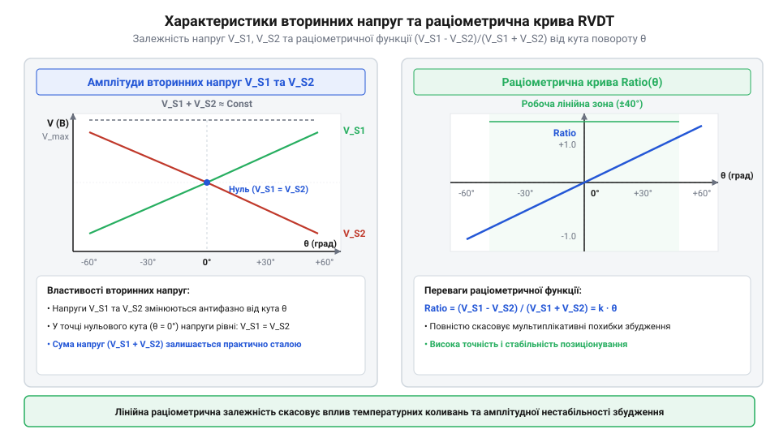
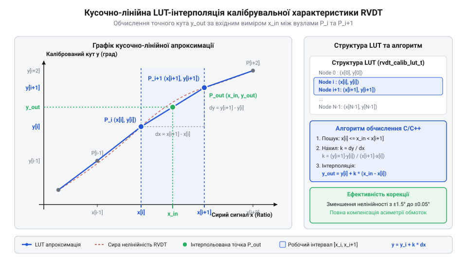
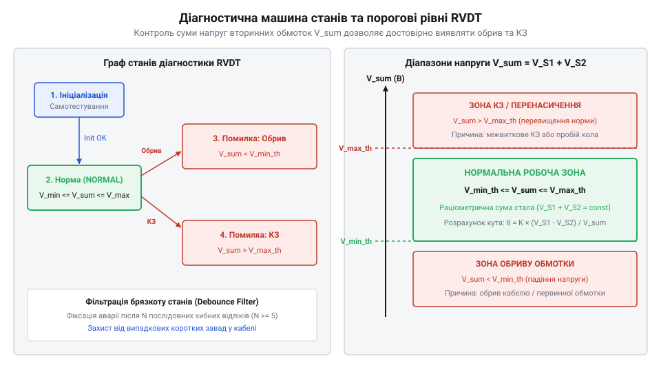

# Програмний API-довідник драйвера зчитування, демодуляції та калібрування RVDT

<preknowlist>
- [Оптичні та індуктивні давачі положення органів вводу](root:cat-hw-controls/optical-and-inductive-position-encoders) — фізичні принципи зчитування позиції індуктивними перетворювачами
- [Дрейф нуля та калібрування органів вводу](root:cat-hw-controls/stick-drift-mitigation) — методи усунення зміщення нуля та побудова калібрувальних характеристик
</preknowlist>

## Архітектура C/C++ драйвера RVDT

У прецизійних авіаційних та промислових системах керування кутовим положенням безконтактні поворотно-змінні диференційні трансформатори RVDT (від англ. @@en|Rotary Variable Differential Transformer@@, RVDT) потребують суворої синхронізації між генерацією збудження та оцифруванням вторинних обмоток. На відміну від позиціонування в [абсолютних поворотних енкодерах](root:cat-hw-controls/rotary-encoders-absolute-single-multi-turn), де обробка зводиться до зчитування готового цифрового кадру, драйвер RVDT функціонує як високоефективний прикладний програмувальний інтерфейс (від англ. @@en|application programming interface@@, API) обробки сигналів у реальному часі.


*Принцип побудови C/C++ драйвера RVDT: взаємодія периферії АЦП, DMA та обробника переривань із програмою керування.*

Програмна архітектура драйвера відокремлює апаратно-залежну периферію від математичних алгоритмів декодування. Дескриптор екземпляра драйвера зберігає покажчики на буфери прямого доступу до пам'яті (від англ. @@en|Direct Memory Access@@, DMA), коефіцієнти підсилення аналогового переднього тракту (від англ. @@en|Analog Front-End@@, AFE) та поточний стан автомата діагностики. Для запобігання втратам вибірок АЦП при високочастотних перериваннях (на частотах збудження `1–10 кГц` дискретизація сягає сотень кілогерц) використовують механізм подвійної пинг-понг буферизації (від англ. @@en|ping-pong buffering@@) у режимі кільцевого буфера DMA (від англ. @@en|circular buffer mode@@). Вибір частоти дискретизації АЦП `f_sample` відносно несучої збудження `f_exc` підпорядковується вимогам запобігання накладанню спектрів (від англ. @@en|aliasing@@): хоча теорема Найквіста вимагає `f_sample > 2 · f_exc`, у реальному драйвері застосовують значне передискретизування (від англ. @@en|oversampling ratio@@) на рівні `f_sample = 20–40 · f_exc`. Це послаблює вимоги до аналогового антиаліасингового фільтра (від англ. @@en|anti-aliasing filter@@) у складі AFE, гарантує точну точкову апроксимацію синусоїди та виключає появу хибних низькочастотних гармонік при синхронному множенні. Розмір буфера `N_buf` обчислюється залежно від частоти дискретизації АЦП `f_sample`, частоти несної збудження `f_exc` та кількості каналів `N_ch` за виразом `N_buf = 2 · (f_sample / f_exc) · N_ch`. Наприклад, для 3-канального оцифрування (`EXC`, `S1`, `S2`) при несучій `f_exc = 5 кГц` та частоті АЦП `f_sample = 200 кГц` (40 вибірок на період несної) кожна половина буфера для `10` періодів несної містить `N_half = 400` вибірок на канал, що дає повний розмір кільцевого масиву `N_buf = 2 · 400 · 3 = 2400` елементів (або `4.8 кБ` при `16`-бітному квантуванні). Контролер DMA почергово заповнює одну половину масиву, викликаючи переривання половинного передавання (від англ. @@en|half-transfer interrupt@@), у той час як обробник драйвера обчислює демодуляцію та кут за попередньо згенерованою другою половиною. Така апаратна розв'язка виключає гонку даних і гарантує безперервний потік вибірок без пропусків.

Нижче наведено структуру C та C++ даних конфігурації та кадру вибірок для реалізації драйвера в обробнику переривань (від англ. @@en|Interrupt Service Routine@@, ISR):

:::tabs
@tab c|esp-idf
:::code api-rvdt-firmware-driver-interface/c/snippet-1.c
@tab cpp|arduino
:::code api-rvdt-firmware-driver-interface/cpp/rvdtstatus.cpp
:::

## Програмна синхронна демодуляція сигналів

Вихідні напруги вторинних обмоток RVDT є вихідними амплітудно-модульованими синусоїдальними сигналами, де амплітуди огинаючих пропорційні куту повороту вала. Для вилучення корисного сигналу відносно збудження застосовують програмну синхронну демодуляцію (від англ. @@en|synchronous demodulation@@). На відміну від пасивного випрямлення, синхронне перемноження з опорною частотою забезпечує повне виправлення фазових зсувів та придушення квадратурного шуму.


*Дискретний потік синхронної демодуляції: множення вхідного відгуку на опорну фазу збудження та подальше згладжування фільтром низьких частот.*

Математично миттєве значення огинаючої `V_demod` обчислюється шляхом перемноження вхідної вибірки `v_s(t)` на опорне синусоїдальне коливання збудження `sin(ω_exc · t + φ)`. Через індуктивність обмоток RVDT та паразитну ємність кабельної лінії відгуки вторинних обмоток мають кутовий фазовий зсув (від англ. @@en|phase shift@@) `φ` відносно первинного збудження. При некомпенсованому множенні `v_s(t) = V_m · sin(ω_exc · t - φ)` на опорну синусоїду `sin(ω_exc · t)` випрямлена огинаюча послаблюється на співмножник `cos(φ)` за формулою `v_mult(t) = (V_m / 2) · cos(φ) - (V_m / 2) · cos(2 · ω_exc · t - φ)`. Наприклад, фазовий зсув `φ = 15°` зменшує обчислену амплітуду на `3.4%`, що спричиняє температурну похибку вимірювання позиції. Для ліквідації цього ефекту в C/C++ драйвер інтегрують алгоритм автокомпенсації фази (від англ. @@en|auto-phase alignment@@): під час ініціалізації або через квадратурні I/Q-компоненти (від англ. @@en|quadrature demodulation@@) обчислюють зсув `φ = arctan(V_Q / V_I)` та зсувають фазу опорної таблиці синуса на той самий кут `φ_comp = φ`, що повністю відновлює коефіцієнт передачі `cos(0) = 1` та усуває амплітудні викривлення.

v_mult(t) = v_s(t) × sin(ω_exc · t + φ)

Оскільки добуток двох синусоїд розкладається на постійну складову та подвійну частоту 2 · ω_exc:

v_mult(t)
= V_m · sin(ω_exc · t) × sin(ω_exc · t)
= (V_m / 2) · (1 - cos(2 · ω_exc · t))                 [тригонометрична тотожність добутку]

Після множення високоефективний дискретний фільтр низьких частот (від англ. @@en|low-pass filter@@, ФНЧ) першого або другого порядку видаляє гармоніку подвійної частоти cos(2 · ω_exc · t), залишаючи лише постійний рівень огинаючої V_m / 2.

У цифровому драйвері застосовують експоненційний рекурсивний ФНЧ (від англ. @@en|low-pass filter@@) першого порядку з коефіцієнтом згладжування `α`. Для забезпечення дискретного еквівалента аналогового RC-фільтра з постійною часу `τ = 1 / (2 · π · f_cutoff)` значення вагового коефіцієнта `α` розраховують через частоту зрізу `f_cutoff` та період дискретизації АЦП `Δt = 1 / f_s` (від англ. @@en|sampling rate@@) за співвідношенням `α = (2 · π · f_cutoff · Δt) / (1 + 2 · π · f_cutoff · Δt)` (або `α = Δt / (τ + Δt)`). Оскільки після випрямлення корисна огинаюча зміщується на постійну складову, а гармоніка збудження подвоюється до `2 · f_exc`, частоту зрізу фільтра `f_cutoff` обирають у діапазоні між максимальною частотою механічного переміщення вала та подвійною несучою (зазвичай `f_cutoff ≈ 0.1–0.2 · f_exc`). Значення `α ∈ (0, 1)` визначає компроміс між згладжуванням та затримкою: при `α → 0` фільтр забезпечує глибоке пригнічення пульсацій подвійної частоти `2 · f_exc`, але збільшує фазове запізнення регулятора, тоді як при `α → 1` зростає смуга пропускання ціною проникнення високочастотного шуму. Обчислення `α` під час ініціалізації драйвера дає змогу адаптувати коефіцієнт згладжування під будь-яку комбінацію тактових частот без перебудови алгоритму обробки вибірок.

y[n] = α × x[n] + (1 - α) × y[n-1]                     [дискретний рекурсивний ФНЧ]

де `α = (2 · π · f_cutoff · Δt) / (1 + 2 · π · f_cutoff · Δt)`, `f_cutoff` — частота зрізу ФНЧ, а `Δt = 1 / f_s` — період дискретизації АЦП (від англ. @@en|sampling rate@@). Проте ефективність демодуляції та згладжування критично залежить від узгодженості тактування: порівняльний аналіз показує, що рассинхронізація між частотою дискретизації АЦП `f_s` та частотою збудження первинної обмотки `f_exc` утворює кутову фазову похибку (від англ. @@en|phase error@@) `Δφ`. Якщо `f_s` не є суворо кратною `N · f_exc`, відносна частотна розбіжність `Δf = |f_s / N - f_exc|` викликає повільні низькочастотні биття огинаючої (від англ. @@en|beat frequency@@) з періодом `T_beat = 1 / Δf`, а амплітуда випрямленого сигналу зменшується на співмножник `cos(Δφ)`. При фазовому розузгодженні `Δφ = 5°` відносна амплітудна похибка вимірювання становить `ε_phase = 1 - cos(5°) ≈ 0.38%`, а при `Δφ = 15°` похибка досягає `3.4%`, що деградує точність позиціонування вала. Для запобігання фазовій десинхронізації вбудований драйвер використовує апаратний запуск АЦП (від англ. @@en|hardware trigger@@) безпосередньо від таймера генератора збудження, а ФНЧ гарантує стійкість відліків в умовах сильних електромагнітних завад, що властиво [оптичним та індуктивним давачам положення](root:cat-hw-controls/optical-and-inductive-position-encoders).

y[n] = α × x[n] + (1 - α) × y[n-1]                     [дискретний рекурсивний ФНЧ]

де α = (2 · π · f_cutoff · Δt) / (1 + 2 · π · f_cutoff · Δt), f_cutoff — частота зрізу ФНЧ, a Δt — період дискретизації АЦП. Такий підхід гарантує стійкість відліків в умовах сильних електромагнітних завад, що властиво [оптичним та індуктивним давачам положення](root:cat-hw-controls/optical-and-inductive-position-encoders).

## Раціометричний розрахунок кутового положення

Пряме вимірювання амплітуди напруги вторинних обмоток RVDT супроводжується значною похибкою. Зміна температури довкілля викликає варіації активного опору мідного дроту обмоток, а коливання напруги живлення первинної котушки прямо пропорційно змінюють вихідні напруги `V_S1` та `V_S2`. Оскільки нестабільність збудження впливає на обидві вторинні обмотки однаково, для вилучення цієї залежності застосовують раціометричний розрахунок (від англ. @@en|ratiometric calculation@@ — нормоване відношення сигналів).

Суть раціометричного методу полягає у визначенні відношення різниці амплітуд огинаючих вторинних обмоток до їхньої суми. Оскільки кожна з вторинних напруг виражається через амплітуду збудження `V_exc` та коефіцієнти взаємної індуктивності `K_1(θ)` і `K_2(θ)`, при діленні величина `V_exc` повністю скорочується. Проте при наявності нелінійностей у магнітопроводі RVDT або неідеальності генератора вихідні сигнали містять вищі гармоніки (від англ. @@en|harmonic distortion@@, третю `3 · ω_exc` та п'яту `5 · ω_exc`), які нелінійно залежать від кута повороту вала. Нефільтровані гармонійні складові спотворюють амплітуди `V_S1` та `V_S2`, викликаючи систематичну похибку нормованої функції `M_raw` величиною до `0.5–1.5%`. Застосування попередньої цифрової синхронної демодуляції у програмному драйвері забезпечує вибіркове виділення основної гармоніки `ω_exc` (від англ. @@en|bandpass filtering@@) завдяки ортогональності синусоїдальних функцій, що повністю усуває вплив вищих гармонік на підсумкове відношення:

        M_raw = (V_S1 - V_S2) ÷ (V_S1 + V_S2)       [нормована раціометрична функція положення]
        θ_raw = M_raw · K_scale                     [первинна лінійна оцінка сирого кута]

Ділення різниці сигналів на їхню суму робить результат `M_raw` абсолютно нечутливим до температурних коливань та амплітудного дрейфу генератора збудження.


*Залежність огинаючих напруг вторинних обмоток та підсумкової раціометричної функції від кута повороту.*

У програмному коді критично важливо передбачити захист від ділення на нуль (від англ. @@en|division by zero@@). Якщо сума напруг `V_S1 + V_S2` падає нижче порогового значення `SUM_MIN_THRESHOLD` (від англ. @@en|threshold voltage@@), це свідчить про обрив лінії збудження або відключення давача. У такому разі драйвер повертає код помилки та блокує оновлення кута. Проте для запобігання хаотичним перемиканням стану (від англ. @@en|chattering@@) при граничних рівнях сигналу та в умовах високоелектричного шуму пороговий контроль доповнюють механізмом гістерезису (від англ. @@en|hysteresis window@@). Драйвер використовує два рознесені рівні: нижній поріг фіксації аварії `SUM_MIN_LOW = SUM_MIN_THRESHOLD` та підвищений поріг відновлення `SUM_MIN_HIGH = SUM_MIN_THRESHOLD + ΔV_hyst` (де дельта гістерезису `ΔV_hyst` становить зазвичай `15–20%` від `SUM_MIN_THRESHOLD`). Драйвер входить у стан помилки при падінні `V_sum < SUM_MIN_LOW`, а повертається до розрахунку кута лише після відновлення напруги вище `SUM_MIN_HIGH`. Вибір чисельного значення `SUM_MIN_THRESHOLD` безпосередньо залежить від розрядності АЦП та опорної напруги `V_ref = 3.3 В`. Для 12-розрядних АЦП (4096 відліків LSB, від англ. @@en|least significant bit@@, ціна молодшого розряду `3.3 В / 4096 ≈ 0.805 мВ`) при номінальній сумарній напрузі `V_sum_nom = 2.0 В` (~2482 LSB) поріг вибирають на рівні 5..10% від номіналу — `SUM_MIN_THRESHOLD = 0.1 В` (124 LSB), з гістерезисом `ΔV_hyst = 0.02 В` (25 LSB), що надійно перекриває квантувальний шум (від англ. @@en|quantization noise@@) та наведення лінії. Для 16-розрядних АЦП (65536 відліків, ціна розряду `3.3 В / 65536 ≈ 50.3 мкВ`) підвищена чутливість дозволяє звузити діагностичний поріг до 2..3% від номіналу — `SUM_MIN_THRESHOLD = 0.05 В` (993 LSB) при `ΔV_hyst = 0.01 В` (198 LSB). Це дозволяє драйверу виявляти не лише повний обрив, а й міжвиткові мікрозамикання чи частковий деградаційний дрейф збудження без хибних спрацьовувань ще до спотворення результатів у задачах, що охоплюють [дрейф нуля та калібрування органів вводу](root:cat-hw-controls/stick-drift-mitigation).

:::tabs
@tab C
:::code api-rvdt-firmware-driver-interface/c/rvdt-calculate-ratiometric-angle.c
@tab C++
:::code api-rvdt-firmware-driver-interface/cpp/rvdtratiometriccalculator.cpp
:::

## Таблична LUT-корекція нелінійності

Реальні кутові трансформатори володіють конструктивною нелінійністю на межах робочого діапазону кутів (зазвичай понад `±30°`), зумовленою крайовими ефектами магнітного поля та технологічними допусками виготовлення ротора. На відміну от цифрових систем, у яких застосовують [індуктивні давачі положення](root:cat-hw-controls/optical-and-inductive-position-encoders), аналоговий відгук RVDT вимагає додаткового калібрування. Для відновлення суворо лінійного зв'язку між реальним кутом вала та вихідним значенням застосовують табличну LUT-корекцію (від англ. @@en|Look-Up Table@@, LUT — таблиця пошуку коефіцієнтів).

Таблиця калібрування зберігається у пам'яті контролера у вигляді пари масивів вузлових точок: сирих виміряних кутів `LUT_x` та фактичних еталонних кутів `LUT_y`. Вибір оптимальної кількості вузлів `N` підпорядковується компромісу між точністю та обсягом пам'яті: гранична похилка кусочно-лінійної інтерполяції (від англ. @@en|interpolation error bound@@) пропорційна квадрату кроку сітки `Δx = (x_max - x_min) / (N - 1)` та другій похідній характеристики `f''(θ)` за формулою `ε_interp ≤ (Δx² / 8) · max|f''(θ)|`. При занадто малій кількості вузлів (`N = 5...8`) залишкова нелінійність RVDT викликає похибку кута до `0.2°–0.5°`, а перевищення `N > 256` недоцільне через обмеження розрядності АЦП та витрати пам'яті мікроконтролера (від англ. @@en|Flash memory footprint@@). Для рівномірних сіток оптимальним вибором є степені двійки з одиницею `N = 2ⁿ + 1` (наприклад, `N = 33` або `N = 65`), що гарантує зниження похибки інтерполяції нижче `0.01°` і дає змогу обчислювати скориговане значення кута між сусідніми вузлами `i` та `i+1` за допомогою кусочно-лінійної інтерполяції (від англ. @@en|piecewise linear interpolation@@):

        dx     = θ_raw - LUT_x[i]                   [відхилення від лівого вузла]
        slope  = (LUT_y[i+1] - LUT_y[i]) ÷ (LUT_x[i+1] - LUT_x[i])   [похил відрізка]
        θ_corr = LUT_y[i] + dx · slope              [відновлений лінійний кут]

Завдяки цьому методу компенсують нелінійність характеристики та [дрейф нуля та калібрування](root:cat-hw-controls/stick-drift-mitigation) органів вводу у реальних промислових контролерах.


*Кусочно-лінійна інтерполяція між виміряними калібрувальними вузлами для відновлення лінійної кутової характеристики.*

Пошук відповідного інтервалу вузлів у таблиці LUT виконують бінарним (від англ. @@en|binary search@@) або послідовним пошуком. Порівняльний аналіз обчислювальної складності (від англ. @@en|time complexity@@) показує, що для нерівномірних калібрувальних сіток бінарний пошук має алгоритмічну складність `O(log₂ N)`, вимагаючи `6` послідовних порівнянь для таблиці з `N = 64` елементів або `8` кроків для `N = 256` елементів. Кожен крок перевірки супроводжується умовними переходами, що викликає штрафи проходження конвеєра процесора (від англ. @@en|branch prediction penalty@@) та створює часовий джитер обчислень. Натомість для рівномірно розташованих вузлів (від англ. @@en|equidistant nodes@@) застосовують пряму індексацію (від англ. @@en|direct indexing@@) зі складністю `O(1)`. Математично для діапазону `[x_min, x_max]` із кроком сітки `Δx = (x_max - x_min) / (N - 1)` індекс лівого вузла `idx` та дробова частка інтервалу `t ∈ [0, 1)` обчислюються виразами `idx = (uint32_t)((θ_raw - x_min) · K_inv)` і `t = (θ_raw - x_min) · K_inv - idx`, де `K_inv = 1 / Δx` — попередньо розрахована обернена крок-константа. Шляхом заміни дорогого ділення плаваючої коми на віднімання та множення на `K_inv` процес визначення вузла зводиться до `3–5` тактів процесора (від англ. @@en|clock cycles@@), а підсумкова інтерполяція спрощується до формули `θ_corr = LUT_y[idx] + t · (LUT_y[idx + 1] - LUT_y[idx])`. Захист від виходу за межі масиву забезпечується функцією обмеження `idx = min(idx, N - 2)`. Навіть при розширенні таблиці до `N > 64` чи `N = 256` елементів прямому методу `O(1)` потрібна фіксована кількість тактів без умовних розгалужень, що гарантує строго детермінований час виконання у перериваннях реального часу для систем, подібних до тих, що опитують [абсолютні поворотні енкодери: однооборотні та багатооборотні](root:cat-hw-controls/rotary-encoders-absolute-single-multi-turn).

:::tabs
@tab C
:::code api-rvdt-firmware-driver-interface/c/rvdt-lut-correct-angle.c
@tab C++
:::code api-rvdt-firmware-driver-interface/cpp/rvdtlutcalibrator.cpp
:::

## Діагностика несправностей обмоток RVDT

У високостійких контурах керування авіаційними приводами та сервосистемами чітка @@en|fault diagnostics@@ (від грецького *διαγνωστική* — розпізнавання) цілісності котушок RVDT є критичною вимогою безпеки. Пасивна індуктивна структура трансформатора дозволяє виявляти апаратні відмови на найранній стадії шляхом безперервного аналізу електричних параметрів первинного збудження та вихідних огинаючих вторинних обмоток.


*Граф станів скінченного автомата діагностики RVDT та порогові межі виявлення обривів і коротких замикань обмоток.*

Для програмного відстеження стану драйвер реалізує @@en|finite-state machine@@ (від англ. *Finite-State Machine*, FSM). Основним інваріантом працездатності RVDT є сумарна напруга вторинних обмоток `V_sum = V_s1 + V_s2`. У нормальному робочому режимі значення `V_sum` залишається практично незмінним незалежно від кута повороту вала. Щоб запобігти хибному спрацьовуванню діагностики (від англ. @@en|false alarm tripping@@) через імпульсні завади чи комутаційні піки інверторів, переходи FSM між нормальним станом та станом помилки виконуються через часові інтервали затримки дебаунсу (від англ. @@en|debounce delay@@). Часова затримка фіксації аварії `t_fault_debounce` реалізується у вигляді лічильника послідовних кадрів буфера DMA (від англ. @@en|frame counter accumulator@@). При частоті збудження `f_exc = 5 кГц` та обробці буфера кожні `2 мс` (10 періодів несучої) інтервалу `t_fault_debounce = 10 мс` відповідає вимога `N_fault = 5` послідовних аномальних кадрів АЦП. Такий вибір створює чіткий баланс: затримка `5...20 мс` є достатньо довгою для фільтрації короткочасних імпульсних наведень ЕРС та комутаційного шуму силових транзисторів, але водночас достатньо короткою, щоб аварійне відключення (від англ. @@en|fail-safe shutdown@@) спрацювало до виходу сервопривода на механічний упор. Для зворотного відновлення стану `RVDT_STATE_OK` застосовують асиметричний інтервал `t_recovery_debounce = 50...100 мс` (`N_recovery = 25...50` кадрів), що вимагає тривалого підтвердження стабільності сумарної напруги та повністю виключає автоколивання стану FSM при деградації контакту. Програмний модуль здійснює порогову перевірку `V_sum` за двома межами:

```
V_sum_min ≤ V_s1 + V_s2 ≤ V_sum_max            [умова інваріантності сумарного сигналу]
```

Обрив або коротке замикання у колі первинного збудження призводить до зникнення магнітного потоку, через що обидві вторинні напруги падають до нуля (`V_sum < V_sum_min`). Спрацьовує @@en|open-circuit detection@@, і FSM фіксує помилку `RVDT_ERR_PRIMARY_OPEN`. Якщо ж відбувається обрив однієї із вторинних обмоток (наприклад, `V_s1 = 0`), сумарна напруга знижується вдвічі, що викликає перехід у стан `RVDT_ERR_SECONDARY_FAULT`.

Крім перевірки напруг, драйвер виконує @@en|out-of-range check@@ обчисленого кута `θ_calc`. Якщо розраховане значення перевищує фізичний межовий кут механізму (`|θ_calc| > θ_max`), драйвер розпізнає механічний зріз шпонки чи зсув осердя і генерує прапорець `RVDT_ERR_OUT_OF_RANGE`.

При фіксації будь-якої з критичних помилок драйвер миттєво переводить систему у @@en|fail-safe state@@: поточне значення кута позначається як невалідне, переривається видача управлінського сигналу у контур позиціонування, а виконавчий обчислювач перемикається на дубльований канал зчитування. Фізичні засади функціонування таких первинних перетворювачів висвітлюють [оптичні та індуктивні давачі положення органів вводу](root:cat-hw-controls/optical-and-inductive-position-encoders), а процедури програмного скидання та усунення залишкових зсувів описано в матеріалі [дрейф нуля та калібрування органів вводу](root:cat-hw-controls/stick-drift-mitigation).
