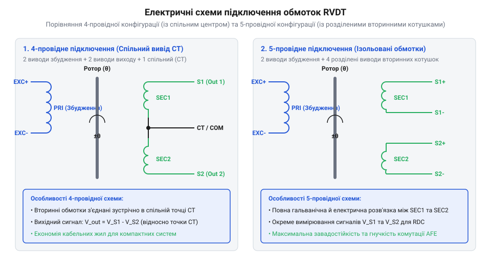
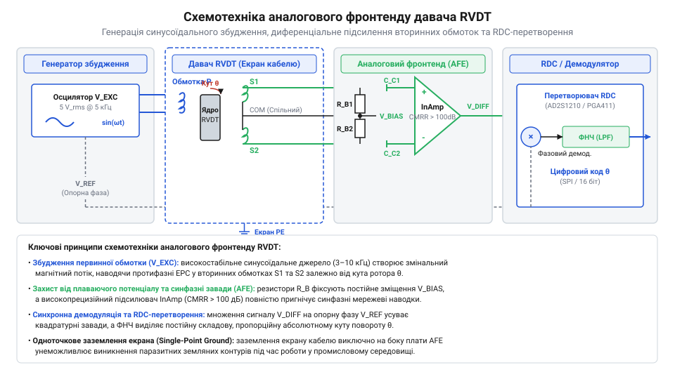
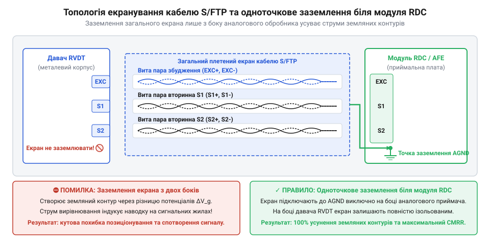

# Апаратний API-довідник підключення, екранування та схемотехніки RVDT

<preknowlist>
- [Поворотний потенціометр](root:cat-hw-controls/rotary-potentiometer) — порівняння аналогового знімання сигналу та зносу контактної доріжки
- [Дрейф нуля та калібрування органів вводу](root:cat-hw-controls/stick-drift-mitigation) — механізми виявлення та компенсації кутового зсуву нуля
- [Абсолютні поворотні енкодери: однооборотні та багатооборотні](root:cat-hw-controls/rotary-encoders-absolute-single-multi-turn) — принципи вимірювання абсолютного кута вала
</preknowlist>

## Електрична розпіновка та сигнальне призначення

Кутовий змінний диференціальний трансформатор (від англ. @@en|Rotary Variable Differential Transformer@@, RVDT) є пасивним електромагнітним давачем, електричний інтерфейс якого складається з первинної обмотки збудження (від англ. @@en|primary excitation winding@@) та двох вторинних вимірювальних обмоток (від англ. @@en|secondary windings@@). На відміну від контактних органів керування, таких як [поворотні потенціометри](root:cat-hw-controls/rotary-potentiometer), RVDT не має затискачів постійного струму і вимагає синусоїдального живлення змінним струмом.

Первинна обмотка `P` підключається до виводів `EXC+` та `EXC-`. Вона живиться синусоїдальною напругою збудження `V_exc` з амплітудним значенням від `3 В` до `26 В` (RMS) та частотою `f_exc` у діапазоні від `400 Гц` (стандарт бортової авіамережі) до `10 кГц` (промислові сервосистеми). Вторинні обмотки `S₁` та `S₂` формують вихідні напруги, амплітуди яких пропорційні синусу й косинусу кута повороту вала `θ`. Для розрахунку електричної потужності збудження враховують повний імпеданс котушки `Z_P = R_P + j · 2π · f_exc · L_P`, який визначається її активним опором `R_P` (типово `20...100 Ом`) та індуктивністю `L_P` (`5...50 мГн`). Дійсний струм збудження `I_exc = V_exc / |Z_P|` формує повну реактивну потужність `S_exc = V_exc · I_exc` та теплову потужність розсіювання `P_exc = I_exc² · R_P` (зазвичай `0.1...1.5 Вт`). Для узгодження імпедансу первинного генератора з індуктивним навантаженням первинної обмотки `P` застосовують резонансне паралельне узгодження (від англ. @@en|impedance matching@@) за допомогою конденсатора `C_tune = 1 / ((2π · f_exc)² · L_P)`, що компенсує індуктивну складову на частоті збудження, знижує струмовий витік вихідного каскаду та запобігає перегріву й спотворенню синусоїди. Через наявність активного опору `R_P` та індуктивності розсіювання обмоток вихідний сигнал давача має початковий внутрішній фазовий зсув `φ_0` (типово `3°...15°`), а його фаза та полярність визначають напрямок відхилення вала відносно нуля. Для точного визначення цього зсуву застосовують осцилографічну вимірювальну процедуру: перший канал `CH1` підключають до джерела збудження `V_exc`, а другий `CH2` — до виходу вторинної обмотки `S₁`, налаштовуючи синхронізацію осцилографа по переходу через нуль з додатною похідною `dV/dt > 0`. Виміряний часовий зсув `Δt` між точками переходу через нуль (від англ. @@en|zero-crossing points@@) обох синусоїд перераховують у фазовий кут `φ = 360° · f_exc · Δt`, де збіг додатних фронтів засвідчує синфазність (`φ ≈ 0°`, додатний кут `θ > 0`), а збіг додатного фронту з від'ємним крутосхилом — протифазність (`φ ≈ 180°`, від'ємний кут `θ < 0`). При використанні аналогового фазочутливого детектора (від англ. @@en|phase-sensitive detector@@, PSD) вхідний сигнал перемножується з опорним меандром збудження, формуючи постійну напругу `V_dc = V_rms · cos(φ)`, де додатний рівень `+V_dc` відповідає синфазному відхиленню, а від'ємний `-V_dc` — протифазному, що забезпечує апаратне розпізнавання знака й величини кута.

В електричній схемотехніці RVDT застосовують дві основні схемні конфігурації виводів. Для коректного зчитування кутового положення ключове значення має методика визначення фазового зсуву та полярності вихідних напруг вторинних обмоток `V_S1` і `V_S2` відносно сигналу збудження `V_exc`. Через наявність активного опору й індуктивності розсіювання обмоток вихідний сигнал має початковий внутрішній фазовий зсув `φ_0` (типово `3°...15°`), а його полярність (синфазність `0°` або протифазність `180°`) визначає напрямок відхилення вала відносно нуля. Практична вимірювальна процедура осцилографом передбачає підключення першого каналу CH1 до джерела `V_exc`, а другого CH2 — до обмотки `V_S1` з налаштуванням синхронізації по переходу через нуль з додатною похідною `dV/dt > 0`. Часовий зсув `Δt` між точками переходу через нуль (від англ. @@en|zero-crossing points@@) двох синусоїд перераховують у фазовий кут `φ = 360° · f_exc · Δt`: збіг додатних фронтів переходу через нуль засвідчує синфазність (`φ ≈ 0°`, додатний кут `θ > 0`), тоді як збіг з від'ємним крутосхилом свідчить про протифазність (`φ ≈ 180°`, від'ємний кут `θ < 0`). При використанні аналогового фазочутливого детектора (від англ. @@en|phase-sensitive detector@@, PSD) вхідний сигнал перемножується з опорним меандром збудження, формуючи постійну напругу `V_dc = V_rms · cos(φ)`: додатний рівень `+V_dc` вказує на синфазне відхилення, а від'ємний `-V_dc` — на протифазне, що забезпечує апаратне розпізнавання знака й величини кута.

1. **4-провідне підключення (від англ. @@en|4-wire configuration@@)**: вторинні котушки `S₁` і `S₂` з'єднані всередині корпусу давача послідовно-зустрічно. Зовнішній кабель містить лише дві дифпари: первинне збудження `EXC+/EXC-` та єдиний диференціальний вихід `OUT+/OUT-`, напруга якого дорівнює різниці `V_out = V_S1 - V_S2`. При нульовому куті `θ = 0°` вихідна амплітуда прямує до нуля.
2. **5-провідне або 6-провідне підключення (від англ. @@en|5-wire configuration@@)**: кожна вторинна обмотка виведена окремою парою `S1+/S1-` та `S2+/S2-` (або зі спільним середнім виводом нейтралі `CT`, від англ. @@en|center tap@@). Ця конфігурація є найбільш переважною для високоточних систем, оскільки дозволяє оцифровувати амплітуди `V_S1` та `V_S2` окремо і застосовувати раціометричне декодування кута `θ = atan2(V_S1, V_S2)`, абсолютно незалежне від амплітудних коливань генератора збудження.


*Схема з'єднання котушок RVDT: 4-провідне послідовно-зустрічне включення проти 5-провідної конфігурації зі спільним виводом нейтралі.*

## Схемотехніка збудження та диференційного фронтенду

Побудова аналогового фронтенду (від англ. @@en|analog front-end@@, AFE) для RVDT починається з розробки прецизійного синусоїдального генератора збудження. Джерело напруги `V_exc` будують на основі генератора з мостом Віна або за схемою ШІМ-кодека з наступною активною ФНЧ-фільтрацією та підсилювачем потужності (від англ. @@en|push-pull driver@@), здатним віддавати струм `I_exc` до `50–100 мА` в індуктивне навантаження первинної обмотки `P`. Вихідний каскад джерела збудження повинен володіти наднизьким вихідним імпедансом (`R_out < 1 Ом`), щоб реактивний струм індуктивності котушки `P` не спричиняв фазового зсуву та викривлення форми синусоїди при зміні кута ротора. Для узгодження струмового навантаження та захисту від перенапруг зворотної ЕРС самоіндукції паралельно первинній обмотці встановлюють RC-демпфер (від англ. @@en|snubber network@@) або обмежувальні діоди, що запобігає перегріву драйвера та стабілізує амплітуду збудження, як це реалізують у [індуктивних давачах положення](root:cat-hw-controls/optical-and-inductive-position-encoders). Водночас для вторинного вимірювального каскаду критично важливим є розрахунок коефіцієнта підсилення `A_v` диференціального препідсилювача (від англ. @@en|instrumentation amplifier@@) для оптимізації динамічного діапазону (від англ. @@en|dynamic range@@) АЦП. Оскільки максимальна амплітуда різницевого сигналу `V_out_max` при граничному куті повороту ротора `θ_max` зазвичай становить лише `0.5...2.5 В` (RMS), занижений коефіцієнт `A_v` призводить до недовикористання шкали оцифрування та втрати ефективної розрядності (від англ. @@en|effective number of bits@@, ENOB). Вибір коефіцієнта підсилення за формулою `A_v = V_ref_ADC / (V_out_max · √2)` забезпечує узгодження пікового значення сигналу з опорною напругою АЦП `V_ref_ADC` (наприклад, `3.3 В` або `5 В`), а задають його за допомогою прецизійного резистивного дільника `A_v = 1 + (2 · R_f / R_g)` з допуском відхилення номіналів `< 0.1%`, що запобігає як обмеженню сигналу (відсічці вершин синусоїди при механічних ударах), так і фазовим викривленням при зсуві нуля.

Вхідний каскад для зчитування сигналів `V_S1` та `V_S2` висуває суворі вимоги до схемотехнічного виконання. Оскільки вторинні котушки володіють власним індуктивним опором, вхідний опір аналогового фронтенду повинен бути високим (`R_in > 100 кОм`), щоб не завантажувати котушки та не створювати амплітудно-фазових спотворень. Для перетворення вихідного амплітудно-модульованого змінного сигналу на постійну напругу застосовують фазочутливий синхронний аналоговий демодулятор (від англ. @@en|synchronous demodulator@@), який перемикає полярність сигналу синхронно з переходами опорної напруги `V_exc` через нуль. Виділення корисного сигналу здійснюється вихідним активним ФНЧ, де вибір межової частоти зрізу `f_c` визначає критичний компроміс: надмірне підвищення `f_c` залишає гармонійні пульсації несучої частоти `2 × f_exc` на виході, погіршуючи роздільну здатність, а надмірне зниження зумовлює фазову затримку у вимірювальному каналі, що ускладнює [калібрування органів вводу](root:cat-hw-controls/stick-drift-mitigation).

Для захисту від плаваючого потенціалу (від англ. @@en|floating potential@@) при відкритому вході або обриві кабелю у сигнальні лінії вмикають симетричні підтягувальні резистори (від англ. @@en|bias resistors@@) `R_bias` номіналом `10...100 кОм`, з'єднані з опорною напругою `AGND` чи `V_ref / 2`. Паралельно цим резисторам встановлюють балансувальні конденсатори `C_f`, утворюючи з ними пасивний фільтр низьких частот (від англ. @@en|low-pass filter@@) для пригнічення високочастотних завад. Межову частоту зрізу `f_c` цього RC-ланцюга обирають у `5–10` разів вищою за частоту збудження `f_exc`, щоб запобігти додатковому фазовому зсуву та фазовим спотворенням корисного сигналу. Обчислення межової частоти зрізу вхідного RC-фільтра диференціального фронтенду виконують за формулою:

f_c = 1 / (2 × π × R_bias × C_f)      [частота зрізу RC-фільтра]

Наприклад, при виборі `R_bias = 10 кОм` та `C_f = 330 пФ` межова частота зрізу становить `f_c ≈ 48.2 кГц`, що є оптимальним для робочої несучої частоти `f_exc = 5 кГц`. Диференціальні операційні підсилювачі (від англ. @@en|operational amplifiers@@) обирають із високим коефіцієнтом пригнічення синфазного сигналу (від англ. @@en|common-mode rejection ratio@@, `CMRR > 90 дБ` на частоті збудження `1–10 кГц`) та малим вхідним струмом зсуву (від англ. @@en|input bias current@@), що унеможливлює наведення синфазних мережевих завад на корисний сигнал.


*Схемотехнічна обв'язка диференціальних входів RVDT із високою вхідною імпедансністю та фіксацією синфазного потенціалу відносно аналогової землі AGND.*

## Топологія кабельних трас та екранування

Передавання низькорівневих аналогових сигналів змінного струму від давача RVDT до оброблювального модуля в умовах промислових електромагнітних завад вимагає суворого дотримання правил топології кабельних ліній. На відміну від контактних [поворотних потенціометрів](root:cat-hw-controls/rotary-potentiometer), де вимірюється постійна напруга, RVDT працює з амплітудно-модульованою несною частотою у діапазоні від 400 Гц до 10 кГц. Навколишнє обладнання — силові перетворювачі, імпульсні джерела живлення та електродвигуни — наводить на вимірювальну трасу синфазну заваду (@@en|common-mode noise@@). Для її пригнічення сигнальні провідники вторинних котушок `S_1` та `S_2` виготовляють у вигляді індивідуально екранованих витих пар (@@en|shielded twisted pair@@, STP), вміщених у спільний зовнішній екран кабелю (структура S/FTP).

Вита пара забезпечує ідентичне наведення магнітної складової завади на обидва провідники плеча, що дозволяє дифпідсилювачу аналогового фронтенду розпізнати її як синфазний сигнал та пригнічити. Однак головною загрозою для точності залишається виникнення земляних контурів (@@en|ground loop@@). Якщо екран кабелю заземлити з обох боків — і біля давача RVDT, і біля модуля RDC (@@en|resolver-to-digital converter@@), — різниця потенціалів між заземлювачами прожене через екран струм вирівнювання. Цей струм індукує дифнапругу на внутрішніх сигнальних жилах за рахунок взаємної індуктивності. Щоб усунути земляний контур, застосовують принципове правило одноточкового заземлення (@@en|single-point grounding@@): екран кабелю підключають до аналогової землі `AGND` виключно на боці приймального модуля RDC або АЦП, а на боці давача екран залишають ізольованим.


*Схема підключення екранованих витих пар давача RVDT із заземленням загального екрана та індивідуальних екранів плечей в одній точці на боці плати аналогового оброблення.*

У разі протяжних кабельних трас (понад 15–20 метрів) проявляється ефект паразитної ємнісної асиметрії провідників відносно екрана. Якщо погонна ємність першої сигнальної жили `C_p1` відрізняється від ємності другої жили `C_p2` навіть на 5–10 пФ, синфазна напруга наводки перетворюється на диференціальну напругу завади на вході підсилювача: `V_diff_noise = V_cm · 2 · π · f_exc · R_line · (C_p1 - C_p2)`. Для оцінки підсумкової кутової похибки `Δθ_err` розраховують співвідношення наведеної диференціальної напруги до крутизни трансформації RVDT `S_rvdt` (типово `10 мВ / 1°` при збудженні `f_exc = 10 кГц`): при синфазній заваді `V_cm = 10 В`, опорі лінії `R_line = 50 Ом` та ємнісному дисбалансі `ΔC_p = 50 пФ` амплітуда завади становить `V_diff_noise ≈ 1.57 мВ`, що викликає додаткову кутову похибку `Δθ_err = V_diff_noise / S_rvdt = 1.57 мВ / (10 мВ/°) = 0.157°` (понад 9.4 кутових мінут), погіршуючи точність позиціонування систем високоточного керування. Для нейтралізації цього ємнісного витоку застосовують схемотехнічний метод активного гвардування екрана (від англ. @@en|active guarding@@ або @@en|driven guard@@). У цьому разі внутрішній екран витої пари підключають не до нерухомої шини заземлення, а живлять від повторювача напруги (від англ. @@en|guard driver@@), який подає на екран точну синфазну напругу `V_guard = V_cm`. Рівність потенціалів між сигнальною жилою та екраном усуває різницю напруг `ΔV = V_signal - V_guard ≈ 0`, через що реактивний струм витоку через паразитну ємність `I_leak = 2π · f_exc · C_p · ΔV` знижується практично до нуля, відновлюючи коефіцієнт пригнічення синфазного сигналу до `CMRR > 90...100 дБ` на довгих трасах. Схемотехнічний розрахунок підсилювача-повторювача `guard driver` вимагає вибору операційного підсилювача з високою швидкістю наростання напруги (`SR > 10–20 В/мкс`) та смугою підсилення (`GBW > 5–10 МГц`), щоб запобігти фазовому зсуву між `V_guard` та `V_cm` на частотах збудження. Для забезпечення стійкості повторювача при роботі на значну ємність екрана кабелю (`C_shield ≈ 1...5 нФ`) у його вихідну ціп послідовно вмикають ізолюючий резистор `R_iso = 10...47 Ом` із зовнішнім компенсаційним конденсатором зворотного зв'язку, що усуває самозбудження та високочастотні автоколивання каскаду, розширюючи можливості, які мають [оптичні та індуктивні давачі положення](root:cat-hw-controls/optical-and-inductive-position-encoders).

```
V_diff_noise = V_cm · 2 · π · f_exc · R_line · (C_p1 - C_p2)
```

Цей механізм різко деградує коефіцієнт пригнічення синфазного сигналу (@@en|common-mode rejection ratio@@, CMRR) вимірювального тракту, що призводить до кутової похибки. Для запобігання ємнісній асиметрії 5-провідні лінії зв'язку із середньою точкою `CT` (@@en|center tap@@) вимагають симетричного прокладання: жила `CT` трасується у вигляді окремого екранованого провідника або центрального дренажного дроту, а вторинні сигнали `S_1` та `S_2` утворюють симетричну пару відносно `CT`. Використання витих пар із низькою погонною ємністю (менше 50 пФ/м) та суворе прокладання траси подалі від силових ліній живлення є обов'язковими нормами при проєктуванні [оптичних та індуктивних давачів положення](root:cat-hw-controls/optical-and-inductive-position-encoders).

## Балансування, термокомпенсація та захист ліній

Навіть при ідеальній симетрії кабелю первинні відхилення параметрів котушок RVDT та розкид паразитної ємності монтажу створюють квадратурний зсув фази між вихідними напругами плечей `V_S1` та `V_S2`. Квадратурна завада перебуває під кутом 90° відносно опорного синусоїдального сигналу збудження і не усувається звичайним відніманням сигналів, що призводить до так званого квадратурного дрейфу нуля. Для її усунення застосовують ємнісне балансування (@@en|capacitive balancing@@) сигнальних плечей аналогового фронтенду.

Схемотехнічно балансування реалізується включенням керамічного підлаштовного конденсатора `C_trim` із діапазоном ємності `2...20 пФ` паралельно плечу з меншою паразитною ємністю. Для вибору градуювального номіналу `C_trim` попередньо вимірюють початкову асиметрію ємностей кабелю `ΔC_p = |C_p1 - C_p2|` (типово `5–15 пФ` для ліній довжиною `10–30 м`) і підбирають конденсатор із діапазоном перекриття не менше `1.5 × ΔC_p` на основі термостабільного діелектрика NP0 / C0G із відносним дрейфом ємності до `±30 ppm/°C`. Регулюванням `C_trim` вирівнюють загальні ємності плечей до умови `C_sum1 = C_sum2`, що відновлює симетрію імпедансів, забезпечує CMRR тракту понад `90 дБ` і пригнічує температурний дрейф нуля. Поряд із ємнісним балансуванням застосовують аналогову температурну компенсацію первинного струму збудження. Оскільки активний опір мідної обмотки RVDT зростає при нагріванні з коефіцієнтом `α_Cu ≈ +0.393%/°C`, у коло зворотного зв'язку підсилювача збудження вмикають термозалежний дільник на базі NTC-терморезистора (англ. *negative temperature coefficient*, @@en|NTC thermistor@@, від латинського *therme* — тепло та *resistere* — чинити опір) і фіксованих резисторів. Падіння опору NTC-елемента при підвищенні температури точно пропорційно збільшує підсилення каскаду, компенсуючи зростання опору міді та утримуючи амплітуду магнітного потоку постійною. Методика розрахунку термозалежного дільника полягає у паралельному шунтуванні NTC-елемента опором `R_p` для лінеаризації його експоненціальної характеристики `R_ntc(T) = R_25 · exp(B · (1/T - 1/T_25))` під лінійний ТКО міді `α_Cu`. Номінал шунта обирають із умови `R_p ≈ R_ntc(T_mid)` для середньої робочої температури (наприклад, `+25 °C`), після чого підбирають послідовний резистор `R_s`, щоб сумарна зміна опору дільника `R_comp(T) = R_s + (R_ntc(T) · R_p) ÷ (R_ntc(T) + R_p)` задавала зміну коефіцієнта підсилення каскаду `A_v(T) = 1 + R_comp(T) / R_in`, яка дзеркально компенсує зростання опору котушки `R_Cu(T) = R_0 · (1 + α_Cu · ΔT)`. Це усуває дрейф магнітного потоку та полегшує [калібрування органів вводу](root:cat-hw-controls/stick-drift-mitigation). Обчислення температурного коефіцієнта зсуву нуля `TC_zero` здійснюють за формулою:

TC_zero = Δθ_null / ΔT      [температурний коефіцієнт зсуву нуля]

де `Δθ_null` — зсув нульової позиції в градусах при зміні температури навколишнього середовища на `ΔT`. У високоточних системах додатково фільтрують вищі гармоніки (2-гу та 3-тю), що виникають через нелінійність кривої намагнічування феромагнітного осердя RVDT та спотворення генератора збудження. Для цього у вимірювальний тракт інтегрують активний загороджувальний фільтр (від англ. @@en|twin-T notch filter@@), центральна частота режекції якого розраховується за формулою:

```
f_notch = 1 / (2 · π · R · C)
```

де `R` та `C` — номінали резисторів і конденсаторів симетричного Т-подібного моста. Налаштування `f_notch` на частоту другої гармоніки (наприклад, 800 Гц при збудженні 400 Гц) відфільтровує гармонійні спотворення та усуває викривлення вихідної огинаючої. Розрахунок номіналів та схемотехніку пригнічення вищих гармонік висвітлює [проєктування та розрахунок активних подвійних Т-подібних загороджувальних фільтрів](root:com-signal/twin-t-notch-filter-design).

Температурна компенсація RVDT охоплює широкий діапазон від -55 °C до +200 °C. При зміні температури активний опір мідного дроту обмоток змінюється за законом:

```
R(T) = R_0 · (1 + α · ΔT)
```

де `α ≈ 0.00393 K⁻¹` — температурний коефіцієнт опору міді. Це призводить до зміни струму збудження та амплітуди вихідної напруги. Для нейтралізації цього ефекту застосовують два методи:
1. Живлення первинної обмотки від джерела стабілізованого струму (@@en|current-driven excitation@@), а не напруги, завдяки чому створюваний магнітний потік не залежить від температурного дрейфу опору `R_primary`.
2. Логометричне опрацювання сигналів (@@en|ratiometric processing@@) у RDC-перетворювачі, де кут розраховується як функція відношення різниці амплітуд до їхньої суми:

```
θ = arctan( k · (V_S1 - V_S2) / (V_S1 + V_S2) )
```

Оскільки температурна зміна коефіцієнта трансформації однаково впливає на обох вторинних обмотках, відношення `(V_S1 - V_S2) / (V_S1 + V_S2)` залишається інваріантним до зміни температури. Це мінімізує [дрейф нуля та калібрування органів вводу](root:cat-hw-controls/stick-drift-mitigation) у критичних авіаційних застосуваннях.

Для захисту аналогових входів від перенапруг, статики (ESD) та випадкового замикання на силовому кабелі вхідні кола оснащують двонапрямними TVS-діодами (@@en|transient voltage suppressor@@) з напругою пробою 6.8..12 В та самовідновлюваними запобіжниками PTC (@@en|positive temperature coefficient fuse@@) на струм спрацьовування 20..50 мА. Такий комплексний захист гарантує надійність системи на рівні з висунутими вимогами до [абсолютних поворотних енкодерів](root:cat-hw-controls/rotary-encoders-absolute-single-multi-turn).
