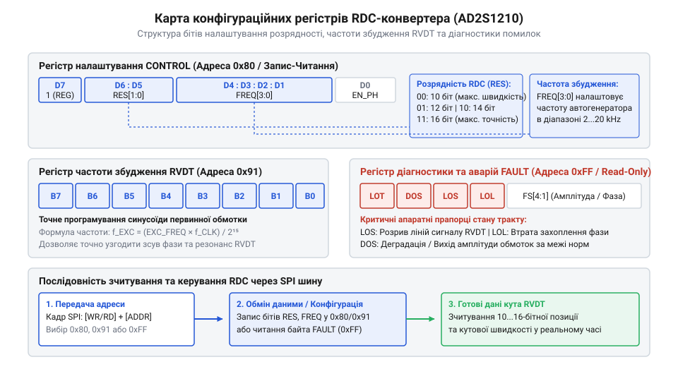
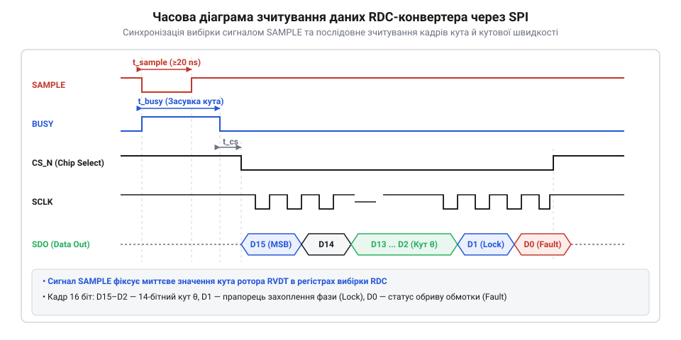

# Програмний інтерфейс RDC-конвертерів: карти регістрів, SPI-кадри та діагностика

<preknowlist>
- [Поворотний потенціометр](root:cat-hw-controls/rotary-potentiometer) — Принцип роботи механічного дільника напруги та його обмеження через знос і тертя контактів.
- [Оптичні та індуктивні давачі положення органів вводу](root:cat-hw-controls/optical-and-inductive-position-encoders) — Базові принципи індуктивного зчитування кутового положення.
- [Абсолютні поворотні енкодери: однооборотні та багатооборотні](root:cat-hw-controls/rotary-encoders-absolute-single-multi-turn) — Принципи формування цифрового коду позиції та передачі даних.
</preknowlist>

## Потреба в RDC та архітектура SPI

Вторинні обмотки давача @@en|RVDT@@ (англ. @@en|Rotary Variable Differential Transformer@@, ротаційний змінний диференціальний трансформатор) випромінюють аналогові амплітудно-модульовані сигнали синусоїдного та косинусоїдного типу. Для обробки цих даних у мікроконтролері звичайний АЦП вимагає високої частоти вибірки, постійного обчислення арктангенса та цифрової фільтрації фазових завад. Щоб звільнити обчислювальне ядро й забезпечити прецизійну точність, застосовують спеціалізовані мікросхеми перетворення — @@en|RDC@@ (англ. @@en|Resolver-to-Digital Converter@@, перетворювач резольвер-цифра, наприклад @@en|AD2S1210@@). Мікросхема @@en|RDC@@ виконує роль апаратного мосту: вона ґенерує синусоїдне збудження для давача, демонтує вихідні напруги та безперервно відстежує кутову координату ротора.

Передача оцифрованого кутового коду та кутової швидкості в мікроконтролер реалізується через чотирипровідну шину @@en|SPI@@ (англ. @@en|Serial Peripheral Interface@@, послідовний периферійний інтерфейс), що містить лінії лінійного вибору @@en|CS@@ (англ. @@en|Chip Select@@), тактування @@en|SCLK@@ (англ. @@en|Serial Clock@@), виходу даних @@en|SDO@@ (англ. @@en|Serial Data Out@@) та входу даних @@en|SDI@@ (англ. @@en|Serial Data In@@).

Для гарантування синхронності вибірки в RDC-конвертерах передбачено окремий апаратний вхід засувки @@en|SAMPLE@@. Короткий від'ємний імпульс на лінії @@en|SAMPLE@@ миттєво фіксує поточний стан внутрішніх відстежувальних реверсивних лічильників, заморожуючи значення позиції та швидкості у вихідних засувках. Це усуває джитер та часовий неоднаковий зсув при зчитуванні по шині @@en|SPI@@, забезпечуючи точну фіксацію координати подібно до того, як працюють [абсолютні поворотні енкодери](root:cat-hw-controls/rotary-encoders-absolute-single-multi-turn).

При синхронному опитуванні кількох осей сервоприводів (наприклад, у багатовісьових промислових маніпуляторах чи авіаційних системах керування) виводи @@en|SAMPLE@@ усіх мікросхем @@en|RDC@@ об'єднують у спільну лінію апаратного стробування від одного джерела таймера мікроконтролера. Подача паралельного від'ємного імпульсу тривалістю не менше 20 нс фіксує координати всіх датчиків в один і той самий фізичний момент часу, виключаючи кінематичний зсув вибірки між вісями. Після завершення імпульсу мікроконтролер витримує технологічну затримку засувки не менше 60 нс перед початком почергового опитування кожної мікросхеми по шині @@en|SPI@@ через окремі лінії @@en|CS@@, що гарантує цілісність векторних обчислень траєкторії руху.

Проте при віддаленому розташуванні RDC-конвертерів від мікроконтролера паразитна ємність (англ. @@en|parasitic capacitance@@) довгих з'єднувальних шлейфів та друкованих провідників шини @@en|SPI@@ суттєво обмежує граничну частоту тактування @@en|SCLK@@. Формування ланцюга `RC` з активного вихідного опору драйвера та ємності лінії уповільнює фронти сигналів, створюючи затримку поширення (англ. @@en|propagation delay@@) даних на лінії @@en|SDO@@. Якщо затримка поширення `t_prop` разом із часом наростання фронту перевищує половину періоду тактового сигналу `SCLK`, мікроконтролер зчитує біт на виклику засувки до того, як рівень напруги на @@en|SDO@@ встигає стабілізуватися, що спричиняє спотворення даних. Для запобігання збоям обміну розробник драйвера мусить знижувати частоту @@en|SCLK@@ (зазвичай з номінальних 25 МГц до 2–5 МГц) пропорційно довжині лінії або впроваджувати програмну компенсацію затримки зсуву фази тактування.

## Конфігурування карти регістрів RDC

Внутрішня архітектура @@en|RDC@@ містить карту адресованих конфігураційних регістрів, які визначають режими роботи, динамічну розрядність перетворення та параметри внутрішнього цифрового автогенератора збудження.

_Структура карти регістрів RDC-конвертера та біти керування роздільністю й частотою збудження._

Ключовим конфігураційним вузлом є регістр керування (англ. @@en|Control Register@@). У ньому програмується роздільна здатність конвертера — `10`, `12`, `14` або `16` біт. Збільшення розрядності підвищує кутову дискретність вимірювання, проте звужує максимальну кутову швидкість вала, яку здатен безпомилково відстежувати внутрішній контур фазового автопідстроювання — @@en|PLL@@ (англ. @@en|Phase-Locked Loop@@, контур фазового автопідстроювання). Наприклад, при розрядності 10 біт конвертер відстежує обертання до 2500 об/с, тоді як при 16 бітах межа швидкості знижується до 125 об/с.

Регістр частоти збудження (англ. @@en|Excitation Frequency Register@@) задає частоту внутрішнього цифрового генератора синуса у діапазоні від 2 кГц до 20 кГц шляхом запису цифрового дільника відносно системної тактової частоти. Зміна режимів між конфігуруванням та зчитуванням позиції або швидкості здійснюється шляхом комбінації керувальних рівнів на вхідних виводах @@en|A0@@ і @@en|A1@@ або записом відповідного командного коду в регістр керування.

Для системного тактування `f_CLKIN = 8.192 МГц` значення дільника `N_freq`, що записується в регістр частоти збудження (англ. @@en|Excitation Frequency Register@@), розраховується через задану частоту синуса `f_exc` та коефіцієнт внутрішнього дільника:

N_freq = (f_exc · 32768) ÷ f_CLKIN      [формула розрахунку цифрового коду частоти]

**Обчислення дільника для частоти збудження 10 кГц:**

f_exc = 10000 Гц      [цільова частота синусоїдного збудження]
f_CLKIN = 8192000 Гц      [системна тактова частота кварцового резонатора]
N_freq = (10000 · 32768) ÷ 8192000 = 40 = 0x28      [значення коду для запису в регістр]

Запис отриманого значення `40` (в шістнадцятковій формі `0x28`) у конфігураційний регістр налаштовує цифровий синусоїдний автогенератор мікросхеми @@en|RDC@@ на точну вихідну частоту 10 кГц з мінімальним фазовим джитером.

## Формування SPI-кадрів зчитування

Процедура зчитування кутового коду та швидкості через шину @@en|SPI@@ вимагає суворого дотримання часових інтервалів стробування та затримок спрацьовування засувок.

_Часова діаграма стробування SAMPLE та вичитання 16-бітних кадрів SPI для позиції та швидкості._

Зчитування розпочинається подачею від'ємного імпульсу на вхід @@en|SAMPLE@@ тривалістю не менше `t_sample` (20–50 нс). Після завершення часу фіксації даних `t_hold` (близько 60 нс) мікроконтролер знижує рівень на лінії @@en|CS@@ і починає ґенерувати тактові імпульси @@en|SCLK@@. Дані передаються послідовними 16-бітними кадрами, починаючи зі старшого біта — @@en|MSB@@ (англ. @@en|Most Significant Bit@@, старший значущий біт) до молодшого біта — @@en|LSB@@ (англ. @@en|Least Significant Bit@@, молодший значущий біт).

Отриманий з @@en|SPI@@ двобайтовий код позиції `N_pos` перераховується в кутові одиниці залежно від обраної розрядності `n`:

Окрім позиції, процедура зчитування кутової швидкості вимагає переведення керувальних виводів у відповідний режим і зчитування 16-бітного кадру в форматі доповняльного коду (англ. @@en|2's complement@@, доповнення до двох). У цьому форматі старший біт визначає напрямок обертання вала (знак `0` відповідає обертанню за годинниковою стрілкою, знак `1` — проти годинникової стрілки), а решта 15 біт визначають абсолютну амплітуду швидкості. Для запобігання зчитуванню проміжних несвіжих даних при високій динаміці обертання використовують двопрохідну схему або перевірку парності кадру: першим транзитом вичитаний старший та молодший байти об'єднуються у знакове 16-бітне ціле число з подальшою знакопоширювальною трансформацією у тип з плаваючою крапкою для розрахунку швидкості в радіанах за секунду.

θ = N_pos · 360° ÷ (2ⁿ)      [перерахунок цифрового коду у кутове положення]

**Обчислення кута при 16-бітній роздільності:**

N_pos = 0xC000 = 49152      [16-бітний код зчитуваного регістра позиції]
θ = 49152 · 360 ÷ 65536 = 270°      [підсумковий кут повороту вала]

Аналогічно, при перемиканні ліній @@en|A0@@/@@en|A1@@ у режим зчитування швидкості, вичитаний кадр розкодовується у кутову швидкість `ω` з урахуванням системної частоти тактування. Отримані значення відповідають тим принципам, за якими будуються [оптичні та індуктивні давачі](root:cat-hw-controls/optical-and-inductive-position-encoders) кутового положення.

## Статусний регістр та діагностика аварій

Для забезпечення надійності приводів мікросхема @@en|RDC@@ оснащена статусним регістром помилок (англ. @@en|Fault Register@@), який аналізує фізичний стан ліній зв'язку та якість індуктивного зв'язку обмоток @@en|RVDT@@.

Бітова маска статусного регістра повертає прапорці апаратних збоїв:

1. Прапорець деградації сигналу — @@en|DOS@@ (англ. @@en|Degradation of Signal@@, падіння амплітуди сигналів): встановлюється при виникненні стану @@en|loss of signal@@ (англ. @@en|loss of signal@@, втрата сигналу), коли сумарна амплітуда вторинних обмоток падає нижче допустимої межі через обрив кабелю або коротке замикання.
2. Прапорець втрати відстеження — @@en|LOT@@ (англ. @@en|Loss of Tracking@@, втрата відстеження): спрацьовує при виникненні стану @@en|loss of lock@@ (англ. @@en|loss of lock@@, втрата захоплення фази), якщо кутова швидкість перевищує можливості контуру @@en|PLL@@ або в системі виникає фазовий зсув між збудженням і відгуком.
3. Прапорець контролю парності (англ. @@en|Parity Fault@@): сигналізує про викривлення бітів під час обміну по шині @@en|SPI@@.

У драйвері мікроконтролера зчитування регістра статусу виконується після кожного кадру або за апаратним перериванням від виводу @@en|FAULT@@. Якщо зафіксовано прапорець @@en|DOS@@ або @@en|LOT@@, програмний драйвер миттєво переводить керувальний сервопривід у безпечний аварійний режим, упереджуючи некоректні дії, що важливо, коли в системі налаштовується [калібрування дрейфу нуля](root:cat-hw-controls/stick-drift-mitigation).

Для повернення перетворювача у робочий стан після усунення фізичної причини аварії недостатньо лише прочитати вміст регістра — прапорці помилок є зафіксованими (англ. @@en|latched@@). Програмний порядок скидання @@en|Fault Register@@ вимагає виконання циклу очищення шляхом повторного стробування лінії @@en|SAMPLE@@. Драйвер формує короткий від'ємний імпульс на виводі @@en|SAMPLE@@, який примушує внутрішню аналого-цифрову логіку мікросхеми виконати свіжий замір стану обмоток, після чого виконується повторне зчитування статусного регістра по шині @@en|SPI@@ для підтвердження обнулення прапорців @@en|DOS@@ та @@en|LOT@@. Якщо прапорці успішно скинуті, драйвер знімає блокировку та відновлює нормальну видачу кутових координат на сервопривід.
