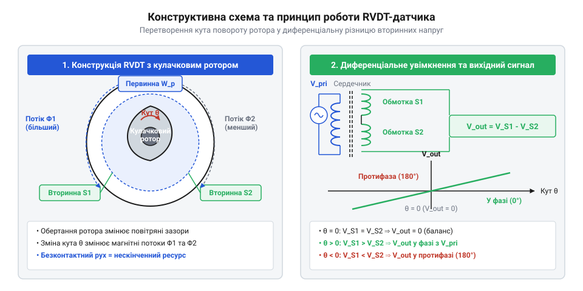
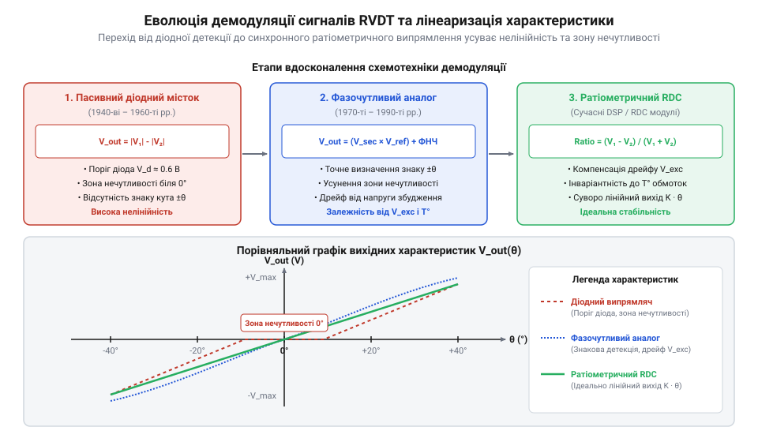

# Історія винайдення та еволюція поворотних диференціальних трансформаторів

<preknowlist>
- [Поворотний потенціометр](root:cat-hw-controls/rotary-potentiometer) — Принцип роботи механічного дільника напруги та його обмеження через знос і тертя контактів.
- [Оптичні та індуктивні давачі положення органів вводу](root:cat-hw-controls/optical-and-inductive-position-encoders) — Базові принципи індуктивного зчитування кутового положення.
</preknowlist>

## Проблема зносу потенціометрів в авіації

На початку 1940-х років, у розпал Другої світової війни, авіаційна техніка зазнала бурхливого розвитку: швидкості польоту зросли, а керування закрилками, елеронами та рулями висоти потребувало точного вимірювання кутового положення в реальному часі. Єдиним на той час доступним інструментом для перетворення кута повороту в електричний сигнал були резистивні дільники напруги. Проте конструкція [поворотних потенціометрів](root:cat-hw-controls/rotary-potentiometer) містила фундаментальний недолік — безпосередній механічний контакт між струмознімальним повзунком (`@@en|Wiper@@`) та резистивною доріжкою.

У жорстких умовах експлуатації військової авіації цей контакт швидко ставав джерелом катастрофічних відмов. Постійна моторна й аеродинамічна вібрація літака спричиняла брязкіт контактів (`@@en|Contact Chatter@@`), під час якого повзунок мікроскопічно відривався від резистивної доріжки. Механічний відрив супроводжувався дуговим мікроіскрінням (англ. @@en|micro-arcing@@) через розрив індуктивного струму обмоток, що викликало локальне вигорання матеріалу та генерувало широкосмуговий частотний спектр контактного шуму (англ. @@en|contact noise spectrum@@) у діапазоні від кілогерців до десятків мегагерців. Це призводило до появи високочастотних сплесків напруги, спотворення корисного сигналу та тимчасової втрати зворотного зв'язку в автопілотах. Крім того, графітові та дротяні резистивні елементи під дією мікроіскріння та тертьового зносу швидко окислювалися від вологи й вкривалися струмопровідним пилом, що викликало незворотний дрейф характеристик і вихід з ладу авіаційних систем.

Схемотехнічно брязкіт контактів мав катастрофічний деструктивний вплив на вхідні каскади тогочасних авіаційних автопілотів. У лампових підсилювачах (англ. @@en|vacuum tube amplifiers@@, з латинської @@la|vacuum@@ — порожнина) високочастотні індуктивні сплески напруги (англ. @@en|inductive voltage spikes@@) під час мікровідриву повзунка миттєво перезаряджали вхідну міжкаскадну ємність і перевантажували керуючу сітку триодів. Це вибивало керуючу напругу сітки (англ. @@en|grid bias voltage@@) за межі лінійного режиму, спричиняючи тимчасове замирання або насичення електронної лампи та фазовий зсув корисного сигналу. У той же час у магнітних підсилювачах (англ. @@en|magnetic amplifiers@@), які масово застосовувалися у важких бомбардувальниках через підвищену вібраційну стійкість, короткочасні розриви кола керуючого струму викликали різкі стрибки намагнічувальної сили феромагнітного осердя (англ. @@en|ferromagnetic core@@). Гістерезисне насичення осердя (англ. @@en|hysteresis saturation@@) призводило до помилкового зсуву фази вихідного струму живлення виконавчих сервомоторів, викликаючи неконтрольовані ривки аеродинамічних керм літака.

Виникла технічна криза: вимірювальний елемент із обмеженим механічним ресурсом (зазвичай не більше `10⁵ .. 10⁶` циклів) не міг гарантувати безпеку польоту. Авіаційні інженери вимагали принципово нового датчика — безконтактного перетворювача положення, позбавленого тертя, здатного працювати в умовах сильної вібрації та володіти практично нескінченним механічним ресурсом.

## Винахід Германа Шевіца та перші RVDT

Розв'язання цієї проблеми запропонував американський інженер Герман Шевіць (англ. @@en|Herman Schaevitz@@). У 1943 році, працюючи над замовленнями для військово-повітряних сил США, він розробив лінійний змінний диференціальний трансформатор `@@en|LVDT@@` (лінійний змінний диференціальний трансформатор, (англ. @@en|Linear Variable Differential Transformer@@)), а невдовзі адаптував цей принцип для кутових переміщень, створивши поворотний диференціальний трансформатор `@@en|RVDT@@` (поворотний змінний диференціальний трансформатор, (англ. @@en|Rotary Variable Differential Transformer@@), патент США US 2,427,614).

В основі винаходу Шевіца лежав принцип безконтактного вимірювання за допомогою зміни індуктивного зв'язку між обмотками. Конструкція RVDT складалася з нерухомого статора, на якому розміщувалася первинна обмотка збудження `P_1` та дві симетричні вторинні обмотки `S_1` і `S_2`, з'єднані зустрічно-послідовно, а також ротора у формі спеціально профільованого феромагнітного кулачка (ексцентрика), закріпленого на валу.

При подачі на первинну обмотку змінної напруги збудження `V_ref` синусоїдальної форми зміна кута повороту ротора `θ` змінювала магнітний опір повітряного зазору, перерозподіляючи магнітний потік між вторинними обмотками.

```
V_diff = V_S1 - V_S2
= K · θ · V_ref          [лінійне наближення диференціальної напруги у діапазоні кутів від -40° до +40°]
```

У нульовому положенні вала (`θ = 0°`) кулачок розташовувався симетрично відносно обох вторинних обмоток. Магнітні потоки через `S_1` та `S_2` були однаковими, наведені ЕРС компенсували одна одну, і вихідна напруга дорівнювала нулю (`V_diff = 0 В`). При обертанні вала за годинниковою стрілкою ротор збільшував переріз магнітопроводу під `S_1` та зменшував під `S_2`. Напруга `V_S1` ставала більшою за `V_S2`, а вихідна різницева напруга зростала пропорційно куту повороту у фазі з первинним сигналом. При обертанні проти годинникової стрілки ситуація змінювалася на протилежну — вихідний сигнал змінював фазу на `180°`.


*Конструктивна схема першого RVDT з кулачковим ротором, первинною та двома протифазними вторинними обмотками для перетворення кута в різницю напруг.*

Спеціальний профіль ротора дозволяв забезпечити високу лінійність перетворення (відхилення від лінійності менше ніж `±0.5%`) у робочому діапазоні кутів до `±40°`. Перші промислові та авіаційні RVDT 1940–1950-х років, вироблені заснованою Шевіцом компанією Schaevitz Engineering, довели свою абсолютну надійність: відсутність контактного тертя усунула знос і шуми, дозволивши використовувати датчики в найвідповідальніших вузлах авіації. Детальніше про заснування компанії та становлення галузевих стандартів диференціальних трансформаторів читайте в огляді [історії Schaevitz Engineering](root:cat-hw-controls/schaevitz-engineering-history).

Досягнення високої лінійності у трансформованій схемі вимагало математичного прорахунку геометрії сердечника. Повітряний зазор циліндричної форми створює синусоїдальну залежність магнітного потоку від кута повороту `Φ(θ) ~ sin(θ)`. Щоб лінеаризувати вихідну різничну напругу `V_diff ~ K · θ`, Герман Шевіць спрофілював кулачковий ротор за радіальною функцією `R(θ) = R_0 ± k · θ`. Зміна радіуса кулачка відповідно змінювала товщину повітряного зазору `g(θ) = g_0 ∓ k · θ`, компенсуючи нелінійність магнітного опору зазору `R_m`. У результаті похідна магнітного потоку по куту `dΦ ÷ dθ` залишалася сталою, що гарантувало строгу пропорційність між кутовим переміщенням ротора та вихідною ЕРС. Однак при кутах відхилення понад `±40°` ця математична модель порушується через крайові ефекти розсіювання магнітного поля (від англ. @@en|fringing effect@@) на полюсних наконечниках статора. На краях роторного кулачка виникає локальне насичення феромагнетика та викривлення силових ліній у повітрі (від англ. @@en|magnetic flux leakage@@), що змінює еквівалентний магнітний опір зазору `R_m(θ)` і призводить до падіння крутизни `dΦ ÷ dθ`, через що нелінійність вихідної напруги стрімко зростає з `±0.5%` до `2–5%` при наближенні до `±60°`.


*Схема еволюції демодуляції сигналів RVDT від діодних містків до синхронних детекторів із графіком лінеаризації вихідної характеристики.*

## Еволюція схемотехніки демодуляції та лінеаризація

Перші трансформаторні давачі кута у 1950-х роках стикнулися з упередженням щодо нелінійності вихідного сигналу. Просте діодне випрямлення вторинних напруг не дозволяло відрізнити позитивний кут повороту від негативного, адже амплітуда ЕРС у двох протифазних обмотках змінювалася симетрично відносно нуля. Крім того, нелінійність падіння напруги на діодах при малих амплітудах спотворювала сигнал поблизу нульової позиції ротора.

Розв'язанням цієї кризи стало впровадження @@en|фазочутливої демодуляції@@ (грец. @@el|phasis@@ — поява, лат. @@la|demodulatio@@ — вимірювання). У 1960-х роках інженери застосували ключові транзисторні схеми, де сигнал первинного збудження використовувався як опорний для перемикання фазового детектора. Це дозволило отримувати постійну напругу, знак якої строго відповідав напрямку відхилення ротора, а значення було пропорційним куту повороту. Завдяки відносній обробці різниці та суми вихідних напруг вдалося усунути вплив температурних коливань опору обмоток та амплітуди збудження, спростувавши міф про нелінійність індуктивних схем.

Справжній прорив відбувся у 1970–1980-х роках із появою спеціалізованих аналогових мікросхем, таких як аналогово-цифрові перетворювачі для трансформаторних давачів. Інтегральні рішення на кшталт `AD598` та `AD698` від компанії @@en|Analog Devices|Analog Devices Inc.@@ об'єднали на одному кристалі прецизійний генератор збудження, синхронний демодулятор та обчислювач ратіометричної функції `(V_1 - V_2) / (V_1 + V_2)`. Така схемотехніка забезпечила нелінійність вихідної характеристики нижче `0.1%` у робочому діапазоні кутів. Саме ця гарантована точність та завадостійкість дозволила використовувати `RVDT` як основне джерело зворотного зв'язку в електродистанційних системах керування польотом (англ. @@en|fly-by-wire@@), де механічні [поворотні потенціометри](root:cat-hw-controls/rotary-potentiometer) спричиняли відмови. Принцип внутрішньої будови та алгоритми роботи таких обчислювачів розглянуто в матеріалі про [спеціалізовані мікросхеми перетворення RVDT у цифровий код](root:cat-hw-controls/rvdt-to-digital-converters).

Ключова перевага ратіометричного архітектурного принципу у мікросхемі `AD598` полягає в автоматичній компенсації температурного дрейфу обмоток `@@en|RVDT@@`. Під час зміни температури навколишнього середовища активний опір мідного провідника обмоток змінюється за законом `R(T) = R_0 · (1 + α · ΔT)`, що призводить до падіння амплітуди ЕРС на обидвох вторинних обмотках на однаковий коефіцієнт `k(T)`. Вбудований обчислювач виконує ділення різниці вторинних сигналів на їхню суму:

```
V_ratio(T) = [k(T) · V_1 - k(T) · V_2] ÷ [k(T) · V_1 + k(T) · V_2]
= k(T) · (V_1 - V_2) ÷ [k(T) · (V_1 + V_2)]    [винесення температурного дрейфу k(T)]
= (V_1 - V_2) ÷ (V_1 + V_2)                      [скорочення температурного дрейфу k(T)]
```

Оскільки дрейф напруги `k(T)` присутній як у чисельнику, так і в знаменнику, він повністю скорочується під час ділення. Це дозволило позбутися додаткових терморезисторів температурної компенсації та забезпечити нульову чутливість вихідного сигналу до температурного розширення та нестабільності напруги первинного збудження.

## RVDT у критичних та екстремальних умовах

Довгий час у промисловості існувала хибна думка, що індуктивні перетворювачі надто чутливі до зовнішніх електромагнітних завад та коливань температури навколишнього середовища. Проте конструктивна еволюція `RVDT` довела протилежне. Відсутність усередині корпусу давача напівпровідникових елементів, електронних плат та тручих контактних груп дозволила розділити вимірювальний вузол і обробну електроніку на значну відстань.

Корпус `RVDT` виготовляють із ферромагнітних сплавів та нержавіючої сталі, а обмотки виконують високотемпературним проводом із керамічною або поліімідною ізоляцією. Це дає змогу давачу безперервно працювати в діапазоні температур від `-55°C` до понад `+200°C`, а в спеціальних виконаннях для аерокосмічної галузі — до `+500°C`. Безконтактна індуктивна конструкція витримує екстремальні рівні вібрації, ударні навантаження до `100g` та високу вологість. На відміну від чутливих до радіації [абсолютних поворотних енкодерів](root:cat-hw-controls/rotary-encoders-absolute-single-multi-turn), `RVDT` виявився стійким до іонізуючого випромінювання.

Для збереження стабільності магнітопроводу та обмоток при екстремальних температурах розробники `@@en|RVDT@@` застосовують прецизійні спеціальні сплави з контрольованими фізичними параметрами. Статор та ротор виготовляють із пермаллою (англ. @@en|Permalloy@@, сплав нікелю та заліза), який зберігає високу магнітну проникність `μ_r > 10000` та точка Кюрі якого перевищує `+460°C`. Корпус і вал виконують із інвару (від лат. @@la|invariabilis@@ — незмінний, англ. @@en|Invar@@), температурний коефіцієнт розширення якого близький до нуля (`α ≈ 1.2 · 10⁻⁶ K⁻¹`), що усуває механічні деформації зазору. Самі обмотки намотують мідним провідником із нікелевим покриттям у керамічній ізоляції (англ. @@en|Ceramic Insulated Wire@@), здатною витримувати тривалий нагрів до `+500°C` без пробою діелектрика, тоді як стандартний поліімідний лак обмежений межею `+220°C`.

Завдяки цим властивостям `RVDT` стали стандартом надійності в ядерній енергетиці для моніторингу положення регулюючих органів реакторів, у супутникових системах орієнтації сонячних панелей та в приводах керованого вектора тяги ракетних двигунів. Еволюційний шлях `RVDT` від перших авіаційних розробок 1940-х років до сучасних сертифікованих модулів продемонстрував, що поєднання фізичної безконтактності та ратіометричної обробки сигналів робить індуктивний давач кута одним із найнадійніших органів первинної інформації у критичній автоматиці.
