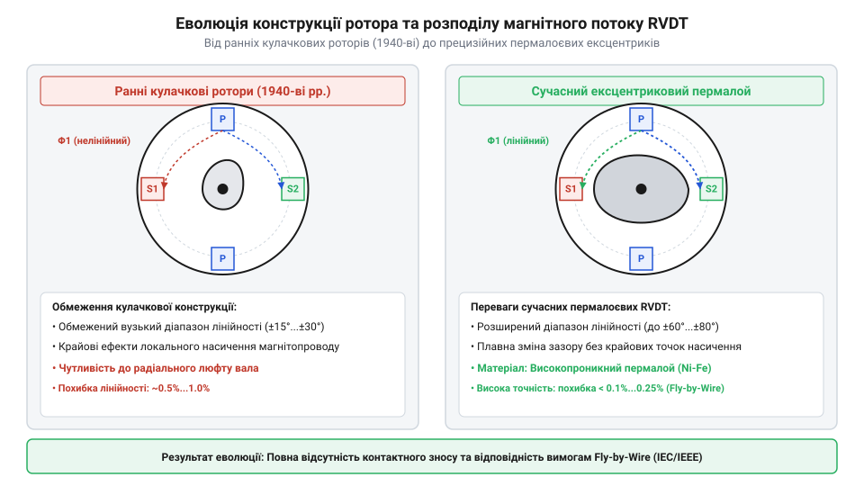
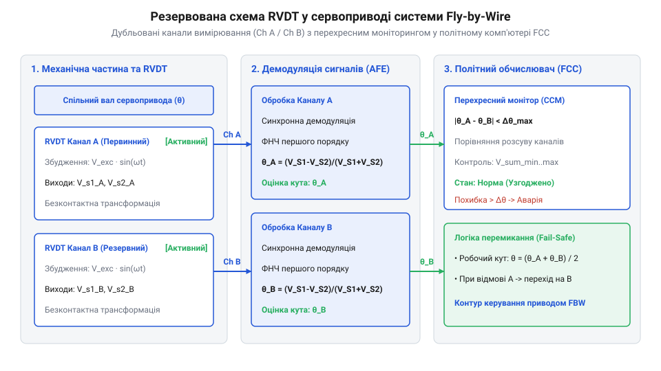

# Еволюція датчиків RVDT: від перших авіаційних безконтактних селекторів до високоточних сервосистем

<preknowlist>
- [Поворотний потенціометр](root:cat-hw-controls/rotary-potentiometer) — механічний знос контактного повзунка та обмеження надійності при тривалій експлуатації
- [Оптичні та індуктивні давачі положення органів вводу](root:cat-hw-controls/optical-and-inductive-position-encoders) — базовий принцип взаємоіндукції та безконтактного зчитування кутового положення
</preknowlist>

## Проблема зношування та поява індуктивного зчитування

У 1940-х роках під час бурхливого розвитку поршневої та першої реактивної авіації системи керування дросельними заслонками двигунів, закрилками та рульовими поверхнями базувалися на використанні контактних [поворотних потенціометрів](root:cat-hw-controls/rotary-potentiometer) і важких електромеханічних сельсинів (від англ. @@en|synchro@@). Проте експлуатація вимірювальних давачів у реальних польотних умовах виявила критичні обмеження контактного зчитування. Суворі авіаційні вібрації з прискоренням до `20–30 g`, циклічні перепади температур від `-55 °C` до `+200 °C` та висока вологість спричиняли швидкий механічний знос струмознімного повзунка. Порівняння характерних апаратних збоїв цих двох типів давачів під дією екстремальних польотних факторів наведено нижче:

| Тип давача | Вплив вібрацій (`20–30 g`) | Вплив термоциклювання (`-55 °C...+200 °C`) | Основний механізм збою |
| :--- | :--- | :--- | :--- |
| Поворотний потенціометр | Відскоки щітки, мікродуговий знос, брязкіт контакту | Окислення резистивної доріжки, зміна опору | Обрив струмознімання та шуми сигналу |
| Електромеханічний сельсин | Знос підшипників, розгойдування ротора через інерцію | Дрейф фазового зсуву, деградація ізоляції | Втрата точності та кутове автоколивання |

Ковзний контакт графітової чи металокерамічної щітки по поверхні резистивної доріжки генерував мікроскопічні відскоки під дією вібрації. Це явище викликало брязкіт контакту, формувало високочастотні електричні завади, викривляло сигнал зворотного зв'язку і в окремих випадках призводило до повної втрати вимірювального сигналу в контурі автопілота. Сельсини, своєю чергою, вимагали обертових роторів зі струмознімальними кільцями та щітками, володіли високим моментом інерції й схильністю до кутового розгойдування.

Інженерна криза надійності авіаційних приводів змусила розробників відмовитися від будь-якого механічного або електричного контакту між рухомим валом та зчитувальними елементами. Розв'язанням проблеми стало використання [індуктивних давачів положення](root:cat-hw-controls/optical-and-inductive-position-encoders), у яких кут повороту перетворюється у вихідну напругу безпосередньо через зміну конфігурації змінного магнітного поля у повітряному зазорі.

## Винахід диференціального трансформатора та кулачкового ротора

Фундамент індуктивного диференціального вимірювання заклав американський інженер Герман Шевіц (англ. *Herman Schaevitz*, @@en|Herman Schaevitz@@), який у 1946–1947 роках запатентував лінійний змінний диференціальний трансформатор (від англ. @@en|Linear Variable Differential Transformer@@, LVDT, патент США US 2,461,238). Конструкція LVDT вирішувала завдання вимірювання лінійних переміщень циліндричного осердя, однак пряме застосування лінійного давача для обертових валів авіаційних селекторів вимагало складних важільних перетворювачів, які вносили люфти та кутовий гістерезис.

У першій половині 1950-х років конструктори розробили спеціалізований кутовий варіант трансформатора — кутовий змінний диференціальний трансформатор (від англ. @@en|Rotary Variable Differential Transformer@@, скорочено @@en|RVDT@@). Головним технологічним проривом стала відмова від лінійного осердя на користь профільованого ротора спеціальної геометричної форми. Перші RVDT мали кулачковий ротор (від англ. @@en|cam-shaped rotor@@ — кулачковий ротор), який при повертанні вала змінював площадочний переріз повітряного зазору між статором та осердям. Однак фізика електромагнітного поля у кулачковому роторі виявила суттєві обмеження: при зміні товщини повітряного зазору `g(θ)` магнітний опір (від англ. @@en|air gap reluctance@@) змінюється за обернено пропорційним законом `R_g(θ) = g(θ) / (μ_0 · A_0)`, що створює значний кутовий коефіцієнт нелінійності (від англ. @@en|non-linearity coefficient@@) `k_NL ≈ 1.5..2.5%` вже при кутах повороту понад `±30°` через появу другої гармоніки в огинаючій сигналу. Розвиток інженерної думки привів до заміни кулачка на дуговий ексцентриковий ротор (від англ. @@en|eccentric rotor@@). У такій геометрії товщина повітряного зазору залишається постійною `g_0`, а кутове повертання змінює безпосередньо ефективну площу перекриття полюсів `A(θ) = A_0 ± k_1 · θ`. Така пряма пропорційність магнітної провідності куту `θ` знизила кутовий коефіцієнт нелінійності до `k_NL < 0.25%` у розширеному робочому діапазоні до `±40°`, що перевищувало точність традиційних [поворотних потенціометрів](root:cat-hw-controls/rotary-potentiometer) і відкрило шлях RVDT до авіаційних сервосистем.

Ключову роль у підвищенні точності відіграв розвиток матеріалознавства м'якомагнітних матеріалів. Осердя ротора та статора почали виготовляти з прецизійних сплавів пермалою (від англ. @@en|permalloy@@ — пермалой, сплав нікелю та заліза) з високою магнітною проникністю `μ_r ≈ 10 000...50 000` та низькими втратами на гістерезис і вихрові струми. При повертанні ротора магнітний опір повітряного зазору під однією вторинною обмоткою `S₁` зменшується, а під іншою `S₂` — пропорційно зростає. Це викликає симетричний перерозподіл взаємної індуктивності та формує вихідну диференціальну напругу `V_out = V_S1 - V_S2`, строго пропорційну кутові повороту `θ`.


*Перехід від профільованого кулачка до симетричного ексцентрикового осердя з пермалою дозволив розширити лінійний діапазон перетворення кута та усунути бічний радіальний тиск на підшипники вала.*

## Впровадження в авіоніку та електродистанційне керування

У 1970–1980-х роках відбувся проривний перехід авіапромисловості від механічних тросових та важільних проводок до електродистанційних систем керування (від англ. @@en|Fly-by-Wire@@). Перші серійні цивільні та військові літаки з електродистанційним керуванням — зокрема Concorde, F-16 та Airbus A320 — вимагали абсолютно надійних давачів положення рульових поверхонь, елеронів та педалей пілота.

Оскільки відмова давача позиційного зворотного зв'язку в системі Fly-by-Wire призводить до втрати керованості повітряним судном, RVDT стали стандартним рішенням завдяки легкості багаторазового канального резервування. Конструктори розробили багатоканальні RVDT (дуплексні, триплексні та квадруплексні), у яких на одному механічному валу встановлювалися дві, три або чотири ізольовані системи первинних і вторинних обмоток у єдиному герметичному корпусі.

Цифрові польотні обчислювачі виконували постійний перехресний моніторинг (від англ. @@en|cross-channel monitoring@@) між каналами `θ_A`, `θ_B` та `θ_C`. У разі відхилення одного з каналів апаратний алгоритм мажоритарного голосування (від англ. @@en|majority voting@@) розраховував медіанне значення кута і миттєво відключав несправний канал без переривання роботи приводу. На відміну від оптичних цифрово-кодових пристроїв, якими є [абсолютні енкодери](root:cat-hw-controls/rotary-encoders-absolute-single-multi-turn), пасивний індуктивний RVDT не містить внутрішньої напівпровідникової електроніки, завдяки чому володіє напрацюванням на відмову понад `500 000` годин і витримує жорстке радіаційне та теплове навантаження біля авіаційних двигунів.

Проте практична реалізація мажоритарного голосування в потрійних RVDT-системах зіштовхнулася з проблемами під час різких перехідних процесів (від англ. @@en|transient response@@) сервоприводу — наприклад, при швидкому відхиленні керма на великі кути. Через мікроскопічні механічні допуски роторів, неідентичність аналогових фільтрів демодуляції та часове зсунення вибірок у незалежних обчислювачах сигнатурні значення `θ_A`, `θ_B` та `θ_C` у динаміці розходяться на короткі проміжки часу. Якщо мажоритарний компаратор зреагує миттєво, цей тимчасовий розсинхрон спричинить хибне відключення справного каналу (від англ. @@en|nuisance tripping@@). Щоб цього уникнути, у ланцюги моніторингу вводять каліброване часове вікно затримки (від англ. @@en|time-delay window@@) тривалістю всього кілька мілісекунд: система зачекає утримання розбіжності вище порогу допуску перед тим, як остаточно розірвати коло живлення первинної обмотки чи ізолювати вихід дефектного канала.


*Дубльована топологія RVDT у сервоприводі електродистанційного керування забезпечує безперервний перехресний моніторинг позиції керма та захист від поодиноких електромагнітних чи механічних відмов.*

## Перехід до цифрових RDC та сервосистем

Еволюція зчитування даних RVDT пройшла шлях від лампових та транзисторних фазочутливих аналогових демодуляторів до спеціалізованих мікросхем резольверно-цифрових перетворювачів (від англ. @@en|Resolver-to-Digital Converter@@, RDC). У 1980–1990-х роках вихід на ринок монолітних RDC-чіпів дозволив оцифровувати вихідні амплітудно-модульовані сигнали вторинних обмоток безпосередньо біля обчислювального блоку. Математична межа ефективної розрядності RDC-перетворювача `N_eff` (ефективна кількість бітів, від англ. @@en|effective number of bits@@, ENOB) прямо визначається відношенням сигнал/шум (від англ. @@en|signal-to-noise ratio@@, SNR) у первинному аналоговому каскаді:

```
SNR = 20 · log₁₀(V_fs / V_noise)              [розрахунок відношення сигнал/шум у дБ]
N_eff = (SNR - 1.76) / 6.02                    [теоретична розрядність квантування]
```

де `V_fs` — середньоквадратична амплітуда повної шкали сигналу, а `V_noise` — середньоквадратична напруга завад та шумів входів. Наприклад, якщо аналоговий фронтенд забезпечує `SNR = 74 дБ`, максимальна досяжна розрядність становить `N_eff = (74 - 1.76) / 6.02 ≈ 12 бітів` (дискретність 4096 відліків), тоді як для 14-бітної точності (`N_eff = 14 бітів`) потрібне `SNR ≥ 86 дБ`, а для 16-бітної — `SNR ≥ 98 дБ`. Якщо через високі електромагнітні наводки чи паразитну ємність кабелю `SNR` знижується до `60 дБ`, молодші розряди 14-бітного RDC зашумлюються, а підсумкова кутова похибка дискретизації обчислюється як `Δθ_err = 360° / 2ⁿ` (де `n = N_eff`), що призводить до втрати точності позиціонування на сервоприводах.

Впровадження раціометричного декодування кута за допомогою чотириквадрантного арктангенса `atan2(V_sin, V_cos)` стало ключовим програмно-апаратним досягненням. Оскільки значення кута обчислюється відношенням напруг вторинних каналів, температура та коливання амплітуди напруги збудження перестали впливати на точність позиціонування. У сучасній робототехніці та верстатах із ЧПК RVDT інтегрують із цифровими сигнальними процесорами (DSP) та мікроконтролерами для керування високомоментними сервоприводами.

Незважаючи на активний розвиток пристроїв, якими є [оптичні та індуктивні давачі положення](root:cat-hw-controls/optical-and-inductive-position-encoders) або оптичні [абсолютні енкодери](root:cat-hw-controls/rotary-encoders-absolute-single-multi-turn), пасивні RVDT зберігають домінуючі позиції у критичних галузях. У зонах з підвищеним рівнем радіації, екстремальними температурами до `+500 °C` та високим вібраційним навантаженням (наприклад, у поворотних соплах реактивних двигунів чи космічних маніпуляторах) RVDT лишаються єдиним працездатним безконтактним рішенням.

## Історична атрибуція та спростування технічних міфів

У популярній технічній літературі та комерційних буклетах часто зустрічається міф про те, що давач RVDT нібито винайшла одна людина на початку 1970-х років спеціально для перших польотних комп'ютерів. Насправді RVDT є результатом колективної еволюції індуктивної сенсорики. Теоретичний і практичний базис диференціального трансформатора (LVDT) запатентував Герман Шевіц (компанія Schaevitz Engineering) у 1946–1947 роках (патент US 2,461,238), а кутові модифікації з кулачковими роторами розроблялися інженерними групами авіабудівних компаній упродовж 1950-х років.

Інший поширений міф зараховує RVDT до різновиду оптичних чи цифрових енкодерів або плутає їх із напівпровідниковими сенсорами на [давачах Холла](root:cat-hw-controls/hall-effect-gimbal-joystick). На відміну від енкодерів, які формують імпульсні чи послідовні цифрові коди, RVDT є строго аналоговим електромагнітним пасивним перетворювачем із суцільним невизначеним кутовим виходом.

Плутанину щодо пріоритетів винаходу остаточно усуває аналіз патентних реєстрів 1950-х років, де зафіксовано розробку кутових модифікацій, які відрізнялися від класичних [індуктивних давачів положення](root:cat-hw-controls/optical-and-inductive-position-encoders). Зокрема, патентні заявки аерокосмічних компаній на кшталт @@en|Bendix Corporation@@ та @@en|General Electric@@ (наприклад, патент US 2,842,756 на поворотний диференціальний трансформатор) задекларували використання профільованого кардіоїдного осердя з @@en|permalloy@@. Саме ця реалізація дозволила перетворити лінійну зміну магнітного опору @@en|LVDT@@ на лінійну кутову залежність вихідної напруги без застосування проміжних кулісних важелів, що закріпило самостійний патентний пріоритет конструкції @@en|RVDT@@.

Чітке розрізнення фізичного перетворювача (пасивного статора й ротора) та електронного фронтенду (демодулятора або RDC) дозволяє правильно оцінювати історію розвитку: витривалість RVDT доведена десятиліттями безвідмовної роботи в аерокосмічній галузі, а сучасна цифрова обробка лише розкрила його нескінченний потенціал точності.
