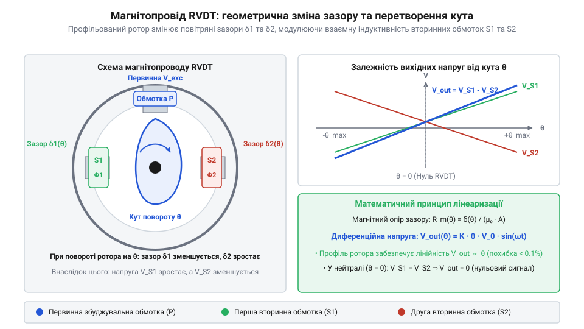
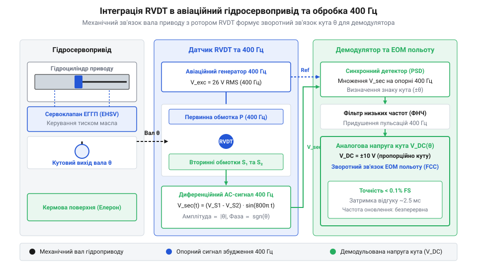

# Історія розвитку поворотних диференціальних трансформаторів

<preknowlist>
- [Поворотний потенціометр](root:cat-hw-controls/rotary-potentiometer) — Принцип роботи контактного дільника напруги та причини зносу резистивної доріжки.
- [Оптичні та індуктивні давачі положення органів вводу](root:cat-hw-controls/optical-and-inductive-position-encoders) — Принципи індуктивної зміни магнітного опору в електромагнітних колах.
</preknowlist>

## Фізичні обмеження потенціометрів в авіації

У ранніх системах автоматичного керування польотом 1930-х років кутове відхилення штурвалів та кермових поверхонь вимірювали на контактних [потенціометрах](root:cat-hw-controls/rotary-potentiometer). Електрична схема була відносно простою: кутовий поворот вала переміщував рухомий металевий контакт — щітку (від англ. @@en|wiper@@ — той, що ковзає) вздовж графітового або дротяного резистивного елемента, змінюючи коефіцієнт ділення напруги. Проте експлуатація цих вузлів у реальних польотних умовах швидко виявила неусувні фізичні обмеження контактного струмознімання.

Головною причиною несправностей стала постійна низькочастотна й високочастотна вібрація планера літака. Під дією вібраційних навантажень щітка втрачала стабільний притиск до доріжки. Виникало таке явище, як контактний брязкіт (від англ. @@en|contact chatter@@) — мікроскопічні відриви щітки від покриття з утворенням мікродуг (від англ. @@en|micro-arcing@@). Це спричиняло швидке шарування резистивного покриття (від англ. @@en|resistive track delamination@@) та локальне зношування провідного шару.

Утворений знос викликав контактний шум (від англ. @@en|contact noise@@) — випадкові високоамплітудні стрибки вихідної напруги. На часовій діаграмі сигналу зворотного зв'язку вібраційний брязкіт відображався у вигляді хаотичної серії спайків (від англ. @@en|voltage spikes@@) та короткочасних провалів напруги до `0 В` тривалістю в кілька мікросекунд. У замкненому контурі від'ємного зворотного зв'язку авіаційного сервоприводу такі високочастотні імпульси диференціювалися аналоговим підсилювачем як надзвичайно високі швидкості кутового відхилення вала, викликаючи хибне спрацьовування виконавчих гідроклапанів та різкий кидок тиску. Літак починав «рискати», а кермові поверхні впадали в високочастотний автоколивальний режим. Додатково цикли заморожування й відтавання вологи в негерметичних відсіках авіоніки при температурах від `-55 °C` до `+70 °C` прискорювали окиснення контактних поверхонь. Перехід від механічного знімання напруги до безконтактного електромагнітного перетворення став для авіабудування питанням живучості бортових систем.

## Винахід симетричного диференціального трансформатора

Шукаючи заміну контактним елементам у 1940-х роках, інженер Герман Шевіц (від англ. @@en|Herman Schaevitz@@) під час роботи в лабораторіях @@en|Bell Labs@@ та подальшого заснування компанії @@en|Schaevitz Engineering@@ розробив концепцію лінійного диференціального трансформатора, яка згодом була адаптована для кутових переміщень під назвою поворотного диференціального трансформатора (від англ. @@en|Rotary Variable Differential Transformer@@, @@en|RVDT@@).

В основу пристрою покладено триобмоткову симетричну систему. Статор RVDT містить центральну первинну обмотку (від англ. @@en|primary winding@@) та дві симетрично розташовані вторинні обмотки (від англ. @@en|secondary windings@@). Первинна обмотка живиться змінним струмом бортової мережі частотою `400 Гц` або окремого генератора на `1 кГц`...`10 кГц`. Вторинні обмотки з'єднані послідовно-зустрічно, утворюючи диференційну вимірювальну схему.

Всередині статора обертається рухомий феромагнітний ротор (від англ. @@en|ferromagnetic rotor@@). Електромагнітна взаємодія між обмотками залежить від положення ротора:

*Схема триобмоткового магнітопроводу RVDT із кулачковим ротором, що демонструє зміну повітряного зазору та лінеаризацію індукованої напруги.*

У нейтральному стані, який називають нульовою точкою (від англ. @@en|null position@@), магнітний потік первинної обмотки розподіляється між вторинними котушками абсолютно однаково. Електромагнітний баланс визначається коефіцієнтами взаємної індуктивності (від англ. @@en|mutual inductance@@) `M_1` та `M_2` між первинною котушкою та кожною із вторинних обмоток. Умова нульового сигналу розраховується з рівності коефіцієнтів взаємоіндукції та послідовно-зустрічного віднімання індукованих напруг `U_s1` та `U_s2`:

M_1 = M_2                               [симетрія магнітного потоку в нулі]
U_s1 = -M_1 · (dI_p / dt)              [індукована ЕРС першої котушки]
U_s2 = -M_2 · (dI_p / dt)              [індукована ЕРС другої котушки]
U_out = U_s1 - U_s2 = 0 В               [повна компенсація протифазних напруг]

Індуковані у вторинних обмотках електрорушійні сили дорівнюють одна одній за амплітудою. Через послідовно-зустрічне підключення ці напруги віднімаються, відтак результуючий вихідний сигнал дорівнює `0 В`.

При повороті ротора на кут `θ` магнітний опір повітряного зазору для однієї вторинної обмотки зменшується, а для іншої — зростає. Рівновага магнітних потоків порушується, і на виході виникає змінна напруга `U_out`:

`U_out = U_s1 - U_s2`

Амплітуда напруги `U_out` є прямо пропорційною куту відхилення ротора, а зсув фази відносно первинного живильного сигналу — `0°` або `180°` — вказує на напрямок повороту відносно нуля. Оскільки ротор не має електричних контактів зі статором, механічне зношування в RVDT обмежене лише терміном служби прецизійних кулькопідшипників.

## Кулачкові ротори та розширення діапазону лінійності

Ранні конструкції індуктивних давачів з циліндричним ротором мали обмежений робочий діапазон. При повороті круглого осердя зміна взаємної індуктивності описувалася синусоїдальною залежністю. Лінійна наближеність зберігалася лише при малих кутах відхилення до `±15°`. При більших поворотах виникала суттєва нелінійність, неприпустима для вимірювальних каналів авіоніки.

Для подолання цього обмеження інженери застосували профільований кулачковий ротор (від англ. @@en|cam-profiled rotor@@). Замість симетричного циліндра ротор виготовляють у формі ексцентрика або кардіоїди з розрахованим радіальним профілем `r(θ)`. Математичний аналіз геометричного профілю будується на компенсації синусоїдальної залежності магнітного опору повітряного зазору (від англ. @@en|air gap reluctance@@) `R_m(θ)`. Якщо товщина зазору `g(θ)` змінюється вздовж радіуса ротора, то магнітний потік `Φ(θ)` залежить від зазору за законом компенсації:

R_m(θ) = g(θ) / (μ_0 · A)              [магнітний опір повітряного зазору]
g(θ) = g_0 / (1 - k · θ)                [профілювання зазору за кривою кардіоїди]
Φ(θ) = F_m / R_m(θ)                     [закон Ома для магнітного кола]
U_out(θ) ∝ dΦ(θ)/dt = K_rvdt · θ        [лінеаризована вихідна напруга]

Під час повороту ротора геометричний профіль кардіоїди нелінійно змінює товщину повітряного зазору (від англ. @@en|air gap@@) між феромагнітним осердям і полюсними наконечниками статора. Така геометрія спроектована так, що пропорційне зменшення зазору `g(θ)` на краях ротора повністю компенсує синусоїдальне згасання зв'язаного магнітного потоку `Φ(θ)`, забезпечуючи суворо лінійну пропорційність напруги куту повороту.

Використання кулачкового профілювання, ідея якого перегукується з принципом профілювання кулачків у механічних [кулачкових перемикачах](root:cat-hw-controls/rotary-cam-switches), дозволило розширити діапазон лінійного вимірювання кута до `±40°`...`±60°` при нелінійності менше ніж `< 0.5%`. Це перетворило RVDT на повноцінні прецизійні вимірювачі серед інших [індуктивних давачів](root:cat-hw-controls/optical-and-inductive-position-encoders).

Для практичної інтеграції RVDT в електродистанційні системи керування політом первинний вихідний змінний струм необхідно було перетворити на постійну напругу, зрозумілу гідравлічним сервоприводам:

*Конструктивна схема підключення RVDT до авіаційного гідросервоприводу із фазочутливим демодулятором 400 Гц.*

Сигнал збудження `400 Гц` надходить на первинну обмотку RVDT та одночасно на опорний вхід фазочутливого демодулятора (від англ. @@en|phase-sensitive demodulator@@). Демодулятор порівнює фазу вихідного сигналу `U_out` з фазою опорної напруги. При збігу фаз (`0°`) електронний блок формує позитивну постійну напругу, а при протифазі (`180°`) — негативну, у діапазоні від `-10 В` до `+10 В`. Згенерований аналоговий сигнал подається безпосередньо на керувальні золотники авіаційного гідросервоприводу. Принципи побудови та електронні схеми такої обробки висвітлено у матеріалі про [фазочутливі демодулятори RVDT](root:cat-hw-controls/rvdt-demodulation-circuits).

## Стандартизація авіаційних сервоприводів та AC-збудження

У 1950–1960-х роках із розвитком реактивної авіації постала потреба у повній уніфікації бортового електрообладнання. Стандартом живлення авіоніки стала мережа змінного струму частотою `400 Гц`. Вибір такої частоти замість промислових `50 Гц` або `60 Гц` дозволив у рази зменшити масу й габарити трансформаторів та електромагнітів за збереження передаваної потужності. Для RVDT це означало можливість прямим чином живитися від бортової шини AC без додаткових проміжних генераторів або випрямлячів.

Стандартизоване AC-збудження (від англ. @@en|AC excitation@@) зробило RVDT неодмінним елементом авіаційних гідросервоприводів. Їх почали масово монтувати безпосередньо у зворотний зв'язок приводів випуск закрилків, елеронів та серводвигунів керування вектором тяги реактивних двигунів. Робота в таких вузлах вимагала стійкості до екстремальних умов. Щоб витримувати реактивні вібрації та температурні коливання від `-55 °C` до `+200 °C` поблизу сопел двигунів, котушки RVDT почали герметизувати високотемпературним компаундом (від англ. @@en|potting compound@@), а обмотувальний дріт вкривати керамічною або поліімідною ізоляцією. Одночасно постала проблема температурного дрейфу нуля через нерівномірну теплову деформацію елементів. Для її усунення інженери провели ретельне узгодження температурних коефіцієнтів лінійного розширення (від англ. @@en|thermal expansion coefficient@@). Використання прецизійних залізо-нікелевих сплавів (пермалоїв та інвару) із майже ідентичними коефіцієнтами розширення `α ≈ 10.5 × 10⁻⁶ K⁻¹` як для феромагнітного ротора, так і для пакета пластин статора гарантувало постійність повітряного зазору й виключило механічне заклинювання та температурний зсув нульової точки при екстремальних перепадах температур.

На відміну від цифрових пристроїв, таких як [абсолютні поворотні енкодери](root:cat-hw-controls/rotary-encoders-absolute-single-multi-turn), RVDT не містить внутрішньої активної електроніки чи напівпровідникових переходів. Монолітна загерметизована конструкція без рухомих електричних з'єднань забезпечила коефіцієнт напрацювання на відмову понад `10⁷` годин, перетворивши RVDT на світовий стандарт для критичних вузлів реактивних літаків та космічних апаратів.

## Розвінчання міфів першості та сучасний синтез

У технічній літературі нерідко зустрічаються плутанина та міфи щодо авторства індуктивних давачів кута. Поширеною помилкою є ототожнення RVDT із сільсинами (від англ. @@en|synchro@@) або резольверами (від англ. @@en|resolver@@). Сільсини й резольвери з'явилися на початку XX століття для повороту валів на необмежений кут `360°` і містять кілька кругових обмоток або роторні щітки. RVDT є фундаментально іншим пристроєм: це обмежений по куту (`±60°`) диференціальний трансформатор з безконтактним кулачковим осердям, сформований як самостійний клас у 1940-х роках у @@en|Bell Labs@@ та @@en|Schaevitz Engineering@@.

Інший історичний міф приписує винайдення RVDT радянським патентам 1950-х років. Радянські інженери дійсно розробляли власні серії індуктивних безконтактних давачів (зокрема тиристорних та фазових перетворювачів), однак промислова концепція симетричного диференціального трансформатора із кулачковим ротором та фазочутливою демодуляцією була запатентована й серійно впроваждена Германом Шевіцем у США ще у першій половині 1940-х років.

Сучасний етап розвитку RVDT полягає у їхньому синтезі з цифровою авіонікою. В електродистанційних системах керування (від англ. @@en|fly-by-wire@@) аналоговий вихідний сигнал RVDT обробляється спеціалізованими цифровими перетворювачами «RVDT-у-цифру» (від англ. @@en|RVDT-to-Digital Converter@@, @@en|RDC@@). Сучасні мікросхеми оцифровують кут із роздільною здатністю до `16 біт` без втрати безконтактної надійності первинного давача. Поєднуючи надійність електромагнітного перетворення з високою роздільною здатністю, RVDT залишаються фундаментальною альтернативою для авіації поруч із такими пристроями, як [оптичні та індуктивні давачі](root:cat-hw-controls/optical-and-inductive-position-encoders). Детальніше архітектуру та особливості застосування таких спеціалізованих ІС розкрито у статті про [перетворювачі RVDT-у-цифру (RDC)](root:cat-hw-controls/rvdt-to-digital-converters).
