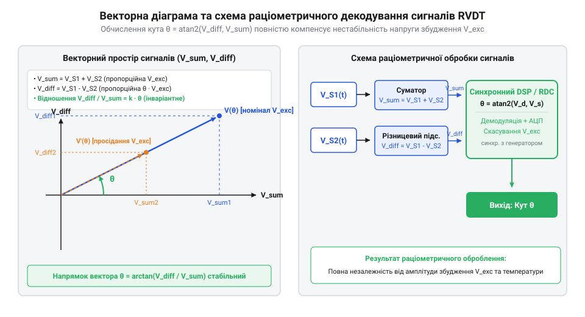

# Електромагнітне моделювання RVDT, раціометричне обчислення кута та аналіз похибок

<preknowlist>
- [Оптичні та індуктивні давачі положення органів вводу](root:cat-hw-controls/optical-and-inductive-position-encoders) — розуміння фізичних принципів електромагнітного перетворення механічного переміщення в електричний сигнал.
- [Дрейф нуля та калібрування органів вводу](root:cat-hw-controls/stick-drift-mitigation) — розуміння джерел температурного дрейфу та методів програмного калібрування давачів.
</preknowlist>

## Електромагнітна модель та магнітний опір

Індуктивний поворотний давач кутового положення RVDT (від англійського @@en|Rotary Variable Differential Transformer@@, від латинського *rotare* — обертатися та *differentia* — різниця) є безконтактним електромагнітним перетворювачем. На відміну від контактних пристроїв вводу, таких як [поворотний потенціометр](root:cat-hw-controls/rotary-potentiometer), RVDT усуває механічне зношення завдяки відсутності ковзних контактів, що забезпечує безперервний ресурс у критичних вузлах керування. Його робота ґрунтується на зміні взаємної індуктивності між первинною обмоткою збудження та двома вторинними обмотками при зміщенні феромагнітного ротора. Загальні фізичні засади таких вимірювачів детальніше висвітлюють [оптичні та індуктивні давачі положення органів вводу](root:cat-hw-controls/optical-and-inductive-position-encoders).

Магнітна система RVDT складається з нерухомого статора з пазами та кулачкового ротора спеціальної профільованої форми. Коли первинну обмотку живлять змінним струмом, у статорі створюється змінний магнітний потік. Цей потік замикається через два повітряні зазори між статором і ротором. Повітряний зазор чинить @@en|magnetic reluctance@@ (від латинського *reluctari* — чинити опір), величина якого залежить від геометричної товщини зазору `g(θ)` за кута повороту вала `θ`:

```
R_g(θ) = g(θ) / (μ_0 · A_g)
```

де `μ_0` — магнітна проникність вакууму, `A_g` — ефективна площа перерізу магнітного потоку в зазорі, `g(θ)` — товщина зазору під відповідною обмоткою.

При повертанні ротора з кутовим ексцентриситетом довжина одного повітряного зазору зменшується, а іншого — зростає на таку саму величину. У лінійній кутовій зоні (`-40° ≤ θ ≤ +40°`) зміна магнітного опору викликає пропорційну зміну взаємної індуктивності `M_1(θ)` та `M_2(θ)` між первинною обмоткою `W_p` та вторинними обмотками `W_s1`, `W_s2`. Проте магнітопровід із пермалою (@@en|permalloy@@) має нелінійну криву намагнічування `B-H`, через що диференціальна магнітна проникність `μ(H) = d B / d H` залежить від напруженості магнітного поля `H`. За наближення до зони магнітного насичення (@@en|magnetic saturation@@) та під дією петлі гістерезису (@@en|hysteresis loop@@) значення `μ(H)` падає, спотворюючи синусоїдальний потік і викликаючи вищі гармоніки. Власна індуктивність первинної обмотки `L_p = W_p² / R_g(θ)` визначає її реактивний індуктивний опір `X_L` на кутовій частоті збудження `ω = 2 · π · f_exc`:

        X_L
        = ω · L_p                              [індуктивний реактивний опір на частоті збудження ω]
        = ω · (W_p² / R_g(θ))                  [вираження через кількість витків W_p та магнітний опір R_g(θ)]

Водночас температурний дрейф викликає зміну активного опору мідного дроту первинної обмотки `R_p(T)` за температурного коефіцієнта опору міді `α_Cu ≈ 0.00393 К⁻¹`:

        R_p(T)
        = R_p0 · (1 + α_Cu · ΔT)               [залежність активного опору від температурного відхилення ΔT]

Зміна `R_p(T)` та `X_L` модифікує повний електричний опір первинної обмотки `Z_p = √(R_p(T)² + X_L²)`, що змінює струм збудження `I_p = V_exc / Z_p` та наведений магнітний потік, викликаючи пропорційний масштабний дрейф вихідних напруг вторинних обмоток.

        R_p(T)
        = R_p0 · (1 + α_Cu · ΔT)               [залежність активного опору від температурного відхилення ΔT]

Зміна `R_p(T)` модифікує повний електричний опір первинної обмотки `Z_p = √(R_p(T)² + (ω · L_p)²)`, що змінює струм збудження `I_p = V_exc / Z_p` та наведений магнітний потік, викликаючи пропорційний масштабний дрейф вихідних напруг вторинних обмоток.

```
M_1(θ) = M_0 + k_m · θ
M_2(θ) = M_0 - k_m · θ
```

тут `M_0` — взаємна індуктивність у стані електричного нуля (`θ = 0°`), а `k_m` — коефіцієнт кутової чутливості взаємної індуктивності.

Зміна взаємної індуктивності визначає відповідні коефіцієнти трансформації `k_1(θ)` та `k_2(θ)` для кожної вторинної обмотки. Відношення вихідної напруги до напруги збудження у безнавантажувальному режимі виражається лінійною залежністю:

```
k_1(θ) = V_s1 / V_exc = k_0 + k_θ · θ
k_2(θ) = V_s2 / V_exc = k_0 - k_θ · θ
```

де `k_0` — базовий коефіцієнт трансформації в нулі, `k_θ` — крутизна трансформації на один градус повороту вала.

## Амплітудна модуляція вихідних напруг

Живлення первинної обмотки RVDT здійснюється високочастотною синусоїдальною напругою збудження `v_exc(t) = V_exc · sin(ω_exc · t)`, де `V_exc` — амплітуда напруги, а `ω_exc = 2 · π · f_exc` — колова частота несучого коливання (зазвичай від 400 Гц до 10 кГц). Магнітний потік ротора індукує у вторинних обмотках змінні ЕРС, що являють собою @@en|amplitude modulation@@ сигналів.

Миттєві напруги на виході першої та другої вторинних обмоток враховують коефіцієнти трансформації та власний фазовий зсув `φ`, утворений індуктивністю розсіювання й активним опором котушок:

```
v_s1(t) = (k_0 + k_θ · θ) · V_exc · sin(ω_exc · t + φ)
v_s2(t) = (k_0 - k_θ · θ) · V_exc · sin(ω_exc · t + φ)
```

Для вимірювання кута вторинні обмотки з'єднують послідовно-диференціально (протифазно). У цьому випадку підсумкова результуюча напруга `v_diff(t)` дорівнює різниці вихідних напруг:

```
v_diff(t)
= v_s1(t) - v_s2(t)
= (k_0 + k_θ · θ - (k_0 - k_θ · θ)) · V_exc · sin(ω_exc · t + φ)      [віднімання протифазних напруг]
= 2 · k_θ · θ · V_exc · sin(ω_exc · t + φ)                           [зведення подібних доданків]
```

Амплітудна огинаюча диф-напруги `2 · k_θ · θ · V_exc` прямо пропорційна куту повороту `θ`. Знак кута визначає фазу вихідного сигналу: при `θ > 0` сигнал `v_diff(t)` перебуває в фазі з несучим коливанням, а при переході через електричний нуль (`θ < 0`) співмножник `θ` змінює знак, що еквівалентно фазовому зсуву огинаючої на `180°`. Крутизна трансформації `k_θ` математично визначається співвідношенням кількості витків вторинних обмоток `W_s` до первинної обмотки `W_p` та градієнтом зміни взаємної індуктивності `d M / d θ`:

        k_θ
        = (W_s / W_p) · (d M_norm / d θ)           [залежність від кількості витків вторинної обмотки W_s]

Збільшення кількості витків `W_s` пропорційно підвищує амплітудну чутливість `k_θ`, проте зростання `W_s` збільшує власну індуктивність і паразитна ємність котушок, що обмежує верхню межу частоти збудження `f_exc`.

Сумарна напруга при синфазному включенні вторинних обмоток `v_sum(t)` має вигляд:

```
v_sum(t)
= v_s1(t) + v_s2(t)
= (k_0 + k_θ · θ + (k_0 - k_θ · θ)) · V_exc · sin(ω_exc · t + φ)      [додавання синфазних напруг]
= 2 · k_0 · V_exc · sin(ω_exc · t + φ)                               [зведення подібних доданків]
```

Огинаюча сумарного сигналу `2 · k_0 · V_exc` є постійною величиною щодо кута `θ` і відстежує лише амплітуду живильної напруги `V_exc`.

## Раціометричне декодування кута через atan2

Пряме вимірювання амплітуди `v_diff(t)` створює високу чутливість до нестабільності джерела живлення: будь-яке коливання напруги збудження `V_exc` сприймається як уявна зміна кута вала. Для придушення цієї завади застосовують @@en|ratiometric measurement@@ (від латинського *ratio* — відношення), яке полягає в обчисленні відношення амплітуд різницевого та сумарного сигналів після демодуляції.


*Векторна діаграма огинаючих вихідних сигналів V_diff та V_sum і відповідний раціометричний розрахунок кута θ за допомогою функції atan2.*

Після синхронного випрямлення сигналів отримана амплітуда різниці `V_diff(θ)` та амплітуда суми `V_sum(θ)` утворюють відношення `R(θ)`:

```
R(θ)
= V_diff(θ) / V_sum(θ)
= (2 · k_θ · θ · V_exc) / (2 · k_0 · V_exc)                          [підстановка виразів огинаючих]
= (k_θ / k_0) · θ                                                    [скорочення однакових множників 2 та V_exc]
```

З амплітудного відношення `R(θ)` повністю зникають змінні `V_exc`, частота `f_exc` та температурний дрейф опору мідного дроту первинної обмотки. Програмні методи усунення залишкового зсуву нуля висвітлено в статті [дрейф нуля та калібрування органів вводу](root:cat-hw-controls/stick-drift-mitigation).

Для відновлення кута в повному діапазоні знаків без ризику ділення на нуль використовують двоаргументний арктангенс `atan2(y, x)`:

```
θ_calc = atan2(V_diff(θ), V_sum(θ) · (k_θ / k_0))
```

Для малих кутів (`tan(x) ≈ x` або `sin(x) ≈ x`) формула спрощується до лінійного відношення `θ_calc = (k_0 / k_θ) · (V_diff / V_sum)`, що гарантує високу обчислювальну швидкість у мікроконтролерах без апаратного блоку плаваючої коми. Однак відмова від використання точної функції `atan2` на користь лінійної апроксимації вносить геометричну методичну похибку, яка стрімко зростає при відхиленні ротора від електричного нуля. Математична оцінка цієї похибки базується на розкладі Тейлора `tan(θ) = θ + θ³ / 3 + O(θ⁵)`: абсолютна помилка дорівнює `ε_abs(θ) = |tan(θ) - θ| ≈ θ³ / 3` (у радіанах), а відносна методична нелінійність становить `ε_rel ≈ θ² / 3`. При куті повороту `θ = 5°` (0.0873 рад) абсолютна похибка становить всього `0.013°` (відносна помилка 0.25%), що є припустимим для більшості застосувань. Проте при збільшенні кута до `θ = 15°` (0.2618 рад) кутова похибка досягає `0.34°` (відносна нелінійність 2.3%), а при `θ = 30°` (0.5236 рад) помилка відмови від `atan2` перевищує `2.74°` (понад 9% від вимірюваного значення). Таким чином, спрощена лінійна формула придатна лише у вузькій зоні `±10°`, тоді як для забезпечення високого класу точності в усьому робочому діапазоні RVDT використання тригонометричного обчислювача `atan2` є математично обов'язковим.

## Компенсація квадратури та аналіз нелінійності

У реальних RVDT у стані електричного нуля (`θ = 0°`) вихідна різницева напруга не дорівнює строго нулю через ємнісну асиметрію між обмотками. Виникає @@en|quadrature component@@ напруги `V_quad`, яка зсунута по фазі на `90°` відносно корисного сигналу:

```
v_diff_real(t) = 2 · k_θ · θ · V_exc · sin(ω_exc · t + φ) + V_quad · cos(ω_exc · t + φ)
```

Придушення квадратурної напруги забезпечує @@en|synchronous demodulation@@. Опорний сигнал `sin(ω_exc · t + φ)` множать на вхідне коливання та інтегрують за період несучої `T_exc`. Оскільки ортогональний добуток `cos(x) · sin(x)` дає нульове середнє значення, квадратурний компонент повністю скасовується в аналогово-цифровому тракті. Однак для ліквідації залишкової нелінійності вихідної характеристики при великих кутах відхилення необхідний числовий розрахунок вагових коефіцієнтів непарного полінома `θ_calc = a_1 · R + a_3 · R³` (де `R = V_diff / V_sum`). Обчислення значень `a_1` та `a_3` виконують методом найменших квадратів на основі масиву із `M` експериментальних вимірювань `(R_m, θ_m)`. Для цього мінімізують суму квадратів відхилень `S = ∑ [θ_m - (a_1 · R_m + a_3 · R_m³)]²`, що приводить до нормальної системи лінійних алгебричних рівнянь: Схемотехніку фазочутливих детекторів та розрахунок фазового зсуву детально описує [демодуляція сигналів RVDT](root:hw-analog/rvdt-signal-demodulation).

```
[ ∑ R_m²    ∑ R_m⁴ ] [ a_1 ]   [ ∑ (R_m · θ_m)   ]
[                  ] [     ] = [                 ]
[ ∑ R_m⁴    ∑ R_m⁶ ] [ a_3 ]   [ ∑ (R_m³ · θ_m)  ]
```

Визначник цієї системи `D = ∑ R_m² · ∑ R_m⁶ - (∑ R_m⁴)²` дозволяє обчислити точні коефіцієнти лінеаризації за формулами Крамера:

```
a_1 = (∑ (R_m · θ_m) · ∑ R_m⁶ - ∑ (R_m³ · θ_m) · ∑ R_m⁴) / D
a_3 = (∑ R_m² · ∑ (R_m³ · θ_m) - ∑ (R_m · θ_m) · ∑ R_m⁴) / D
```

Отримані значення `a_1` та `a_3` прошивають у енергонезалежну пам'ять мікроконтролера, що забезпечує компенсацію геометричних спотворень RVDT в усьому діапазоні кутів.

Другим чинником похибки є крайова геометрична нелінійність при кутах `|θ| > 40°`, зумовлена крайовими ефектами магнітного поля та насиченням сталі. Для її усунення застосовують @@en|polynomial linearization@@ третього порядку:

```
θ_correct = a_1 · R(θ) + a_3 · (R(θ))³
```

де `a_1` та `a_3` — калібрувальні коефіцієнти, які розраховують під час заводського калібрування RVDT. Сукупний бюджет похибки вимірювання кута після поліноміальної корекції не перевищує `0.05%` від повної шкали. Для побудови високоточних цифрових систем зчитування положення RVDT інтегрують із контролерами, подібними до тих, що використовують [абсолютні поворотні енкодери: однооборотні та багатооборотні](root:cat-hw-controls/rotary-encoders-absolute-single-multi-turn).
