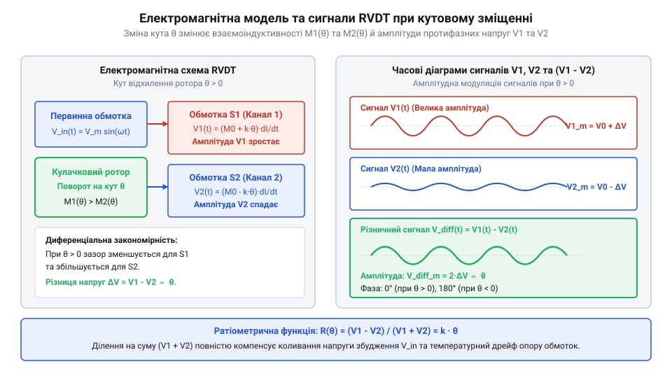
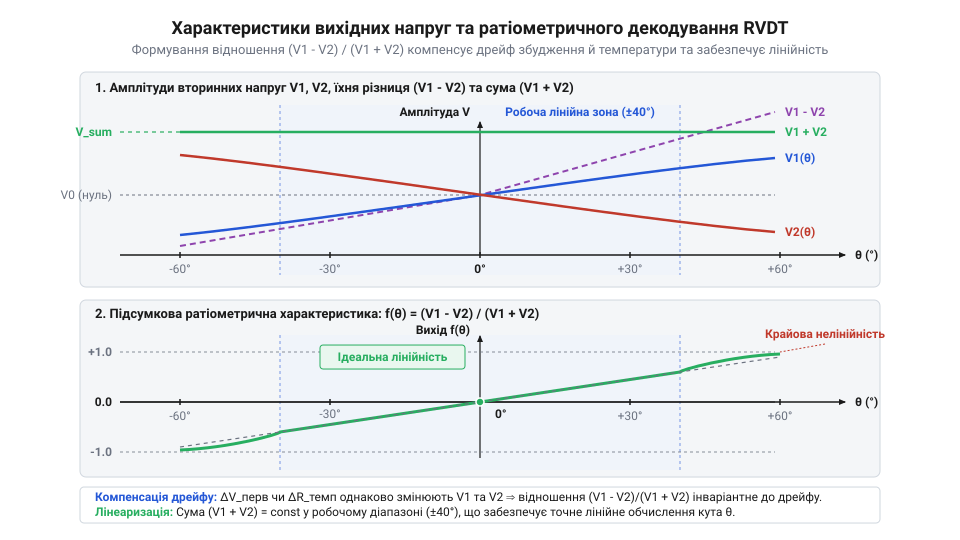

# Математична модель передавальної функції RVDT та ратіометричного декодування

<preknowlist>
- [Оптичні та індуктивні давачі положення органів вводу](root:cat-hw-controls/optical-and-inductive-position-encoders) — фізичний принцип взаємної індукції та трансформаторної зсувної взаємодії
- [Дрейф нуля та калібрування органів вводу](root:cat-hw-controls/stick-drift-mitigation) — поняття температурного дрейфу нуля та методи його компенсування
</preknowlist>

## Нестабільність прямого вимірювання напруги RVDT

Поворотний змінний диференціальний трансформатор (RVDT, від англ. @@en|Rotary Variable Differential Transformer@@, від лат. @@la|transformare@@ — перетворювати) вимірює кутове положення вала безпосередньо через зміну магнітного зв'язку між первинною обмоткою збудження та двома вторинними обмотками. На первинну обмотку подається синусоїдальна напруга збудження `V_exc(t) = V_p · sin(ω · t)`. Наївний підхід до зчитування координати полягає в прямому вимірюванні амплітуди вихідної напруги однієї з вторинних обмоток або їхньої прямої різниці. Проте в реальних промислових та авіаційних умовах така пряма детекція призводить до критичних похибок, роблячи вимірювання абсолютно ненадійним.

Перше джерело нестабільності — плавання амплітуди джерела збудження `V_p`. Будь-які коливання напруги живлення генератора чи дрейф коефіцієнта підсилення вихідного буфера на ±5% пропорційно змінюють амплітуду індукованої ЕРС у вторинних обмотках. Другим, ще більш небезпечним чинником є температурний дрейф опору обмоток. Мідний провідник має високий позитивний температурний коефіцієнт опору (від англ. @@en|temperature coefficient of resistance@@, TCR) `α ≈ +0.393% / °C`. Якщо температура в зоні встановлення давача зростає на `ΔT = 50 °C`, активний опір первинної обмотки `R_p` зростає за законом `R_p(T) = R_p0 · (1 + α · ΔT)` майже на `20%`. Математично амплітуда струму збудження `I_p` залежить від повного опору `|Z_p| = √(R_p² + (ω L_p)²)`. Продиференціювавши вираз амплітуди вихідної вторинної напруги `V_sec(θ) = ω · M(θ) · I_p` за активним опором `R_p`, отримуємо аналітичну залежність відносної похибки вимірювання кута `δ_θ`:

δ_θ = ΔV_sec ÷ V_sec                                    [визначення відносної похибки]
= - (R_p · ΔR_p) ÷ (R_p² + (ω L_p)²)                    [диференціювання струму I_p за R_p]
= - α · ΔT ÷ [1 + (ω L_p ÷ R_p)²]                       [підстановка ΔR_p = α · ΔT · R_p]

З отриманої формули видно, що зростання температури `ΔT` викликає зворотний дрейф вихідної напруги, де похибка кута `δ_θ` прямо пропорційна коефіцієнту `α` та залежить від співвідношення індуктивного `ω L_p` і активного `R_p` опорів обмотки.

Зростання опору зменшує струм збудження первинної обмотки, що викликає падіння створеного магнітного потоку та пропорційне зменшення амплітуд вторинних напруг `V₁` і `V₂`. Для вимірювальної системи це виглядає так, ніби ротор датчика здійснив поворот на кілька градусів, хоча фізичний вал залишався абсолютно нерухомим. На відміну від [поворотних потенціометрів](root:cat-hw-controls/rotary-potentiometer) чи [оптичних та індуктивних давачів](root:cat-hw-controls/optical-and-inductive-position-encoders), де пряме вимірювання швидко зазнає [дрейфу нуля](root:cat-hw-controls/stick-drift-mitigation), індуктивний диференціальний трансформатор вимагає відносного математичного алгоритму обробки, абсолютно незалежного від температури й напруги живлення.

## Електромагнітна модель індукції обмоток RVDT

Конструктивно RVDT складається зі статора з чотирма полюсами, на яких розміщено первинну обмотку та дві симетричні вторинні обмотки `S₁` і `S₂`, а також феромагнітного ротора спеціальної ексцентричної чи кардіоїдної форми. Коли вал повертається на кут `θ`, ротор змінює повітряний зазор під полюсами, регулюючи магнітну провідність (від англ. @@en|permeance@@, від лат. @@la|permeare@@ — проникати) магнітного кола кожної обмотки.

У робочому діапазоні кутів (зазвичай `[-θ_max, +θ_max]`, де `θ_max ≈ ±40°`) взаємоіндуктивності `M₁(θ)` та `M₂(θ)` між первинною та відповідною вторинною обмотками змінюються строго лінійно та протифазно. Проте через технологічні допуски виготовлення статора та ротора початковий повітряний зазор під обмотками виявляється асиметричним (`g₁ = g₀ + Δg`, `g₂ = g₀ - Δg`). Оскільки магнітна провідність обернено пропорційна товщині зазору, початкові коефіцієнти взаємоіндуктивності набувають вигляду `M₀₁ = M₀ · (1 - Δg ÷ g₀)` та `M₀₂ = M₀ · (1 + Δg ÷ g₀)`. Знайдемо різницю базових взаємоіндуктивностей `ΔM₀` в нульовому положенні ротора (`θ = 0°`):

ΔM₀ = M₀₂ - M₀₁                                       [різниця початкових взаємоіндуктивностей]
= M₀ · (1 + Δg ÷ g₀) - M₀ · (1 - Δg ÷ g₀)             [підстановка коефіцієнтів із врахуванням асиметрії]
= 2 · M₀ · (Δg ÷ g₀)                                  [зведення подібних доданків]

Ураховуючи кутову чутливість `K_m`, підсумкові рівняння взаємоіндуктивностей з асиметрією зазору набувають вигляду `M₁(θ) = M₀ · (1 - Δg ÷ g₀) · (1 + K_m · θ)` та `M₂(θ) = M₀ · (1 + Δg ÷ g₀) · (1 - K_m · θ)`. Ця геометрична асиметрія створює початкове зміщення нуля, яке вимагає фазочутливого калібрування.

        M₁(θ) = M₀ · (1 + K_m · θ)
        M₂(θ) = M₀ · (1 - K_m · θ)

де `M₀` — взаємоіндуктивність обмоток у нульовому положенні ротора (`θ = 0`), а `K_m` — коефіцієнт чутливості взаємоіндуктивності до кутового зміщення.

За законом електромагнітної індукції Фарадея (від англ. @@en|Faraday's law of induction@@), ЕРС, індукована у вторинних обмотках, пропорційна швидкості зміни магнітного потоку. З урахуванням коефіцієнта трансформації `G_t` та фазового зсуву `φ` між струмом і напругою, миттєві значення вихідних напруг мають вигляд:

        V₁(t, θ) = G_t · V_p · (1 + K_m · θ) · sin(ω · t + φ)
        V₂(t, θ) = G_t · V_p · (1 - K_m · θ) · sin(ω · t + φ)

*Зміна взаємоіндуктивності первинної та вторинних обмоток залежно від кута повороту ротора θ викликає протифазну зміну амплітуд вихідних сигналів V₁ та V₂.*

Після фазочутливої детекції амплітудні значення вихідних сигналів `V₁_peak(θ)` та `V₂_peak(θ)` виражаються формулами:

        V₁_peak(θ)
        = G_t · V_p · (1 + K_m · θ)      [амплітуда першої вторинної обмотки]

        V₂_peak(θ)
        = G_t · V_p · (1 - K_m · θ)      [амплітуда другої вторинної обмотки]

Обидва вирази містять спільний множник `G_t · V_p`, який залежить від температури обмоток, частоти `ω` та стабільності генератора збудження.

## Математичне виведення ратіометричної функції декодування

Щоб повністю усунути вплив нестабільності джерела збудження та температурної зміни опору обмоток, застосовують ратіометричне декодування (від англ. @@en|ratiometric decoding@@, від лат. @@la|ratio@@ — відношення). Воно полягає в обчисленні відношення різниці амплітуд вторинних напруг до їхньої суми.

Знайдемо різницю амплітуд вихідних сигналів `V_diff(θ)`:

        V_diff(θ)
        = V₁_peak(θ) - V₂_peak(θ)
        = G_t · V_p · [(1 + K_m · θ) - (1 - K_m · θ)]
        = 2 · G_t · V_p · K_m · θ         [різниця амплітуд вторинних обмоток]

Знайдемо суму амплітуд вихідних сигналів `V_sum(θ)`:

        V_sum(θ)
        = V₁_peak(θ) + V₂_peak(θ)
        = G_t · V_p · [(1 + K_m · θ) + (1 - K_m · θ)]
        = 2 · G_t · V_p                   [сума амплітуд вторинних обмоток]

Тепер поділимо різницю сигналів на їхню суму, сформувавши ратіометричний коефіцієнт `F_ratio(θ)`:

        F_ratio(θ)
        = V_diff(θ) / V_sum(θ)
        = (2 · G_t · V_p · K_m · θ) / (2 · G_t · V_p)
        = K_m · θ                         [скорочення спільних множників]

У результаті ділення спільні множники передавального коефіцієнта `G_t` та амплітуди `V_p` повністю скорочуються! Більше того, нелінійність кривої намагнічування ферромагнітного сердечника створює вищі гармоніки в струмі збудження (зокрема третю гармоніку `3ω`), що додає до вихідних напруг однаковий гармонічний спектр `H(t) = V_p1 · sin(ω t) + V_p3 · sin(3ω t)`. Оскільки обидві обмотки охоплюють той самий магнітний потік, вирази для різниці `V_diff(t) = 2 · K_m · θ · H(t)` та суми `V_sum(t) = 2 · H(t)` містять ідентичну гармонічну суму `H(t)`, яка повністю скорочується у знаменнику при формуванні ратіометричного відношення `F_ratio(θ) = K_m · θ`. Звідси отримуємо вираз для точно визначеного кута повороту вала `θ`, повністю захищеного як від дрейфу живлення, так і від гармонічних спотворень генератора:

        θ
        = F_ratio(θ) / K_m
        = (V₁_peak - V₂_peak) / (K_m · (V₁_peak + V₂_peak))    [формула ратіометричного кута]

*Ратіометрична функція декодування усуває нелінійність та забезпечує повну компенсацію амплітудного плавання збудження й температурного дрейфу.*

Цей математичний результат гарантує, що обчислений кут `θ` залежить виключно від конструктивного коефіцієнта чутливості `K_m` та співвідношення амплітуд. На відміну від [квадратурних інкрементальних енкодерів](root:cat-hw-controls/rotary-encoders-quadrature) та [абсолютних енкодерів](root:cat-hw-controls/rotary-encoders-absolute-single-multi-turn), аналогова ратіометрична обробка RVDT забезпечує неперервну роздільну здатність із нульовою чутливістю до дрейфу живлення.

У реальних пристроях слід враховувати два неідеальних ефекти: залишкову напругу нуля `V_null` при `θ = 0` (через паразитичну ємність між обмотками) та геометричну нелінійність вищих порядків при кутах `|θ| > 40°`. При великих кутах насичення магнітопроводу додає кубічний член `M₁(θ) = M₀ · (1 + K_m · θ - K_n · θ³)`, який компенсують цифровими таблицями корекції у мікроконтролері. Для автоматизованого обчислення ратіометричного співвідношення та оцифрування вихідних сигналів у реальному часі застосовують спеціалізовані [перетворювачі резольвер/RVDT у цифровий код](root:cat-hw-controls/rdc-converters).

## Лінійність, кутовий діапазон і коефіцієнт трансформації

Математичний зв'язок між кутовим переміщенням ротора та вихідною напругою `RVDT` описується через @@en|коефіцієнт трансформації@@ (лат. @@la|coefficiens@@ — спільний чинник, @@la|transformatio@@ — перетворення) `K_TR`. Цей параметр визначає відносну зміну амплітуди вихідного сигналу на кожен градус повороту вала при номінальній напрузі первинного збудження `V_EX`. Чутливість давача `S_θ` зазвичай виражають у мілівольтах на вольт збудження на градус (`mV / V / °`).

Для визначення вихідної напруги різничного сигналу `V_diff = V₁ - V₂` при куті повороту `θ` застосовують пряме співвідношення:

V_diff(θ) = K_TR · V_EX · θ                             [визначення різничної напруги]
= S_θ · V_EX · θ                                       [через питому чутливість]

У робочому діапазоні кутів `θ ∈ [-40°, +40°]` геометрична форма ротора забезпечує суворо лінійну зміну магнітного опору повітряного зазору. Якщо кут повороту виходить за ці межі і досягає `±60°`, лінійність порушується через викривлення магнітного поля на краях полюсних наконечників статора та насичення ферромагнітного сердечника. Фізично реальна залежність різничної ЕРС від кута має синусоїдальний характер `V_diff(θ) = V_max · sin(k_m · θ)`, де `k_m` — конструктивний коефіцієнт магнітного поля. Розкладаючи цю функцію в ряд Тейлора (названого на честь англійського математика Брука Тейлора, англ. @@en|Brook Taylor@@; від грец. @@el|πολύ@@ — багато та @@el|ὄνομα@@ — ім'я) навколо нульової точки `θ = 0`, кутовий вираз набуває вигляду полінома (від англ. @@en|Taylor polynomial@@) із непарними степенями:

        V_diff(θ) = V_max · (k_m · θ - (k_m · θ)³ ÷ 6 + (k_m · θ)⁵ ÷ 120 - ...)   [розклад синусоїдальної ЕРС у ряд Тейлора]

У вузькому діапазоні малих кутів вищі степені є нехтовно малими, тому передавальна функція апроксимується лінійним членом `V_diff(θ) ≈ K_TR · V_EX · θ`. Проте при відхиленні вала понад `±40°` кубічний член кутової нелінійності (англ. @@en|cubic non-linearity@@) `-(k_m · θ)³ ÷ 6` почне створювати помітний від'ємний прогин залежності від ідеальної прямої, викликаючи геометричне викривлення вихідного сигналу та зростання похибки нелінійності `NL`.

Відносну похибку геометричної нелінійності `NL` обчислюють як відношення максимального відхилення реальної характеристики від ідеальної прямої до повної вихідної шкали `V_FS` при максимальному куті `θ_max`:

NL = (|V_diff(θ) - V_ideal(θ)| ÷ V_FS) × 100%           [розрахунок відносної нелінійності]

Розглянемо обчислення нелінійності на реальному прикладі.
**Умова:** `RVDT` з чутливістю `S_θ = 2.5 mV/V/°` працює при напрузі збудження `V_EX = 5 V`. При куті `θ = 40°` ідеальна напруга становить `V_ideal = 2.5 × 5 × 40 = 500 mV`. Реальний виміряний сигнал через крайове насичення становить `V_diff = 492 mV`. Повна шкала `V_FS = 500 mV`.

NL = (|492 - 500| ÷ 500) × 100%                        [підстановка виміряних значень]
= (8 ÷ 500) × 100%                                     [різниця амплітуд]
= 1.6%                                                 [підсумкова нелінійність]

Для збереження високої точності в системах зворотного зв'язку робочий кутовий діапазон обмежують зоною `±40°`, де нелінійність не перевищує `0.25%`, або застосовують табличну корекцію [дрейфу нуля](root:cat-hw-controls/stick-drift-mitigation).

## Залишкова напруга та фазочутлива демодуляція

У математично ідеальній моделі `RVDT` при нульовому куті повороту `θ = 0°` індуковані ЕРС у вторинних обмотках строго рівні (`V₁ = V₂`), а різнична напруга дорівнює нулю. На практиці в нульовій позиції завжди присутня @@en|залишкова напруга@@ `V_null`. Основними причинами її виникнення є геометрична асиметрія витків вторинних обмоток, паразитична міжобмоточна ємність `C_p` та вищі гармонічні складові струму збудження.

Залишкова напруга складається з двох компонентів: активної складової в фазі з первинним струмом та квадратурної складової (від англ. @@en|quadrature component@@, зсунутої на `90°`), яка виникає через паразитичну міжобмоточну ємність `C_p` та вихрові струми в осерді. Ззвичайний амплітудний випрямляч вимірює скалярний модуль сигналу `|V_diff|`, тому при проходженні через нуль замість нульового значення він фіксує мінімум, що дорівнює `|V_null|`. Це унеможливлює визначення знаку кута повороту за допомогою ззвичайного випрямляча. Для компенсації квадратурної завади опорний синусоїдальний сигнал збудження піддають фазовому зсуву (від англ. @@en|phase shift@@) на кут `φ_ref`, підганяючи його точно під фазу первинного струму `φ_p`. Повний диференціальний сигнал `V_diff(t) = V_m(θ) · sin(ω t + φ_p) + V_quad · cos(ω t + φ_p)` перемножується з підлаштованим опорним сигналом `V_ref(t) = sin(ω t + φ_ref)` у фазочутливому демодуляторі: Для усунення розфазування та квадратурної завади в реальних вимірювальних трактах застосовують спеціальні [способи компенсації фазового зсуву](root:cat-hw-controls/rvdt-phase-shift-compensation).

V_DC = (V_m(θ) ÷ 2) · cos(φ_p - φ_ref) + (V_quad ÷ 2) · sin(φ_p - φ_ref)  [постійна складова після фільтрації низьких частот]
= (V_m(θ) ÷ 2) · cos(0) + (V_quad ÷ 2) · sin(0)                        [підстановка умови фазової синхронізації φ_ref = φ_p]
= V_m(θ) ÷ 2                                                           [повне пригнічення квадратурного компонента V_quad]

де `V_m(θ)` — амплітуда корисного сигналу, пропорційна куту повороту `θ`, `V_quad` — амплітуда квадратурної залишкової напруги, `ω` — циклічна частота, а `V_DC` — постійна напруга на виході фільтра низьких частот. Завдяки такій фазовій компенсації вираз `sin(φ_p - φ_ref)` обертається в нуль, що дозволяє повністю відфільтрувати квадратурний компонент `V_quad` і забезпечити точне проходження вихідного сигналу через нульову позначку.

Для точного декодування напрямку відхилення застосовують @@en|фазочутливу демодуляцію@@ (грец. @@el|phasis@@ — поява, лат. @@la|demodulatio@@ — вимірювання). Вторинний сигнал `V_sec(t) = V_m · sin(ω t + ϕ)` перемножується з опорним сигналом збудження `V_ref(t) = cos(ω t)`.

V_demod(t) = V_m · sin(ω t + ϕ) · cos(ω t)               [перемноження сигналу й опорної фази]
= (V_m ÷ 2) · [sin(2ω t + ϕ) + sin(ϕ)]                 [тригонометрична тотожність добутку]
= (V_m ÷ 2) · sin(2ω t + ϕ) + (V_m ÷ 2) · sin(ϕ)       [розкриття дужок]

Після проходження через фільтр низьких частот високочастотна складова з подвоєною частотою `2ω` відфільтровується, і на виході залишається лише постійна напруга `V_DC`:

V_DC = (V_m ÷ 2) · sin(ϕ)                             [постійна складова після фільтрації]

Фазовий зсув `ϕ` між первинним струмом та вторинною напругою виникає через індуктивний опір обмоток `L` та їхній активний опір `R`:

ϕ = arctan(ω L ÷ R)                                   [фазовий зсув обмотки]

При знаку кута `θ > 0°` амплітуда `V_m` має додатну фазу відносно збудження, і `V_DC > 0`. При `θ < 0°` фаза вихідного сигналу змінюється на `180°`, що робить `V_m` від'ємним і дає `V_DC < 0`. Завдяки фазочутливому демодулюванню квадратурна складова `V_null` повністю пригнічується, а вихідний сигнал строго проходить через нуль, забезпечуючи високу точність [індуктивних давачів](root:cat-hw-controls/optical-and-inductive-position-encoders) порівняно з контактними [поворотними потенціометрами](root:cat-hw-controls/rotary-potentiometer).
