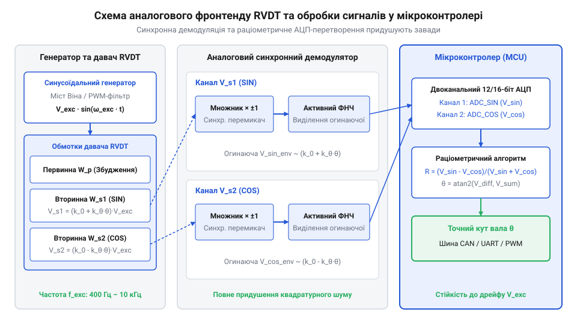

# Проєкт аналогового фронтенду та програмного розбору сигналів RVDT на мікроконтролері

<preknowlist>
- [Оптичні та індуктивні давачі положення органів вводу](root:cat-hw-controls/optical-and-inductive-position-encoders) — розуміння фізичних принципів індуктивного перетворення переміщення в ЕРС.
- [Дрейф нуля та калібрування органів вводу](root:cat-hw-controls/stick-drift-mitigation) — розуміння методів програмного калібрування нуля та цифрової фільтрації.
- [Абсолютні поворотні енкодери: однооборотні та багатооборотні](root:cat-hw-controls/rotary-encoders-absolute-single-multi-turn) — розуміння принципів цифрового декодування кутового положення вала.
</preknowlist>

## Проблема зчитування та архітектура фронтенду

Пряме підключення обмоток ротаційного трансформатора RVDT (від англ. @@en|Rotary Variable Differential Transformer@@ — ротаційний змінний диференціальний трансформатор) до аналогово-цифрового перетворювача (@@en|ADC@@) мікроконтролера є неможливим через зміннострумову природу вихідних сигналів. Первинна обмотка RVDT живиться синусоїдальною напругою збудження частотою від 400 Гц до 10 кГц, а з двох вторинних обмоток знімаються амплітудно-модульовані гармонійні напруги. На відміну від оптичних чи цифрових пристроїв, про які розвідано у статті про [абсолютні поворотні енкодери](root:cat-hw-controls/rotary-encoders-absolute-single-multi-turn), RVDT є пасивним індуктивним сенсором. Якщо подати сигнальні лінії з вторинних обмоток безпосередньо на входи АЦП, мікроконтролер вимірюватиме миттєві високочастотні значення змінної напруги, а не огинаючу амплітуди. Більше того, при переході ротора через механічний нуль фаза вихідного сигналу зміщується на 180 градусів, що робить неможливим визначення напрямку повороту вала за допомогою звичайного випрямляча.

Для перетворення змінних напруг RVDT у постійні рівні, придатні для оцифрування, застосовують аналоговий фронтенд (від англ. @@en|analog front-end@@, AFE). Функціональна схема тракту зчитування складається з чотирьох основних блоків: генератора синусоїдального збудження первинної обмотки, первинного підсилювача збудження, синхронного демодулятора вторинних сигналів та двоканального АЦП мікроконтролера. Генератор створює опорну синусоїду заданої частоти, яка подається на трансформатор і одночасно слугує тактовим сигналом для фазочутливого детектора. Докладніше фізику трансформації первинного магнітного потоку у вторинну ЕРС описано у статті про [індуктивні давачі положення](root:cat-hw-controls/optical-and-inductive-position-encoders).


*Принципова електрична схема аналогового фронтенду та обчислювального тракту мікроконтролера для декодування сигналів RVDT.*

Сигнальні провідники вторинних обмоток підключаються до диференційних попередніх підсилювачів @@en|AFE@@, які нормалізують напругу та пригнічують синфазні завади ліній зв'язку. Для запобігання шунтуванню вторинних обмоток із власним вихідним імпедансом `Z_out` (що викликало б струмове навантаження давача та температурну нестабільність амплітуди) вхідний опір каскаду підсилення `R_in = 2 · R_1` обирають високим — не менше `100 кОм` (або `1 МОм` при використанні вимірювальних операційних підсилювачів). Коефіцієнт підсилення диференційного каскаду `K_v = R_f / R_1` розраховують виходячи з максимального пікового значення вторинної напруги `V_sec,max` та вхідного діапазону АЦП `V_ADC,ref`: при `V_sec,max = 2,0 В` і шкалі АЦП `3,3 В` співвідношення резисторів зворотного зв'язку `R_f = 150 кОм` та вхідного `R_1 = 100 кОм` забезпечує `K_v = 1,5`, що узгоджує динамічний діапазон без ризику насичення підсилювача. Після синхронної демодуляції зміннострумові амплітуди перетворюються на пропорційні напруги постійного струму `V_S1` та `V_S2`. Ці напруги оцифровуються АЦП мікроконтролера, де програмний обчислювач декодує кутове положення ротора за раціометричним алгоритмом.

## Генератор збудження та синхронний демодулятор

Формування стабільного синусоїдального збудження первинної обмотки є критичним для забезпечення високої точності RVDT. Найпоширенішим схемотехнічним рішенням для генерації напруги збудження є автогенератор на операційному підсилювачі з мостом Віна (від англ. @@en|Wien bridge oscillator@@). Міст Віна забезпечує низький рівень гармонійних викривлень (THD < 0.1%), що усуває вищі гармоніки, які здатні викликати фазові зсуви у вторинних кола. Альтернативним цифровим методом є використання ШІМ-каналу мікроконтролера з подальшою багаторазовою пасивною чи активною ФНЧ-фільтрацією (від англ. @@en|low-pass filter@@) для виділення першої гармоніки. Оскільки первинна обмотка RVDT має низький індуктивний опір, вихід генератора буферизують потужним операційним підсилювачем або двотактним транзисторним каскадом.

Виділення інформативного сигналу про кут та напрямок повороту виконує аналоговий синхронний демодулятор, побудований на фазочутливому детекторі (від англ. @@en|phase-sensitive detector@@). Переключаючи полярність коефіцієнта підсилення вхідного підсилювача ( між +1 та -1) синфазно з напругою збудження, демодулятор множить вихідний синусоїдальний сигнал на меандр опорної частоти:

```
V_demod(t) = V_sec(t) · sign(V_ref(t))
```

Для реалізації випрямлення застосовують аналогові ключі (наприклад, мікросхеми CD4053 або ADG719), якими керує квадратний опорний сигнал, сформований компаратором з синусоїди збудження. Проте через індуктивність розсіювання, активний опір обмоток та ємність з'єднувального кабелю RVDT між вихідними вторинними напругами та первинним збудженням виникає фазовий зсув (від англ. @@en|phase shift@@, зазвичай від 5 до 20 градусів). Якщо перемикати аналогові ключі без урахування цієї затримки, середня постійна напруга на виході демодулятора зменшиться пропорційно cos(phi), що призведе до спаду чутливості та похибки вимірювання. Для запобігання втратам амплітуди у коло формування опорного сигналу вмикають фазокомпенсувальний ланцюг (наприклад, активний фазообертач чи RC-ланцюг затримки), який зсуває квадратний меандр на кут phi, суміщаючи моменти перемикання ключів із точними точками переходу вторинних сигналів через нуль. Коли скоригована напруга збудження перебуває в позитивній напівхвилі, аналоговий ключ пропускає сигнал вторинної обмотки без змін. У негативній напівхвилі ключ перемикає сигнал на інвертувальний вхід підсилювача. У результаті такого синхронного перемикання з фазовою компенсацією високочастотна несуча випрямляється з максимальною амплітудою й урахуванням знака фази: якщо кут повороту додатний, вихідна середня напруга після ФНЧ є позитивною; якщо кут від'ємний — негативною. Активний фільтр низьких частот другого порядку зрізає залишки пульсацій збудження, залишаючи плавні постійні напруги V_S1 та V_S2.

## Диференціальне АЦП-вимірювання та декодування

Оцифровані значення постійних напруг V_S1 та V_S2 з виходів синхронного демодулятора подаються на два синхронізовані канали АЦП мікроконтролера. Залежність амплітуд вторинних напруг від кута повороту вала theta описується виразами:

```
V_S1 = V_0 · (1 + k · theta)
V_S2 = V_0 · (1 - k · theta)
```

де V_0 — базова амплітуда при нульовому положенні, а k — коефіцієнт чутливості RVDT. Пряме обчислення кута з напруги V_S1 або V_S2 призвело б до високої похибки через нестабільність напруги живлення чи температурну зміну опору первинної обмотки, які змінюють амплітуду V_0. Для усунення цього недоліку застосовують раціометричний алгоритм декодування (від англ. @@en|ratiometric decoding@@):

```
V_diff = V_S1 - V_S2
V_sum = V_S1 + V_S2
Ratio = V_diff / V_sum
```

Оскільки амплітуда збудження V_0 входить однаковим множником у різницеву V_diff та сумарну V_sum напруги, під час ділення змінний коефіцієнт V_0 повністю скорочується:

```
Ratio = (2 · V_0 · k · theta) / (2 · V_0) = k · theta
```

Такий підхід робить вимірювання кута абсолютно інваріантним до амплітудних коливань генератора збудження. У програмній реалізації драйвера обчислення кута виконують за допомогою арктангенса двох аргументів `atan2f(V_diff, V_sum)` або через пряме ділення з перевіркою мінімального допустимого значення сумарної напруги `V_sum`. Якщо `V_sum` падає нижче заданого порогу `min_sum_voltage_v`, драйвер фіксує аварійну ситуацію обриву котушки чи кабелю; якщо перевищує `max_sum_voltage_v` — коротке замикання.

:::tabs
@tab C
:::code proj-rvdt-demodulator-and-adc-processing-unit/c/rvdt_driver.h 15-34
:::code proj-rvdt-demodulator-and-adc-processing-unit/c/rvdt_driver.c 19-56
@tab C++
:::code proj-rvdt-demodulator-and-adc-processing-unit/cpp/include/rvdt_decoder.hpp 40-52
:::code proj-rvdt-demodulator-and-adc-processing-unit/cpp/src/rvdt_decoder.cpp 6-45
:::

Функція `rvdt_process_sample` у мові C та метод `RVDTDecoder::update` у C++ приймають значення вибірок АЦП, валідують цілісність кола за порогами суми напруг, розраховують відношення `Ratio` і застосовують експоненціальний ІІР-фільтр (від англ. @@en|Infinite Impulse Response@@) для згладжування шумів.

## Калібрування нуля та програмна фільтрація

Під час практичної експлуатації RVDT у контурах сервоприводів виникає проблема квадратурної напруги нуля (від англ. @@en|quadrature voltage@@). Через паразитні міжобмоткові ємності та фазовий зсув струму витоку навіть у точці механічного нуля вихідна напруга вторинних обмоток містить ортогональну компоненту, зсунуту на 90 градусів відносно збудження. Завдяки використанню фазочутливого синхронного демодулятора квадратурна складова множиться на ортогональну опорну функцію й повністю пригнічується після фільтра низьких частот, що гарантує високу точність фіксації нуля.

Механічний зсув нуля, викликаний погрешностями монтажу давача на вал двигуна, усувається програмним калібруванням. Процедура встановлення нуля зчитує поточний сирий кут ротора та зберігає його як постійне зміщення `zero_offset_deg`, яке віднімається від усіх наступних вимірювань:

:::tabs
@tab C
:::code proj-rvdt-demodulator-and-adc-processing-unit/c/rvdt_driver.c 58-63
:::code proj-rvdt-demodulator-and-adc-processing-unit/c/main.c 54-62
@tab C++
:::code proj-rvdt-demodulator-and-adc-processing-unit/c/cpp/RvdtDriver.cpp 40-44
:::code proj-rvdt-demodulator-and-adc-processing-unit/c/cpp/main.cpp 56-61
:::

При великих кутах відхилення ротора (понад ±30–45 градусів) геометрія магнітопроводу RVDT викликає крайову нелінійність характеристики. Для корекції нелінійності використовують кубічний поліном лінеаризації:

```
y = c0 + c1 · x + c2 · x² + c3 · x³
```

у якому коефіцієнти c0..c3 визначають під час заводського калібрування на стенді. Для вирівнювання завад використовується цифровий однополюсний ІІР-фільтр низьких частот з коефіцієнтом згладжування `alpha_filter`. Потім обчислений кут передається в алгоритми керування сервоприводом. Механізми компенсації зсувів детально розглянуто у матеріалі про [калібрування органів вводу](root:cat-hw-controls/stick-drift-mitigation).
