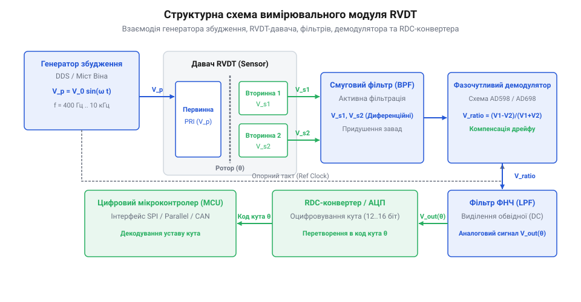
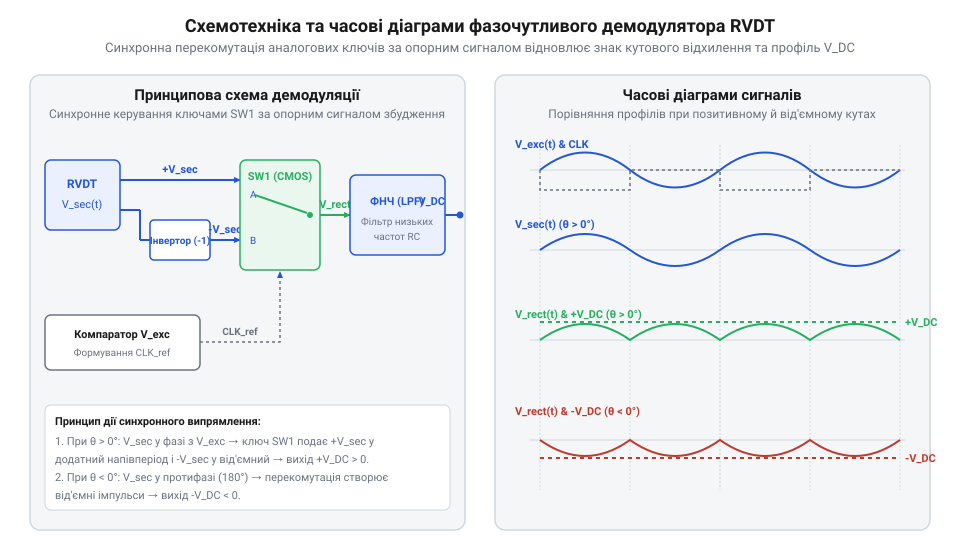

# Проєкт вимірювального модуля підключення та демодуляції сигналу RVDT

<preknowlist>
- [Поворотний потенціометр](root:cat-hw-controls/rotary-potentiometer) — Принцип роботи аналогових органів вводу та дільників напруги.
- [Оптичні та індуктивні давачі положення органів вводу](root:cat-hw-controls/optical-and-inductive-position-encoders) — Базові принципи індуктивного зчитування кутового положення.
- [Абсолютні поворотні енкодери: однооборотні та багатооборотні](root:cat-hw-controls/rotary-encoders-absolute-single-multi-turn) — Концепція абсолютного відліку кутових координат.
</preknowlist>

## Вимоги та архітектура вимірювального модуля

Пряме зчитування сигналів поворотного диференціального трансформатора @@en|RVDT@@ (англ. @@en|Rotary Variable Differential Transformer@@, ротаційний змінний диференціальний трансформатор) за допомогою вбудованого аналого-цифрового перетворювача (англ. @@en|Analog-to-Digital Converter@@, АЦП) мікроконтролера виявляється недоцільним та складноздійсненним через специфіку трансформаторного зчитування. Вторинні обмотки @@en|RVDT@@ формують аналогові амплітудно-модульовані (англ. @@en|Amplitude Modulation@@, AM) сигнали синусоїдної форми високої несучої частоти f_exc (від 400 Гц до 10 кГц), фаза яких відносно збудження вказує напрямок відхилення ротора від електричного нуля, а амплітуда пропорційна куту повороту. З точки зору спектрального аналізу, при кутовому переміщенні ротора з частотою f_rot вихідний спектр вимірювального сигналу зосереджений у вузькій смузі навколо несучої і складається з бічних гармонік f_exc - f_rot та f_exc + f_rot. Пряме оцифрування таких сигналів вимагало б частоти вибірки АЦП щонайменше у 5–10 разів вищої за несучу f_exc відповідно до теореми Найквіста-Шеннона, неперервного програмного виконання фазочутливої демодуляції та постійного обчислення арктангенса у процесорному ядрі. Крім того, в умовах промислових електромагнітних завад вихідні лінії сприймають значний рівень синфазного шуму. Використання диференціального аналогового тракту з інструментальним підсилювачем дозволяє забезпечити коефіцієнт придушення синфазного сигналу (англ. @@en|Common-Mode Rejection Ratio@@, CMRR) на рівні 80–110 дБ, що розраховується як CMRR = 20 · lg(A_diff / A_cm) і послаблює синфазну наводку A_cm у 10^4–10^5 разів відносно дифсигналу A_diff. Додаткова фільтрація активним смуговим фільтром звужує смугу пропускання Δf до частотного інтервалу модуляції, піднімаючи відношення сигнал/шум (англ. @@en|Signal-to-Noise Ratio@@, SNR) за залежністю SNR_dB = 10 · lg(P_signal / P_noise) та відсікаючи мережеві 50/60 Гц і високочастотні імпульсні завади. На відміну від простих змінних резисторів, де використовується [поворотний потенціометр](root:cat-hw-controls/rotary-potentiometer) як простий дільник напруги постійного струму, давач @@en|RVDT@@ вимагає спеціалізованого апаратного тракту аналогового узгодження, фільтрації та демодуляції.

Апаратна архітектура вимірювального модуля будується за модульним принципом для забезпечення високої завадостійкості та точності обробки. Первинним вузлом системи є стабільний генератор синусоїдального збудження, який живить первинну обмотку давача. Вхідний аналоговий тракт вторинних обмоток містить диференціальні підсилювачі для придушення синфазних завад (англ. @@en|Common-Mode Rejection Ratio@@, коефіцієнт придушення синфазного сигналу) та активні смугові фільтри, що виділяють несучу частоту. Центральним ланцюгом обробки є фазочутливий демодулятор (англ. @@en|phase-sensitive demodulation@@, фазочутлива демодуляція), який випрямляє вихідний сигнал із урахуванням поточного напрямку кута. Для отримання підсумкового цифрового коду застосовують спеціалізований перетворювач резольвер-цифра — @@en|RDC@@ (англ. @@en|Resolver-to-Digital Converter@@, перетворювач резольвер-цифра), який виконує апаратне відстеження позиції.

*Структурна організація вимірювального модуля RVDT: від первинного генератора збудження до підсилювачів, демодулятора та конвертера RDC.*

## Схемотехніка стабільного генератора синусоїдального збудження

Надійність та точність вимірювання кута давачем @@en|RVDT@@ прямо залежать від якості первинного живлення. Амплітуда secondary-напруг вихідних обмоток є функцією струму збудження первинної обмотки, тому будь-які нестабільності напруги живлення або вищі гармонійні спотворення (англ. @@en|Total Harmonic Distortion@@, коефіцієнт нелінійних спотворень) призводять до викривлення розрахованого кута. Генератор збудження мусить формувати синусоїдний сигнал із низьким коефіцієнтом нелінійних спотворень (менше 0.5%) та стійкою амплітудою в широкому діапазоні температур.

Класичним схемотехнічним рішенням є генератор синуса на базі мосту Віна (англ. @@en|Wien bridge oscillator@@, генератор з мостом Віна) із колом автоматичного регулювання посилення (англ. @@en|Automatic Gain Control@@, АРП). Опорна частота генерації задається RC-ланцюгом позитивного зворотного зв'язку.

Частота синусоїдного збудження `f_exc` розраховується за формулою:

        f_exc = 1 ÷ (2 · π · R · C)      [визначення частоти генератора Віна]

Для стабілізації амплітуди в негативний зворотний зв'язок операційного підсилювача вмикають польовий транзистор або фоторезистивний оптрон, керований випрямленою вихідною напругою. У сучасних цифрових модулях аналоговий міст Віна часто замінюють цифровим синтезатором @@en|DDS@@ (англ. @@en|Direct Digital Synthesis@@, прямий цифровий синтез) на базі мікроконтролера або пліс із вихідним активним ФНЧ. Оскільки первинна обмотка давача має низький комплексний опір (від 50 до 300 Ом), вихід генератора підсилюють двополярним транзисторним драйвером або потужним операційним підсилювачем, здатним віддавати струм до 100 мА.

Для математичного розрахунку ланцюга @@en|AGC@@ (англ. @@en|Automatic Gain Control@@, автоматичне регулювання посилення, АРП) польовий транзистор з керувальним p-n переходом (англ. @@en|Junction Field-Effect Transistor@@, @@en|JFET@@) вмикають як керований напругою резистор у нижнє плече зворотного зв'язку операційного підсилювача. Опір сток-витік R_DS у квазілінійній області залежить від керувальної напруги затвор-витік V_GS та напруги відсічки V_p:

        R_DS = R_DS0 ÷ (1 - V_GS ÷ V_p)      [динамічний опір каналу JFET]

Коефіцієнт підсилення схеми K_v = 1 + R_f ÷ (R_1 + R_DS) у стаціонарному режимі підтримується на рівні точно K_v = 3.0, що компенсує загасання мосту Віна. Для подолання температурного дрейфу напруги відсічки V_p та опору каналу R_DS0 (з температурним коефіцієнтом порядку +0.6%/°C) у коло формування напруги зміщення затвора інтегрують термокомпенсувальний диференціальний дільник із NTC-термістором або зворотний діодний ланцюг. При зміні температури зміщення V_GS корегується пропорційно дрейфу V_p, що стабілізує амплітуду збудження давача у допустимих межах ±0.05%/°C в діапазоні від -40 °C до +85 °C.

## Вхідне узгодження та активна фазочутлива демодуляція

Сигнали із вторинних обмоток @@en|RVDT@@ надходять на вхідний підсилювач через довготривалі екрановані виті пари. Для нейтралізації промислових завад і наводок вхідний каскад будують на інструментальному підсилювачі з високим коефіцієнтом придушення синфазного сигналу. Далі сигнали проходять через активний смуговий фільтр (англ. @@en|bandpass filter@@, смуговий фільтр) 2-го порядку, налаштований на центральну частоту збудження `f_exc`, що відсікає високочастотні наводки та постійну складову.

Для виділення амплітуди й знака кута повороту застосовують фазочутливий демодулятор. Звичайний діодний міст не здатен відрізнити позитивний кут повороту від негативного, оскільки амплітуда сигналу при одинакових відхиленнях вліво та вправо є рівною, а змінюється лише фаза на 180°. Фазочутливий демодулятор виконує синхронне перемикання аналогових ключів (наприклад, CMOS-перемикачів) під керуванням опорного меандру, сформованого з фази первинного збудження.

*Принципова схемотехніка фазочутливого демодулятора: синхронне перемикання аналогових ключів перетворює амплітудно-модульовані сигнали RVDT у знакопостійну напругу.*

Під час позитивної напівхвилі збудження аналоговий ключ пропускає вхідний сигнал без змін (помноження на `+1`), а під час негативної напівхвилі — інвертує його (помноження на `-1`). Ефективність демодуляції суттєво залежить від точної фазової синхронізації: індуктивний характер обмоток @@en|RVDT@@ спричиняє фазовий зсув φ між напругою збудження та вторинним сигналом, через що постійна складова вихідної напруги зменшується за законом V_out = (2 ÷ π) · V_max · cos(φ). Для усунення розфазування та забезпечення cos(φ) = 1 в коло формування опорного меандру вмикають фазозсувний ланцюг, що компенсує кут φ. Після демодулятора пульсуючий сигнал згладжується активним ФНЧ @@en|Sallen-Key@@ (англ. @@en|Sallen-Key low-pass filter@@, фільтр Саллена-Кея) 2-го порядку. Математичний вибір його коефіцієнтів базується на розрахунку частоти зрізу f_c = 1 ÷ (2 · π · √(R_1 · R_2 · C_1 · C_2)) та забезпечення добротності Баттерворта Q = 0.707 (при R_1 = R_2 та C_1 = 2 · C_2), що гарантує максимальну гладкість АЧХ, придушення пульсацій подвоєної несучої частоти 2 · f_exc на 40 дБ/декаду та відсутність викидів у перехідній характеристиці. Утворена постійна напруга V_out є чітко пропорційною куту, а її полярність вказує напрямок повороту, що дозволяє здійснювати точне вимірювання кутового положення, як це описують [оптичні та індуктивні давачі положення органів вводу](root:cat-hw-controls/optical-and-inductive-position-encoders).

## Інтеграція RDC-конвертера та цифровий інтерфейс

Пряме оцифрування вихідних напруг датчика звичайним АЦП вимагає високої обчислювальної потужності мікроконтролера для безперервного обчислення арктангенса та синхронної демодуляції. Спеціалізований перетворювач кута @@en|RDC@@ (англ. @@en|Resolver-to-Digital Converter@@, від *@@en|resolver@@* — резольвер і *@@en|digital@@* — цифровий) усуває це навантаження, реалізуючи апаратний слідкуючий контур фазового автопідстроювання. Як і [абсолютні поворотні енкодери](root:cat-hw-controls/rotary-encoders-absolute-single-multi-turn), @@en|RDC@@ видає готовий двійковий код кута, але працює з аналоговими синусоїдальними сигналами датчика @@en|RVDT@@ (англ. @@en|Rotary Variable Differential Transformer@@, від *@@en|rotary@@* — поворотний і *@@en|transformer@@* — трансформатор).

Для зчитування даних мікроконтролер подає імпульс на лінію `SAMPLE`, яка фіксує поточний стан слідкуючого регістра @@en|RDC@@. В основі перетворення лежить замкнений апаратний слідкуючий контур II типу (англ. @@en|Type-II tracking loop@@), який постійно порівнює вхідні аналогові сигнали з внутрішнім цифровим кутом φ. Спеціалізований дільник множить вхідний синус на cos(φ), а косинус на sin(φ), формуючи сигнал помилки sin(θ - φ) = sin(θ) · cos(φ) - cos(θ) · sin(φ), який після фазочутливої демодуляції інтегрується реверсивним лічильником для зведення помилки неузгодження до нуля. Одночасно з відстеженням позиції вбудований аналоговий діагностичний вузол неперервно розраховує векторну суму квадратів вихідних амплітуд V_sin² + V_cos². Якщо ця сума падає нижче 50% від норми V_ref² внаслідок обриву чи короткого замикання обмотки, виставляється прапорець аварії @@en|LOS@@ (англ. @@en|Loss of Signal@@, втрата сигналу). При амплітудній асиметрії або спотворенні обвідної у межах 50–80% спрацьовує прапорець @@en|DOS@@ (англ. @@en|Degradation of Signal@@, деградація сигналу), а якщо помилка неузгодження |θ - φ| перевищує припустимий кутовий допуск через надмірну швидкість обертання вала, фіксується помилка @@en|LOT@@ (англ. @@en|Loss of Tracking@@, втрата стеження). Після витримки стробу вибірки через шину @@en|SPI@@ (англ. @@en|Serial Peripheral Interface@@, від *@@en|serial@@* — послідовний) вичитується 16-бітне слово, нижні біти якого передають згадані прапорці діагностики мікроконтролеру для апаратного контролю цілісності вимірювального тракту.

Драйвер обробляє отриманий код, перевіряє паритет і виконує ратіометричний перерахунок у фізичні градуси.

:::tabs
@tab C
:::code proj-rvdt-signal-conditioning-and-demodulation-board/c/rvdt_rdc.h 18-51
:::code proj-rvdt-signal-conditioning-and-demodulation-board/c/rvdt_rdc.c 80-126

@tab C++
:::code proj-rvdt-signal-conditioning-and-demodulation-board/cpp/RVDTDecoder.hpp 57-85
:::code proj-rvdt-signal-conditioning-and-demodulation-board/cpp/RVDTDecoder.cpp 58-106
:::

## Трасування друкованої плати та мінімізація завад

Високоточний аналоговий тракт @@en|RVDT@@ з чутливістю в одиниці мілівольт працює поруч із високочастотними цифровими шинами @@en|SPI@@ та імпульсними джерелами живлення. Без належного топологічного захисту на друкованій платі @@en|PCB@@ (англ. @@en|Printed Circuit Board@@, від *@@en|printed@@* — друкований і *@@en|circuit@@* — схема) цифрові завади наводяться на вхідні лінії, що викликає дрейф вихідного коду @@en|RDC@@.

Для забезпечення електромагнітної сумісності @@en|EMC@@ (англ. @@en|Electromagnetic Compatibility@@, від *@@en|electromagnetic@@* — електромагнітний) земляний шар розділяють на дві ізольовані зони: аналогову @@en|AGND@@ та цифрову @@en|DGND@@. Вони з'єднуються строго в одній точці — безпосередньо під мікросхемою @@en|RDC@@ через феритову намистину або вузьку перемичку. Це запобігає протіканню імпульсних струмів цифрової частини через аналогову земляну заливку і усуває [зсув нульової позиції](root:cat-hw-controls/stick-drift-mitigation) при зміні навантаження.

Аналогові диференціальні лінії від обмоток @@en|RVDT@@ трасують симетричною парою однакової довжини в оточенні земляного екрана. У жорстких промислових та авіаційних умовах вхідні та вихідні кола додатково оснащують оптичною або магнітною гальванічною розв'язкою шини @@en|SPI@@, а лінії живлення генератора збудження та @@en|RDC@@ фільтрують @@en|LC@@-ланками для придушення високочастотних завад.

Для збереження симетрії диференціальної пари міжшарові переходи (англ. @@en|via@@) трасують парно, мінімізуючи їх кількість для запобігання фазовій асиметрії. Паразитна ємність переходів (англ. @@en|parasitic capacitance@@) створює високочастотний витік сигналу на земляні шари, тому діаметр вирізу заземлення у внутрішніх шарах (англ. @@en|antipad@@) навколо переходів збільшують, розраховуючи ємність за наближеною формулою:

        C_via ≈ (1.41 · ε_r · D_1 · T) ÷ (D_2 - D_1)      [оцінка паразитної ємності VIA]

де ε_r — відносна діелектрична проникність плати, D_1 — діаметр контактного майданчика переходу, D_2 — діаметр вирізу в землі, а T — товщина плати. Це дозволяє утримати паразитну ємність у межах до 0.3 пФ. Окрему увагу приділяють розміщенню вимірювального трансформатора гальванічної розв'язки (англ. @@en|isolation transformer@@): його монтують безпосередньо біля вхідного роз'єму плати, залишаючи суцільний ізоляційний зазор (англ. @@en|creepage distance@@) шириною не менше 5 мм без будь-якої мідної заливки під корпусом. Таке розмежування унеможливлює проникання вирівнювальних струмів між контурами заземлення та забезпечує захист аналогового підсилювача від високовольтних промислових імпульсів.
