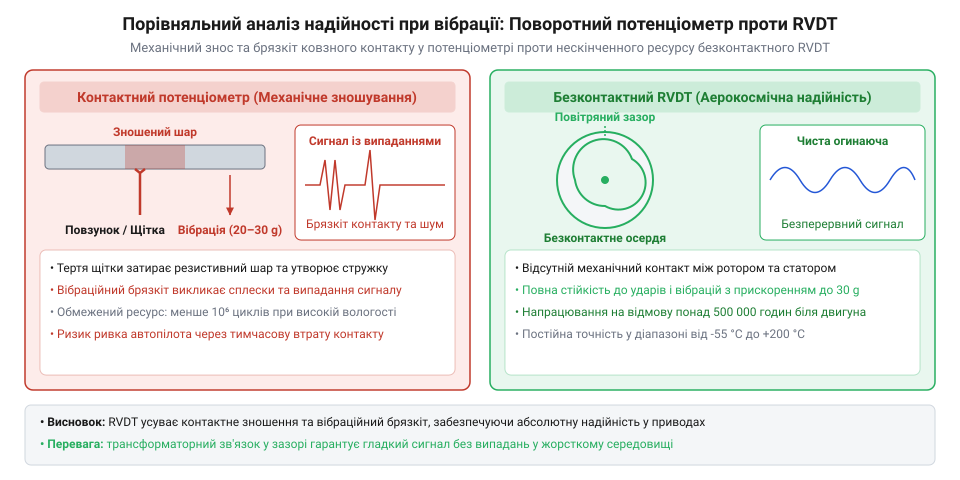
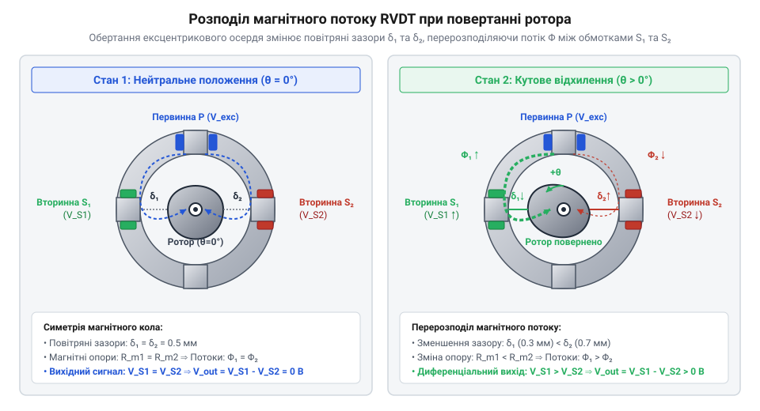
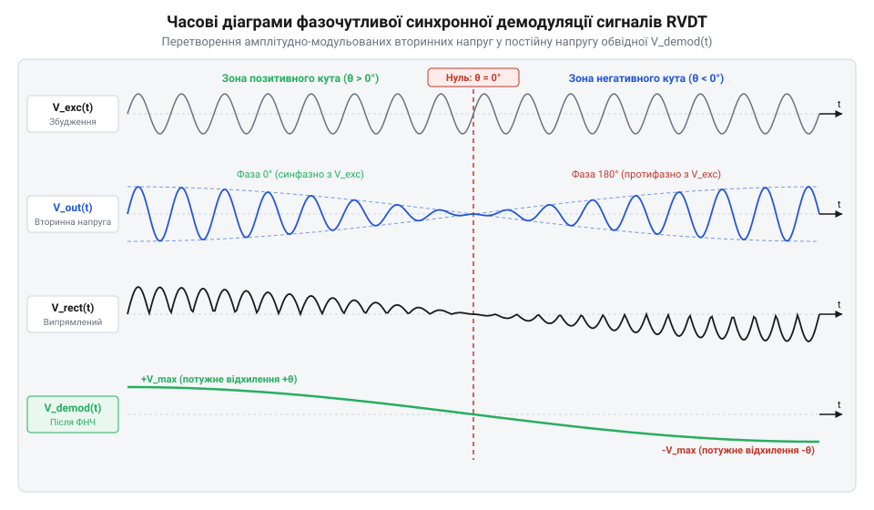
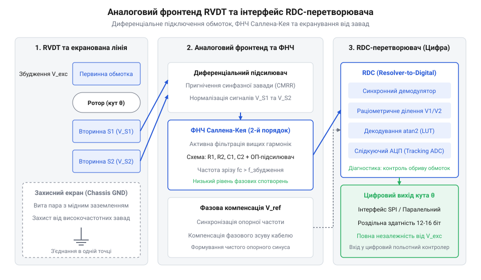
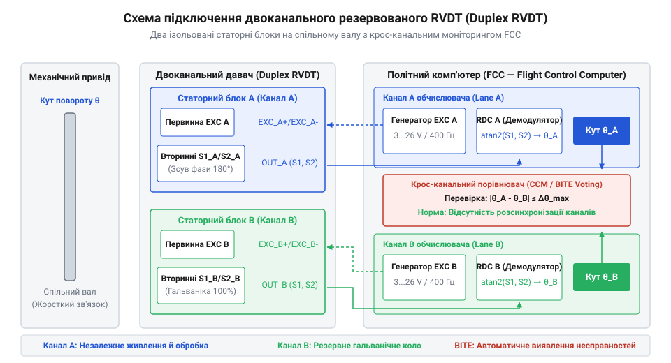

# Принцип роботи та конструкція давача RVDT

<preknowlist>
- [Оптичні та індуктивні давачі положення органів вводу](root:cat-hw-controls/optical-and-inductive-position-encoders) — базові принципи індуктивного зчитування та взаємоіндукції
- [Поворотний потенціометр](root:cat-hw-controls/rotary-potentiometer) — принцип аналогового кутового вимірювання та проблеми механічного зносу контактів
</preknowlist>

## Проблема вимірювання кута в екстремальних умовах

У вимірювальних системах авіації, космічної техніки, парових і газових турбін та важкої гідравліки прецизійний контроль кутового положення вала відбувається в умовах тривалих ударних вібрацій (амплітудою до 30 g), робочих температур від -55 °C до +200 °C та агресивних хімічних випарів. Застосування [поворотних потенціометрів](root:cat-hw-controls/rotary-potentiometer) у таких вузлах неприпустиме: при безперервному вібраційному розгойдуванні графітова чи металокерамічна доріжка швидко стирається ковзним контактом (від англ. @@en|wiper contact@@ — ковзний контакт), спричиняючи шуми, шунтування та повну втрату вимірювального сигналу.

З іншого боку, [абсолютні поворотні енкодери](root:cat-hw-controls/rotary-encoders-absolute-single-multi-turn) на базі оптичних дисків містять крихкі скляні маски, напівпровідникові світлодіоди та фотодіодні матриці, чутливі до радіації, запилення та запотівання лінз при термоударах. Гранична робоча температура авіаційних випромінювальних світлодіодів фізично обмежена порогом +85...+105 °C, після якого деградація p-n переходу призводить до спаду світлового потоку й делінеаризації сигналів, а накопичена доза іонізуючого випромінювання понад 10⁴ RAD викликає помутніння оптичного скла та незворотну деградацію напівпровідників. Магнітні давачі на елементах Холла зазнають температурного дрейфу та насичення під дією зовнішніх потужних електромагнітних полів. Натомість пасивна індуктивна конструкція RVDT на базі суцільного феромагнітного осердя та керамічної ізоляції обмоток витримує сумарну радіаційну дозу понад 10⁸ RAD та робочі температури до +200 °C (а в спеціальному виконанні до +500 °C), забезпечуючи абсолютну стабільність у космічних і ракетних застосуваннях.


*Порівняння механічної надійності: фретинг-корозія та знос контактної доріжки потенціометра проти безконтактного електромагнітного ротора RVDT.*

Вирішенням цієї проблеми є застосування кутового змінного диференціального трансформатора (від англ. @@en|Rotary Variable Differential Transformer@@, скорочено @@en|RVDT@@). Це повністю безконтактний пасивний індуктивний давач, у якому відсутній тертьовий електричний контакт із рухомим елементом. Усі електронні напівпровідникові компоненти винесені у зовнішній вториний блок обробки, а всередині герметичного корпусу давача розташовано лише сталеве осердя, мідні обмотки та обертовий феромагнітний ротор.

Завдяки такій конструкції RVDT володіє нескінченною теоретичною роздільною здатністю (від англ. @@en|infinite resolution@@), витримує мільярди циклів обертання без механічного зносу та демонструє середній час напрацювання на відмову (MTBF) понад 500 000 годин. Крім відсутності електричного зносу, безконтактне обертання ротора повністю виключає фрикційний момент тертя (від англ. @@en|friction torque@@) ковзного контакту. У малопотужних прецизійних сервоприводах авіоніки та оптико-електронних прицільних систем механічне тертя звичайних потенціометрів викликає ефект переривистого руху тертя (від англ. @@en|stick-slip motion@@) та формує зони нечутливості (від англ. @@en|deadband@@). Відсутність механічного контакту у RVDT забезпечує нульовий механічний гістерезис (від англ. @@en|mechanical hysteresis@@), що дозволяє відпрацьовувати мікроскопічні кутові відхилення вала без запізнення й паразитного опору. Детально про виникнення та історичний шлях впровадження цих пристроїв у сервосистемах керування політом розкрито в матеріалі про [еволюцію кутових трансформаторів](root:cat-hw-controls/rvdt-operating-principles/hist-evolution-of-rvdt-in-aerospace-and-industrial-controls.md). На відміну від суміжних [оптичних та індуктивних давачів](root:cat-hw-controls/optical-and-inductive-position-encoders), RVDT оптимізовано для безперервного аналогового вимірювання кутового відхилення з високим ступенем симетрії та лінійності. Проте при роботі в зоні екстремального нагріву (понад `+200 °C`) гранична точність вимірювання обмежується падінням опору міжвиткової керамічної ізоляції: виникають паразитні струми витоку `I_leak` та зростає вплив міжобмоткових ємностей `C_parasitic`, які формують квадратурний напруговий зсув і зміщують електричний нуль давача.

Для верифікації механічної стійкості в авіаційних умовах давачі RVDT проходять сертифікаційні випробування на електродинамічних вібростендах під дією широкосмугової випадкової вібрації (з середньоквадратичним прискоренням до `20 g` у діапазоні частот `10...2000 Гц`) та пікових ударних імпульсів амплітудою до `100 g`. Під час динамічного трясіння високошвидкісна система збору даних здійснює безперервний контроль вторинних напруг `V_S1` та `V_S2` для виявлення мікроскопічних осьових зсувів ротора `Δz_axial` чи резонансних коливань статорного осердя. Відсутність викривлень амплітудної модуляції `ΔV_vib` та фазового тремтіння (від англ. @@en|phase jitter@@) під дією вібрації підтверджує абсолютну жорсткість вала і стабільність повітряного зазору давача.

Окрім механічних вібрацій, авіаційні давачі RVDT піддаються випробуванням на хімічну сумісність із агресивними робочими рідинами, зокрема синтетичними гідравлічними оливами на основі складних ефірів фосфорної кислоти @@en|Skydrol@@ (від англ. Skydrol — авіаційна гідравлічна рідина). Потрапляння таких випарів усередину корпусів звичайних давачів спричиняє швидке розчинення епоксидних компаундів та корозію обмоточного проводу. Для забезпечення абсолютної хімічної інертності корпус RVDT виконують герметичним із корозійностійкої нержавіючої сталі методом лазерного зварювання швів, а ущільнювальні елементи виготовляють із фторкаучукових еластомерів та фторопласту PTFE. Під час сертифікаційних випробувань за стандартом RTCA DO-160 (Section 11) давач витримує тривале занурення та розбризкування рідини Skydrol при підвищеній температурі без погіршення опору міжобмоткової ізоляції `R_iso > 100 МОм` та без виникнення паразитних витоків струму.

## Магнітопровід та взаємна індуктивність RVDT

Конструкція RVDT складається з двох основних частин: нерухомого статора з трьома системними обмотками та обертового ротора зі спеціально профільованого м'якомагнітного сплаву (пермаллою або електротехнічної сталі). На відміну від прямолінійних давачів, як-от [лінійні змінні диференціальні трансформатори LVDT](root:cat-hw-sensors/lvdt-linear-variable-differential-transformers), у яких осердя здійснює поступальне переміщення, ротор RVDT володіє кулачковою (кутовою ексцентриковою) або купоподібною формою (від англ. @@en|cam-shaped rotor@@ — кулачковий ротор).


*Фізичний устрій RVDT: первинна обмотка збудження, дві протифазно включені вторинні обмотки та кулачковий ротор, що перерозподіляє магнітний потік.*

На статорі розміщено первинну обмотку збудження (від англ. @@en|primary excitation winding@@) `P` та дві однакові вторинні обмотки (від англ. @@en|secondary windings@@) `S₁` і `S₂`. Первинна обмотка живиться змінною синусоїдальною напругою збудження `V_exc(t) = V_exc · sin(ω_exc · t)` з частотою `f_exc` у діапазоні від 400 Гц до 10 кГц та амплітудою `V_exc` від 3 В до 26 В. Змінний струм первинної обмотки створює в статорному осерді синусоїдальний магнітний потік `Φ(t)`.

Коли ротор перебуває у зафіксованій нульовій кутовій позиції `θ = 0°`, повітряні зазори між ротором та обома вторинними обмотками є абсолютно симетричними. Магнітні опори (@@en|magnetic reluctance@@) обох магнітних шляхів однакові:

```
R_m1 = R_m2                                     [рівність магнітних опорів зазорів у нульовій позиції]
```

При цьому взаємні індуктивності `M₁` та `M₂` між первинною та кожною із вторинних обмоток рівні між собою (`M₁ = M₂ = M₀`). Оскільки вторинні обмотки з'єднані зустрічно-послідовно (диференційно), напруги, наведені у них за законом електромагнітної індукції Фарадея, мають однакову амплітуду й протилежну фазу. Сумарна вихідна диференціальна напруга у нулі дорівнює нулю:

```
V_out(t)
= V_S1(t) - V_S2(t)                             [різниця вторинних напруг диференційної пари]
= M1 · (d I_exc / dt) - M2 · (d I_exc / dt)     [підстановка взаємних індуктивностей]
= 0                                             [повна компенсація амплітуд при θ = 0]
```

При повороті ротора на кут `θ` у межах робочого діапазону (зазвичай `±40°` або `±60°`) ексцентричний профіль ротора зменшує повітряний зазор перед однією вторинною обмоткою та збільшує перед іншою. Зміна повітряного зазору `g(θ)` викликає зворотну зміну магнітного опору ділянки `R_m(θ) = g(θ) / (μ₀ · μ_r · A)`. Звідси взаємна індуктивність першої обмотки `M₁(θ)` зростає, а другої `M₂(θ)` — зменшується за лінійним законом від кута `θ`. Однак у точній нульовій позиції (`θ = 0°`) реальна вихідна напруга не стає строго нульовою: через паразитні міжобмоткові ємності `C_parasitic`, вихрові струми Фуко в осерді статора та фазовий зсув між первинним і вторинним струмами виникає залишковий квадратурний сигнал (від англ. @@en|quadrature null voltage@@), що перебуває у фазовому зсуві `90°` відносно корисного сигналу. Ця квадратурна наводка компенсується фазочутливим демодулюванням або апаратним вирівнюванням фази збудження.

```
M1(θ) = M0 · (1 + k_m · θ)                      [зростання взаємної індуктивності першої обмотки]
M2(θ) = M0 · (1 - k_m · θ)                      [зменшення взаємної індуктивності другої обмотки]
```

Де `M₀` — взаємна індуктивність у нульовому положенні, `k_m` — конструктивний коефіцієнт магнітної чутливості ротора, а `θ` — кут повороту вала. Підставляючи ці значення у вираз для вихідної напруги, отримуємо амплітудно-модульований синусоїдальний сигнал, амплітуда якого прямо пропорційна куту повороту `θ`, а фаза відносно напруги збудження вказує на напрямок відхилення (`0°` при `θ > 0` та `180°` при `θ < 0`). При цьому частотна залежність реактивного опору первинної обмотки `X_L = 2π · f_exc · L_P` визначається індуктивністю осердя `L_P = (N_P² · μ₀ · μ_r · A) / l_m`. Матеріал осердя (наприклад, пермаллой) забезпечує високу відносну магнітну проникність `μ_r ≈ 10 000...50 000`, однак із зростанням частоти збудження `f_exc` поверхневий скін-ефект і вихрові струми (від англ. @@en|eddy currents@@ — вихрові струми) зменшують ефективну проникність `μ_r(f)`, змінюючи струм намагнічування `I_mag = V_exc / √(R_P² + (2π · f_exc · L_P)²)`: низька частота знижує реактивний опір `X_L` та загрожує насиченням осердя високим струмом `I_mag`, а надто висока частота обмежує струм намагнічування і корисний амплітудний потік. У разі виникнення магнітного насичення (від англ. @@en|magnetic saturation@@ — магнітне насичення) робоча точка осердя заходить у нелінійну ділянку кривої намагнічування `B-H` (від англ. @@en|magnetization curve@@ — крива намагнічування), що порушує пропорційність між напруженістю магнітного поля `H` та магнітною індукцією `B`. Через симетричний нелінійний характер характеристики `B(H)` у формі синусоїдального магнітного потоку виникають несинусоїдальні спотворення, що призводить до появи в наведених вторинних напругах `V_S1(t)` та `V_S2(t)` вищих непарних гармонік (переважно 3-ї `3 · f_exc` та 5-ї `5 · f_exc`). Одночасно з цим вихрові струми в товщі феромагнітного матеріалу створюють власний протилежно спрямований магнітний потік із фазовим запізненням, що додатково спотворює форму огинаючої та спричиняє похибки амплітудно-фазової демодуляції корисного сигналу.

```
V_out(t)
= (M1(θ) - M2(θ)) · ω_exc · I_exc · cos(ω_exc · t)   [підстановка індуктивностей M1 та M2]
= 2 · M0 · k_m · θ · ω_exc · I_exc · cos(ω_exc · t)  [лінійна залежність амплітуди від кута θ]
```

Повний математичний апарат із формулами виведення коефіцієнтів трансформації та аналізом вищих гармонік наведено у матеріалі про [електромагнітну модель взаємної індуктивності](root:cat-hw-controls/rvdt-operating-principles/math-rvdt-electromagnetics-and-demodulation.md). Для квазісинхронних вимірювальних систем, як-от [сельсини та резольвери](root:cat-hw-sensors/synchro-and-resolver-transducers), RVDT надає аналогічні синусно-косинусні огинаючі, проте вирізняється значно простішою схемотехнікою первинного розв'язання сигналів.

Для компенсації впливу коефіцієнта теплового розширення статорного магнітопроводу `α_stator` (що при нагріві збільшує геометричний зазор і знижує коефіцієнт трансформації) в конструкцію давача закладають схему механічної самокомпенсації зазору. Зовнішній корпус виготовляють із прецизійного сплаву Інвар з низьким коефіцієнтом розширення `α_housing ≈ 1.2 · 10⁻⁶ K⁻¹`, а статорний пакет фіксують через компенсаційні кільця, теплове видовження яких `Δl_comp = l₀ · α_comp · ΔT` протидіє радіальному розширенню осердя. Таке схемотехнічне поєднання матеріалів підтримує стабільну ширину повітряного зазору `g(θ)` і нейтралізує температурну амплітудну похибку в усьому діапазоні від `-55 °C` до `+200 °C` без застосування додаткових цифрових поправок.

Окрім температурних деформацій, на граничну точність RVDT суттєво впливає міжобмоткова паразитна ємність `C_parasitic`, яка виникає між первинною та вторинними котушками статора. При високих частотах збудження `f_exc` через цю ємність протікає високочастотний ємнісний струм витоку `I_cap = 2π · f_exc · C_parasitic · V_exc`, який оминає магнітний потік і наводить на вторинних обмотках паразитну квадратурну напругу зі зсувом фази `90°`. Це призводить до розмиття точки електричного нуля `θ = 0°` та виникнення залишкової напруги, яку неможливо усунути звичайним диференційним відніманням сигналів. Для мінімізації `C_parasitic` застосовують секціонування обмоток (від англ. @@en|sectional winding@@ — секціонована намотка): первинну та вторинні котушки розділяють на кілька ізольованих секцій у багатокамерних діелектричних каркасах, що еквівалентно послідовному з'єднанню міжвиткових ємностей `1 / C_total = ∑ (1 / C_i)` та зменшує сумарну паразитну ємність до значення `C_parasitic < 5 пФ`. Додатково між секціями обмоток розміщують заземлені міжобмоткові екрани Фарадея (від англ. @@en|Faraday shield@@ — екран Фарадея) з незамкненого мідного фольгованого витка, що повністю перехоплює ємнісні витоки на землю та зменшує фазову похибку до `Δϕ_phase < 0.5°`.

## Демодуляція та раціометричне обчислення кута

Вихідні сигнали вторинних обмоток RVDT являють собою високочастотну синусоїду збудження, амплітуда якої модульована кутовим положенням ротора. Для витягнення значення кута `θ` аналоговий фронтенд виконує фазочутливу синхронну демодуляцію (від англ. @@en|phase-sensitive synchronous demodulation@@).


*Часові діаграми обробки сигналу RVDT: напруга збудження, амплітудно-модульовані вторинні сигнали та випрямлені обвідні після синхронного випрямлення.*

Синхронний демодулятор помножує вихідний сигнал `V_out(t)` на опорну прямокутну або синусоїдальну фазу збудження `V_ref(t)`. Отриманий сигнал містить постійну складову, пропорційну амплітуді, та подвійну частоту збудження `2 · f_exc`. Для виділення повільної обвідної постійного струму сигнал пропускають через активний фільтр низьких частот другого порядку (типово топологію Саллена-Кея, від англ. @@en|Sallen-Key low-pass filter@@) із частотою зрізу `f_cutoff ≈ f_exc / 10`. Другий порядок фільтра забезпечує крутизну спаду `-40 dB/декаду`, що на подвійній частоті збудження `2 · f_exc` (яка перевищує частоту зрізу в 20 разів) пригнічує залишковий високочастотний шум більш ніж на `-40 dB` (у 100 разів) та зменшує пульсації обвідної до менш ніж `1%`. На частоті зрізу фільтр створює фазовий зсув `-90°`, а в смузі корисного кутового руху вносить стабільну групову затримку `τ_g ≈ 1 / (2π · f_cutoff)`, яка легко враховується в цифровому алгоритмі раціометричної обробки.

Однак у високошвидкісних закритих контурах сервокерування (від англ. @@en|servo control loop@@ — контур сервокерування) ця аналогова групова затримка `τ_g` викликає динамічну похибку запізнення сигналу положення. При високій кутовій швидкості обертання вала `ω = dθ / dt` часове запізнення фільтрації перетворюється на пропорційний кутовий зсув `Δθ = ω · τ_g` між реальним механічним кутом ротора та демодульованим значенням. У контурі від'ємного зворотного зв'язку цей додатковий фазовий зсув прямим чином зменшує фазовий запас стійкості (від англ. @@en|phase margin@@ — фазовий запас стійкості) на кут `Δϕ = ω_c · τ_g` (де `ω_c` — частота зрізу контуру сервоприводу), що за високих швидкостей відпрацювання викликає перерегулювання, тривалі високочастотні коливання та загрожує втратою стійкості всієї системи. Для компенсації фазового запізнення без погіршення фільтрації пульсацій у мікроконтролерну прошивку інтегрують алгоритм цифрової упереджувальної компенсації (від англ. @@en|predictive compensation@@ — упереджувальна компенсація). На кожному такті дискретизації обчислюють поточну кутову швидкість `ω = (θ[k] - θ[k-1]) / T_s` або її оцінку за допомогою фільтра Калмана, після чого відновлюють реальне положення ротора лінійною екстраполяцією: `θ_comp = θ_demod + ω · τ_g`. Таке цифрове зміщення повністю нейтралізує фазовий зсув від ФНЧ, повертає номінальний фазовий запас стійкості та забезпечує високу динамічну точність позиціонування під час стрімких кутових прискорень.

Після випрямлення та фільтрації отримують два аналогових потенціали `V_sin` та `V_cos`, пропорційних синусу та косинусу кута `θ`. Головна проблема прямих амплітудних вимірювань полягає у тому, що `V_sin` залежить не лише від кута `θ`, а й від напруги збудження `V_exc`, частоти `f_exc` та температурного дрейфу опору обмоток `R(T)`. Для повного усунення цих нестабільностей застосовують раціометричне обчислення кута (від лат. *ratio* — відношення, @@en|ratiometric calculation@@) за допомогою чотириквадрантного арктангенса `atan2`:

Однак зміна температури навколишнього середовища `T` додатково викликає температурний дрейф фазового зсуву `Δφ(T)` між напругою збудження `V_exc` та вихідними вторинними напругами через зміну активного опору мідних обмоток `R(T) = R₀ · (1 + α · ΔT)`. Якщо синхронна демодуляція використовує жорстко фіксовану опорну фазу, цей фазовий розсоглас зменшує амплітуду випрямленого сигналу на множник `cos(Δφ(T))` та породжує залишковий квадратурний дрейф нуля. Для алгоритмічної компенсації температурного зсуву фази цифровий обробник обчислює поточний фазовий кут `φ_comp = atan2(V_quad, V_in-phase)` за співвідношенням квадратурної `V_quad` та синфазної `V_in-phase` складових демодульованого сигналу, після чого здійснює динамічний зсув опорного синусоїдального вектора на кут `-φ_comp` перед оцифруванням або корегує значення `V_sin` та `V_cos` перед обчисленням `atan2`.

```
V_ratio
= V_sin / V_cos                                  [відношення сигналів двох вторинних каналів]
= (k · V_exc · sin(θ)) / (k · V_exc · cos(θ))   [скорочення спільного множника амплітуди збудження]
= tan(θ)                                         [чиста залежність від тангенса кута]
θ
= atan2(V_sin, V_cos)                            [відновлення кута у діапазоні від -180° до +180°]
```

Оскільки амплітуда збудження `V_exc` входить однаково чисельником і знаменником у дріб `V_sin / V_cos`, вона повністю скорочується. Це робить виміряний кут `θ` абсолютно незалежним від коливань живлення та температурного нагрівання котушок. Детальний математичний аналіз раціометричного метод та компенсацію фазового зсуву розкрито у матеріалі про [електромагнітну модель взаємної індуктивності](root:cat-hw-controls/rvdt-operating-principles/math-rvdt-electromagnetics-and-demodulation.md). Практичну схемотехнічну схему випрямлення на операційних підсилювачах містить [проєкт аналогового фронтенду та демодулятора](root:cat-hw-controls/rvdt-operating-principles/proj-rvdt-demodulator-and-adc-processing-unit.md).

У цифровому C/C++ драйвері RDC-перетворювача обробка починається із синхронізованого оцифрування аналогових сигналів АЦП у момент досягнення піку хвилі збудження за апаратним таймерним перериванням `TIM_TRIG_ADC`. Зчитані значення `v_sin_raw` та `v_cos_raw` проходять через цифровий ІІР-фільтр другого порядку (від англ. @@en|infinite impulse response@@, IIR), який пригнічує квантувальний шум. Далі драйвер віднімає квадратурні зсуви `v_sin_clean = v_sin_raw - offset_sin`, обчислює кут через функцію `atan2f(v_sin_clean, v_cos_clean)` та конвертує результат у градуси: `angle_deg = angle_rad * (180.0f / M_PI)`. Фінальне значення кута коригується вибіркою з таблиці `angle_deg += rdc_lut_lookup(angle_deg)`, що забезпечує затримку обчислення менше `5 мкс` при частоті оновлення `10 кГц`.

Для запобігання похибкам демодуляції при нестабільності генератора збудження в цифровий фронтенд інтегрують алгоритм апаратного відстеження частоти (від англ. @@en|Phase-Locked Loop@@, PLL — фазове автопідстроювання частоти). У польотних або промислових умовах частота живлення первинної обмотки `f_exc` може відхилятися від номіналу на `±10%...15%`, що за відсутності підлаштування викликає фазовий розсоглас `Δϕ` між опорним стробом демодулятора та піком вихідного синусоїдального сигналу. Щоб усунути цей дрейф, опорна напруга збудження подається на компаратор переходу через нуль (від англ. @@en|zero-crossing detector@@), який формує переривання вхідного захоплення таймера мікроконтролера. Алгоритм безперервно вимірює тривалість періоду `T_exc = 1 / f_exc` та апаратно коригує фазову затримку запуску АЦП `t_sample_delay = T_exc / 4` для оцифрування строго на максимумі синусоїди. Завдяки такому адаптивному відстеженню фазовий зсув демодуляції залишається близьким до нуля (`Δϕ ≈ 0°`), а точність декодування кута `θ` зберігається навіть при динамічних стрибках частоти бортової мережі живлення.

## Схемотехнічне підключення та компенсація похибок

Для передачі диференціальних сигналів від RVDT до блоку обробки використовують 4-провідну або 5-провідну схемотехнічну обв'язку з екранованими витими парами (від англ. @@en|shielded twisted pairs@@). 5-провідна схема містить окремий дріт спільної точки вторинних обмоток, що дозволяє вимірювати напругу кожного плеча відносно аналогової землі `AGND`.


*Схемотехнічна обв'язка RVDT: диференціальне узгодження обмоток, екранування витих пар та підключення до Resolver-to-Digital (RDC) перетворювача.*

Для запобігання утворенню земляних контурів (від англ. @@en|ground loops@@) та синфазного шуму зовнішній плетений екран кабелю заземлюють строго з одного боку — біля аналого-цифрового перетворювача чи RDC-модуля (від англ. @@en|Resolver-to-Digital Converter@@, RDC). 

Проте на довгих кабельних трасах (від англ. @@en|long cable runs@@ — довгі кабельні траси) одностороннє екранування не усуває асиметрію паразитних міжпровідникових ємностей та ємностей відносно екрана `C_p1 ≠ C_p2`. На робочих частотах збудження `f_exc` ця ємнісна несиметрія утворює реактивний мостовий розбаланс, який перетворює синфазні мережеві завади кабельного джгута у паразитну диференціальну напругу та знижує реальний коефіцієнт пригнічення синфазного сигналу (від англ. @@en|common-mode rejection ratio@@, CMRR) аналогового фронтенду з паспортних `90 дБ` до `60...70 дБ`. Для збереження CMRR понад `90 дБ` застосовують точне ємнісне балансування (від англ. @@en|capacitive balancing@@ — ємнісне балансування): у сигнальну лінію з меншим значенням ємності вмикають прецизійний керамічний підлаштовний конденсатор (від англ. @@en|trimming capacitor@@ — підлаштовний конденсатор) `C_trim` з діапазоном `2...20 пФ`. Процес налаштування полягає у подачі тестової синфазної напруги `V_cm` на замкнені сигнальні жили з'єднувального кабелю з одночасним обертанням ротора `C_trim` до досягнення глибокого мінімуму вихідного диференціального сигналу `V_diff < 30 мкВ`, що компенсує технологічні допуски кабелю та гарантує стійкість системи до високовольтних завад у промисловому та авіаційному середовищі.

Попри високу лінійність RVDT у центральній зоні, на межах кутового діапазону (понад `±40°`) виникають крайові нелінійності через насичення осердя та крайові магнітні потоки розсіювання. Для досягнення високої точності прошивка контролера реалізує калібрувальні інтерполяційні таблиці LUT (від англ. @@en|lookup tables@@ — інтерполяційні таблиці).

Крім корекції нелінійності, практичний монтаж RVDT на валу приводного механізму вимагає усунення похибок механічної невісіості та неточності встановлення нульової позиції. Для цього застосовують математичну модель триточкового калібрування за опорними кутами `θ_min`, `θ_zero` та `θ_max`. Під час юстування фіксують первинний електромонтажний зсув нуля `θ_offset = θ_raw(zero)`, а також обчислюють коефіцієнти масштабного підсилення `K_pos` та `K_neg` для позитивної і негативної напівсфер обертання: `K_pos = θ_max / (θ_raw(max) - θ_offset)` та `K_neg = θ_min / (θ_raw(min) - θ_offset)`. Скориговане значення кута `θ_calib` у реальному часі визначається як `θ_calib = K · (θ_raw - θ_offset)`, що повністю відновлює фізичну нульову позначку та компенсує асиметрію передавального відношення механічного приводу без повторного ручного регулювання кріплення давача. При екстремальному нагріві до `+200 °C` теплове розширення статора та підвищення опору мідних обмоток змінюють коефіцієнт трансформації, тому процедуру визначення `K_pos` і `K_neg` повторюють у термокамері при `+200 °C` з еталонною оптичною ділильною головкою, розраховуючи граничні температурні коефіцієнти `K_pos(+200°C)` та `K_neg(+200°C)`. Отримані граничні коефіцієнти зберігають у пам'яті, а прошивка здійснює лінійну інтерполяцію підсилення між кімнатною та робочою температурою.

При первинному калібруванні вимірюють відхилення реального кута `θ_real` від розрахованого `θ_calc` із кроком `1°`. Отримані похибки записують у таблицю LUT в енергонезалежну пам'ять. При виконанні реальних вимірювань підсумковий кут формується лінійною інтерполяцією:

```
θ_corr = θ_calc + LUT_interpolate(θ_calc)
```

Подібно до загальних методів [усунення дрейфу нуля органів вводу](root:cat-hw-controls/stick-drift-mitigation), у прошивці RVDT реалізують апаратне обнулення механічного зсуву статора при первинній монтажній установці. Повний залізний довідник розводки та заземлення міститься у матеріалі [апаратний API-довідник підключення](root:cat-hw-controls/rvdt-operating-principles/api-rvdt-hardware-interface-and-wiring.md), а програмні алгоритми обробки LUT-таблиць надає [програмний API-довідник драйвера зчитування](root:cat-hw-controls/rvdt-operating-principles/api-rvdt-firmware-driver-interface.md).

Для коректної обробки амплітудно-модульованих сигналів аналоговий фронтенд (від англ. @@en|analog front-end@@) вимагає прецизійного вибору параметрів підтягувальних резисторів та дифпідсилювачів. Оскільки вторинні обмотки RVDT володіють власним індуктивним та активним опором, вхідний опір дифпідсилювача та підтягувальних резисторів обирають у діапазоні від `10 кОм` до `100 кОм`. Це запобігає надмірному струмовому навантаженню трансформатора та не допускає паразитного фазового зсуву вихідної напруги. Підтягувальні резистори фіксують постійне синфазне зміщення (від англ. @@en|common-mode voltage bias@@) відносно землі `AGND`, усуваючи плаваючий потенціал при обриві лінії та забезпечуючи захист від завад. Диференціальні операційні підсилювачі (від англ. @@en|operational amplifiers@@) обирають із високим коефіцієнтом пригнічення синфазного сигналу (від англ. @@en|common-mode rejection ratio@@, CMRR понад `90 дБ` на частотах `1–10 кГц`) та низьким вхідним струмом зсуву (від англ. @@en|input bias current@@). Симетрію плечей забезпечують застосуванням прецизійних резистивних матриць із допуском `0.01%`, оскільки найменша асиметрія опорів перетворює синфазні наведення кабелю у розбаланс амплітуд `V_sin` і `V_cos`, що призводить до кутової похибки демодуляції.

Для пригнічення завад вищих гармонік, що виникають через нелінійність магнітопроводу та несинусоїдальні вихрові струми, аналоговий фронтенд оснащують активними загороджувальними фільтрами (від англ. @@en|notch filters@@ — режекторні фільтри). Найчастіше застосовують топологію подвійного Т-подібного моста (від англ. @@en|twin-T notch filter@@), резонансна частота пригнічення якого `f_notch` налаштовується на другу чи третю гармоніку збудження `2 · f_exc` або `3 · f_exc` за співвідношенням `f_notch = 1 / (2π · R · C)`. Прецизійні керамічні конденсатори `C` з допуском `1%` та тонкоплівкові резистори `R` забезпечують глибину замирання завади понад `35 дБ` при помірній добротності (від англ. @@en|quality factor@@, `Q ≈ 2..5`). Це запобігає гармонічним спотворенням (від англ. @@en|harmonic distortion@@) обвідних напруг `V_sin` і `V_cos`, усуваючи фазовий дрейф при раціометричному декодуванні кута.

## Відмовостійкі авіаційні конфігурації RVDT

У критично важливих вузлах авіоніки — таких як приводи елеронів, рулів висоти, повороту та поворотних сопел двигунів — відмова давача кута загрожує втратою керування літального апарата. Для забезпечення відповідності нормативам функціональної безпеки (наприклад, DAL A за стандартом DO-178C/DO-254) застосовують відмовостійкі резервовані конфігурації (від англ. @@en|fault-tolerant redundant configurations@@).

Найпоширенішим рішенням є подвійний (дуплексний, від лат. *duplex* — подвійний, @@en|duplex RVDT@@) або квадруплексний (4-канальний) давач RVDT. Конструктивно дуплексний RVDT містить два незалежні статорні блоки з власними обмотками збудження й вторинними обмотками, розташовані на одному суцільному механічному валу всередині єдиного корпусу.


*Принципова схема подвійного (duplex) RVDT-датчика з повністю гальванічно розділеними каналами збудження та крос-канальним моніторингом у цифрових обчислювачах політу.*

Кожен канал дуплексного RVDT підключається до окремого польотного обчислювача (від англ. @@en|flight control computer@@, FCC). Обчислювачі виконують взаємне крос-канальне порівняння (від англ. @@en|cross-channel monitoring@@) зчитуваних кутів `θ_A` та `θ_B` в реальному часі.

Окремим викликом дуплексних конфігурацій є виявлення прихованих фазових відхилень `ΔΦ_exc = Φ_A - Φ_B` між первинними обмотками збудження, оскільки канали живляться від автономних генераторів із незалежним температурним дрейфом опорних кварцових генераторів. Через перехресну магнітну індукцію між статорними обмотками фазовий розсоглас збудження викликає низькочастотні биття та викривлення обвідних напруг вторинних каналів. Для виявлення прихованої десинхронізації алгоритм крос-канального моніторингу вимірює часову затримку між переходами струмів збудження `I_excA` та `I_excB` через нульовий рівень. Якщо фазовий розсоглас перевищує граничне значення `|ΔΦ_exc| > 5°`, цифровий обчислювач активує апаратне підганяння опорної частоти через фазове автопідганяння частоти (від англ. @@en|phase-locked loop@@, PLL) або ізолює скомпрометований канал збудження до відновлення синфазності. Математика підлаштування спирається на пропорційно-інтегральний ПІ-регулятор фазової похибки `e_phi(t) = K_pd · (Φ_A(t) - Φ_B(t))`, який формує корекцію частоти керованого генератора `Δf(t) = K_p · e_phi(t) + K_i · ∫ e_phi(t) dt`. Цифровий генератор зсуває фазовий крок `Φ_B(t + Δt) = Φ_B(t) + 2π · (f_0 + Δf(t)) · Δt` до зменшення похибки `e_phi` нижче `0.1°`; якщо корекція `Δf` перевищує граничну смугу захоплення або триває довше `t_pll > 15 мс`, канал вважається несправним і ізолюється.

Діагностична апаратура безперервно контролює електричні параметри кожного каналу:

1. **Контроль суми амплітуд вторинних обмоток** — оскільки при будь-якому повороті ротора нормальна сума амплітуд `|V_S1| + |V_S2|` лишається практично константною, раптове падіння суми сигналів нижче порогового значення вказує на обрив дроту, коротке замикання в котушці або вихід з ладу генератора збудження.
2. **Перевірка розходження між каналами** — якщо відхилення `|θ_A - θ_B|` перевищує допустимий допуск `Δθ_max` (типово `0.5°`) протягом часу `t_fault > 10 мс`, система декларує апаратну відмову каналу, відключає його та переходить на резервний канал без переривання сервокерування.

У порівнянні з [абсолютними поворотними енкодерами](root:cat-hw-controls/rotary-encoders-absolute-single-multi-turn) чи [сельсинами та резольверами](root:cat-hw-sensors/synchro-and-resolver-transducers), пасивна індуктивна конструкція RVDT не містить електронних компонентів на рухомому валу, що забезпечує найвищий рівень надійності серед усіх органів кутового введення.

У трьохканальних авіаційних сервоприводах для підвищення стійкості до поодиноких відмов реалізують потрійне модульне резервування (від англ. @@en|Triple Modular Redundancy@@, TMR) із триплексною конфігурацією RVDT. Обробка трьох незалежних сигналів `θ_A`, `θ_B` та `θ_C` базується на алгоритмі мажоритарного голосування (від англ. @@en|majority voting@@), який обчислює медіанне значення `θ_voted = median(θ_A, θ_B, θ_C)`. Якщо один із каналів зазнає обриву обмотки чи температурного дрейфу, його показник відхиляється від двох інших, проте медіанний селектор миттєво відсікає аномальний сигнал без сплеску у контурі керування. Автоматична діагностика фіксує понаднормову різницю `|θ_i - θ_voted| > Δθ_thresh` протягом заданого інтервалу часу, виключає несправний канал із голосування та переводить систему у дуплексний режим із збереженням працездатності (від англ. @@en|fail-operational@@).

Для найвідповідальніших первинних рульових поверхонь у системах електродистанційного керування (від англ. @@en|fly-by-wire@@) застосовують квадруплексні (чотириканальні) конфігурації RVDT, які забезпечують дворазовий рівень збереження працездатності з наступним безпечним відключенням (від англ. @@en|fail-operational / fail-operational / fail-safe@@). У цій архітектурі 4 незалежні канали RVDT (`θ_A`, `θ_B`, `θ_C`, `θ_D`) опитують окремі обчислювачі. При виникненні першої апаратної відмови (наприклад, обриву обмотки каналу A) діагностичне ядро ізолює несправний канал і зберігає повну функціональність на трьох каналах (перший рівень @@en|fail-operational@@). При виникненні другої відмови (наприклад, міжвиткового замикання у каналі B) система відключає другий скомпрометований канал і продовжує керування за результатом крос-моніторингу двох залишкових каналів C та D (другий рівень @@en|fail-operational@@). Лише у випадку виникнення третьої послідовної відмови та втрати узгодженості між залишковою парою привод переходить у детермінований безпечний стан (від англ. @@en|fail-safe@@) з апаратним зачепленням вала у нейтральному положенні.
