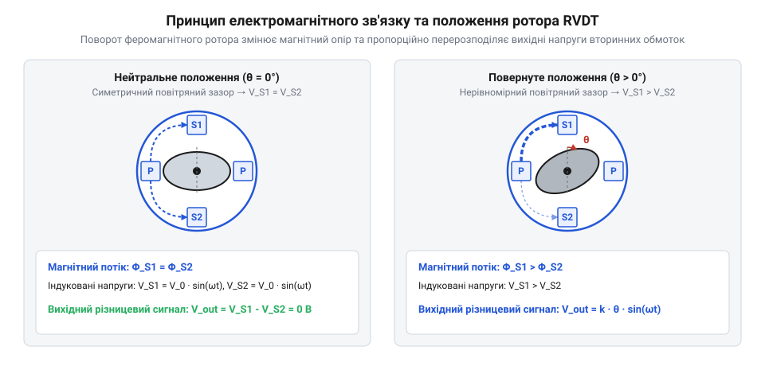
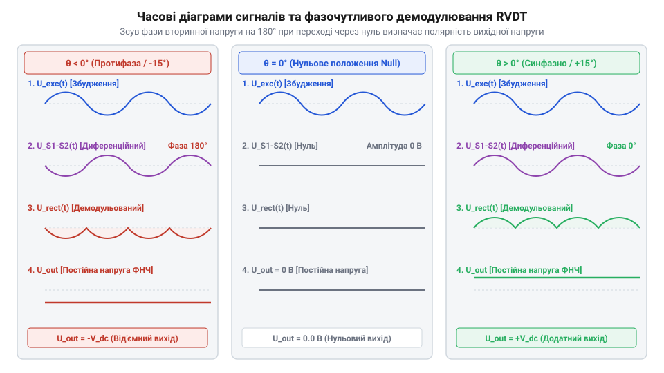
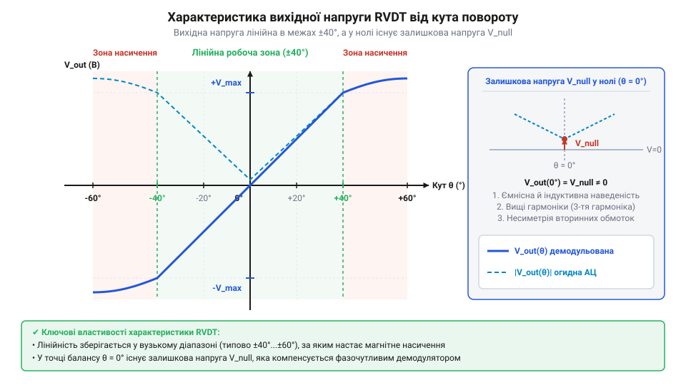

# Принцип роботи та конструкція давача RVDT

<preknowlist>
- [Поворотний потенціометр](root:cat-hw-controls/rotary-potentiometer) — концепція вимірювання кутового положення вала та недоліки резистивного ковзного контакту при вібраціях.
- [Оптичні та індуктивні давачі положення органів вводу](root:cat-hw-controls/optical-and-inductive-position-encoders) — загальний принцип класифікації безконтактних давачів кута та відмінності між індуктивним й оптичним зніманням даних.
- [Дрейф нуля та калібрування органів вводу](root:cat-hw-controls/stick-drift-mitigation) — розуміння причин виникнення нульового зміщення сигналу та методів його компенсації.
</preknowlist>

## Проблема вимірювання у жорсткому середовищі

Вимірювання кутового положення органів керування у важкій промисловості та авіації відбувається в умовах екстремальних вібрацій, високої вологості та сильних температурних перепадів. Ззвичайні контактні [поворотні потенціометри](root:cat-hw-controls/rotary-potentiometer) в таких режимах швидко деградують через трибологічний знос резистивної доріжки, фретінг-корозію та втрату контакту ковзана. Оптичні пристрої, такі як [оптичні та індуктивні давачі положення органів вводу](root:cat-hw-controls/optical-and-inductive-position-encoders), чутливі до запорошення растра й конденсації вологи.

Для високонадійних систем потрібен повністю пасивний безконтактний перетворювач. Цю задачу вирішує обертовий змінно-диференційний трансформатор (від англ. @@en|Rotary Variable Differential Transformer@@, @@en|RVDT@@). Він не має замикальних контактних елементів, що унеможливлює механічний знос і забезпечує необмежений термін експлуатації.

При експлуатації в діапазоні температур від −55 °C до +125 °C лінійне теплове розширення конструктивних елементів описується співвідношенням `ΔL / L = α · ΔT`, де `α` — коефіцієнт лінійного теплового розширення, а `ΔT` — зміна температури. Розрахунок відносного розширення матеріалів показує, що для нержавіючої сталі статора (`α_stator ≈ 11...16 × 10⁻⁶ K⁻¹`) та феромагнітного сплаву ротора (`α_rotor ≈ 10...12 × 10⁻⁶ K⁻¹`) різниця розширення на радіальному радіусі `r = 10 мм` при `ΔT = 100 °C` складає `Δg = (α_stator - α_rotor) · r · ΔT ≈ 2...4 мкм`. Завдяки симетричному круговому розташуванню повітряних зазорів таке незначне відносне зміщення викликає однакову зміну магнітного опору в усіх плечах, зберігаючи амплітудний баланс вторинних обмоток та нульову точку пристрою.

## Електромагнітний принцип диференційного зв'язку RVDT

Конструкція RVDT складається з нерухомого статора та кулачкового феромагнітного ротора на валу. На статорі розміщено первинну обмотку збудження, яка живиться змінною напругою, та дві вторинні котушки, з'єднані зустрічно-послідовно.

*Схема магнітного зв'язку обмоток статора через профільований ротор.*

Поворот кулачкового ротора змінює магнітний опір повітряного зазору під обмотками. В нейтральному положенні магнітні потоки однакових вторинних котушок рівні, а вихідна напруга дорівнює нулю. При повороті вала напруга в одній котушці зростає, а в іншій спадає, формуючи диференціальний змінний сигнал. Амплітуда вихідного сигналу пропорційна куту відхилення, а фаза відносно первинного струму визначає напрямок обертання.

## Демодулювання та логометричний розрахунок сигналів

Вихідний змінний сигнал RVDT потребує випрямлення та виділення напрямку. Для цього застосовують фазочутливий демодулятор (від англ. @@en|phase-sensitive demodulator@@), який порівнює фазу вихідного сигналу з фазою первинного тактування та формує постійну напругу відповідного знаку.

*Процес демодуляції амплітудно-модульованого сигналу RVDT.*

Для захисту від температурного дрейфу опору мідних обмоток та нестабільності живлення використовують логометричний розрахунок (від англ. @@en|ratiometric calculation@@). Обчислення відношення різниці напруг вторинних котушок до їхньої суми `(V1 - V2) / (V1 + V2)` повністю компенсує зміну амплітуди збудження.

*Вихідна лінійна характеристика RVDT та фазовий зсув у зоні нуля.*

У точці нуля виникає залишкова квадратурна напруга через наводки та несиметрію. Її усувають програмними алгоритмами, які описує [дрейф нуля та калібрування органів вводу](root:cat-hw-controls/stick-drift-mitigation).

## Застосування та вибір параметрів збудження

Завдяки високій надійності RVDT є стандартом в авіаційних системах керування елеронами й закрилками та нафтогазовій автоматиці. Для живлення первинної обмотки обирають синусоїдальну напругу амплітудою від `3 В` до `20 В` на частотах від `1 кГц` до `10 кГц`.

Частота збудження має у `10` разів перевищувати максимальну динамічну частоту повороту вала для запобігання фазовим затримкам. Лінії підключення RVDT виконують екранованими витими парами, а корпус заземлюють для захисту від високочастотних індукованих наводок.
