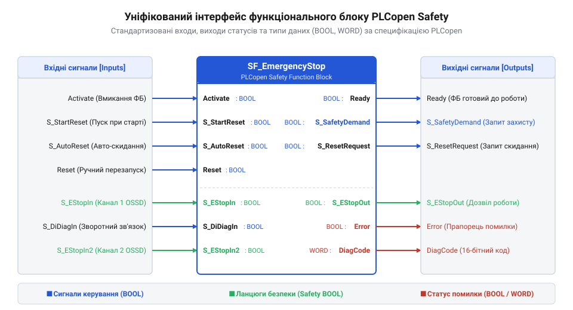
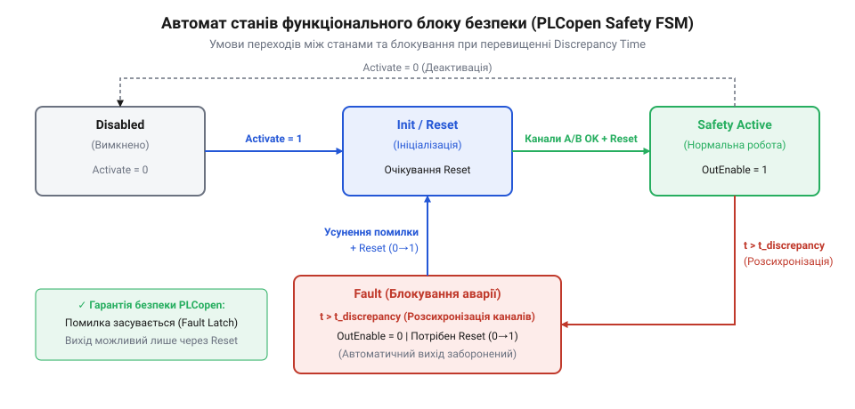
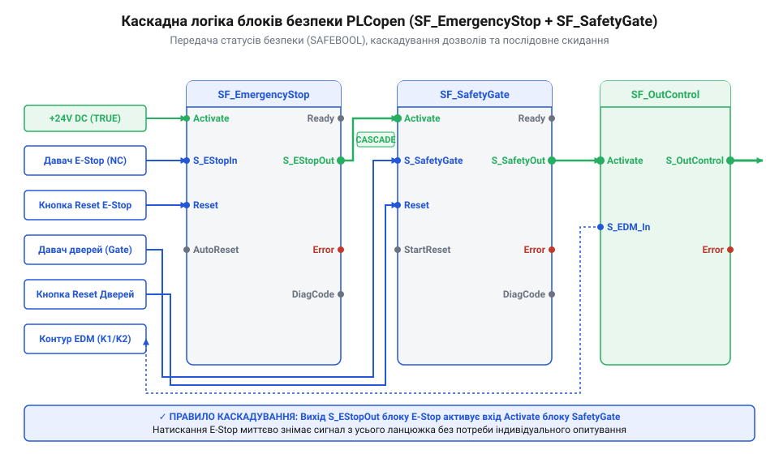
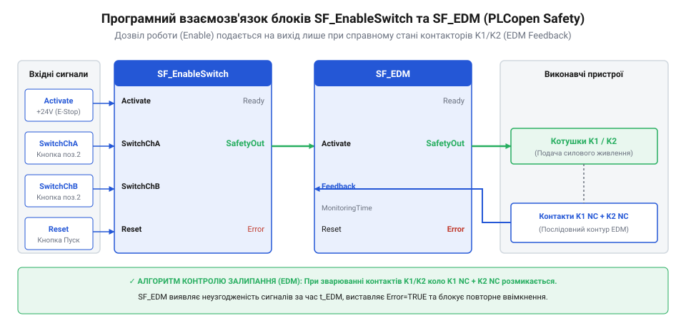
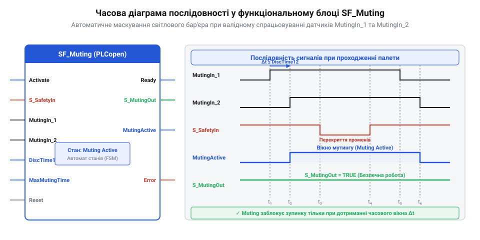

# Програмний інтерфейс та функціональні блоки контролерів захисного відключення

<preknowlist>
- [Кнопка аварійного стопу грибок та органи безпечного відключення (IEC 60947-5-5)](root:cat-hw-controls/estop-mushroom-button) — принципи подвійного розмикання та електричні сигнали аварійного зупинення
- [Трипозиційні кнопки дозволу та педалі «мертвої руки»](root:cat-hw-controls/enabling-switches-and-dead-man-pedals) — принципи роботи трьохпозиційного механізму дозволу в режимі налагодження
- [Пульт налагодження промислових роботів (Teach Pendant)](root:cat-hw-controls/teach-pendant-interface) — призначення органів керування та інтерфейсу вибору режимів робототехнічних систем
</preknowlist>

## Стандартизована архітектура блоків PLCopen Safety

У звичайних програмованих логічних контролерах розробник створює довільну програмувальну логіку, проте в системах захисного відключення будь-яке неоднозначне трактування сигналів може призвести до відмови захисту. Для комутації таких пристроїв, як [кнопки аварійного зупинення](root:cat-hw-controls/estop-mushroom-button), вимагається сувора уніфікація інтерфейсів програмного забезпечення. Цю задачу вирішує специфікація `@@en|PLCopen Safety@@` (від англ. *@@en|Programmable Logic Controller@@* — програмований логічний контролер та *@@en|safety@@* — безпека), яка розширює стандарт `@@en|IEC 61131-3@@` і регламентує уніфіковану структуру функціональних блоків безпеки.

*Структура вхідних та вихідних сигналів функціонального блоку PLCopen Safety з розподілом на керуючі входи, входи безпеки та діагностичні виходи.*

Кожен функціональний блок безпеки має строго розділені групи входів і виходів. До загальних керуючих входів належать прапор дозволу роботи `@@en|Activate@@` (тип `@@en|BOOL@@`) та сигнал підтвердження чи скидання `@@en|Reset@@` (тип `@@en|BOOL@@`). Прапор `@@en|Activate@@` безпосередньо керує життєвим циклом блоку: при його перемиканні в стан `FALSE` екземпляр повністю деактивується, а всі внутрішні системні таймери (зокрема таймери виявлення розсихронізації контактів та витримки часу зворотного зв'язку) миттєво зупиняються й примусово скидаються в нуль. Це запобігає застряганню незавершених часових інтервалів та забезпечує чистий запуск обчислень без залишків старих таймаутів при повторному ввімкненні. При таком аварійному чи плановому деактивуванні внутрішні прапори автомата станів примусово скидаються у вихідне положення: виходи `@@en|Ready@@` та `@@en|SafetyOutput@@` миттєво переходять у `FALSE`, прапор помилки `@@en|Error@@` скидається, оскільки деактивація вважається санкціонованим вимкненням, а регістр `@@en|DiagCode@@` приймає значення `16#0000` (`@@en|Disabled@@`). Входи безпеки (наприклад, двоканальні сигнальні лінії від захисних датчиків) мають суфікс `@@en|S_@@` і приймають значення безпечного стану. На вихідній стороні блок формує двопозиційні статусні прапори: `@@en|Ready@@` (тип `@@en|BOOL@@`), що підтверджує активність екземпляра блоку в циклі контролера; `@@en|SafetyDemand@@` (тип `@@en|BOOL@@`), що сигналізує про розмикання кола захисту; та `@@en|Error@@` (тип `@@en|BOOL@@`), що вказує на внутрішню або зовнішню несправність. Для розширеного моніторингу призначений вихід `@@en|DiagCode@@` (тип `@@en|WORD@@`), який транслює поточний шестнадцятеричний код стану або помилки в діагностичний регістр контролера.

## Автомат станів та часові розсихронізації

Під час механічного спрацьовування захисних контактів у двоканальних колах — наприклад, при натисканні [трипозиційними кнопками дозволу](root:cat-hw-controls/enabling-switches-and-dead-man-pedals) або спрацьовуванні вимикачів огорож — контакти двох каналів розмикаються не одночасно. Щоб відрізнити нормальний часовий зсув контактів від небезпечного пробою чи залипання лінії, функціональний блок функціонує як детермінований кінцевий автомат станів — `@@en|Finite State Machine@@` (від лат. *status* — стан), або `@@en|FSM@@`.

*Кінцевий автомат станів функціонального блоку безпеки із зафіксованими умовами переходів між робочим станом, вимогою безпеки та блокуванням Fault.*

Автомат станів `@@en|FSM@@` охоплює п'ять базових режимів: `@@en|Disabled@@` (блок деактивовано вході `@@en|Activate@@`), `@@en|Init@@` (первинна ініціалізація змінних), `@@en|Safety Active@@` (безпечний робочий режим, силовий вихід увімкнено), `@@en|Safety Request@@` (розмикання кола захисту оператором чи датчиком) та `@@en|Fault@@` (аварійне блокування при несправності). Для контролю синхронності каналів використовують параметр `@@en|Discrepancy Time@@` (від англ. *@@en|discrepancy@@* — неузгодженість, від лат. *discrepantia* — розходження) типу `@@en|TIME@@`. Якщо при зміні стану один канал змінив рівень, а перший і другий канали не узгодилися впродовж заданого інтервалу `@@en|Discrepancy Time@@`, `@@en|FSM@@` негайно фіксує апаратну неузгодженість контактів і здійснює незворотний перехід у стан `@@en|Fault@@`. Вихід із цього стану можливий лише після фізичного усунення розсихронізації та виконання процедури квитування через сигнал `@@en|Reset@@`. При спробі подати імпульс квитування `@@en|Reset@@` у той момент, коли вхідні сигнали безпеки залишаються у збійному чи неочищеному стані, `@@en|FSM@@` відкидає команду скидання й залишається у стані `@@en|Fault@@`. Логіка блоку аналізує цілісність каналів до моменту реєстрації фронту скидання: якщо сигнали на входах `S_` не відновилися до нормативного рівня, імпульс `@@en|Reset@@` ігнорується, а регістр `@@en|DiagCode@@` фіксує помилку послідовності квитування `16#C001`, вимагаючи спочатку повного відновлення датчиків і лише потім нового розімкнення й замикання цепу скидання.

Якщо сигнал `@@en|Reset@@` надходить одночасно з виникненням нового порушення в каналах захисту або в момент розсихронізації вхідних ліній, автомат станів надає безумовний пріоритет функції безпеки та блокує перехід до робочого режиму. За вимогами @@en|PLCopen Safety@@ квитування виконується виключно за надійної логічної одиниці на обох каналах, тому будь-яка неузгодженість на вході під час подачі команди скидання відкидає процедуру ініціалізації та залишає `@@en|FSM@@` у стані `@@en|Fault@@`. Більше того, тримання сигналу `@@en|Reset@@` у постійно активному стані не дає змоги автоматично обійти несправність: спроба перезапуску при невідновлених каналах фіксує помилку логіки скидання й вимагає повного зняття керувального імпульсу та повторного подання фронту після фізичного усунення обриву чи заклинювання контактів.

## Блоки аварійного зупинення та захисних огорож

Для програмного опрацювання сигналів від фізичних органів аварійного вимкнення застосовують функціональні блоки специфікації PLCopen Safety. Основним елементом системи є блок `SF_EmergencyStop` (від англ. @@en|emergency stop function block@@), призначений для контролю [кнопок аварійного стопу](root:cat-hw-controls/estop-mushroom-button) з двоканальними NC-контактами.

Вхідний сигнал `S_EStopIn` отримує узагальнений статус від двоканального апаратного модуля моніторингу. Прапор `S_StartReset` визначає поведінку блоку при початковій подачі живлення: при `S_StartReset = TRUE` блок автоматично переходить у стан безпечної активності `Safety Active`, якщо контакти кнопки замкнені. Якщо ж `S_StartReset = FALSE`, вимагається примусове квитування імпульсом на вході `Reset`. Вхід `S_AutoReset` контролює повторний пуск після відпускання кнопки аварійного вимкнення: у режимі автоматичного скидання (`S_AutoReset = TRUE`) вихід `Ready` і `SafetyOutput` відновлюються одразу після відновлення `S_EStopIn = TRUE`. У режимі ручного скидання оператор мусить натиснути окрему кнопку `Reset`, сформувавши позитивний фронт сигналу. У промислових умовах з високим рівнем електромагнітних завад спосіб формування цього імпульсу має критичне значення: апаратне формування через фізичну кнопку із заземленим екраном забезпечує примусове фільтрування дребезгу контактів на рівні вхідних кіл безпеки, тоді як програмне формування сигналу квитування (наприклад, з панелі оператора через мережевий зв'язок) потребує суворої перевірки тривалості та чистих фронтів сигналу. На відміну від апаратного замкнення, програмний імпульс у зашумленому середовищі схильний до хибних наводок та накладення коротких сплесків, тому логіка блоку аналізує не лише наявність високого рівня, а й вимагає повноцінного переходу з нульового стану в одиничний із фіксованою тривалістю підтвердження, що виключає випадковий повторний пуск від завад на лінії. Застосування автоматичного скидання (`S_AutoReset = TRUE`) створює потенційну небезпеку несподіваного пуску, тому для запобігання обходу захисту логіку блоку каскадують із кінцевим модулем керування виходами, який вимагає окремого примусового імпульсу запуску обладнання. Автоматичне відновлення сигналу `SafetyOutput` лише знімає програмне блокування кола захисту, але не подає напругу на котушки контакторів до надходження навмисної команди пуску від оператора, що унеможливлює самовільний запуск ліній після механічного розблокування кнопки.

Для моніторингу захисних дверей, зсувних екранів та світлових бар'єрів використовується блок `SF_SafetyGate` (від англ. @@en|safety gate function block@@). На відміну від аварійного стопу, цей блок підтримує окремі входи для двох незалежних контактів вимикача огорожі (`S_SafetyGateIn1` та `S_SafetyGateIn2`) і вбудований таймер розсихронізації `DiscrepancyTime`. При відкритті захисних дверей блок миттєво знімає вихідний дозволяючий сигнал `SafetyOutput = FALSE`.

*Підключення та каскадування функціональних блоків SF_EmergencyStop та SF_SafetyGate.*

При побудові багаторівневих систем безпеки виходи `SafetyOutput` блоків `SF_EmergencyStop` та `SF_SafetyGate` об'єднують у каскадні ланцюжки. Вихід `SafetyOutput` першого блоку подається на вхід `Activate` наступного блоку. Це гарантує, що спрацьовування будь-якого первинного датчика безпеки викликає послідовне безпечне вимкнення усіх підпорядкованих виконавчих органів.

## Блоки моніторингу контакторів і трипозиційного дозволу

Безпечне програмне керування вимагає постійного контролю стану силових комутаційних апаратів та підтримки спеціальних режимів налагодження. Для захисту від залипання силових контактів застосовують блок моніторингу зовнішніх пристроїв `SF_EDM` (від англійського *external device monitoring* — моніторинг зовнішніх пристроїв; @@en|external device monitoring@@).

Блок `SF_EDM` відстежує стан допоміжних нормально замкнених NC-контактів зовнішніх контакторів через входи `S_EDM1` та `S_EDM2`. У вимкненому стані системи, коли силовий вихід `S_OutControl` знеструмлений, NC-контакти контакторів мусять бути замкнені (`S_EDM1 = TRUE`, `S_EDM2 = TRUE`). При команді на включення вихід `SafetyOutput` стає `TRUE`, а котушки контакторів отримують живлення. З цього моменту вмикається внутрішній таймер `MonitoringTime` (типово `200–500 мс`). Якщо протягом цього часу NC-контакти не розімкнуться (що свідчить про обрив кола або механічне заклинювання контактора), блок `SF_EDM` переходить у стан апаратної помилки `Fault` (`Error = TRUE`, `DiagCode = 16#8001`) та блокує подальший пуск. Аналогічна перевірка здійснюється при вимкненні: якщо після зняття сигналу керування хоча б один NC-контакт не замкнеться протягом `MonitoringTime` (через зварювання силових контактів), система фіксує аварію. У разі несиметричного залипання, коли один контактор знеструмлюється й розмикає свої силові контакти (`S_EDM2 = TRUE`), а інший приварюється і залишає допоміжний контакт відкритим (`S_EDM1 = FALSE`), дубльований силовий контур розмикається справним апаратом, що запобігає негайній катастрофічній ситуації. Проте блок `SF_EDM` фіксує розходження між входами `S_EDM1` та `S_EDM2`, знімає дозволяючий сигнал із котушки справного контактора й переходить у незворотний стан `Fault`, блокуючи будь-які наступні спроби повторного ввімкнення до фізичної заміни пошкодженого апарата. Для виявлення обриву вимірювальних ліній блок аналізує початковий стан вхідних кіл ще до видачі команди на запуск: відсутність напруги на `S_EDM1` чи `S_EDM2` у спокійному стані розпізнається як обрив кабелю або розмикання лінії моніторингу й блокує ввімкнення виходів. При цьому допуск таймера `MonitoringTime` обирають з урахуванням механічної інерції контакторів (зазвичай 20–150 мс на перемикання), залишаючи технологічний запас 200–500 мс для запобігання хибним спрацьовуванням від нормального дребезгу якоря.

Для безпечного проведення налагоджувальних та сервісних робіт всередині робочих зон обладнання застосовують блок `SF_EnableSwitch` (від англ. @@en|enabling switch function block@@), який опрацьовує сигнали від [трипозиційних кнопок дозволу](root:cat-hw-controls/enabling-switches-and-dead-man-pedals), що інтегруються у [пульти налагодження роботів](root:cat-hw-controls/teach-pendant-interface).

*Взаємозв'язок контуру моніторингу контакторів SF_EDM та трипозиційного дозволу SF_EnableSwitch.*

Блок `SF_EnableSwitch` опрацьовує три фізичні стани важеля кнопки дозволу:
1. **Положення 1 (не натиснуто):** входи `S_Channel1 = FALSE`, `S_Channel2 = FALSE`. Робоча зона знеструмлена, вихід `SafetyOutput = FALSE`.
2. **Положення 2 (середнє натискання — дозволений стан):** обидва канали замкнені (`S_Channel1 = TRUE`, `S_Channel2 = TRUE`). Блок формує дозволяючий сигнал `SafetyOutput = TRUE`, дозволяючи ручне переміщення механізмів на зниженій швидкості.
3. **Положення 3 (панічне сильне стискання):** спрацьовують механічні розмикачі, сигнали повертаються у `FALSE`. Блок миттєво знімає дозволяючий сигнал `SafetyOutput = FALSE` та переходить у стан захисного вимкнення.

Перехід із положення 3 назад у положення 2 через проміжне відновлення не дозволяє автоматично увімкнути вихід: вимагається повне відпускання рукоятки до положення 1 з наступним повторним натисканням до положення 2, що виключає випадковий пуск при панічних судомах оператора.

## Тимчасове глушіння Muting та керування виходами

У багатьох автоматизованих виробничих лініях виникає потреба в автоматичному транспортуванні деталей чи піддонів через захищену зону без зупинки конвеєра. Для тимчасового автоматичного вимкнення захисної функції світлового бар'єра при проходженні вантажу застосовують функціональний блок `SF_Muting` (від англ. @@en|muting function block@@).

Блок `SF_Muting` підтримує підключення від двох до чотирьох додаткових оптичних чи індуктивних датчиків м'ютингу (`MS_11`, `MS_12`, `MS_21`, `MS_22`). Механізм м'ютингу базується на суворій часовій та просторовій послідовності перетину датчиків: вантаж на конвеєрі перекриває датчики м'ютингу перед тим, як перетнути промінь світлового бар'єра. Якщо послідовність спрацьовування правильна, блок тимчасово переходить у стан `Muting Active` (`MutingActive = TRUE`), зберігаючи вихід `SafetyOutput = TRUE`, незважаючи на затінення основного світлового бар'єра. При зміні швидкості рухомого конвеєрного полотна часовий інтервал між послідовним затіненням сенсорних пар змінюється обернено пропорційно швидкості переміщення. Якщо швидкість транспортування знижується й часова затримка між спрацьовуванням датчиків перевищує задане вікно `MutingTimeDifference`, блок `SF_Muting` сприймає це як розсихронізацію чи появу стороннього предмета і негайно блокує виходи. Тому для конвеєрів зі змінною швидкістю часові межі `MutingTimeDifference` розраховують за найнижчою робочою швидкістю полотна, а в складнотехнічних системах адаптують вікно опитування через динамічне вимірювання швидкості енкодером, що запобігає хибам спрацьовування при сповільненні чи прискоренні лінії. У разі зупинки конвеєра, коли вантаж застрягає всередині небезпечної зони та спричиняє спрацьовування таймера `MaxMutingTime` із переходом блоку в аварійний стан, для вимушеного розблокування лінії застосовують сигнал примусового протягування `Override` (від англ. @@en|override@@ — примусове перевизначення). Опрацювання цього сигналу у блоці `SF_Muting` відбувається за суворим безпековим регламентом: функція `Override` стає доступною лише тоді, коли хоча б один м'ютинговий датчик або світловий бар'єр залишається затіненим, а оператор подає контрольований сигнал із замочного перемикача чи підтверджуючої кнопки. Після активації `Override` блок тимчасово примусово відновлює вихід `SafetyOutput = TRUE`, дозволяючи ввімкнути привод конвеєра у режимі поштовхового повільного переміщення для евакуації вантажу. Для унеможливлення зловживань та некоректного обходу світлового бар'єра час дії примусового протягування жорстко обмежений внутрішнім таймером `MaxOverrideTime` (типово від 8 до 120 с) із вимогою постійного утримання органу керування. Якщо за цей час вантаж не залишить зону і датчики не звільняться, блок скасовує режим протягування і незворотно блокує виходи до усунення причин аварії.

*Часова послідовність спрацьовування датчиків Muting та тимчасового блокування світлового бар'єра.*

Для запобігання зловживанням у блоці `SF_Muting` передбачено два захисні обмеження: таймер максимальної тривалості м'ютингу `MaxMutingTime` (якщо вантаж застряг у зоні контролю, через заданий час м'ютинг скасовується і система вимикається) та таймер розсихронізації м'ютингових датчиків `MutingTimeDifference`. У випадку зупинки конвеєра з вантажем всередині зони використовують вхід примусового протягування `Override`.

Сформований дозволяючий сигнал безпеки подається на кінцевий блок керування виходами `SF_OutControl` (від англ. @@en|output control function block@@). Цей блок реалізує безпечний інтерфейс видачі команд на вихідні напівпровідникові чи релейні канали ПЛК, забезпечуючи захищене перемикання приводів із підтримкою локального та централізованого скидання.

## Регістри діагностики та обробка помилок

Надійність роботи програмованого контролера захисного відключення залежить від швидкості виявлення та точності локалізації апаратних і програмних відмов. Кожен функціональний блок специфікації PLCopen Safety містить 16-бітний вихідний регістр діагностичного коду `DiagCode` (від англ. @@en|diagnostic code register@@), який відображає поточний внутрішній стан автомата або точний код несправності у шістнадцятковому форматі `16#XXXX`.

Значення `DiagCode = 16#0000` відповідає стану неактивності `Disabled` (`Activate = FALSE`), стан `16#8000` вказує на нормальну роботу в режимі `Safety Active`, а значення `16#8001` свідчить про стан очікування скидання `Safety Request`. Під час переходу з вимоги безпеки `16#8001` у робочий стан `16#8000` регістр фіксує проміжні коди: `16#8002` означає стан очікування підтвердження оператора (`Reset Request`), коли вхідні зони безпеки повністю відновлені, але виходи лишаються вимкненими до подачі квитуючого сигналу, а `16#8003` відображає активну фазу обробки фронту `Reset` (`Reset Initiated`), під час якої перевіряється відсутність затискання кнопки перед замиканням силових контактів. При виникненні апаратних збоїв чи порушенні часових параметрів блок виходить у стан `Fault` (`Error = TRUE`) та записує відповідний Hex-код помилки у `DiagCode`:
- `16#C001`: помилка послідовності скидання (спроба затиснути кнопку `Reset` або наявність високого рівня на вході при пуску).
- `16#C002`: помилка неузгодженості каналів за таймером `DiscrepancyTime` (один контакт датчика розімкнувся, а другий залишився замкненим).
- `16#C010`: помилка зворотного зв'язку контакторів за таймером `MonitoringTime` у блоці `SF_EDM` (залипання або обрив NC-контактів).
- `16#C020`: порушення часової послідовності активації м'ютингових датчиків `MS_XX` у блоці `SF_Muting`.

Оскільки виконання програми ПЛК відбувається циклічно (@@en|cyclic scan execution@@), значення вихідного регістра `DiagCode` оновлюється під час кожного сканування. Щоб короткочасний апаратний збій чи короткий сплеск розсихронізації не втратився при подальшому переході блоку в новий стан, у програмі реалізується механізм фіксації історії відмов. При настанні події `Error = TRUE` поточний код `DiagCode` разом із системною позначкою часу копіюється в енергонезалежний діагностичний буфер і замикається у внутрішньому регістрі фіксації помилок (@@en|latched fault register@@). Завдяки цьому під час циклічного опитування верхній рівень АСУ ТП та операторські панелі HMI гарантовано зчитують точну першопричину аварії навіть при самовідновленні сигналу або спробі швидкого квитування.

Обробка помилок у програмі контролера безпеки вимагає розрізнення тимчасових експлуатаційних спрацьовувань (відкриття дверей, натискання [кнопки аварійного стопу](root:cat-hw-controls/estop-mushroom-button)) та фатальних апаратних відмов. Усунення стану `Fault` можливе лише подачею позитивного фронту на вхід скидання помилки `Reset` (або `FaultReset`) після повного усунення фізичної причини аварії. Повторна спроба квитування при невідновленому датчику або замкнених контактах залишає блок у стані помилки, що повністю запобігає несанкціонованому чи автоматичному виходу системи з режиму захисного блокування.
