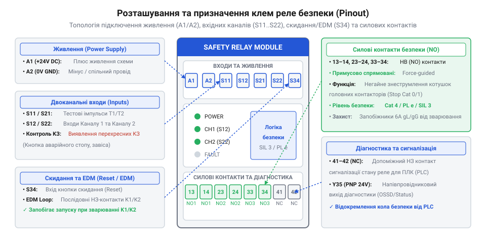
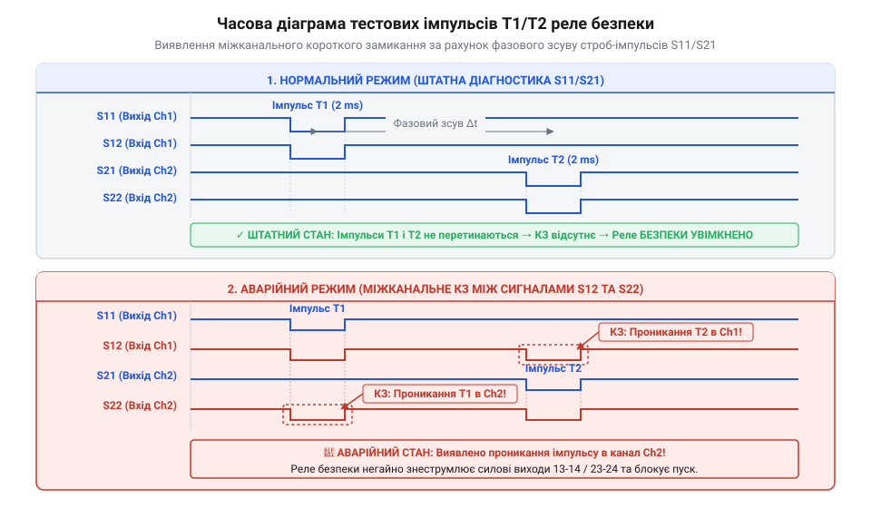
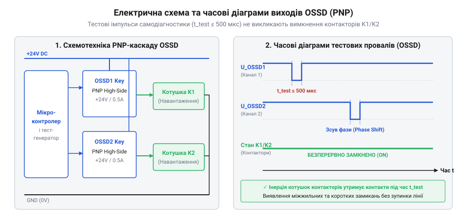
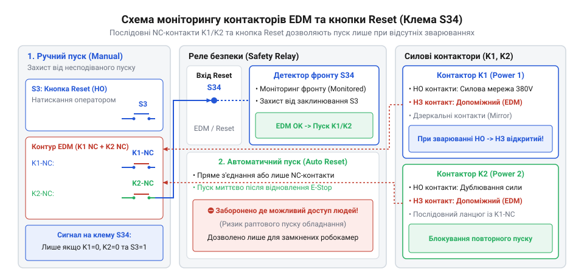
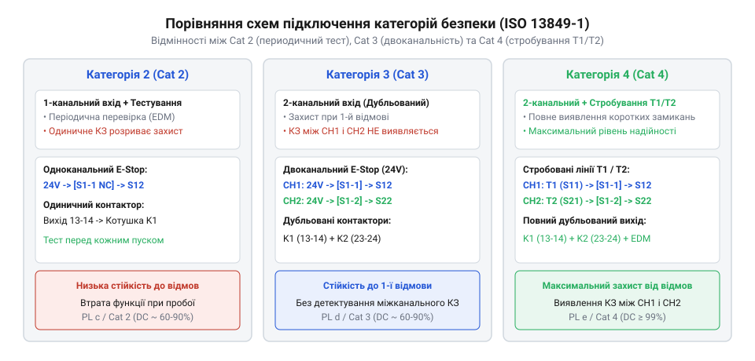

# Залізний інтерфейс: призначення клем, рівні сигналів та схеми підключення реле безпеки

<preknowlist>
- [Кнопка аварійного стопу грибок та органи безпечного відключення (IEC 60947-5-5)](root:cat-hw-controls/estop-mushroom-button) — принципи апаратного розмикання кіл живлення та двоканальної комутації при надзвичайних ситуаціях
- [Тросові вимикачі аварійного зупинення (IEC 60947-5-5)](root:cat-hw-controls/cable-pull-switches-and-safety-rope-switches) — механізм примусового розмикання контактів при обриві чи натягу троса
- [Трипозиційні кнопки дозволу та педалі «мертвої руки»](root:cat-hw-controls/enabling-switches-and-dead-man-pedals) — трьохпозиційні схеми підключення для дозволу налагоджувальних робіт
</preknowlist>

## Фізичне призначення клем живлення та керування

Реле безпеки є апаратною основою для побудови кіл аварійного вимкнення та захисного блокування. На відміну від стандартних промислових реле, воно містить дубльовану структуру внутрішніх клем, що забезпечує діагностику обривів, зварювання контактів та коротких замикань у зовнішніх кабельних лініях. Стандартизована маркувальна сітка виводів дозволяє однозначно розділити клеми на три базові групи: лінії живлення, кола первинних давачів та силові виходи.

Електричне живлення внутрішніх електронних вузлів та котушок реле подається на клеми `A1` (позитивний полюс `+24V DC` або фаза `L`) та `A2` (спільний провідник `0V DC` або нейтраль `N`). Для стабільної роботи внутрішньої дубльованої схеми допустимий діапазон живлення становить `85...110% · U_nominal` (що відповідає `20.4...26.4 V DC` для стандартних мереж `24V DC`). Падіння напруги нижче 85% активує вузол блокування при зниженні напруги (від англ. @@en|undervoltage lockout@@), який переводить реле в безпечний стан відмови для упередження нестійкого утримання якоря силових котушок, тоді як перевищення межі в 110% спричиняє термічний перегрів внутрішніх елементів живлення. Власна споживана потужність реле становить `P_consumed ≈ 2.5...5 W` (або `5...8 VA` для версій змінного струму), що необхідно враховувати при виборі джерела живлення шафи автоматики. Клеми керування первинними давачами розбито на два незалежні канали. Виводи `S11` та `S21` слугують генераторами тестових імпульсів для першого та другого каналів відповідно. Сигнали з цих генераторів проходять через зовнішні [сухі контакти](root:cat-hw-controls/estop-mushroom-button) або кінцеві вимикачі й повертаються на виходи моніторингу `S12` (канал 1) та `S22` (канал 2). Двоканальна структура виключає ситуацію, коли поширена поодинока відмова призводить до втрати захисної функції. Клема `S34` (або `S33-S34`) слугує для підключення кнопки скидання помилок та моніторингу стану зовнішніх виконуючих контакторів (від англ. @@en|external device monitoring@@, EDM).

Силова комутаційна частина складається з трьох послідовно з'єднаних нормально розімкнених (від англ. @@en|normally open@@, NO) контактних груп із примусовим розмиканням: `13-14`, `23-24` та `33-34`. Клеми `41-42` утворюють допоміжний нормально замкнений (від англ. @@en|normally closed@@, NC) діагностичний контакт для індикації стану на контролері верхнього рівня, а напівпровідниковий вихід `Y35` формує транзисторний сигнал статусного повідомлення. Гранична комутаційна здатність силових контактів суворо регламентується за категоріями застосування згідно зі стандартом IEC 60947-5-1 (англ. @@en|utilization category@@). У категорії `AC-15` для змінного струму (комутація індуктивних котушок контакторів змінної напруги) максимальне допустиме навантаження становить `5 A` при напрузі `230 V AC` (гранична потужність до `1150 VA`). У категорії `DC-13` для постійного струму (керування котушками DC-реле, електромагнітними гальмами та клапанами зі значною постійною часу `L/R` до `40 мс`) граничний робочий струм обмежений значенням `2 A` при напрузі `24 V DC` (потужність `48 W`). Таке жорстке обмеження струму в колах постійного струму обумовлене відсутністю природного переходу напруги через нуль, через що згасання електричної дуги вимагає більшого повітряного зазору для запобігання ерозії та приварювання контактних наплавок.


*Стандартизована топологія клем реле безпеки із розділенням на кола живлення, двоканального моніторингу давачів та силової комутації.*

Для захисту низьковольтних ліній моніторингу від силового потенціалу керування у реле безпеки передбачено гальванічну розв'язку між внутрішньою логікою, клемами датчиків `S11-S22` та силовими контактами `13-34`. Використання оптоелектронних розв'язувальних вузлів запобігає пробою високої напруги на первинні датчики, як-от [трипозиційні кнопки дозволу](root:cat-hw-controls/enabling-switches-and-dead-man-pedals), у разі короткого замикання в котушках зовнішніх контакторів. Крім того, конструктивне виконання клемного блоку передбачає роздільні бар'єри й гвинтові затискачі із захистом від самовідгвинчування при вібраціях, що гарантує надійний електричний контакт у промислових шафах автоматики.

## Часові параметри та стробування тестових імпульсів

Головним механізмом виявлення міжканальних коротких замикань у двоканальних ланцюгах захисту є вихідне стробування. Замість постійної напруги постійного струму `24V DC` генератори `S11` та `S21` формують спеціальні прямокутні тестові імпульси `T1` та `T2`. Ці імпульси мають однакову амплітуду, але зсунуті в часі один відносно одного на половину періоду повторення.

Тривалість тестового провалу чи імпульсу `t_pulse` зазвичай становить від 0.5 до 2.0 мілісекунд при періоді дотримування `T_period` близько 10–50 мілісекунд (частота `f_test = 20–100 Гц`). Оскільки виходи `S11` та `S21` є строго протифазними, коли на клемі `S11` присутній високий рівень напруги імпульсу `T1`, на клемі `S21` сформовано низький рівень імпульсу `T2`. Для стійкості до зовнішніх завад вхідні каскади `S12` та `S22` містять аналогові RC-фільтри з постійною часу `τ = 50...100 мкс` і оптронні розв'язки, що разом із цифровою вибіркою відсікають голчасті наводки від силових ліній з високими швидкісними крутостями фронту `dU/dt > 1 кВ/мкс`. Вхідний фільтр нижніх частот (від англ. @@en|low-pass filter@@) демпфує високочастотний спектр завад від частотних перетворювачів (`f_spike > 100 кГц`), завдяки чому напруга на світлодіоді оптрона не досягає порогу вмикання `U_th ≈ 1.5...2.0 В` за час сплеску. Далі тригер Шмітта (від англ. @@en|Schmitt trigger@@) із гістерезисом між порогом увімкнення `U_on = 15 V` і вимкнення `U_off = 5 V` передає сигнал на вузол цифрової вибірки (від англ. @@en|digital sampling window@@), який вимагає збігу щонайменше трьох послідовних відліків із часовим кроком `t_sample ≈ 200 мкс`, через що паразитно наведені імпульси тривалістю менше часового вікна вибірки апаратно згладжуються і не спричиняють хибного блокування захисного контуру.

Якщо між провідниками першого та другого каналів виникає замикання (наприклад, перетискання кабелю підключення [трипозиційної кнопки дозволу](root:cat-hw-controls/enabling-switches-and-dead-man-pedals)), тестовий імпульс `T1` із лінії `S11` потрапляє на вхід `S22` другого каналу. Внутрішня мікроконтролерна схема порівнює часові відліки вхідних сигналів із еталонними вихідними імпульсами. Збіг тестового імпульсу `T1` на виході `S22` у момент, коли `S21` мовчить, миттєво фіксується як міжканальне коротке замикання (від англ. @@en|cross-fault@@). Реле безпеки негайно знеструмлює вихідні ланцюги та блокує повторний пуск до повного усунення несправності.


*Часова залежність тестових імпульсів T1 і T2: фазовий зсув забезпечує миттєве виявлення замикання між каналами S12 та S22.*

## Специфікація напівпровідникових виходів OSSD і діагностики

У сучасних системах безпеки замість релейних контактних груп для комутації кіл керування широко застосовують напівпровідникові виходи розмикання сигналів (від англ. @@en|output signal switching device@@, OSSD). Такі виходи будуються на потужних високовольтних p-n-p транзисторних ключах прямої провідності (від англ. @@en|high-side PNP switch@@) з номінальною вихідною напругою `24V DC` та допустимим струмом навантаження до 0.5 А на канал. Головною перевагою OSSD є відсутність механічного зносу контактів та миттєва швидкість реакції (менше 10 мілісекунд).

Для безперервної самодіагностики транзисторних ключів у підключеному стані драйвер OSSD періодично формує коротковідсутні тестові провали напруги (від англ. @@en|dark test pulse@@) тривалістю 100–500 мікросекунд. Протягом цього мікроінтервалу транзистор короткочасно закривається, перевіряючи здатність знеструмити лінію при відмові. У відкритому стані напруга насичення ключа (від англ. @@en|saturation voltage@@) створює падіння `U_sat ≤ 1.5 V`, тому вихідний потенціал під навантаженням залишається в межах високого логічного рівня (`U_out ≥ 22.5 V`). Зростання `U_sat` через перегрів чи деградацію викликає падіння напруги нижче порогового вхідного рівня `15 V` підключеного обладнання. У вимкненому ж стані через відкритий PNP-перехід протікає залишковий струм витоку (від англ. @@en|leakage current@@) `I_leak ≤ 0.5 mA`: при високому імпедансі навантаження цей струм здатний утримувати потенціал вище 5 В, що завадить розпізнаванню вимкненого стану. Щоб напруга встигала швидко впасти нижче порогового рівня 5 В і не виникало затягування імпульсних фронтів, максимальна ємність кабельної лінії та навантаження не повинна перевищувати `C_load_max = 100 нФ`: перевищення ємності збільшує сталу часу розряду `τ = R_load · C_load`, через що потенціал під час провалу не досягає нуля і внутрішній діагностувальний вузол помилково трактує це як пробій транзистора. Оскільки тривалість провалу значно менша за механічну сталу часу масивних контакторів чи реле, виконуючі приводи не встигають розімкнутися, відпрацьовуючи сигнал без хибних зупинок обладнання. Якщо ж напівпровідниковий ключ пробито й він не вимикається, внутрішня діагностика фіксує відсутність тестового провалу та переводить пристрій у безпечний стан відмови.

Для передачі статусних даних на промислові контролери верхнього рівня використовують допоміжні напівпровідникові виходи (наприклад, транзисторний вихід `Y35` зі струмом до 100 мА) або електромеханічний нормально замкнений контакт `41-42`. Сумісність із первинними активними сенсорами, якими є світлові бар'єри чи [трипозиційні кнопки дозволу](root:cat-hw-controls/enabling-switches-and-dead-man-pedals), забезпечується прямою підключуваністю виходів OSSD до вхідних клем `S12` та `S22`.


*Схема транзисторного ключа OSSD з часовою діаграмою тестових провалів напруги: вузькі інверсні імпульси дозволяють перевіряти транзистори без вимкнення навантаження.*

Для забезпечення надійності в жорстких промислових умовах вихідні транзисторні каскади OSSD оснащуються вбудованим апаратним захистом від коротких замикань на спільний провідник `0V DC` або лінію живлення `+24V DC`. При перевищенні допустимого струму внутрішній інтегральний драйвер обмежує вихідний струм на рівні `I_lim ≈ 0.7...1.1 A` та переходить у режим теплового вимкнення, що запобігає вигоранню напівпровідникового кристала до спрацьовування зовнішніх запобіжників. Крім того, наявність вбудованих захисних стабілітронів або зворотних діодів дозволяє транзисторним виходам безпосередньо комутувати індуктивні котушки малопотужних допоміжних реле або клапанів без виникнення небезпечних комутаційних сплесків напруги.

## Контур скидання та моніторингу контакторів EDM

Після відновлення нормального стану первинних давачів безпеки (наприклад, при відпусканні натиснутої [кнопки аварійного стопу](root:cat-hw-controls/estop-mushroom-button)) силові контакти реле не повинні замикатися автоматично, якщо система налаштована на режим ручного скидання (від англ. @@en|manual reset@@). Керування запуском та моніторинг зовнішніх приводів здійснюються через вхідну клему `S34` (або замикальний ланцюг `S33-S34`).

Для реалізації функції моніторингу зовнішніх пристроїв (від англ. @@en|external device monitoring@@, EDM) у контур клеми `S34` послідовно вмикають нормально замкнені (NC) допоміжні контакти силових контакторів `K1` та `K2`. У знеструмленому (безпечному) стані контактори вимкнені, а їхні NC-контакти замкнені, утворюючи суцільне коло для проходження імпульсу запуску з клеми `S11` через кнопку скидання. Залежно від вимог безпеки об'єкта схемотехніка замикання клеми `S34` реалізує ручний або автоматичний режим. При контрольованому ручному скиданні (від англ. @@en|monitored manual reset@@) внутрішня логіка вимагає відпускання кнопки оператором: аналіз спадного фронту сигналу гарантує, що якщо кнопку Reset заклинило чи закорочено перемичкою, реле заблокує запуск. При автоматичному запуску (від англ. @@en|automatic reset@@) клему `S34` з'єднують із `S11` напряму через NC-контакти без кнопки, тому відновлення сигналу первинного датчика миттєво вмикає виходи; такий режим дозволений лише за відсутності ризику перебування людини всередині небезпечної зони. Під час процедури скидання в обох режимах внутрішня логіка реле контролює стан входу `S34` у чітко заданому часовому вікні опитування `t_EDM` (зазвичай від 200 до 500 мс після подачі команди на замикання силових контактів). Якщо внаслідок механічного заклинювання чи зварювання контактів хоча б один NC-контакт розмикається з запізненням, виходить за межі вікна `t_EDM` або розмикається передчасно ще до завершення фази ініціалізації, реле миттєво фіксує апаратний збій. У такому разі система переходить у стан аварійного блокування (від англ. @@en|fault lockout@@), знімає керувальну напругу з котушок `K1` та `K2` і унеможливлює подальший повторний пуск до усунення несправності та повного скидання живлення.

Коли оператор натискає кнопку Reset, струм протікає через клему `S34`, дозволяючи реле безпеки замкнути силові контакти `13-14` та `23-24`, які подають живлення на котушки контакторів `K1` та `K2`. Якщо ж під час аварійного зупинення контакти одного з силових контакторів приварилися (від англ. @@en|contact welding@@), його допоміжний NC-контакт залишиться розімкненим. При наступній спробі пуску коло клеми `S34` виявиться обірваним, і реле безпеки заблокує ввімкнення, упереджуючи повторну подачу напруги на несправний привод.


*Схемотехніка контуру EDM та кнопки Reset: послідовний ланцюг допоміжних NC-контактів блокує пуск реле при зварюванні силових контакторів.*

## Схеми підключення за категоріями Cat 2, Cat 3, Cat 4

Архітектура комутації вхідних датчиків та вихідних контакторів безпосередньо визначається обраною категорією безпеки за @@en|ISO 13849-1@@. Головна відмінність між рівнями розмежування лежить у кількості каналів відключення, наявності активного стробування та здатності системи зберігати захисну функцію при одиночних або накопичених несправностях.

У схемах за Категорією 2 (@@en|Category 2@@) застосовують одноканальний вхід від одного розмикального контакту кнопки [аварійного стопу](root:cat-hw-controls/estop-mushroom-button) між клемами `S11` та `S12`. При цьому перевірка працездатності здійснюється періодичним тестовим сигналом від системи керування перед кожним робочим циклом. Виникнення одиночної несправності (обриву чи замикання) між тестами може призвести до тимчасової втрати захисної функції.

У Категорії 3 (@@en|Category 3@@) використовують двоканальне підключення двох незалежних нормально закритих контактів первинного вимикача до клем `S11-S12` (канал CH1) та `S21-S22` (канал CH2) із дубльованими контакторами `K1` та `K2` у силовому колі. Проте при подачі одинакової постійної напруги `+24 V DC` на обидва канали без часового зсуву міжканальне коротке замикання залишається непоміченим до моменту натискання кнопки, що при накопиченні другої відмови знижує підсумковий рівень надійності.

Максимальну стійкість забезпечує Категорія 4 (@@en|Category 4@@), де обидва канали живляться від контрольних генераторів такт-імпульсів `S11` та `S21` із фазовим зсувом. Будь-яке коротке замикання між провідниками каналів чи на корпус негайно розпізнається внутрішньою схемою порівняння, а контур зворотного зв’язку `S34` перевіряє розмикання допоміжних контактів контакторів `K1` і `K2` перед кожним повторним запуском.


*Принципова порівняльна схема підключення елементів контуру безпеки для категорій Cat 2, Cat 3 та Cat 4 зі стробуванням.*

При побудові розширених зон захисту виникає потреба підключати кілька послідовних органів вимкнення — наприклад, декількох [кнопок аварійного стопу](root:cat-hw-controls/estop-mushroom-button) або [тросових вимикачів](root:cat-hw-controls/cable-pull-switches-and-safety-rope-switches). Послідовне з'єднання нормально замкнених контактів у ланцюгах `S11-S12` та `S21-S22` дозволяє знеструмити реле при натисканні будь-якого датчика, проте створює ризик маскування відмов (від англ. @@en|fault masking@@): якщо в одному з датчиків виникне внутрішнє коротке замикання або зварювання контакту, повторне спрацьовування сусідньої кнопки може приховати цю несправність від внутрішньої діагностики реле під час процедури скидання. Щоб зберегти максимальне діагностичне охоплення (від англ. @@en|diagnostic coverage@@) на рівні `DC ≥ 99%` для вимог Категорії 4, послідовні електромеханічні вимикачі замінюють активними датчиками з виходами OSSD або розводять їх на окремі двоканальні входи модулів розширення, що виключає накопичення прихованих пошкоджень у спільній кабельній трасі.

Для запобігання накопиченню прихованих пошкоджень у схемах за Категорією 3, де відсутнє безперервне цифрове стробування входів, застосовують процедуру примусового функціонального тестування (від англ. @@en|functional test@@) перед кожним робочим циклом. Система керування вимагає від оператора періодичного спрацьовування первинних захисних органів — наприклад, розмикання захисного огородження або натискання [трипозиційних кнопок дозволу](root:cat-hw-controls/enabling-switches-and-dead-man-pedals). Якщо впродовж встановленого інтервалу випробування один із розмикальних контактів не змінить свій стан або виявить неузгодженість часового перемикання каналів, внутрішня логіка заблокує дозвіл на запуск, упереджуючи появу нової відмови поверх уже наявної прихованої несправності.

## Розрахунок ліній та апаратне діагностування відмов

Надійність функціонування вхідних кіл моніторингу обмежується максимально допустимим опором петлі дротів `R_line_max` між клемами `S11-S12` та `S21-S22` (для більшості промислових реле `R_line_max ≈ 30 Ω`). Опір двопровідної мідної лінії обчислюється за формулою:

```
R_wire = (2 · ρ · L) ÷ S         [опір двопровідної петлі кабельної лінії]
```

де `ρ ≈ 0.0175 Ω·мм²/м` — питомий опір міді при температурі 20 °C, `L` — одностороння довжина кабелю в метрах, а `S` — переріз жили в квадратних міліметрах. Виразивши односторонній радіус дії `L_max`, отримуємо вираз граничної довжини траси:

```
L_max = (R_line_max · S) ÷ (2 · ρ)  [максимальна довжина кабельної лінії]
```

**Розрахунок граничної довжини кабелю.** Для мідного кабелю перерізом `S = 0.75 мм²` при граничному опорі входів `R_line_max = 30 Ω`:

```
L_max
= (30 · 0.75) ÷ (2 · 0.0175)      [підстановка параметрів мідного провідника]
= 22.5 ÷ 0.035                    [ділення на подвійну питому провідність]
≈ 642.8 м                         [гранична довжина кабелю в один бік]
```

При перевищенні даної довжини падіння напруги на провідниках спричиняє ложні спрацьовування вхідних оптичних розв’язок.

Для запобігання термічному руйнуванню та зварюванню силових контактів реле (`13-14`, `23-24`) при коротких замиканнях у котушках контакторів у послідовне коло обов’язково вмикають швидкодіючі плавкі запобіжники класу `gG` або `F` з номінальним струмом `I_fuse ≤ 4 A` або `6 A` (згідно з паспортним значенням коефіцієнта плавлення `I²t`). Для захисту від комутаційних перенапруг при розмиканні індуктивного навантаження котушок, які викликають розмикальну електричну дугу та прискорене ерозійне зношення серебровмісних наплавок, паралельно контакторам підключають дугогасні кола. Для кіл змінного струму застосовують RC-демпфери (від англ. @@en|RC snubber@@) із типовими параметрами `R = 100 Ω` та `C = 0.1...0.22 μФ` або металооксидні варистори (від англ. @@en|varistor@@) з класифікаційною напругою `U_var ≈ 1.2...1.5 · U_rated`, а для кіл постійного струму — зустрічно-паралельні діоди або варисторно-діодні ланцюги. При цьому гасні елементи встановлюють виключно безпосередньо на клемах котушок контакторів, а не паралельно силовим контактам реле, щоб витоки струму через ємність `C` чи варистор не перешкоджали вимкненню контактора та не викривляли роботу систем діагностики.

Апаратне діагностування несправностей здійснюється за допомогою світлодіодних індикаторів на лицьовій панелі реле. Світіння індикатора `POWER` свідчить про наявність живлення `A1-A2`. Активний стан індикаторів `CH1` та `CH2` підтверджує замкненість вхідних каналів. Якщо при натисканні кнопки скидання `Reset` індикатори каналів горять, але силові виходи не замикаються, а світлодіод `FAULT` блимає, це вказує на розмикання кола `S34` через залипання контактів силового контактора `K1` чи `K2` або на наявність міжжильного замикання `S11-S21`.
