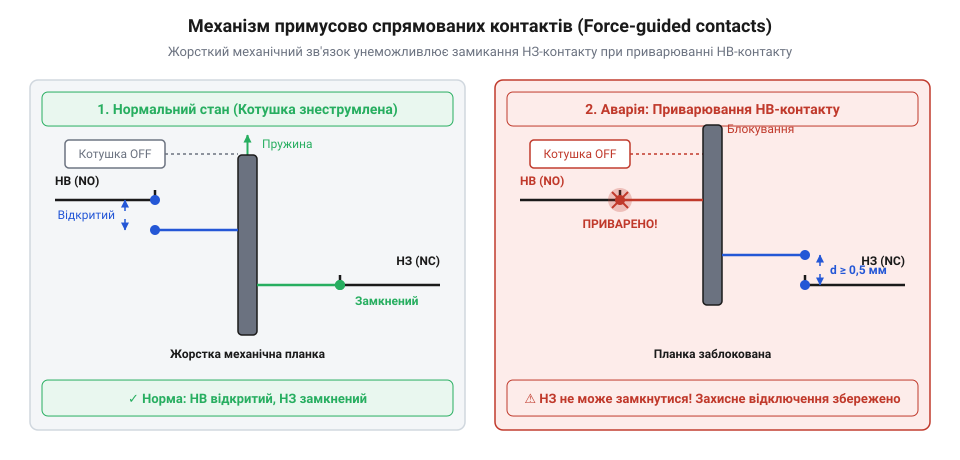
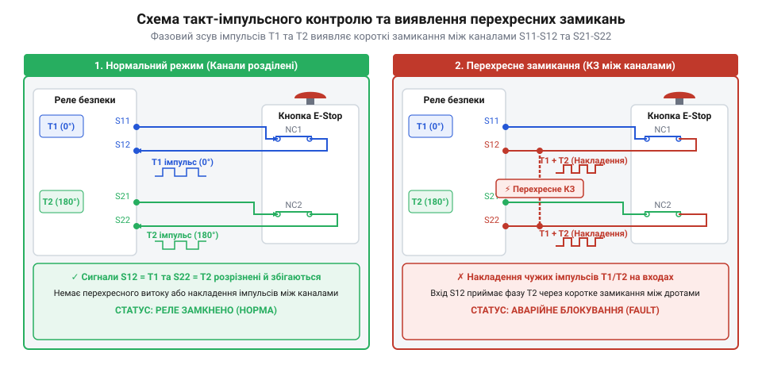

# Еволюція модулів захисного відключення: від блокувальних контакторів до програмованих контролерів безпеки

<preknowlist>
- [Кнопка аварійного стопу грибок та органи безпечного відключення (IEC 60947-5-5)](root:cat-hw-controls/estop-mushroom-button) — Принцип формування сигналу аварійної зупинки та роль кнопкового вимикача в колі безпеки.
- [Трипозиційні кнопки дозволу та педалі «мертвої руки»](root:cat-hw-controls/enabling-switches-and-dead-man-pedals) — Концепція ручного підтвердження безпечних умов при сервісному обслуговуванні та відлагодженні.
</preknowlist>

## Небезпека одноканальних схем із контакторами

У 1970-х роках промислова автоматика спиралася на прості одноканальні схеми аварійного вимкнення (від англійського @@en|single-channel circuit@@). У такій побудові послідовно з котушкою силового контактора (від англійського @@en|contactor@@) вмикали розмикальні контакти, якими володіє [кнопка аварійного стопу грибок](root:cat-hw-controls/estop-mushroom-button). За нормальної роботи струм котушки утримував силові контакти замкнутими. Натискання на кнопку розривало коло живлення котушки, магнітне поле зникало, і повертальна пружина розмикала силові контакти, зупиняючи електродвигун чи прес.

Головна небезпека цієї схеми криється у фізиці комутації високих струмів. Електрична дуга (від англійського @@en|electric arcing@@) та теплове перевантаження викликають зварювання контактів (від англійського @@en|contact welding@@, від давньоанглійського *weallan* — кипіти), коли металеві накладки контактора розплавляються й спаюються між собою. У разі зварювання натискання кнопки розриває коло котушки, проте силові контакти залишаються фізично нерухомими, продовжуючи живити небезпечний механізм.

Фізична причина виникнення високовольтної електричної дуги полягає в індуктивній природі обмоток електродвигунів (від англійського @@en|inductive load@@). У момент розмикання контактора різкий спад струму `di / dt` у момент відриву контактів викликає ЕРС самоіндукції `e = -L · (di / dt)`, яка формує імпульс напруги у кілька тисяч вольт. Цей сплеск іонізує повітряний проміжок між контактами, запалюючи дуговий розряд із температурою понад `3000 °C`. Висока температура миттєво розплавляє поверхневий шар срібно-мідних накладок контакту, утворюючи рідку метал-лужицю. Коли при падінні напруги дуга гасне, розплавлений метал під дією притискної пружини швидко застигає, міцно зварюючи рухомий і нерухомий контакти в єдиний моноліт.

Іншим критичним вразливим місцем є прихована відмова (від англійського @@en|hidden failure@@). Поодиноке коротке замикання (від англійського @@en|short circuit@@) сигнального проводу на корпус або лінію живлення шунтує контакт кнопкового вимикача. Захисна функція повністю втрачається без будь-яких зовнішніх ознак, і оператор дізнається про відмову лише в момент аварії, коли кнопка зупинки перестає реагувати.

Намагання розв'язати цю проблему шляхом послідовного з'єднання кількох кнопкових вимикачів у межах одного провідника не змінює одноканальної суті кола. Спільна сигнальна лінія залишається єдиною точкою відмови (від англійського @@en|single point of failure@@): якщо коротке замикання стається на ділянці кабелю між вимикачем і котушкою контактора, струм повністю оминає весь ланцюжок захисних елементів. Без фізичного розділення схеми на незалежні канали з окремими лініями живлення просте збільшення кількості контактів у межах одного провідника не усуває загрозу прихованого шунтування.

## Примусове спрямування та реле Pilz

Розуміння того, що звичайне електромеханічне реле не здатне виявити залипання власних контактів, призвело до технічного прориву. У 1987 році німецька компанія Pilz представила перше у світі спеціалізоване реле безпеки PNOZ (від німецького @@de|Pilz-Notaus-Schaltgerät@@). Основою цього пристрою стали примусово спрямовані контакти (від англійського @@en|force-guided contacts@@, також відомі як механічно пов'язані контакти за стандартом EN 50205).

У примусово спрямованому механізмі всі замикальні (NO) та розмикальні (NC) контакти жорстко з'єднані спільною ізолювальною штовхальною планкою. Якщо замикальний контакт приварюється в замкнутому стані через електричну дугу, штовхач фізично блокує рух розмикального контакту, не дозволяючи йому замкнутися навіть після знеструмлення котушки. Завдяки цьому зберігається гарантований зазор не менше `0.5 мм`.

Конструктивно ця ізолювальна штовхальна планка виконується у вигляді жорсткого гребеня з термостійкого полімеру (згідно зі стандартом EN 50205 для реле типу A), який фізично захоплює контактні містки всіх контактних груп. Кінематика блокування працює наступним чином: при знеструмленні котушки повертальна пружина намагається перемістити якір у початковий стан спокою, однак приварений замикальний контакт утримує штовхач у проміжному положенні. Оскільки планка утворює безлюфтовий механічний зв'язок (від англійського @@en|mechanical interlocking@@) між усіма рухомими елементами, розмикальний контакт зупиняється на жорсткому упорі, не досягаючи свого протилежного нерухомого контакту. Це гарантує, що при виникненні апаратної відмови в одному з кіл система фіксує неможливість замкнути контрольний розмикальний контакт, розмикаючи коло дозволу й блокуючи будь-яку спробу повторної подачі живлення.

*Принцип механічного зчеплення примусово спрямованих контактів у реле безпеки при зварюванні НВ-контакту.*

Цей механічний зв'язок дозволив реалізувати моніторинг зовнішніх пристроїв EDM (від англійського @@en|external device monitoring@@). Розмикальний контакт реле безпеки вмикають у коло зворотного зв'язку (від англійського @@en|feedback loop@@) пуску. Якщо силовий контактор залипає, його допоміжний розмикальний контакт залишається розімкнутим, що унеможливлює повторний запуск обладнання та сповіщає про відмову. Поєднання дубльованих каналів обробки (від англійського @@en|dual-channel architecture@@) та механічного моніторингу заклало основу сучасної апаратної автоматики захисту.

Для підвищення надійності схеми EDM реалізують два режими повернення пристрою у робочий стан після відновлення безпечних умов. При автоматичному скиданні (від англійського @@en|automatic reset@@) реле самостійно замикає виходи, щойно відновлюються вхідні сигнали та коло зворотного зв'язку, що створює загрозу несподіваного пуску обладнання при поверненні кнопки аварійної зупинки. Натомість ручне контрольоване скидання (від англійського @@en|monitored manual reset@@) вимагає свідомого натискання й відпускання окремої кнопки пуску оператором. Внутрішня схема перевіряє фронти сигналу кнопкового вимикача, що унеможливлює як повторний самозапуск механізму, так і спроби заблокувати кнопку скидання в постійно замкнутому стані.

## Стандарти EN 954 та такт-імпульси

Прийняття європейського стандарту EN 954-1 у 1996 році класифікувало архітектури за категоріями безпеки (від англійського @@en|safety category@@, від `Cat B` до `Cat 4`). Для вищих категорій вимагалося не лише апаратне резервування кіл, але й регулярне автоматичне виявлення коротких замикань між провідниками (від англійського @@en|cross fault@@ або @@en|cross-circuit failure@@). У класичних двоканальних схемах при замиканні між двома сигналами одного потенціалу (+24 В) натискання одного каналу розмикало коло, проте струм другого каналу продовжував живити реле, що призводило до втрати захисної функції.

Для вирішення цієї проблеми інженери розробили алгоритм такт-імпульсного контролю лінії (від англійського @@en|clock pulse monitoring@@). Реле безпеки формує на виходах живлення каналів `T1` та `T2` неперервні прямокутні тестові імпульси зі зміщенням у часі. Якщо між провідниками каналів виникає перехресне замикання, тестові імпульси змішуються, що миттєво фіксується внутрішньою схемою порівняння й переводить пристрій у безпечний стан (від англійського @@en|safe state@@).

Для надійного розпізнавання фазового зсуву між сигналами `T1` та `T2` тривалість часового інтервалу зміщення суворо узгоджують із частотою опитування входів. Аналого-цифровий перетворювач (від англійського @@en|Analog-to-Digital Converter@@, АЦП) або цифрова схема дискретизації здійснює вибірку сигналів із періодом, суттєво коротшим за ширину тестового імпульсу. Якщо частота опитування АЦП виявиться занизькою відносно часового зсуву імпульсів, мікроконтролер ризикує потрапити в інтервал між вибірками та пропустити накладення сигналів при замиканні, що збільшить час реакції (від англійського @@en|response time@@) або призведе до незафіксованої відмови.

*Схема такт-імпульсного контролю лінії та розпізнавання перехресного короткого замикання в двоканальному реле.*

Подальшим розвитком цієї технології стала поява напівпровідникових OSSD-виходів (від англійського @@en|Output Signal Switching Device@@). Замість електромеханічних контактів у них застосовано силові транзистори, які постійно самодіагностуються шляхом короткочасного розмикання кола на проміжок менше `100 мкс`. Інерційні силові контактори не встигають розімкнутися за цей час, але електронна схема реле перевіряє здатність транзистора повністю закриватися.

Проте практичне використання OSSD-виходів на великих відстанях наражається на фізичне обмеження кабельних трас. Паразитна ємність (від англійського @@en|parasitic capacitance@@) довгих сигнальних провідників затримує спад напруги під час тестового вимкнення, формуючи загладжені RC-фронти розряду. Якщо напруга не встигає впасти до нульового рівня за відведені `100 мкс`, діагностична схема помилково сприймає залишковий заряд як пробій вихідного транзистора й переводить модуль у стан відмови. Це призводить до хибних спрацьовувань захисту, для запобігання яким довжину кабельних ліній суворо обмежують або застосовують активні повторювачі сигналу.

## Програмовані контролери та міфи безпеки

У 2000-х роках еволюція нормативної бази завершилася впровадженням стандартів ISO 13849-1 (рівні продуктивності PL a–e, від англійського @@en|Performance Level@@) та IEC 62061 (рівні повноти безпеки SIL 1–3, від англійського @@en|Safety Integrity Level@@). Це відкрило шлях до створення програмованих контролерів безпеки (від англійського @@en|Safety PLC@@), які замінили масиви дискретних реле гнучкою програмованою логікою.

Разом із появою програмованих систем поширився небезпечний міф про те, що функціональну безпеку (від англійського @@en|functional safety@@) можна реалізувати суто програмно на звичайному мікроконтролері або стандартному ПЛК. У реальності звичайне програмне забезпечення не здатне компенсувати апаратні відмови: замикання пам'яті, зависання ядра або пробій вихідного ключа залишають керувальний сигнал увімкненим.

Сучасні програмовані пристрої захисту будуються за дубльованою архітектурою `1oo2` (один із двох, від англійського @@en|1-out-of-2 architecture@@) з двома незалежними процесорними ядрами, що працюють у синхронному режимі (від англійського @@en|lockstep architecture@@) та безперервно порівнюють результати обчислень. У разі найменшої розбіжності між ядрами апаратна система примусово знеструмлює виходи. Такий підхід застосовують у сучасних промислових системах, включаючи [пульт налагодження промислових роботів (Teach Pendant)](root:cat-hw-controls/teach-pendant-interface) та мобільну робототехніку, де [трипозиційні кнопки дозволу та педалі «мертвої руки»](root:cat-hw-controls/enabling-switches-and-dead-man-pedals) інтегровано у загальну дубльовану мережу захисту.

Усередині таких мікроконтролерів апаратні компаратори синхронно порівнюють шини даних, адрес та значення внутрішніх регістрів обох ядер на кожному такті виконання команд. Для захисту від випадкових збоїв у напівпровідниковій структурі використовують пам'ять із корекцією помилок (від англійського @@en|Error-Correcting Code@@, ECC), де спеціальний контролер не лише автоматично виправляє поодинокі бітові викривлення, але й виконує фонове тестування комірок. Якщо компаратор фіксує розбіжність у регістрах ядер або пам'ять повертає подвійну невиправну помилку, модуль безпеки вважає свій стан скомпрометованим і миттєво генерує апаратний сигнал зупинки незалежно від поточного стану програмного забезпечення.
