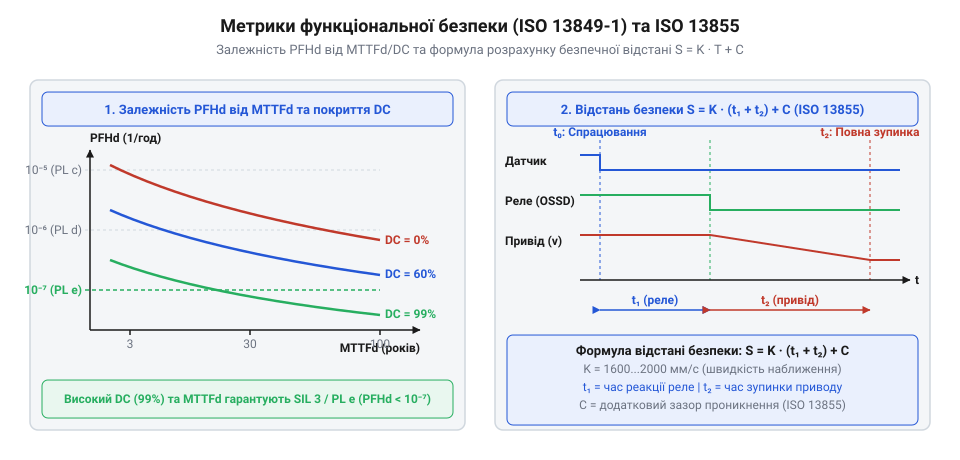

# Розрахунок показників надійності PL/SIL та часових інтервалів захисного вимкнення

<preknowlist>
- [Кнопка аварійного стопу грибок та органи безпечного відключення (IEC 60947-5-5)](root:cat-hw-controls/estop-mushroom-button) — засади побудови контурів аварійного вимкнення та концепція двоканального розмикання.
- [Трипозиційні кнопки дозволу та педалі «мертвої руки»](root:cat-hw-controls/enabling-switches-and-dead-man-pedals) — конструкція та класифікація станів органів дозволу у робочих зонах.
</preknowlist>

## Проблема оцінки надійності та безпечної відстані

Просте підключення механічного контакту до силового кола не гарантує захисту оператора в разі виникнення аварійної ситуації. Ззвичайні перемикачі зазнають механічного зносу, зварювання контактів від електричної дуги або втрати пружинних властивостей, через що лінія аварійного вимкнення може не розімкнутися в критичний момент. Навіть при застосуванні вимикачів із примусовим розмиканням, якими обладнані пристрої [аварійного стопу](root:cat-hw-controls/estop-mushroom-button) та [трипозиційні кнопки дозволу](root:cat-hw-controls/enabling-switches-and-dead-man-pedals), затримка спрацьовування реле й інерція механічного приводу створюють часове вікно, протягом якого небезпечний рух триває.

Для запобігання травмуванню обчислюють сумарний час реакції системи `T`, який складається з затримки виявлення датчиків `t_sensor`, часу обробки логіки `t_logic` та часу фізичного гальмування приводу `t_stop`. Для контактних пристроїв, як-от механічних кінцевих вимикачів чи [кнопок аварійного стопу](root:cat-hw-controls/estop-mushroom-button), `t_sensor` визначається механічним розмиканням контактів (зазвичай 5–15 мс). У безконтактних оптичних бар'єрах та світлових завісах `t_sensor` охоплює час оптичного сканування променів, цифрової фільтрації завад та перемикання напівпровідникових виходів @@en|OSSD@@ (від англ. @@en|Output Signal Switching Device@@ — вихідний пристрій комутації сигналу), що становить від 10 до 35 мс залежно від роздільної здатності завіси. Реле безпеки або логічний контролер додають затримку `t_logic` (10–30 мс) на міжканальне узгодження, а основну частку загального часу складає механічна інерція `t_stop` (100–500 мс) до повної зупинки вала. Якщо людина рухається в бік небезпечної зони зі швидкістю наближення `K`, неадекватна відстань встановлення захисного огородження чи оптичного бар'єра призводить до того, що оператор досягає небезпечного вузла раніше, ніж привод повністю зупиниться.

Кількісна оцінка ймовірності відмови контуру безпеки та кінематичний розрахунок захисної відстані нормуються міжнародними стандартами @@en|ISO 13849-1@@ (від англ. @@en|International Organization for Standardization@@ — Міжнародна організація зі стандартизації), @@en|IEC 62061@@ (від англ. @@en|International Electrotechnical Commission@@ — Міжнародна електротехнічна комісія) та @@en|ISO 13855@@. Вони вимагають математичного підтвердження того, що середня частота небезпечних відмов обладнання не перевищує допустимих меж для заданого рівня продуктивності @@en|Performance Level@@ (`PL`) або рівня повноти безпеки @@en|Safety Integrity Level@@ (`SIL`).

## Обчислення показників MTTFd, DC та CCF

Надійність апаратних компонентів контуру безпеки оцінюють через середній час до небезпечної відмови `MTTF_d` (від англ. @@en|mean time to dangerous failure@@ — середній час до небезпечної відмови). Для електромеханічних елементів значення `MTTF_d` розраховують на основі показника `B_10d` (кількість циклів комутації, за якої відмовляє 10% випробуваних зразків) та річної кількості комутацій `n_op`:

        n_op
        = (d_op × h_op × 3600) / t_cycle     [інтенсивність комутацій за рік]

        MTTF_d_i
        = B_10d / (0.1 × n_op)               [обчислення наробітку компонента в роках]

де `d_op` — дні роботи на рік, `h_op` — години роботи на добу, `t_cycle` — середній час між комутаційними циклами в секундах. Загальний опір каналу відмовам обчислюють за методом додавання інтенсивностей:

        1 / MTTF_d
        = ∑ (1 / MTTF_d_i)                   [сумування відносних інтенсивностей відмов]

Показник діагностичного покриття `DC` (від англ. @@en|diagnostic coverage@@ — охоплення діагностикою) характеризує частку небезпечних відмов, які виявляються автоматичними внутрішніми тестами системи:

        DC_avg
        = ∑ (DC_i / MTTF_d_i) / ∑ (1 / MTTF_d_i) [зважений середній коефіцієнт діагностики]

Значення `DC_avg` класифікують на чотири рівні: відсутнє (`DC < 60%`), низьке (`60% ≤ DC < 90%`), середнє (`90% ≤ DC < 99%`) та високе (`DC ≥ 99%`).

Для двоканальних структур оцінюють відсоток відмов від спільної причини `CCF` (від англ. @@en|common cause failure@@ — відмова з причин спільного походження). Кількісну оцінку `CCF` проводять за баловою шкалою (таблиця @@en|ISO 13849-1@@ Annex F), враховуючи фізичне розділення каналів, різноманітність технологій, захист від перенапруг та стійкість до зовнішніх впливів. Наприклад, фізичне рознесення кабельних трас двох каналів дає 15 балів, використання різних технологій сенсорів або поєднання нормалізовано замикаючих і розмикаючих контактів додає 20 балів, встановлення захисту від перенапруги й завад — 15 балів, а захист від температурного й вібраційного впливу додає ще 15 балів. Контур вважається захищеним від відмов спільної причини, якщо загальна сума балів за всіма інженерними заходами становить не менше 65 зі 100 можливих.

## Розрахунок ймовірностей відмови PFHD і PFD

Для оцінки стійкості контурів у режимі безперервного опитування обчислюють ймовірність небезпечної відмови на годину `PFH_d` (від англ. @@en|probability of dangerous failure per hour@@). Залежність `PFH_d` від `MTTF_d` та `DC` для двоканальних резервованих систем (Категорія 3 та Категорія 4) показано на схемі нижче.

*Залежність ймовірності небезпечних відмов від коефіцієнта діагностичного покриття та часова модель обчислення безпечної відстані.*

Для резервованої структури Категорії 4 з високим діагностичним покриттям у режимі безперервного опитування спрощена математична модель @@en|ISO 13849-1@@ визначає ймовірність небезпечної відмови на годину `PFH_d`. Якщо ж контур працює в режимі низької частоти запитів (коли аварійна ситуація виникає рідше одного разу на рік), оцінюють середню ймовірність відмови за вимогою `PFD_avg` (від англ. @@en|probability of failure on demand@@) згідно з @@en|IEC 62061@@. Для дубльованої архітектури `1oo2` показник `PFD_avg` залежить від періоду регламентних перевірок `T_proof` і обчислюється як `PFD_avg ≈ PFH_d × (T_proof / 2)`, що підтверджує готовність системи до спрацьовування в критичний момент. Спрощене вираження для `PFH_d` двоканальної системи має вигляд:

        PFH_d
        ≈ (1 / (MTTF_d_eq × 10)) × (1 - DC_avg / 100)  [наближення для двоканальної структури]

Розглянемо практичний розрахунок показників безпеки для дубльованого релейного контуру.

**Обчислення рівнів безпеки для двоканального релейного контуру:**

        MTTF_d_channel = 50 років
        DC_avg = 99%
        PFH_d = (1 / (50 × 10)) × (1 - 0.99)
              = (1 / 500) × 0.01                      [підстановка параметрів у рівняння]
              = 0.002 × 0.01                          [обчислення річного значення]
              = 2 × 10⁻⁵ років⁻¹                       [інтенсивність небезпечних відмов]
              = (2 × 10⁻⁵) / 8760                     [переведення в інтенсивність за годину]
              = 2.28 × 10⁻⁸ год⁻¹                      [відповідність вимогам PL e / SIL 3]

Отримане значення `PFH_d = 2.28 × 10⁻⁸ год⁻¹` лежить у межах інтервалу `10⁻⁸ ≤ PFH_d < 10⁻⁷ год⁻¹`, що підтверджує досягнення найвищих рівнів безпеки `PL e` за @@en|ISO 13849-1@@ та `SIL 3` за @@en|IEC 62061@@.

## Розрахунок безпечної відстані за ISO 13855

Навіть за умови високої надійності `PL e` система не захистить оператора, якщо орган керування або захисна світлова завіса розташовані занадто близько до небезпечної зони. Мінімальну безпечну відстань `S` обчислюють за кінематичним рівнянням стандарту @@en|ISO 13855@@:

        S
        = K × T + C                                   [базове рівняння безпечної відстані]
        = K × (t_resp + t_stop) + C                   [деталізація часових інтервалів]

де `K` — швидкість наближення тіла або частини тіла людини (за стандартом `K = 1600 мм/с` для загального наближення або `K = 2000 мм/с`, якщо можливе швидке проникнення руками), `T` — сумарний час затримки системи в секундах (`t_resp` — час реакції датчика й реле безпеки, `t_stop` — час механічної зупинки приводу), `C` — додаткова відстань на проникнення частини тіла до моменту виявлення (мм).

Розглянемо приклад розрахунку відстані встановлення захисного органу.

**Розрахунок безпечної відстані для захисної світлової завіси:**

        K = 2000 мм/с
        t_resp = 0.02 с
        t_stop = 0.18 с
        C = 120 мм
        T = 0.02 + 0.18 = 0.20 с                    [обчислення сумарного часу затримки]
        S = 2000 × 0.20 + 120                       [застосування кінематичної формули]
          = 400 + 120                               [обчислення шляху гальмування]
          = 520 мм                                  [мінімальна безпечна відстань]

За розрахунком пристрій повинен розташовуватися на відстані не менше `520 мм` від небезпечної зони. Якщо фізично розмістити завісу або кнопку на такій відстані неможливо, інженер мусить зменшити час механічної зупинки `t_stop` за допомогою активних гальмівних систем або застосувати пристрої з меншим додатковим фактором `C`.
