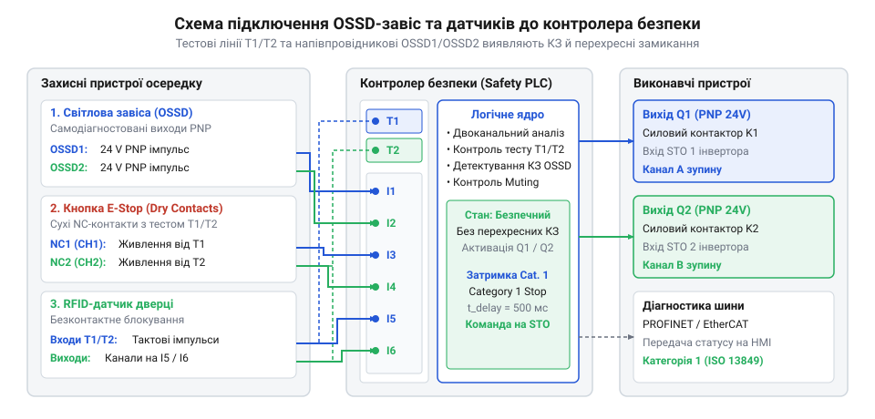
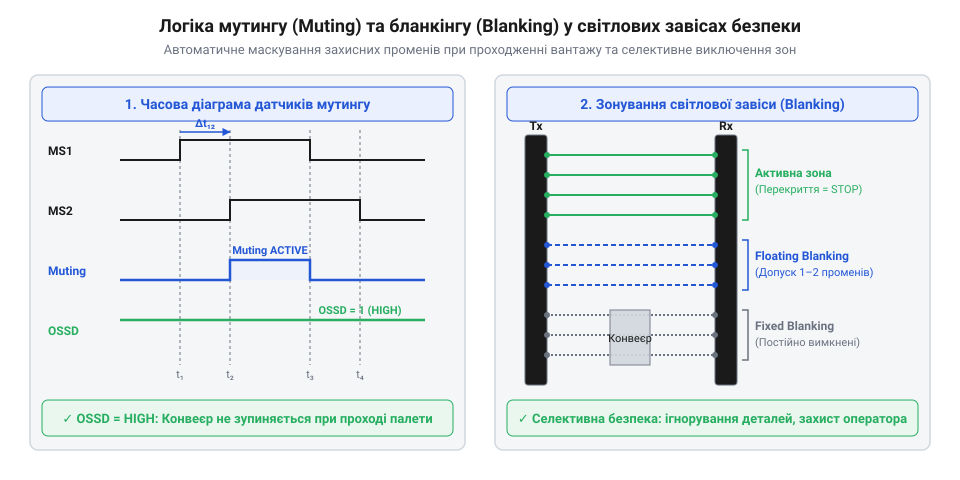

# Інтеграція програмованого контролера безпеки з OSSD-пристроями та світловими завісами

<preknowlist>
- [Кнопка аварійного стопу грибок та органи безпечного відключення (IEC 60947-5-5)](root:cat-hw-controls/estop-mushroom-button) — Принцип формування сигналу аварійної зупинки та схема підключення розмикальних контактів.
- [Трипозиційні кнопки дозволу та педалі «мертвої руки»](root:cat-hw-controls/enabling-switches-and-dead-man-pedals) — Концепція ручного підтвердження безпечних умов при сервісному обслуговуванні.
- [Пульт налагодження промислових роботів (Teach Pendant)](root:cat-hw-controls/teach-pendant-interface) — Принципи інтеграції органів керування роботом у загальну мережу захисту.
</preknowlist>

## Загрози роботизованого осередку та вимоги захисту

Сучасні автоматизовані виробничі осередки містять високошвидкісні промислові маніпулятори, поворотні позиціонери та важкі пресові установки, що становлять смертельну небезпеку для обслуговчого персоналу. Неконтрольоване проникнення людини в робочу зону під час виконання технологічної програми здатне призвести до важких травм чи летальних наслідків. Класичні системи аварійного вимкнення, що базуються на простих електромеханічних концевих вимикачах чи одній кнопці аварійного стопу, виявляються недостатніми: вони знеструмлюють обладнання неконтрольовано (категорія зупину 0), викликаючи падіння важких робочих органів під дією гравітації або пошкодження інструменту.

Забезпечення функціональної безпеки згідно зі стандартами ISO 13849-1 та IEC 62061 вимагає створення багаторівневого захисного бар'єра. Замість повного блокування технологічного процесу при будь-якому наближенні людини, сучасна автоматика розділяє робочий осередок на спеціалізовані зони: зону автоматичного руху, зону селективного завантаження матеріалу та зону сервісного обслуговування. Ключовим елементом такої системи є програмований контролер безпеки (від англ. @@en|configurable safety controller@@), який аналізує стан оптичних завіс, безконтактних датчиків та кнопок дозволу. На відміну від зупинки за Категорією 0 (від англ. @@en|Category 0 stop@@), коли живлення двигуна розмикається миттєво й спричиняє небезпечний інерційний вибіг масивних робочих органів чи падіння механізмів, контролер реалізує керовану зупинку за Категорією 1 (від англ. @@en|Category 1 stop@@). У цьому режимі силові перетворювачі активують електричне гальмування з підтриманням живлення протягом розрахованого часового інтервалу, і лише після повної зупинки вала апаратно знеструмлюють коло двигуна, що запобігає пошкодженню обладнання та збоям логіки захисту.

Для досягнення найвищого рівня продуктивності (від англ. @@en|Performance Level@@ PL e) та рівня повноти безпеки (від англ. @@en|Safety Integrity Level@@ SIL 3) контролер безпеки об'єднує всі дискретні та напівпровідникові сенсори в єдину логічну матрицю захисту, спираючись на жорсткі вимоги щодо резервування логічних обчислювачів за Категорією 4 (від англ. @@en|Category 4@@). Фізична архітектура контролера реалізується за двоканальною схемою 1oo2 (від англ. @@en|1oo2 architecture@@), де два незалежних мікроконтролери паралельно виконують одну й ту саму програму безпеки та здійснюють постійне перехресне порівняння (від англ. @@en|cross-monitoring@@) вхідних даних, проміжних станів і вихідних команд через ізольовану внутрішню шину. Кожен обчислювач охоплюється окремим апаратним сторожовим таймером (від англ. @@en|watchdog timer@@), який знеструмлює силові виходи у разі найменшої розбіжності тактів, зависання коду чи розходження результатів обчислень. Таке дублювання та високе діагностичне покриття (від англ. @@en|diagnostic coverage@@, DC ≥ 99%) гарантують, що жодна поодинока апаратна відмова не призведе до втрати функцій захисту. Це дозволяє гнучко адаптувати реакцію осередку на зовнішні події: при спрацьовуванні сервісних дверей оператора огородження переводити роботу маніпулятора у режим зниженої безпечної швидкості з утриманням [трипозиційної кнопки дозволу](root:cat-hw-controls/enabling-switches-and-dead-man-pedals) на [пульті налагодження](root:cat-hw-controls/teach-pendant-interface), а при виявленні непогоджених або аварійних сигналів — негайно активувати зупинку з блокуванням силових кіл.

## Апаратна схема та схемотехніка OSSD-ліній

На відміну від традиційних сухоконтактних датчиків, оптико-електронні захисні завіси та оптичні бар'єри використовують напівпровідникові OSSD-виходи (від англ. @@en|Output Signal Switching Device@@). Принцип роботи OSSD базується на безперервному формуванні двох дубльованих каналів PNP-транзисторів, які періодично короткочасно подають випробовувальні тестові імпульси напругою 0 В тривалістю від 100 до 300 мікросекунд. Це дозволяє входу контролера безпеки виявляти як внутрішні апаратні пробої транзисторів, так і зовнішні перехресні короткі замикання між провідниками чи замикання на лінію живлення +24 В.

Схемотехніка підключення вимагає роздільного прокладання сигнальних ліній каналів OSSD A та OSSD B для мінімізації наводок і запобігання міжфазним замиканням. Крім того, силові виходи контролера безпеки охоплюються колами моніторингу зворотного зв'язку EDM (від англ. @@en|External Device Monitoring@@). Нормально замкнені допоміжні контакти силових контакторів підключаються до спеціалізованого входу EDM: якщо після зняття напруги з котушки контакти залипають, контролер фіксує апаратну відмову та блокує повторний пуск. Забезпечення безвідмовної роботи напівпровідникових виходів також вимагає використання джерел живлення 24 В постійного струму, сертифікованих за стандартами безпечної наднизької напруги SELV (від англ. @@en|Safety Extra-Low Voltage@@) або захищеної наднизької напруги PELV (від англ. @@en|Protective Extra-Low Voltage@@). Такі блоки живлення мають подвійну гальванічну ізоляцію первинного й вторинного кіл та вбудований захист від імпульсних перенапруг, що унеможливлює потрапляння небезпечного потенціалу мережі 230/400 В на лінії OSSD і запобігає апаратному пробою PNP-транзисторів у замкнений стан при високовольтних сплесках.

Для збереження прямокутної форми коротких випробовувальних імпульсів OSSD напругою 0 В (тривалістю 100–300 мкс) критично важливо дотримуватися вимог щодо параметрів кабельної лінії. Повна погонна ємність сигнальних провідників T1 та T2 не повинна перевищувати 20 нФ (або 100–150 пФ/м), оскільки висока паразитна ємність спричиняє загладжування спадів напруги й перетворює прямокутний тестовий спалах на трапецеїдальний сигнал, що призводить до помилкового розпізнавання відмови вхідним каскадом контролера. Для компенсації омічного падіння напруги та забезпечення високої завадозахищеності ліній живлення випробовувальних кіл рекомендується використовувати екранований кабель типу «вита пара» з перерізом мідних жил від 0,5 до 1,5 мм² (від англ. @@en|American Wire Gauge@@ AWG 20–16) при максимальній довжині траси до 100 метрів.

Нижче наведено практичну реалізацію підсистеми обробки OSSD-сигналів та контролю EDM:

:::tabs
@tab C
:::code proj-configurable-safety-controller-ossd-integration/c/include/safety_types.h 1-58
:::code proj-configurable-safety-controller-ossd-integration/c/include/safety_controller.h 1-27
:::code proj-configurable-safety-controller-ossd-integration/c/src/safety_controller.c 1-94

@tab C++
:::code proj-configurable-safety-controller-ossd-integration/cpp/include/safety_types.hpp 1-58
:::code proj-configurable-safety-controller-ossd-integration/cpp/include/ossd_channel.hpp 1-43
:::code proj-configurable-safety-controller-ossd-integration/cpp/src/safety_controller.cpp 1-54
:::

## Конфігурування логічних функцій Muting та Blanking

При транспортуванні деталей та заготовок крізь світлову завісу виникає потреба в тимчасовому маскуванні захисних променів для безперешкодного проходу палети без зупинки обладнання. Для цього застосовується логічна функція Muting (приглушення). Система оснащується додатковими оптичними або індуктивними датчиками M1 та M2, розташованими перед завісою. Режим Muting активується лише тоді, коли датчики перекриваються у суворо визначеній послідовності та в межах допустимого часового вікна (наприклад, не більше 3000 мс між спрацьовуванням M1 та M2). Якщо промінь завіси переривається без попередньої активації датчиків мутингу чи з порушенням часового графіку, контролер безпеки миттєво генерує сигнал аварійної зупинки.

На відміну від маскування всього бар'єра, функція Blanking дозволяє постійно або динамічно виключати з контролю окремі оптичні пучки світлової завіси. Фіксоване бланкування (від англ. @@en|fixed blanking@@) застосовується для нерухомих конструктивних елементів (наприклад, конвеєрних станин чи прокладених кабельних лотків), а плаваюче бланкування (від англ. @@en|floating blanking@@) дозволяє переміщення заготовки відомого перерізу в межах визначеного допуску за кількістю променів. Під час програмування плаваючого бланкування встановлюють бітову маску та допуск променів (від англ. @@en|beam tolerance@@), який визначає максимально допустиме число одночасно перекритих пучків у будь-якому місці оптичної матриці (наприклад, 1 або 2 промені). Якщо при зміні кутової орієнтації чи перекосі заготовки на рольгангу її проекція розширюється й перекриває додатковий промінь понад налаштований допуск, контролер безпеки миттєво ідентифікує це як присутність стороннього предмета чи руки оператора та розмикає виходи захисту.

Повна реалізація логіки Muting, Blanking та контролера безпеки наведена в наступних модулях:

:::tabs
@tab C
:::code proj-configurable-safety-controller-ossd-integration/c/src/safety_controller.c 95-166
:::code proj-configurable-safety-controller-ossd-integration/c/main.c 1-93

@tab C++
:::code proj-configurable-safety-controller-ossd-integration/cpp/include/safety_controller.hpp 1-82
:::code proj-configurable-safety-controller-ossd-integration/cpp/src/safety_controller.cpp 55-150
:::code proj-configurable-safety-controller-ossd-integration/cpp/src/main.cpp 1-88
:::

## Логіка затримки Cat 1 та моніторинг EDM

Під час аварійного вимкнення високоінерційного обладнання (наприклад, приводів робототехнічного осередку, які налагоджують через [пульт керування](root:cat-hw-controls/teach-pendant-interface)) миттєве знеструмлення двигунів за Категорією 0 (від англійського @@en|Category 0 stop@@) призводить до неконтрольованого вибігу механізмів під дією інерції. Логіка безпечної зупинки за Категорією 1 (від англійського @@en|Category 1 stop@@) передбачає активне електричне гальмування привода з підтриманням живлення протягом заданого часового інтервалу, і лише після повної зупинки — апаратне розмикання силових кіл.

Для гарантованого відключення силового живлення програмований контролер безпеки використовує силові контактори з примусово керованими контактами (від англійського @@en|force-guided contacts@@). Механічний зв'язок у таких контакторах гарантує: якщо силовий НР-контакт (від англійського @@en|normally open@@) приварився у замкненому стані через електричну дугу, допоміжний НЗ-контакт (від англійського @@en|normally closed@@) фізично не зможе замкнутися. Підсистема моніторингу зовнішніх пристроїв EDM (від англійського @@en|External Device Monitoring@@) безперервно відстежує стан цих НЗ-контактів зворотного зв'язку.

При зміні стану виходів безпеки контролер розраховує очікуваний стан НЗ-кіл зворотного зв'язку. Тривалість контрольного часового вікна (наприклад, `SAFETY_EDM_TIMEOUT_MS` = 200 мс) розраховується з урахуванням власної механічної затримки спрацьовування силових контакторів (яка зазвичай становить від 15 до 50 мс для розмикання або замикання примусово керованих контактів) з додаванням технологічного запасу на знос пружин, котушок та час відклику вхідних фільтрів ПЛК. Якщо встановлений таймаут є занадто коротким, природний механічний інерційний запізнювальний інтервал контактора викликає фальшиве спрацьовування тривоги, а надто тривалий час — затримує виявлення небезпечного приварювання контакту. Якщо протягом розрахованого вікна НЗ-контакти не підтверджують зміну стану контакторів, підсистема EDM фіксує незйомну апаратну відмову та блокує повторний запуск системи до усунення несправності.

:::code proj-configurable-safety-controller-ossd-integration/c/include/safety_controller.h 6-10
:::code proj-configurable-safety-controller-ossd-integration/c/src/safety_controller.c 77-94

У об'єктно-орієнтованій реалізації на C++ контроль стану силових кіл та часових відхилень інтегровано у загальний автомат станів через перелічувані типи помилок, де залипання контактора або урвище сигналу фідбеку реєструється кодом `FaultCode::HardwareFailure`.

:::code proj-configurable-safety-controller-ossd-integration/cpp/include/safety_types.hpp 25-33
:::code proj-configurable-safety-controller-ossd-integration/cpp/src/safety_controller.cpp 127-143

## Діагностика шини та валідація осередку

Завершальним етапом впровадження системи безпеки є інтеграція діагностичних даних у мережу автоматизації (наприклад, EtherCAT або PROFINET) та проведення комплексного випробування осередку. На відміну від класичних електромеханічних реле, програмований контролер безпеки передає у верхній рівень керування не лише бінарний стан виходів, а й деталізовані коди помилок, що дозволяє оперативно локалізувати причину зупинки лінії (наприклад, розходження каналів, перевищення таймауту Muting або збій EDM).

:::code proj-configurable-safety-controller-ossd-integration/cpp/include/safety_types.hpp 43-54

Натурна валідація захищеного осередку після складання шафи вимагає обов'язкової перевірки трьох базових сценаріїв із фіксацією випробувань в офіційному валідаційному протоколі (від англ. @@en|validation protocol@@):
1. **Переривання оптичного променя:** фізичне перекриття світлової завіси тестовим стрижнем з вимірюванням повного часу реакції системи (від англ. @@en|response time@@) від моменту розмикання променя до знеструмлення OSSD-виходів (який не повинен перевищувати 15–30 мс) та фіксацією переходу контролера в стан спрацювання захисту.
2. **Перевірка режимів Muting та Blanking:** імітація проходження технологічного вантажу через послідовні датчики M1 і M2 з дотриманням часового вікна та контроль блокування виходів при порушенні послідовності.
3. **Штучна імітація відмов:** введення несиметричного сигналу каналів OSSD для перевірки таймера неузгодженості, імітація перехресного замикання та імітація залипання силового контактора (розмикання кола EDM під час спроби увімкнення виходів). Навіть при натисканні дублюючих органів керування, таких як [кнопка аварійного стопу](root:cat-hw-controls/estop-mushroom-button) або [педаль дозволу](root:cat-hw-controls/enabling-switches-and-dead-man-pedals), відновлення роботи без усунення апаратного збою є неможливим.
Усі виміряні часові затримки, контрольна сума конфігурації (CRC), версія прошивки та серійні номери пристроїв заносяться до протоколу й завіряються підписом відповідального інженера з функціональної безпеки.

:::code proj-configurable-safety-controller-ossd-integration/c/main.c 28-89
:::code proj-configurable-safety-controller-ossd-integration/cpp/src/main.cpp 37-85

Лише після успішного проходження всіх пунктів валідаційного протоколу та підтвердження відсутності автоматичного скидання апаратних помилок без ручного підтвердження кнопкою Reset осередок вважається готовим до безпечної промислової експлуатації.
