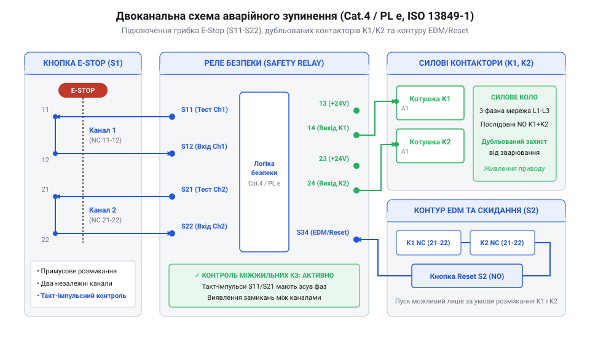

# Практична реалізація двоканального контуру аварійного зупину категорії Category 4 / PL e

<preknowlist>
- [Кнопка аварійного стопу грибок та органи безпечного відключення (IEC 60947-5-5)](root:cat-hw-controls/estop-mushroom-button) — призначення двох незалежних нормально закритих контактів з примусовим розмиканням.
</preknowlist>

## Схемотехніка та елементна база контуру Категорії 4

Просте підключення механічної кнопки до силового котушкового кола не здатне забезпечити захист оператора при апаратних відмовах. У разі зварювання контактів вимикача чи виникнення короткого замикання в кабелі натискання на орган керування не розімкне силову лінію. Для усунення цих ризиків стандарт @@en|ISO 13849-1@@ визначає вимоги до структури @@en|Category 4@@ (від англ. @@en|Category 4@@ — Категорія 4) та найвищого рівня продуктивності @@en|Performance Level@@ (`PL e`), які вимагають наявності двох незалежних каналів зупинення, високого діагностичного покриття (`DC ≥ 99%`) та стійкості до накопичених несправностей.

Основою схемотехніки Категорії 4 є спеціалізоване реле безпеки @@en|Safety Relay@@ (від англ. @@en|Safety Relay@@ — реле безпеки), яке здійснює внутрішню самодіагностику та випромінює тестові імпульси для перевірки цілісності вхідних ліній. Контрольні виходи `S11` та `S21` генерують прямокутні такт-імпульси з постійним часовим зсувом (від англ. @@en|phase shift@@ — фазовий зсув) або протифазною кодовою послідовністю. У разі виникнення міжжильного короткого замикання (від англ. @@en|cross-fault@@ — міжканальне замикання) в кабелі кнопки імпульси з лінії `S11` моментально потрапляють на вимірювальний вхід `S22`, що викликає часову розсинхронізацію та негайне аварійне вимкнення контуру задовго до спроби механічного спрацьовування. Надійність механічної частини кнопки оцінюється покажчиком `B10d` (від англ. @@en|B10d@@ — кількість циклів комутації до виникнення десяти відсотків небезпечних відмов), який визначає вихідну долговічність контактів і дає змогу обчислити середній час до небезпечної відмови `MTTFd` залежно від інтенсивності експлуатації:

```
MTTFd = B10d ÷ (0.1 · n_op)         [середній час до небезпечної відмови за інтенсивністю дій]
```

де `n_op` — розрахункова кількість комутаційних операцій на рік. Для надійної діагностики стану виконавчих пристроїв у ланцюзі @@en|External Device Monitoring@@ (`EDM`) застосовують дзеркальні розмикальні контакти допоміжних реле та контакторів, обрані відповідно до категорії комутаційного навантаження за @@en|IEC 60947-5-1@@ — категорії `AC-15` для зміннострумових котушок або `DC-13` для індуктивних постійнострумових кіл `24 V DC`. Вибір контактів належної категорії запобігає зварюванню клем від дугового зносу та гарантує точну передачу стану контактора на діагностичний вхід реле. Загальна елементна база контуру складається з чотирьох основних вузлів:

1. **Орган аварійного вимкнення**: Двоканальна грибкова кнопка [аварійного стопу](root:cat-hw-controls/estop-mushroom-button) з контактами примусового розмикання згідно з @@en|IEC 60947-5-5@@. Кнопка має два окремих розмикальних контакти, які фізично розділені всередині корпусу.
2. **Логічний модуль безпеки**: Модульне реле безпеки, що має тестові такт-імпульсні виходи `S11` та `S21`, вимірювальні входи `S12` та `S22`, вхід зворотного зв’язку `S34` та дубльовані силові виходи `13-14` і `23-24`.
3. **Виконавчі пристрої**: Двоє дубльованих силових контакторів `K1` та `K2`, котушки яких підключаються до незалежних виходів реле, а силові контакти з'єднуються послідовно в колі живлення двигуна. Контактори обов'язково обладнуються механічно зв'язаними розмикальними допоміжними контактами для моніторингу стану @@en|External Device Monitoring@@ (`EDM` — від англ. @@en|External Device Monitoring@@ — моніторинг зовнішніх пристроїв).
4. **Орган скидання**: Кнопка ручного скидання з нормально розімкненим контактом, яка запобігає автоматичному повторному запуску обладнання після відновлення кнопки аварійного стопу.

## Монтаж та розводка електричної схеми

Електричне підключення елементів контуру Категорії 4 вимагає суворого розділення вхідних такт-імпульсних кіл, силових виходів та ланцюга діагностичного зворотного зв'язку. Принципову схему зборки показано нижче.


*Принципова електрична схема підключення двоканальної кнопки аварійного зупину, реле безпеки з імпульсними виходами S11-S22, котушок контакторів та контуру EDM з кнопкою Reset.*

Перед початком збірки готують дріт із мідними багатожильними провідниками перерізом від 0.75 мм² до 1.5 мм² з обтиснутими ізольованими штирьовими наконечниками. Вхідні лінії `S11-S12` та `S21-S22` обов'язково маркують жовто-жовтогарячими маркувальними бірочками та виводять на окрему захищену клемну колодку шафи керування (наприклад, клеми `-X1:11`–`-X1:14`), що виключає випадкову комутацію кіл безпеки із загальними колами `24 V DC`. Сам монтаж та комутація схеми здійснюються за наступним покроковим алгоритмом:

Окрему увагу приділяють вибору та розрахунку захисного запобіжника в колі живлення клем `A1-A2`. Для захисту внутрішніх напівпровідникових елементів та оптронів реле безпеки застосовують швидкодіючий запобіжник (від англ. @@en|fast-acting fuse@@ — швидкий плавкий запобіжник) класу `F` або `gG`. Розрахунок струмового номіналу запобіжника `I_fuse` виконують з урахуванням власного струму споживання логічної схеми реле `I_logic` (що зазвичай становить `100–200 mA`) та пікових струмів індикації з коефіцієнтом запасу `1.3–1.5`:

```
I_fuse = 1.5 · I_logic         [обчислення номіналу захисного запобіжника живлення]
```

Отримане значення округлюють до найближчого стандартного ряду вгору (зазвичай `1 A` або `2 A`). Використання уповільнених запобіжників чи перевищення номіналу недопустиме, оскільки у разі внутрішнього пробою чи замикання лінії на корпус це призведе до вигорання внутрішніх доріжок плати реле раніше за спрацьовування апарата захисту.

1. **Підключення живлення реле**: Подайте напругу `+24 V DC` на клему `A1` реле безпеки через захисний запобіжник номіналом 1 А, а клему `A2` з'єднайте з спільним провідником `0 V DC`.
2. **Монтаж першого вхідного каналу (CH1)**: Провідник від такт-імпульсного виходу `S11` прокладіть до першого розмикального контакту кнопки (клема 11), а вихід контакту (клема 12) підключіть до вимірювального входу реле `S12`.
3. **Монтаж другого вхідного каналу (CH2)**: Провідник від другого такт-імпульсного виходу `S21` (який генерує імпульси зі зсувом фази відносно `S11`) прокладіть до другого розмикального контакту кнопки (клема 21), а повернення (клема 22) підключіть до входу `S22`.
4. **Розводка силових виходів**: Подайте потенціал `+24 V DC` на вхідні силові клеми реле `13` та `23`. З виходу `14` прокладіть дріт до котушки першого контактора `K1:A1`, а з виходу `24` — до котушки другого контактора `K2:A1`. Другі виводи котушок `K1:A2` та `K2:A2` підключіть до `0 V DC`.
5. **Формування контуру EDM та Reset**: Сформуйте послідовне коло моніторингу: від джерела `+24 V DC` прокладіть дріт через розмикальний допоміжний контакт `K1 (21-22)`, далі послідовно через розмикальний контакт `K2 (21-22)` та замыкальний контакт кнопки ручного скидання `Reset` на вхід реле `S34`.

## Пусконалагодження та перевірка стійкості до відмов

Після завершення монтажу проводять серію пусконалагоджувальних випробувань для перевірки штатної роботи та верифікації стійкості контуру до апаратних несправностей.

**Перевірка штатного алгоритму функціонування:**
1. Подайте живлення на щит. Індикатори каналів `CH1` та `CH2` на реле безпеки не горять, силові контактори `K1` та `K2` знеструмлені.
2. Натисніть кнопку `Reset`. Реле перевіряє цілісність розмикальних контактів `K1` і `K2` через вхід `S34`. Якщо контактори справні та розімкнені, реле замикає виходи `13-14` та `23-24`, контактори `K1` і `K2` спрацьовують, подаючи живлення на привод.
3. Натисніть грибкову кнопку аварійного стопу. Розмикаються обидва контакти, реле миттєво (за час менше 20 мс) знімає напругу з котушок `K1` та `K2`, зупиняючи обладнання.
4. Поверніть грибок кнопки у вихідний стан. Контактори не повинні вмикатися автоматично. Повторне включення відбувається лише після повторного натискання кнопки `Reset`.

**Тестування реакції на штучно створені несправності:**
- **Обрив одного каналу**: Відключіть дріт від клеми `S12`. При натисканні `Reset` реле фіксує відсутність сигналу на `CH1` і блокує включення силових виходів.
- **Міжжильне коротке замикання**: Установіть перемичку між провідниками `S12` та `S22`. Завдяки протифазним такт-імпульсам з виходів `S11` та `S21` реле виявляє перехресне замикання жил, вимикає силові виходи та переходить у режим аварійного блокування @@en|Lockout@@. Точний час вимкнення виходів вимірюють двоканальним осцилографом: перший щуп підключають до лінії `S12`, а другий — до силого виходу `14`. При замиканні осцилограма фіксує фазовий зсув імпульсів та розмикання виходу `14` за час, що не перевищує 15–20 мс.
- **Замикання на землю**: З'єднайте провідник `S12` з шиною `0 V`. Внутрішній електронний захист реле обмежує струм короткого замикання та відключає вхідний канал `CH1`.
- **Зварювання силового контактора**: Для імітації примусово утримуйте допоміжний контакт `K1 (21-22)` у розімкненому стані. Натисніть і відпустіть кнопку аварійного зупину, після чого спробуйте натиснути `Reset`. Оскільки контур `EDM` розімкнений через «залиплий» контакт `K1`, реле не дозволить повторно ввімкнути контактор `K2`, запобігаючи небезпечному повторному пуску.
