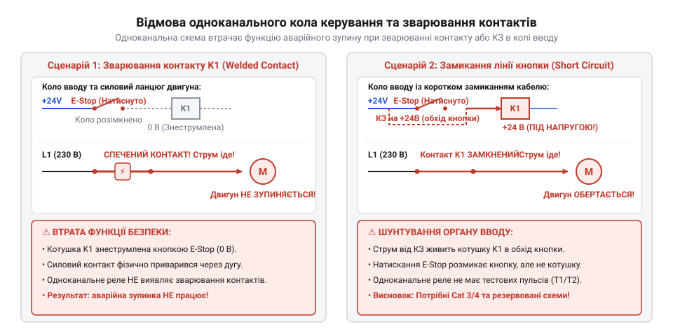
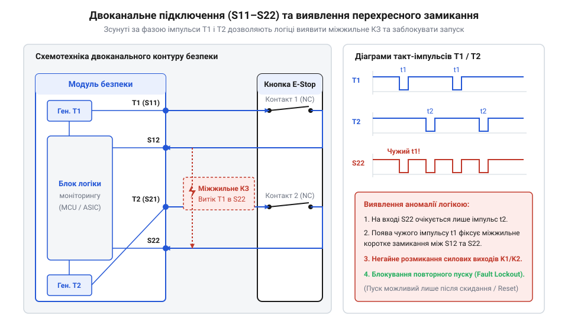
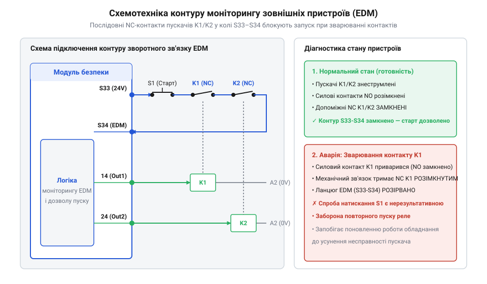
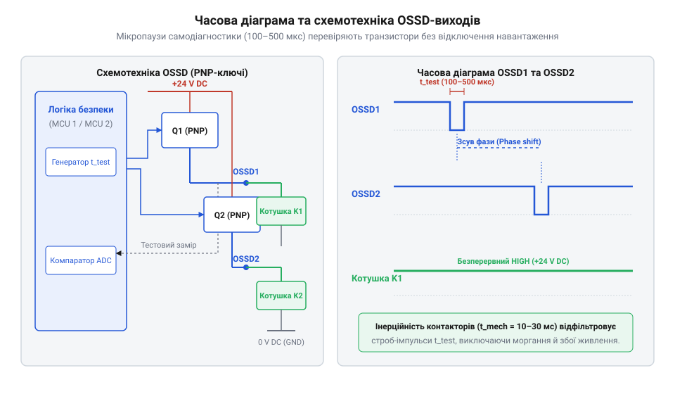
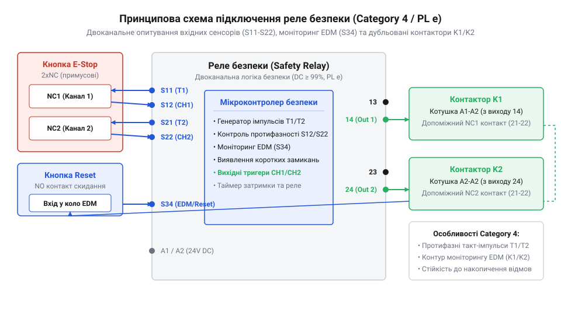

# Реле безпеки та контролери захисного відключення

<preknowlist>
- [Кнопка аварійного стопу грибок та органи безпечного відключення (IEC 60947-5-5)](root:cat-hw-controls/estop-mushroom-button) — Механіку розмикання сухих NC-контактів та вимоги стандарту IEC 60947-5-5 до органів аварійного вимкнення.
- [Трипозиційні кнопки дозволу та педалі «мертвої руки»](root:cat-hw-controls/enabling-switches-and-dead-man-pedals) — Принцип формування сигналів перехідних станів для двоканальних вхідних кіл реле безпеки.
- [Тросові вимикачі аварійного зупинення (IEC 60947-5-5)](root:cat-hw-controls/cable-pull-switches-and-safety-rope-switches) — Принцип роботи двокатегорійних контактних груп вимикачів натягу троса.
</preknowlist>

## Небезпека одинарних контурів та відмова вимкнення

У промисловій автоматизації безпека оператора критично залежить від здатності системи гарантовано знеструмити силові приводи при виникненні небезпечної ситуації. Традиційні кола керування побудовані на одинарному послідовному контурі: струм живлення котушки силового контактора проходить через один нормально замкнений контакт аварійної кнопки. У штатному режимі кнопка замкнена, напруга подається на котушку, і двигун обертається. Проте під час комутації високих індуктивних навантажень або при протіканні струмів короткого замикання між контактами виникає електрична дуга. Сплеск температури здатний розплавити контактні накладки, викликаючи зварювання контактів (англ. *welded contacts*, від англ. *weld* — зварювати) @@en|welded contacts@@. 

Коли виникає зварювання, фізичний натиск на орган вимкнення не здатний розірвати електричне коло, оскільки механічне зусилля зворотної пружини недостатнє для зриву спеченого металу. Крім того, при пошкодженні кабельного шлейфу сигнальна жила може коротко замкнутися на лінійний провідник живлення за органом керування. Усі ці ситуації утворюють приховану відмову (англ. *dangerous undetected fault*) @@en|dangerous undetected fault@@: обладнання продовжує справно працювати, але кнопка вимкнення повністю втрачає свою захисну функцію. Людина дізнається про відмову лише в момент аварії, коли натискання на [Кнопка аварійного стопу грибок та органи безпечного відключення (IEC 60947-5-5)](root:cat-hw-controls/estop-mushroom-button) не призводить до зупину механізму.

*Шлях проходження струму в одноканальному контурі при прихованому зварюванні контактів або замиканні жили живлення вхідного кола.*

Для усунення прихованих відмов стандартне проміжне реле замінюють на спеціалізований модуль моніторингу — реле безпеки (англ. *safety relay*, від англ. *safety* — безпека) @@en|safety relay@@. Його основу становлять елементи з примусово спрямованими контактами (англ. *force-guided contacts*, від англ. *force* — сила) @@en|force-guided contacts@@ відповідно до стандарту IEC 60947-5-1 (Додаток L / Annex L). У таких реле нормально розімкнені (NO) та нормально замкнені (NC) контакти механічно зв'язані жорстким ізоляційним штовхачем зі склонаповненого полімеру в єдиний кінематичний ланцюг, де розмикання реалізовано за стандартизованим методом прямої механічної дії (англ. *positive opening operation*). Під час знеструмлення котушки пружина повернення (англ. *return spring*, від англ. *return* — повернення та *spring* — пружина) @@en|return spring@@ вивільняє накопичену пружну енергію, силоміць розганяючи штовхач і механічно відриваючи рухомі контактні містки. Самі контактні накладки виготовляють із термостійких спечених сплавів (AgSnO₂ або AgCdO), що витримують температуру електричної дуги понад 1000 °C і запобігають глибокій ерозії контактів (англ. *contact erosion*) @@en|contact erosion@@. Протягом експлуатаційного ресурсу (10⁶...10⁷ комутацій) початкове натягнення пружини компенсує часові допуски механічного зносу накладок завтовшки до 0.2...0.3 мм. Якщо ж під дією екстремального струму бодай один NO-контакт зварився, спечена пластина блокує повний робочий хід траверси (1.2...1.8 мм) і фізично перешкоджає зворотному руху штовхача під дією пружини, через що NC-контакт не може замкнутися при знеструмленні котушки, гарантовано залишаючи між поверхнями розмикання зазор не менше 0.5 мм. При цьому часовий допуск переключення траверси та розсинхронізації контактних груп під час знеструмлення котушки не перевищує 15...20 мс, що дає змогу внутрішньому компаратору безпомилково зафіксувати відхилення кінематики. Цей механічний бар'єр унеможливлює помилкове проходження струму через коло зворотного зв'язку і дає змогу контуру самодіагностики зафіксувати відмову та заблокувати повторний запуск обладнання. Простежити розвиток захисних пристроїв від первинних контакторів до сучасних модулів можна у [нарисі еволюції захисних модулів](root:cat-hw-controls/safety-relays-and-controllers/hist-safety-relays-evolution.md).

## Двоканальна архітектура та випробувальні такт-імпульси

Для забезпечення вимог високої надійності одинарний контур замінюють на двоканальну архітектуру (англ. *dual-channel architecture*) @@en|dual-channel architecture@@ з паралельним дублюванням кіл. Орган аварійного вимкнення оснащують двома незалежними NC-контактами, а реле безпеки отримує два вхідні канали: канал 1 (клеми S11–S12) та канал 2 (клеми S21–S22). Якщо в одному з каналів відбудеться зварювання контакту або обрив провідника, другий канал збереже здатність розірвати коло живлення й знеструмити виконавчі пускачі.

Проте звичайне дублювання каналів не захищає від міжжильного короткого замикання (перехресного замикання — англ. *cross-fault*, від англ. *cross* — перехрестя) @@en|cross-fault@@. Якщо два провідники сигнальних кіл S12 та S22 прокладені у спільному кабелі й зазнають механічного здавлення або перетирання ізоляції, вони можуть з'єднатися між собою. При натисканні аварійної кнопки обидва розмикачі відкриваються, але струм з клеми S11 через точку замикання витікає в канал S22, імітуючи замкнений стан і блокуючи вимкнення.

Для активного виявлення міжжильних замикань реле безпеки генерує на вихідних клемах S11 та S21 випробувальні такт-імпульси (англ. *test pulses*, від англ. *test* — випробування) @@en|test pulses@@ T1 та T2. У часовій області імпульс T1 є короткочасним провалом постійної напруги +24 В до 0 В тривалістю 100...500 мкс із періодом повторення 10...50 мс, тоді як імпульс T2 згенерований із суворим часовим зсувом фази на 180° або має протилежну полярність відносно T1. Якщо між жилами S12 та S22 виникає коротке замикання, прямокутні імпульсні фронти T1 накладаються на лінію T2, що змінює амплітудну обвідну напруги та викликає часовий розсинхрон на вхідних компараторах реле. Це дає змогу схемі самодіагностики зафіксувати витік струму між каналами ще до спрацьовування органів керування й миттєво відключити вихідні кола.

*Формування випробувальних такт-імпульсів T1/T2 на вхідних клемах S11–S22 та механізми виявлення міжжильного короткого замикання.*

Коли сигнальні провідники `S12` та `S22` замикаються між собою, випробувальний сигнал `T1` потрапляє на вхід другого каналу. Амплітудний спектр прямокутних випробувальних імпульсів визначається базовою частотою повторення `f_test = 20...100 Гц` та багатим набором високочастотних гармонік, сформованих крутими фронтами перемикання між номінальним рівнем `+24 V DC` та порогами випробувального провалу менше `+5 V DC`. Схемотехніка входів побудована на аналогових віконних компараторах, які паралельно відстежують верхній та нижній порогові рівні напруги. Для захисту чутливих вхідних клем від імпульсних сплесків ЕРС самоіндукції (від англ. @@en|back-EMF@@ — ЕРС самоіндукції), що виникають через паразитну індуктивність довгих кабельних ліній або комутаційні завади, на вході застосовують напівпровідникові супресори (від англ. @@en|transient voltage suppressor@@ — супресор обмежувач напруги) та діоди фіксації потенціалу. Вони зрізають амплітудні сплески вище `+30 V` та інверсні викиди нижче `-0.7 V`. Далі аналоговий вхідний RC-фільтр низьких частот із часовим вікном вибірки `20...50 мкс` згладжує залишки високочастотних наводок, зберігаючи крутизну фронтів випробувальних стробів, після чого логічна схема збігу порівнює фазові фронти надійшлих сигналів із еталонними такт-імпульсами `T1` і `T2`. При накладанні прямокутних фронтів амплітудна обвідна змінюється, а подвійні віконні компаратори фіксують недопустимий витік струму: якщо під час провалу `T1` напруга на каналі перевищує поріг розпізнавання логічного нуля (понад `+5...+11 V`), операційні підсилювачі компаратора виявляють порушення фазової симетрії та часовий розсинхрон прямокутних спадів ще до цифрової обробки. Сформований перепад напруги проходить крізь вхідний тригер Шмітта з гістерезисом `2...3 V` для придушення брязкання й засувається вхідним апаратним RS-тригером фіксації відмови, який надійно блокує схему керування у вимкненому стані, після чого внутрішній мікроконтролер чи логічна схема реле миттєво розпізнає перехресне замикання як фатальну похибку і переводить виходи у захищений вимкнений стан.

Використання двоканальних кіл із генерацією такт-імпульсів є обов'язковою умовою досягнення рівнів [Функціональна безпека обладнання: категорії 1-4, PL a-e та оцінка надійності](root:math-probability/iso-13849-functional-safety-categories) за стандартами ISO 13849-1 (Category 3 / Category 4, PL d / PL e). Схемотехнічні рішення T1/T2 широко застосовуються при підключенні таких пристроїв, як [Трипозиційні кнопки дозволу та педалі «мертвої руки»](root:cat-hw-controls/enabling-switches-and-dead-man-pedals), [Тросові вимикачі аварійного зупинення (IEC 60947-5-5)](root:cat-hw-controls/cable-pull-switches-and-safety-rope-switches) та у панелях [Пульт налагодження промислових роботів (Teach Pendant)](root:cat-hw-controls/teach-pendant-interface).

## Контур моніторингу зварювання контактів EDM

Навіть якщо реле безпеки оснащене примусово спрямованими контактами та опитує вхідні датчики за двоканальною схемою, воно не може безпосередньо комутувати високі струми електродвигунів. Для керування силовими колами застосовують зовнішні контактори або пускачі K1 та K2. Проте в момент вимкнення потужного індуктивного навантаження на силових контактах пускачів виникає потужна дуга, яка може призвести до їхнього зварювання. Якщо контакти контактора K1 зварилися, знеструмлення котушки реле безпеки не зупинить двигун, створюючи критичну загрозу для оператора.

Для виявлення відмов зовнішніх виконавчих пристроїв застосовують контур моніторингу зворотного зв'язку (англ. *external device monitoring*, від англ. *monitor* — контролювати) @@en|External Device Monitoring@@ (EDM). Для цього використовують контактори з примусово зв'язаними допоміжними нормально замкненими (NC) контактами. Допоміжні NC-контакти контакторів K1 та K2 з'єднують послідовно та підключають до клем скидання або дозволу запуску (клеми Y1–Y2 або S34) реле безпеки.

*Підключення допоміжних NC-контактів силових контакторів K1/K2 до контуру зворотного зв'язку EDM для діагностики зварювання.*

Логіка роботи контуру EDM базується на циклічній перевірці станів із чітким часовим вікном моніторингу (t_EDM = 300...500 мс залежно від інерційності пускачів):
* **У робочому стані** (котушки K1/K2 під напругою): головні NO-контакти замкнені, а допоміжні NC-контакти розмикаються у межах часового допуску 5...15 мс, розриваючи коло Y1–Y2.
* **При натисканні аварійної кнопки**: реле безпеки знімає напругу з котушок K1/K2. У нормі обидва контактори відпадають за час 20...50 мс, їхні силові контакти розмикаються, а допоміжні NC-контакти замикаються до вичерпання вікна моніторингу EDM, відновлюючи цілісність кола Y1–Y2.
* **При зварюванні контактів K1**: пускач K1 не може повернутися у вихідний стан. Його допоміжний NC-контакт залишається розімкненим понад відведений інтервал t_EDM, і ланцюг Y1–Y2 не замикається, що фіксується як відмова виконуючого органу.

Коли коло EDM залишається розімкненим, внутрішній алгоритм реле безпеки переводить тригер перезапуску в режим апаратного блокування, ігноруючи відновлення вхідних сигналів S11–S22 та імпульси на клемі скидання. Схемотехнічно клеми Y1–Y2 побудовані на основі вимірювального кола з [гальванічною розв'язкою](root:math-probability/iso-13849-functional-safety-categories) через внутрішній оптронний каскад, що надійно відокремлює низьковольтну мікропроцесорну логіку від польових кіл +24 V DC: з клеми Y1 подається внутрішній потенціал +24 В, а клема Y2 з'єднана з інфрачервоним світлодіодом внутрішнього оптрона через струмообмежувальний резистор та захисний діод. Тільки за наявності неперервного проходження струму через послідовні розмикальні контакти контакторів світлодіод випромінює світло, вихідний фототранзистор оптрона відкривається й насичується, підтверджуючи цілісність кола для внутрішнього мікроконтролера. Алгоритм опитування клем Y1–Y2 вимагає стабільного замкненого стану контуру зворотного зв'язку ще до подачі переднього фронту сигналу скидання, що унеможливлює обхід діагностики заклиненою кнопкою. Процедура зняття апаратного блокування Fault Reset та ручного перезапуску опирається на суворі часові параметри: внутрішній таймер вимагає подачі імпульсу скидання тривалістю не менше 50 мс для відбудови від дребезгу та мережевих завад і не більше 2...5 с, причому активація відбувається виключно на спадаючому фронті сигналу — якщо кнопку скидання заклинило або закорочено на +24 В, відсутність спадаючого фронту розпізнається як фальсифікація та блокує включення. Надійність цього блокування гарантують примусово зв'язані контакти (англ. *mechanically linked contacts*, від англ. *link* — з'єднувати) @@en|mechanically linked contacts@@ контакторів (стандарт IEC 60947-5-1, Додаток L): механічний жорсткий коромисловий зв'язок усередині пускача унеможливлює одночасне замикання головних силових та допоміжних розмикальних контактів. Навіть якщо один із силових контактів зварився із зазором не менше 0.5 мм, допоміжний NC-контакт фізично не зможе повернутися у замкнене положення при знеструмленні котушки, утримуючи оптронний каскад вимкненим та лінію EDM розімкненою до заміни пошкодженого пускача.

## Інтеграція транзисторних OSSD-виходів та світлових завіс

Сучасні оптико-електронні засоби захисту — світлові завіси, лазерні сканери небезпечних зон та електронні датчики — не мають сухих механічних контактів. Замість них застосовують напівпровідникові виходи захисного відключення (англ. *Output Signal Switching Device*, від англ. *output* — вихід) @@en|Output Signal Switching Device@@ (OSSD). На відміну від релейних контактів, OSSD-виходи побудовані на потужних p-n-p транзисторах, які подають напругу +24 В на вхідні канали модулів моніторингу.

Для забезпечення динамічної самодіагностики p-n-p транзисторних ключів без зупинки обладнання OSSD-виходи постійно генерують тестові мікропаузи. Внутрішній драйвер завіси короткочасно — на 100...500 мкс із періодом повторення 10...50 мс — закриває вихідний транзистор і перевіряє, чи впав потенціал на лінії нижче порогу 5 В за рахунок розряду через навантаження. Щоб напруга встигла швидко знизитися за час мікропаузи, граничний опір навантаження OSSD-виходу має перебувати у межах 50 Ом...2.4 кОм (що відповідає струму навантаження від 10 мА до 0.5 А при напрузі +24 В) за максимальної ємності кабельної лінії не більше 100 нФ. Якщо опір навантаження занадто високий або сигнальний провідник коротко замкнений на джерело +24 В чи транзистор пробитий, напруга під час мікропаузи не знижується, і світлова завіса негайно розпізнає пошкодження та переходить у стан аварії.

*Формування мікросекундних тестових пауз у напівпровідникових виходах OSSD для динамічного виявлення коротких замикань.*

Вхідні кола реле та контролерів безпеки розробляють із врахуванням часової фільтрації тестових строб-імпульсів OSSD-виходів. Вони містять апаратні згладжуючі RC-фільтри з постійною часу `τ = 0.5...2.0 мс` та алгоритми цифрової вибірки, які ігнорують поодинокі тестові мікропаузи тривалістю до 1 мс. Завдяки ємності вхідного фільтра потенціал на клемі під час короткочасної паузи не встигає впасти нижче стандартизованого порогу логічної одиниці (11...15 В при номінальній напрузі +24 В), запобігаючи хибним спрацьовуванням пристроїв. Для забезпечення високої швидкодії при аварійному відключенні вхідний каскад обладнують активним розрядним ключем на польовому або біполярному транзисторі (від англ. @@en|active discharge transistor switch@@ — активний розрядний транзисторний ключ). Коли напруга OSSD зникає постійно (при перекритті променя завіси), внутрішній компаратор фіксує перевищення тривалості мікропаузи понад 1 мс і негайно відкриває розрядний транзистор. Це створює низькоомний шлях струму з опором відкритого каналу не більше 10...50 Ом на спільний провідник `0 V DC`, забезпечуючи прискорений примусовий розряд накопиченого заряду вхідного конденсатора всього за 100...200 мкс в обхід високого опору пасивного RC-кола. У результаті вхідний конденсатор повністю розряджається нижче порогового рівня логічного нуля (не більше 5 В), і контролер безпеки гарантовано знеструмлює силові виходи за нормативний час реагування не більше 10...20 мс без затримок на пасивне розсіювання енергії.

*Повна принципова схема захисного відключення системи рівня PL e з двоканальним входом, OSSD та контуром EDM.*

При підключенні пристроїв з @@en|Output Signal Switching Device@@ (OSSD) внутрішній генератор випробовувальних такт-імпульсів `T1/T2` реле чи контролера безпеки обов'язково вимикають апаратно — за допомогою [DIP-перемикачів конфігурації](root:cat-hw-controls/dip-switches-and-configuration-blocks) — або програмно в налаштуваннях логічного модуля. Вимкнення генератора необхідне тому, що подача зовнішніх протифазних імпульсів `T1/T2` на лінії з активними p-n-p транзисторами OSSD викликає конфлікт ключів, помилкові виявлення міжжильних замикань та аварійне блокування вхідного каскаду. Після деактивації генератора вхідний канал приладу перемикається з режиму фазового перехресного контролю в режим очікування постійного потенціалу +24 В з апаратним ігноруванням власного [динамічного стробування OSSD-виходів](root:cat-hw-drivers/ossd-safety-semiconductor-outputs), оскільки всю самодіагностику виконує сам електронний датчик. Таке узгодження є критичним під час побудови надійних схем захисту, що відповідають вимогам нормативів щодо [оцінки функціональної безпеки](root:math-probability/iso-13849-functional-safety-categories) для рівня @@en|Category 4@@ / `PL e`.

## Категорії ISO 13849-1 та вибір схем підключення

Кінцевий вибір схемотехнічної архітектури реле або контролера безпеки визначається розрахованим рівнем ефективності захисту — рівнем повноти безпеки (англ. *Performance Level*; далі — @@en|PL@@) відповідно до міжнародного стандарту ISO 13849-1. Стандарт виділяє п'ять рівнів (від PL a до PL e) залежно від суворості травм, частоти перебування оператора у небезпечній зоні та можливості уникнення загрози.

Для досягнення кожного рівня PL висуваються чіткі вимоги до структурної категорії (Category B, 1, 2, 3, 4) та показника охоплення діагностикою (англ. *Diagnostic Coverage*; далі — @@en|DC@@):
* **Категорія 1 (Category 1)**: Одноканальна схема із застосуванням виключно перевірених надійних компонентів. Поліпшує надійність порівняно з базовою категорією B, але поодинока відмова (зварювання контакту) все одно призводить до втрати захисної функції (досягає PL c, діагностичне охоплення не нормується: DC < 60%).
* **Категорія 2 (Category 2)**: Одноканальна структура з періодичним автоматичним тестуванням захисної функції перед запуском обладнання або у робочих циклах. Вимагає діагностичного охоплення від низького до середнього діапазону (Low: 60% ≤ DC < 90% для PL c або Medium: 90% ≤ DC < 99% для PL d).
* **Категорія 3 (Category 3)**: Двоканальна дубльована структура (S11–S12 та S21–S22). Поодинока відмова не призводить до втрати функції безпеки, проте накопичення недіагностованих прихованих відмов при тривалій експлуатації може знизити надійність. Вимагає охоплення діагностикою у діапазоні від низького до середнього (Low: 60% ≤ DC < 90% або Medium: 90% ≤ DC < 99%) для забезпечення рівня PL d.
* **Категорія 4 (Category 4)**: Двоканальна структура з постійним моніторингом міжжильних коротких замикань (такт-імпульси T1/T2) та обов'язковим контуром моніторингу зовнішніх контакторів EDM. Будь-яка поодинока відмова виявляється негайно або до наступного запиту захисної функції, а накопичення похибок не призводить до втрати безпеки. Вимагає виключно високого діагностичного охоплення (High: DC ≥ 99%) і є єдиним шляхом досягнення найвищого рівня PL e.

При проєктуванні системи інженер обирає між електромеханічними реле та програмованими контролерами безпеки, керуючись кількісними критеріями масштабів вхідних і вихідних кіл. Для локальних верстатів із 1–3 захисними елементами (до 4–8 вхідних каналів безпеки та 2–4 вихідних груп) оптимальним є використання дискретних реле безпеки, підключених згідно зі специфікацією [Залізний інтерфейс: призначення клем, рівні сигналів та схеми підключення реле безпеки](root:cat-hw-controls/safety-relays-and-controllers/api-safety-relay-hardware-terminals-and-wiring.md). Проте при збільшенні кількості точок моніторингу до 8...12 входів і більше жорсткий каскадний монтаж окремих реле призводить до надмірної складності шафи, розширення кабельних трас та ускладнення діагностики, роблячи економічно й технічно виправданим перехід на конфігуровані контролери з логічною обробкою сигналів.

Для комплексних робототехнічних осередків із багатьма зонами, світловими завісами, мутингом та пультом налагодження застосування окремих реле стає громіздким. У таких системах використовують програмовані контролери захисного відключення. Надійність обробки забезпечує архітектура внутрішнього дубльованого мікропроцесорного ядра (структура 1oo2D або 2oo2): два незалежні обчислювальні процесори паралельно виконують одну й ту саму програму безпеки та постійно обмінюються проміжними результатами й контрольними сумами пам'яті через високошвидкісну міжпроцесорну шину перехресного порівняння. Алгоритм обміну вимагає виконання циклічної звірки хеш-кодів вхідних векторів, змінних стану та обчислених вихідних сигналів через двопортову буферну пам'ять із апаратним захистом контрольної суми CRC32 у межах суворого часового вікна вибірки (до 5...10 мкс). При розходженні даних між ядрами логіка локалізації апаратних помилок 1oo2D негайно перериває цикл, запускає фонові тести ОЗП і арифметико-логічних пристроїв (АЛУ), ідентифікує збійне ядро та викликає апаратне розмикання лінії зовнішнього сторожового таймера, знеструмлюючи вихідні драйвери та фіксуючи код несправності у діагностичному регістрі. Схемотехніка їхніх входів інтегрує підтримку OSSD та T1/T2 на апаратному рівні, а логіка взаємозв'язку програмується за допомогою сертифікованих функціональних блоків, наведених у довіднику [Програмний інтерфейс та функціональні блоки контролерів захисного відключення](root:cat-hw-controls/safety-relays-and-controllers/api-programmable-safety-controller-software-interface.md).

Детальний математичний апарат для розрахунку ймовірностей небезпечної відмови за годину (PFHd) та середнього часу до відмови (MTTFd) винесено у теоретичний матеріал про [Розрахунок показників надійності PL/SIL та часових інтервалів захисного вимкнення](root:cat-hw-controls/safety-relays-and-controllers/math-functional-safety-metrics-and-timing-calculations.md), а загальні класифікації ризику описані у статті [Функціональна безпека обладнання: категорії 1-4, PL a-e та оцінка надійності](root:math-probability/iso-13849-functional-safety-categories).
