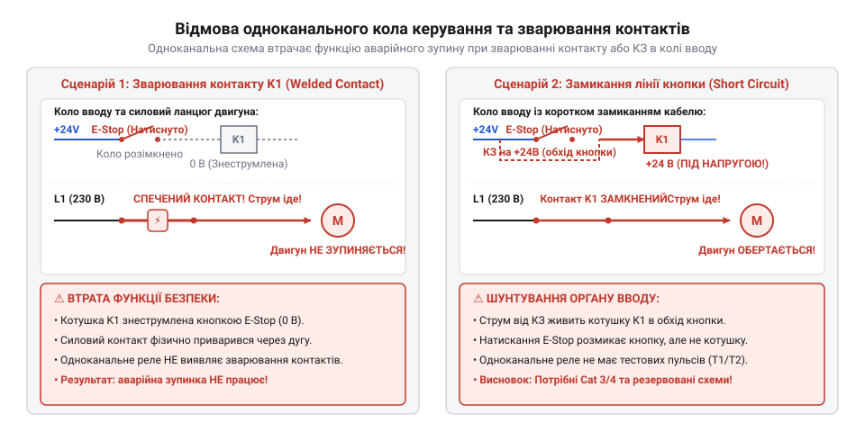
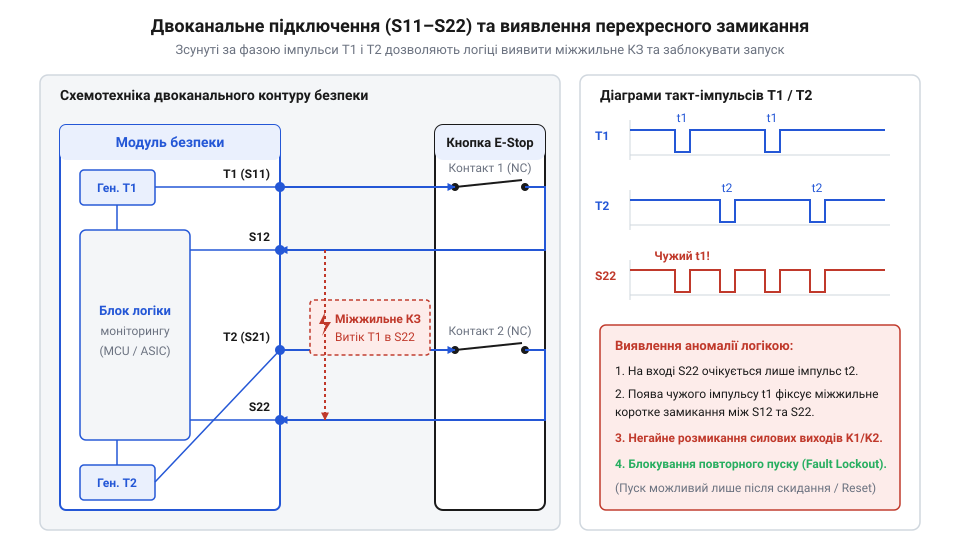

# Реле безпеки та контролери захисного відключення

<preknowlist>
- [Кнопка аварійного стопу грибок та органи безпечного відключення (IEC 60947-5-5)](root:cat-hw-controls/estop-mushroom-button) — Механіку розмикання сухих NC-контактів та вимоги стандарту IEC 60947-5-5 до органів аварійного вимкнення
- [Трипозиційні кнопки дозволу та педалі «мертвої руки»](root:cat-hw-controls/enabling-switches-and-dead-man-pedals) — Принцип формування сигналів перехідних станів для двоканальних вхідних кіл реле безпеки
</preknowlist>

## Прихована відмова та примусові контакти

Звичайні промислові реле та контактори призначені для оперування силовим навантаженням у штатному режимі, але в контурах функціональної безпеки їх використання є небезпечним. При виникненні клейкого зварювання контактних плит через електричну дугу або механічного заклинювання пружини, проміжне реле втрачає здатність розімкнути коло. В одноканальній схемі це створює критичний стан — приховану відмову (англ. @@en|dangerous undetected fault@@): коли оператор тисне на [кнопку аварійного стопу](root:cat-hw-controls/estop-mushroom-button), коло залишається замкненим, а обладнання продовжує працювати.

*Схема небезпеки прихованої відмови в одноканальному колі та ризик зварювання контактів звичайного реле.*

Для усунення неконтрольованого включення спеціалізовані модулі безпеки застосовують реле з примусово спрямованими контактами (англ. @@en|force-guided contacts@@) за стандартом IEC 60947-5-1. На відміну від звичайних реле, де розмикальні та замикальні контакти рухаються незалежно на гнучких пружинах, у реле безпеки всі контактні групи жорстко з'єднані єдиним ізоляційним коромислом. Якщо один нормальний відкритий контакт (NO) зварився й залишається замкненим, механічне коромисло фізично блокує повернення нормального закритого контакту (NC) у вихідне положення, залишаючи його розімкненим із зазором не менше 0.5 мм. Це дає змогу схемі діагностики надійно зафіксувати відмову й заблокувати повторний запуск системи.

## Двоканальний захист та контур EDM

Для унеможливлення відмови через пошкодження одного провідника контури аварійного вимкнення будують за двоканальною архітектурою. Вхідні сигнальні лінії опитуються паралельно з використанням тестувальних такт-імпульсів (англ. @@en|test pulses@@), які модулюють низький рівень напруги на кілька мікросекунд. Це дозволяє модулю безпеки негайно виявити міжжильне перехресне замикання (англ. @@en|cross-fault detection@@) між провідниками `S11-S12` та `S21-S22` ще до моменту натискання органу вимкнення.

*Двоканальна схема з випробувальними такт-імпульсами для виявлення міжжильних замикань та короткого замикання на масу.*

Для контролю спрацьовування силових вихідних пристроїв реалізується контур моніторингу зовнішніх контакторів EDM (від англ. @@en|External Device Monitoring@@ — моніторинг зовнішніх пристроїв). Послідовний ланцюг із додаткових NC-контактів усіх вихідних контакторів вмикається в коло скидання та запуску модулю безпеки. Якщо хоча б один силовий контактор заклинив або зварився, його допоміжний NC-контакт залишиться розімкненим, що унеможливить повторне запуск реле безпеки навіть після відпускання аварійної кнопки чи [трипозиційної кнопки дозволу](root:cat-hw-controls/enabling-switches-and-dead-man-pedals).

## OSSD-виходи та вибір архітектури

Сучасні безконтактні датчики та світлові бар'єри формують сигнальні лінії за допомогою транзисторних виходів перемикання OSSD (від англ. @@en|Output Signal Switching Device@@ — вихідний пристрій сигнального перемикання). Напівпровідникові ключі P-N-P структури періодично вимикають вихідну напругу +24 В на короткі інтервали тривалістю менше 100 мкс для самодіагностики відсутності пробою транзистора, що вимагає використання спецвходів реле безпеки із вхідними фільтрами низьких частот.

Залежно від рівня ризику обладнання обирають відповідну категорію за стандартом ISO 13849-1 — від Category 1 (одноканальне реле) до Category 4 / PL e (двоканальне реле з повним безперервним моніторингом та випробувальними імпульсами). При великій кількості захисних зон (понад 3–4 контури) дискретна релейна схемотехніка стає громіздкою, і розробники переходять на двопроцесорні програмовані контролери безпеки з матричною конфігурацією логічних блоків.
