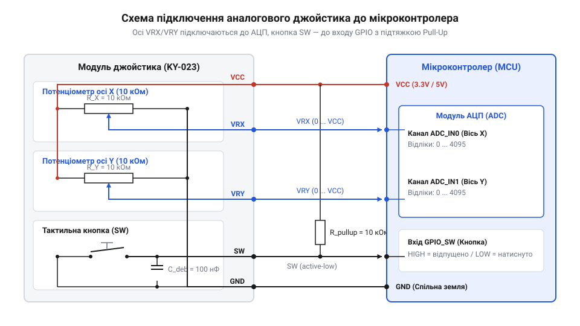
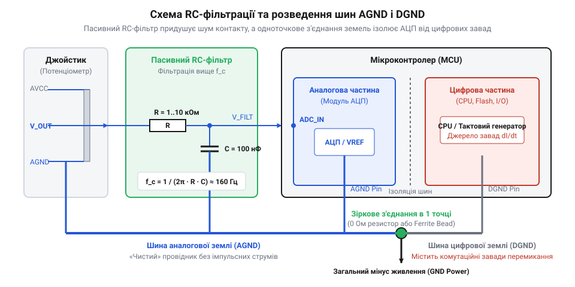

# Схема підключення та електричний інтерфейс аналогового джойстика

<preknowlist>
- [Поворотний потенціометр](root:cat-hw-controls/rotary-potentiometer) — Будова резистивного доріжкового елемента, струмознімача та розрахунок дільника напруги
- [Стік на давачах Холла (Hall Effect Gimbal)](root:cat-hw-controls/hall-effect-gimbal-joystick) — Магнітометричний принцип вимірювання кута відхилення важеля без фізичного контакту
- [KY-023 — джойстик-модуль](root:cat-hw-controls/ky-023-joystick) — Стандартне розпінування та конструкція поширеного двоосьового модуля з кнопкою
</preknowlist>

## Призначення виводів та потенціометрична схема

Для зчитування двовимірного кутового відхилення важеля керування в цифрових системах використовують потенціометричний джойстик (англ. *potentiometric joystick*; далі — @@en|potentiometric joystick@@). Конструктивно вузол складається з двох ортогонально розташованих поворотних потенціометрів з номінальним опором 10 кОм для осей X та Y (англ. *X-axis*, *Y-axis*; далі — @@en|X-axis@@, @@en|Y-axis@@), а також вбудованого тактильного перемикача натискання на важіль. Схемотехнічну основу та класичне розпінування розглянуто на прикладі готового модуля [KY-023 джойстик-модуль](root:cat-hw-controls/ky-023-joystick). При механічному замиканні тактильної кнопки натискання виникає електричний брязкіт контактів (англ. *contact bounce*; далі — @@en|contact bounce@@) тривалістю від 2 до 10 мс, який без апаратного придушення (паралельного керамічного конденсатора ємністю 100 нФ між виводом SW та землею або RC-ланцюга з тригером Шмітта) формує серію хибних логічних перепадів на цифровому вході мікроконтролера.

Електричний інтерфейс джойстика виведено на 5-піновий з'єднувач з наступним призначенням виводів:

Для забезпечення надійного зчитування стану кнопки натискання SW лінії комутації вимагають підтяжки до шини `VCC`. Хоча більшість мікроконтролерів мають внутрішні підтягувальні резистори, їхній високий опір (20–50 кОм) робить лінію вразливою до наводок від силових провідників. Для підвищення завадостійкості рекомендовано встановлювати зовнішній резистор Pull-Up номіналом від 4.7 кОм до 10 кОм: опір 10 кОм гарантує чіткий логічний рівень одиниці у розімкненому стані й обмежує струм споживання при натисканні до помірних 0.33–0.5 мА (при живленні 3.3–5.0 В).

Схема комутації на землю з резистором Pull-Up реалізує активний низький рівень (англ. *active-low*; далі — @@en|active-low@@): у спокійному стані на вході мікроконтролера утримується високий потенціал, який падає до нуля лише під час замикання контакту. На відміну від альтернативної схеми з підтяжкою до землі Pull-Down та активним високим рівнем (англ. *active-high*; далі — @@en|active-high@@), де контакт комутує лінію на VCC, конфігурація active-low є безпечнішою при трасуванні дротів до зовнішніх панелей керування. Винесення лінії заземлення замість шини живлення зменшує ризик випадкового короткого замикання `VCC` на корпус пристрою, а також відповідає апаратній архітектурі більшості мікроконтролерів, вхідні каскади яких мають лише внутрішні резистори Pull-Up.

* `VCC` — шина живлення аналогових доріжок потенціометрів (3.3 В або 5.0 В).
* `GND` — спільна шина заземлення.
* `VRX` (або `OUTX`) — аналоговий вихід напруги рухомого струмознімача (англ. *wiper*; далі — @@en|wiper@@) потенціометра осі X.
* `VRY` (або `OUTY`) — аналоговий вихід напруги струмознімача потенціометра осі Y.
* `SW` (або `SEL`) — дискретний вихід тактильної кнопки, що комутується на шину `GND` при натисканні.

*Принципова схема підключення потенціометричного джойстика та кнопки до аналогових входів АЦП мікроконтролера.*

Аналогові виходи `VRX` та `VRY` підключають безпосередньо до аналогових входів аналого-цифрового перетворювача (АЦП) мікроконтролера. Вихід кнопки `SW` підключають до цифрового входу GPIO із задіянням внутрішнього або зовнішнього підтягувального резистора Pull-Up до шини `VCC`.

## Опорна напруга VREF та стабільність живлення

Точність зчитування позиції важеля та відсутність зміщення центральної точки залежать від стабільності живлення. Потенціометричні джойстики працюють за принципом логометричного вимірювання (англ. *ratiometric measurement*; далі — @@en|ratiometric measurement@@). При підключенні крайніх виводів потенціометрів до тієї ж шини живлення `V_CC`, що й аналогова опорна напруга АЦП (англ. *analog reference voltage*; далі — @@en|analog reference voltage@@; `V_REF`), вихідний цифровий код АЦП `N_ADC` не залежить від абсолютної величини напруги. Навіть при коливаннях температури довкілля температурний коефіцієнт опору (від англ. *temperature coefficient of resistance*; далі — @@en|temperature coefficient of resistance@@) вуглецевої доріжки масиву впливає одночасно на обидва плечі резистивного дільника. Завдяки симетричній зміні опору півплечей відношення опорів `R_wiper / R_total` зберігає високу стабільність, суттєво зменшуючи температурний дрейф центральної точки при сталих механічних габаритах кардана:

    N_ADC
    = 2ᵇ · (V_OUT ÷ V_REF)                   [залежність відносного коду АЦП]
    = 2ᵇ · (R_wiper ÷ R_total)               [скасування напруги живлення у логометричній схемі]

де `b` — розрядність АЦП, `R_wiper` — опір плеча потенціометра від землі до струмознімача, а `R_total` — повний опір резистивної доріжки. За детальнішим описом роботи резистивного дільника зверніться до матеріалу [поворотний потенціометр](root:cat-hw-controls/rotary-potentiometer).

Незважаючи на скасування повільних коливань напруги у логометричному співвідношенні, високочастотні пульсації шини `V_CC` створюють шум вимірювань. Для нейтралізації імпульсних завад шину живлення джойстика шунтують керамічним розв'язувальним конденсатором ємністю 0.1 мкФ паралельно з танталовим конденсатором ємністю 10 мкФ безпосередньо біля виводів модуля.

Для досягнення максимальної завадостійкості в прецизійних вимірювальних трактах аналогову частину джойстика та вивід опорної напруги VREF АЦП живлять від окремого малошумного лінійного стабілізатора з низьким падінням напруги (англ. *Low Dropout regulator*; далі — @@en|LDO@@). Окремий LDO-стабілізатор ізолює вимірювальний дільник від високочастотних імпульсних завад системної шини живлення мікроконтролера та цифрових периферійних модулів, забезпечуючи високий коефіцієнт придушення пульсацій PSRR та запобігаючи хаотичному дрейфу нульової точки.

## Апаратна RC-фільтрація та розділення земель AGND і DGND

Під час руху важеля джойстика механічний контакт струмознімача створює контактний шум (англ. *contact noise*; далі — @@en|contact noise@@) та мікроамплітудні сплески напруги. Для придушення високочастотних завад до входу АЦП на кожну з аналогових ліній `VRX` та `VRY` встановлюють пасивний RC-фільтр низьких частот (англ. *low-pass RC filter*; далі — @@en|low-pass RC filter@@). Вибір опору `R_f` вимагає врахування еквівалентного вхідного опору каналу АЦП та часу вибірки внутрішньої ємності `C_sample`: занадто високе значення `R_f` (понад 10 кОм) спотворює процес заряджання комутованого конденсатора вибірки, спричиняючи системні помилки квантування, тоді як конденсатор `C_f` виступає локальним резервуаром заряду під час короткого вікна тактування АЦП.

Параметри пасивного RC-фільтра розраховують виходячи з граничної частоти зрізу `f_c = 1 ÷ (2 · π · R_f · C_f)`. Резистор `R_f = 1 кОм` та керамічний конденсатор `C_f = 100 нФ` забезпечують частоту зрізу:

    f_c
    = 1 ÷ (2 · π · 1000 Ом · 10⁻⁷ Ф)        [підстановка номіналів R_f та C_f]
    = 1 ÷ (6.2832 · 10⁻⁴)                  [обчислення знаменника]
    ≈ 1591.5 Гц                             [гранична частота зрізу фільтра]

Ця частота зрізу ефективно фільтрує наводки від цифрових шин та високочастотний контактний шум, не створюючи відчутної затримки для динамічних дій користувача (затримка сигнального фронту не перевищує 0.5 мс).

*Схема обв'язки з пасивним RC-фільтром низьких частот та трасуванням розділених шин AGND і DGND.*

Для запобігання проникненню зворотних струмів цифрових кіл мікроконтролера в аналоговий тракт застосовують трасування з розділенням шин: аналогова земля (англ. *analog ground*; далі — @@en|analog ground@@; AGND) потенціометрів підключається до цифрової землі (англ. *digital ground*; далі — @@en|digital ground@@; DGND) в одній точці («зірка») поблизу виводу заземлення АЦП.

Під час вибору керамічного конденсатора `C_f` для пасивного RC-фільтра аналогового сигналу критично використовувати компоненти першого класу (англ. *Class 1 ceramic capacitor*; далі — @@en|Class 1 ceramic capacitor@@) з діелектриком C0G або NP0. На відміну від сегнетоелектричної кераміки X7R чи Y5V, матеріали C0G/NP0 мають практично нульовий температурний коефіцієнт ємності, не втрачають ємність під впливом постійної напруги зміщення (англ. *DC bias effect*; далі — @@en|DC bias effect@@) та позбавлені п'єзоелектричного ефекту (англ. *piezoelectric effect*; далі — @@en|piezoelectric effect@@). Це унеможливлює появу мікрофонного шуму під час механічних вібрацій важеля джойстика та забезпечує незмінність розрахованої граничної частоти зрізу `f_c` за будь-яких температурних умов.

## Електричні відмінності давачів Холла та діагностика зносу

Альтернативою потенціометричним джойстикам є безконтактні важелі на базі давачів Холла (англ. *Hall effect sensor*; далі — @@en|Hall effect sensor@@), детально розгледжені у матеріалі [стік на давачах Холла](root:cat-hw-controls/hall-effect-gimbal-joystick). На відміну від пасивних потенціометрів, давачі Холла є активними напівпровідниковими мікросхемами, вихідна аналогова напруга яких формується внутрішніми підсилювачами. Проте безконтактна технологія чутлива до паразитних зовнішніх магнітних полів від силових моторів чи динаміків, а також до температурного зсуву чутливості кристаллу, що вимагає застосування екранування корпуса та внутрішньої диференціальної компенсації для збереження стабільності центральної точки.

Порівняльний аналіз електричних характеристик та проявів зносу зведено у таблицю:

| Параметр / Характеристика | Потенціометричний джойстик | Джойстик на давачах Холла |
| :--- | :--- | :--- |
| **Принцип роботи** | Пасивний резистивний дільник | Активний напівпровідник (ефект Холла) |
| **Струм споживання** | Відсутній статичний (лише струм дільника ~0.3-0.5 мА) | Постійний статичний (5–10 мА на вісь) |
| **Характер зносу** | Механічна ерозія вуглецевої доріжки, шорох | Відсутній механічний знос давача |
| **Ознаки несправності** | Хаотичні стрибки напруги, «провали» до 0V/VCC | Повний вихід з ладу або зміщення магніту |

При деградації вуглецевого шару потенціометра опір контактного переходу зростає, спричиняючи підвищення контактного шуму @@en|contact noise@@ та появу скачкоподібних немонотонних зміщень вихідного сигналу («стік-дрейф»). Апаратна RC-фільтрація частково згладжує ці сплески, проте остаточна компенсація механічної деградації вимагає впровадження програмних мертвих зон та алгоритмів калібрування.

Активне напівпровідникове середовище давачів Холла створює специфічні виклики для енергоефективності автономних пристроїв. Пасивний потенціометричний джойстик споживає мінімальний статичний струм близько 300 мікроампер на вісь при базовому опорі 10 кілоом. Виробники можуть повністю вимикати живлення потенціометра через вивід загального призначення у режимі сну. Натомість двом активним давачам Холла потрібен постійний струм живлення від 10 до 20 міліампер для підтримання роботи внутрішніх підсилювачів та магнітних кристалів. Таке статичне навантаження швидко розряджає акумулятор портативного контролера у режимі очікування. Для збереження автономності інженери вимушені застосовувати ключ управління живленням (від англійського @@en|power gating@@ — комутація живлення) на польовому транзисторі або впроваджувати імпульсний режим опитування датчиків.
