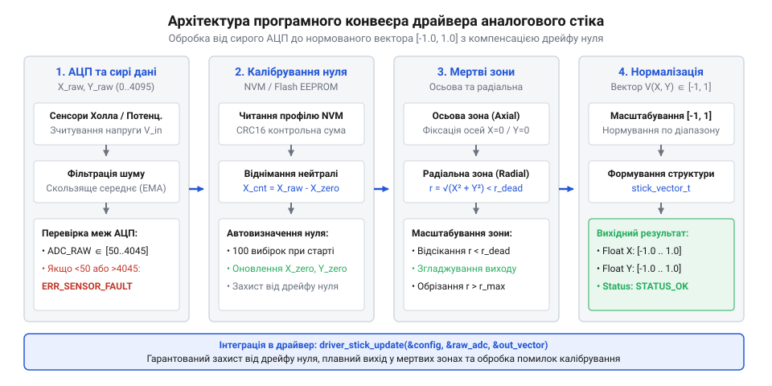
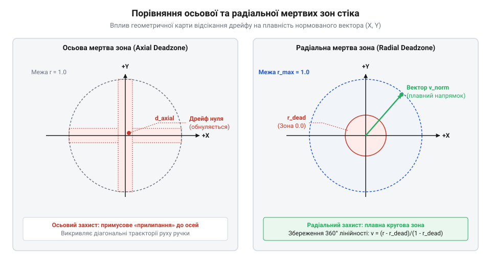

# Програмний інтерфейс драйвера калібрування та обробки мертвих зон

<preknowlist>
- [KY-023 — джойстик-модуль](root:cat-hw-controls/ky-023-joystick) — Фізичні характеристики двоосьових аналогових джойстиків на потенціометрах та первинне зчитування сигналів X/Y через АЦП мікроконтролера.
- [Стік на давачах Холла (Hall Effect Gimbal)](root:cat-hw-controls/hall-effect-gimbal-joystick) — Особливості вихідних сигналів магнітних сенсорів Холла, їх лінійність та відсутність механічного зносу порівняно з потенціометрами.
</preknowlist>

## Проблема дрейфу та архітектура драйвера

Аналогові органи керування на основі [KY-023 джойстик-модуля](root:cat-hw-controls/ky-023-joystick) чи [стіків на давачах Холла](root:cat-hw-controls/hall-effect-gimbal-joystick) видають сирі значення з АЦП (аналогово-цифровий перетворювач; англ. @@en|ADC@@). Через механічний знос, завади живлення та температурне розширення сигнал у центрі відхиляється від ідеалу, викликаючи стік-дрейф (від англійського @@en|stick drift@@ — зсув палиці керування; англ. @@en|stick drift@@). Пряме використання сирих даних без обробки призводить до хибних спрацьовувань у стані спокою.

Для усунення цієї проблеми застосовують програмний драйвер (від англійського @@en|driver@@ — поводир, керуючий елемент; англ. @@en|driver@@). Він будується у вигляді послідовного конвеєра: зчитування АЦП, автокалібрування (від французького @@fr|calibre@@ — розмір за шаблоном; англ. @@en|calibration@@), відсікання мертвих зон (англ. @@en|deadzone@@), нормування та згладжування.


*Конвеєр драйвера: послідовна обробка вибірок АЦП через блоки автокалібрування, deadzone та нормування.*

Архітектура драйвера спирається на структуру конфігурації, яка зберігає точки нуля, мінімальні й максимальні межі осей, а також параметри нечутливості. Для масштабування на багатоосьові системи (двоосьові важелі [KY-023 джойстик-модуля](root:cat-hw-controls/ky-023-joystick), педалі або маніпулятори з додатковими каналами) структура містить масив описувачів окремих осей `axis_config_t axes[NUM_AXES]`, де кожен елемент зберігає власні калібрувальні коефіцієнти та апаратне прив'язування. Конфігурація явно фіксує ідентифікатор фізичного каналу `adc_channel_t` та номер периферійного модуля АЦП. Таке апаратне розділення джерел АЦП є критичним на мікроконтролерах із кількома перетворювачами, де окремі блоки АЦП розділяються з іншими внутрішніми підсистемами чи магістралями DMA. Драйвер дозволяє закріпити аналогові канали осей за виділеним периферійним блоком з однаковим часом вибірки, що усуває взаємні наведення та гарантує стабільне синхронне оновлення координат без затримок у головному циклі.

У структурі конфігурації драйвера (наприклад, `stick_config_t`) поля `center_x` та `center_y` зберігають калібровані координати нуля: для 10-бітного АЦП з повним розмахом від `0` до `1023` номінальний центр `512` у реальних пристроях допускає зсув у межах `400..624`, тоді як для 12-бітного АЦП (діапазон `0..4095`) значення нуля лежать у межах `1600..2496`. Крайні апаратні межі руху осей фіксуються в полях `min_x`, `min_y` (типово `0..100` для 10 біт чи `0..400` для 12 біт) та `max_x`, `max_y` (типово `923..1023` чи `3695..4095`), що дозволяє врахувати механічний недохід важеля до кутових упорів. Захист від дрейфу визначають пороги `deadzone_radial` (англ. @@en|deadzone@@) із допустимим діапазоном від `5%` до `25%` від повного радіуса шкали та `deadzone_axial` у межах `2%..15%`, що запобігають паразитним мікрозсувам уздовж головних координатних осей.

## Ініціалізація та процедура автокалібрування

Ініціалізація драйвера починається із завантаження збережених коефіцієнтів або виконання процедури автовизначення нейтралі. При включенні пристрою важіль перебуває у вільному стані спокою. Драйвер виконує серію зчитувань АЦП для обчислення середнього значення нуля осей X та Y.

Процедура автокалібрування розраховує зміщення центрального значення `raw_zero` та фіксує амплітуду дрейфу в спокої, обов'язково виконуючи практичну перевірку серії вибірок на відхилення від середнього (дисперсію) для відсікання випадкових торкань важеля під час запуску. Якщо під час збору даних оператор випадково торкнеться стіка, вибіркове середньоквадратичне відхилення `σ² = ∑(x_i - raw_zero)² / N` перевищить встановлений поріг стабільності `σ_max` (типово `10..15` відліків АЦП). Отримавши високу дисперсію, драйвер відкидає зіпсовану серію вибірок та повертає код помилки `STICK_ERR_INVALID_CALIB`, запобігаючи запису спотворених координат нуля в конфігурацію.

:::tabs
:::code api-calibration-driver-software/c/c/stick-calibrate-neutral.c
:::code api-calibration-driver-software/cpp/cpp/stickerror.cpp
:::

Збереження отриманих параметрів у неенергозалежній пам'яті дозволяє уникати повторного калібрування при кожному перезапуску. При асиметричному ході вала джойстика нейтраль `raw_zero` рідко збігається з геометричним центром АЦП, тому для кожної осі розраховують два окремі масштабні коефіцієнти двох напіввісей: від'ємної `scale_neg = 1.0 / (raw_zero - raw_min)` та додатної `scale_pos = 1.0 / (raw_max - raw_zero)`. При поточній виміряній величині `v` відхилення від нуля `(v - raw_zero)` множиться на `scale_neg`, якщо `v < raw_zero`, або на `scale_pos`, якщо `v >= raw_zero`. Таке роздільне перемасштабування гарантує симетричний діапазон нормованого вектора від `-1.0` до `1.0` навіть за значного кутового або апаратного розкиду механіки вала.

## Налаштування радіальних та осьових мертвих зон

Після віднімання нуля залишаються дрібні флуктуації сигналу. Для їхнього усунення застосовують осьові та радіальні мертві зони.

Осьова мертва зона обробляє кожну вісь окремо: якщо абсолютне значення координати менше за поріг `deadzone_axial`, воно скидається в нуль. Недоліком чисто осьового відсікання є спотворення діагонального руху у вигляді «сходинок» уздовж ортогональних ліній. Радіальна мертва зона обчислює відстань від центра на площині як модуль вектора `r = √(dx² + dy²)`. Якщо радіус менший за заданий поріг `deadzone_radial`, обидві координати прирівнюються до нуля. Проте просте радіальне відсікання створює ступеневий стрибок координати одразу за межею порогу. Щоб забезпечити плавну неперервну відповідь, застосовують масштабовану радіальну мертву зону (англ. @@en|scaled radial deadzone@@): залишковий діапазон `[deadzone_radial .. 1.0]` перемасштабовують у повну шкалу `[0.0 .. 1.0]` за формулою `r_scaled = (r - deadzone_radial) / (1.0 - deadzone_radial)` і множать на одиничний вектор напрямку. 1.0]` перемасштабовують у повну шкалу `[0.0 .. 1.0]` за формулою `r_scaled = (r - deadzone_radial) / (1.0 - deadzone_radial)` і множать на одиничний вектор напрямку. Для обробки складних кутових ухилів джойстика на [аналогових джойстик-модулях](root:cat-hw-controls/ky-023-joystick) та [стіках Холла](root:cat-hw-controls/hall-effect-gimbal-joystick) ці методи комбінують: спочатку проєкції вектора `|dx|` і `|dy|` порівнюють із порогом `deadzone_axial`, створюючи хрестоподібний коридор фіксації (англ. @@en|cardinal snapping@@) уздовж головних осей для пригнічення тремору пальців, а потім результуючий вектор проганяють через радіальне перемасштабування `r_scaled`. Такий двостадійний механізм узгоджує кут ухилу `θ = arctan(dy / dx)` із полярним радіусом, гарантуючи стійку фіксацію чистого горизонтального чи вертикального руху без втрати плавності та кругової симетрії при переході в діагональні квадранти.


*Геометрія мертвих зон: радіальне відсікання зберігає кругову симетрію та запобігає «сходинкам» уздовж осей.*

Радіальний метод зберігає кругову симетрію та забезпечує плавність руху у будь-якому напрямку.

## Отримання нормованого вектора та згладжування

Фінальним етапом обробки є формування нормованого вектора (англ. @@en|normalized vector@@) у діапазоні від -1.0 до 1.0.

Щоб після відсікання мертвої зони не виникало стрибка напруги, діапазон від межі `deadzone` до 1.0 перемасштабують за формулою:

```
v_norm = (r - deadzone) / (1.0 - deadzone)     [перемасштабування радіуса за межею мертвої зони]
```

Для приглушення високочастотного шуму АЦП до вихідного вектора застосовують експоненційне згладжування з коефіцієнтом `α ∈ (0, 1]`. Точний вибір коефіцієнта згладжування `α` (англ. @@en|smoothing factor@@) прямо залежить від частоти дискретизації АЦП `f_s = 1 / dt` (англ. @@en|sampling rate@@) та бажаної сталої часу фільтра `τ` (англ. @@en|time constant@@; від англ. *time* — час, та *constant* — стала, постійна) за співвідношенням `α = dt / (τ + dt)`. При високій частоті опитування на [стіках Холла](root:cat-hw-controls/hall-effect-gimbal-joystick) (`f_s = 1000` Гц, `dt = 1` мс) коефіцієнт `α = 0.05..0.10` дає чудове пригнічення флуктуацій при збереженні реакції на швидкі рухи з непомітною затримкою `τ ≈ 10..20` мс. При низьких частотах дискретизації на [джойстик-модулях](root:cat-hw-controls/ky-023-joystick) (`f_s = 50` Гц, `dt = 20` мс) мале `α < 0.3` створює відчутне запізнення (англ. @@en|input lag@@), тому `α` збільшують до `0.5..0.7`, а приглушення сплесків доручають додатковому механізму — обмеженню швидкості наростання (англ. @@en|slew rate limit@@; від англ. *slew* — повертати, повертатися, та *rate* — швидкість, темп). Алгоритм обчислює прирост координати `Δv = v_target - v_current` за період опитування `dt` і, якщо його абсолютна величина перевищує допустимий поріг `MAX_SLEW_RATE · dt`, штучно обмежує крок до максимально дозволеного значення. Це усуває ударні апаратні ривки та стрибки при різкому відпусканні вала, гарантуючи плавність передачі динаміки в виконавчі механізми системи керування.

```
y_k = α · x_k + (1.0 - α) · y_k_prev             [фільтрація першого порядку]
```

Отриманий вектор `(x, y)` готовий для використання в алгоритмах керування реального часу.

## Обробка помилок та інтеграція в RTOS

Надійний драйвер мусить коректно опрацьовувати апаратні збої: обрив лінії АЦП, пошкодження даних калібрування або вихід вибірок за допустимі межі. Під час ініціалізації функції драйвера зчитаний з енергонезалежної пам'яті (англ. @@en|non-volatile memory@@ — @@en|Flash memory@@ або @@en|EEPROM@@) профіль проходить обов'язкову валідацію. Щоб запобігти використанню спотворених значень, які виникають через раптове відключення живлення (англ. @@en|power loss@@) під час запису або зношування осередків, структура містить 32-бітову контрольну суму (англ. @@en|checksum@@ — циклічний надлишковий код, англ. @@en|CRC32@@, скорочення від @@en|Cyclic Redundancy Check@@). Драйвер заново обчислює @@en|CRC32@@ для всіх полів структури — зміщень центру, коефіцієнтів масштабування та меж мертвих зон — і порівнює результат із збереженим значенням. Якщо виявлено розбіжність, драйвер скасовує застосування профілю, повертає помилку STICK_ERR_INVALID_CALIB та активує резервний режим (англ. @@en|fallback@@) із дефолтними фабричними налаштуваннями, скидаючи вихідний вектор у безпечний нейтральний стан (0.0, 0.0).

У системах з операційною системою реального часу (англ. @@en|RTOS@@) обробку стіка організують у вигляді окремої періодичної задачі. Зчитані нормовані координати передаються в інші задачі системи через чергу повідомлень (англ. @@en|queue@@) або захищаються м'ютексом (англ. @@en|mutex@@; від англ. *mutual* — взаємний, та *exclusion* — виключення). Механізм захисту конфігурації м'ютексом стає критичним, коли фонова задача калібрування чи інтерфейсу користувача виконує динамічне перекалібрування центральних зсувів або порогів мертвих зон на [джойстик-модулі](root:cat-hw-controls/ky-023-joystick) паралельно з періодичним обчисленням вектора. Без блокування задача опитування АЦП може зчитати частково оновлену структуру `stick_config_t`, що призведе до стану гонитви (англ. @@en|race condition@@) і виникнення математичних сплесків у координатах `(x, y)`. Використання м'ютекса гарантує атомарність оновлення: фонова задача захоплює м'ютекс на час модифікації коефіцієнтів у пам'яті, а високопріоритетна задача опитування швидко копіює активні параметри під захистом засувки (англ. @@en|mutex lock@@) без тривалого блокування (англ. @@en|lock contention@@) фонового потоку.

:::code api-calibration-driver-software/c/c/vsticktask.c

Така організація гарантує фіксований час відгуку інтерфейсу в межах 10 мілісекунд без блокування основних обчислювальних потоків.
