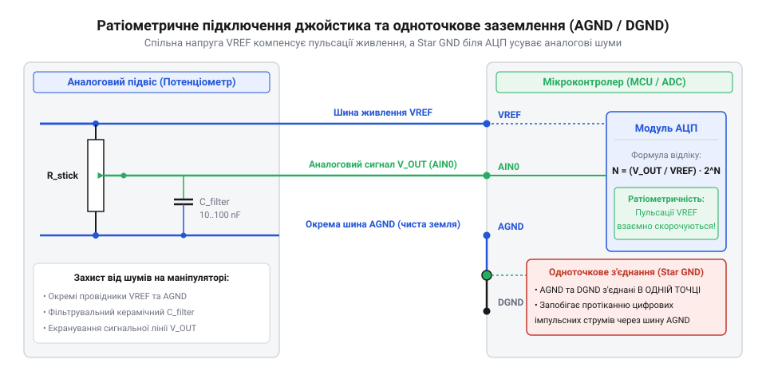
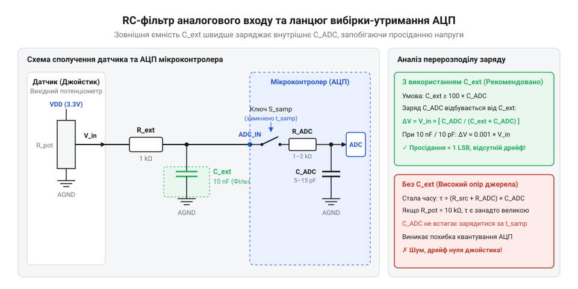

# Апаратний інтерфейс підключення аналогових датчиків підвісу до АЦП

<preknowlist>
- [KY-023 — джойстик-модуль](root:cat-hw-controls/ky-023-joystick) — внутрішня потенціометрична схема двох осей та розподіл виводів VCC, GND, VRx, VRy.
- [Стік на давачах Холла (Hall Effect Gimbal)](root:cat-hw-controls/hall-effect-gimbal-joystick) — принцип формування вихідної аналогової напруги безконтактними магнітними сенсорами.
</preknowlist>

## Шуми живлення та тремтіння відліків

У високоточних двовісних маніпуляторах і джойстиках положення важеля визначається вимірюванням напруги на виході датчиків. На практиці розробники часто зіштовхуються з явищем неконтрольованого тремтіння цифрових кодових значень (англ. @@en|jitter@@, від англ. *to jitter* — тремтіти) навіть у моменти, коли важіль нерухомо перебуває у центрі. Помилково вважаючи це суто механічним дрейфом, проблему намагаються компенсувати розширенням мертвих зон у програмі, що викривляє точність керування.

Головною фізичною причиною такого тремтіння є паразитна пульсація та імпульсний шум на загальній шині живлення. При симетричному зчитуванні напруги будь-яке коливання живильної напруги спричиняє відповідний зсув зчитуваного потенціалу. Якщо цифрове коло мікроконтролера чи драйвери моторів створюють імпульсні струми навантаження, ця завада прямо проникає у вимірювальний тракт. Математично амплітуда джиттера у дискретних одиницях молодшого розряду (англ. @@en|Least Significant Bit@@, `LSB`) залежить від відносного розмаху пульсацій `ΔV_noise` та роздільної здатності АЦП `N` (де крок квантування `1 LSB = V_ref / 2ⁿ`). При розмаху пульсацій напруги `ΔV_noise` джиттер у кодових значеннях обчислюється як `Jitter_LSB = ΔV_noise / (V_ref / 2ⁿ) = 2ⁿ · (ΔV_noise / V_ref)`. Зокрема, для 12-бітного АЦП (`2¹² = 4096`) при опорній напрузі `V_ref = 3.3 В` величина `1 LSB` становить близько `0.805 мВ`, тому навіть відносно невеликі пульсації живлення `ΔV_noise = 10 мВ` призводять до необоротної нестабільності у `10 мВ / 0.805 мВ ≈ 12.4 LSB`, змушуючи молодші 3–4 біти постійно хаотично змінюватися. Через це необхідно чітко розмежовувати живильне коло датчиків та опорний потенціал (англ. @@en|Reference Voltage@@, `V_ref`), який задає верхній поріг шкали перетворення аналогово-цифрового перетворювача (АЦП).

Особливо гостро ця проблема проявляється при використанні імпульсних ШІМ-регуляторів живлення (англ. @@en|switching regulators@@), що працюють на несучій частоті `f_pwm` (типово `100 кГц`–`2 МГц`) з коротким часом наростання фронту `t_r ≈ 10`–`50 нс`. Згідно з Фур'є-аналізом спектральна щільність напруги завад `S_v(f)` випромінює гармонічний спектр, амплітуда якого у першій зоні спадає зі швидкістю `-20 дБ/декаду` до першої кутової частоти `f₁ = 1 / (π · τ)`, а вище другої граничної частоти `f₂ = 1 / (π · t_r)` — зі швидкістю `-40 дБ/декаду`. Якщо високочастотні гармоніки ШІМ зі спектральною щільністю потрапляють у вхідний тракт АЦП, через явище стробоскопічного накладання частот (англ. @@en|aliasing@@, від англ. *alias* — викривлене ім'я, псевдонім) імпульсний шум переноситься у низькочастотну область керування (`0`–`100 Гц`), викликуючи додаткове тремтіння осей маніпулятора.

## Розділення шин AGND і джерело VREF

Для усунення впливу силових струмів на вимірювальні канали схемотехніка вимагає строгого фізичного розділення цифрової землі (англ. @@en|Digital Ground@@, `DGND`) та чистої аналогової землі (англ. @@en|Analog Ground@@, `AGND`, від грец. *ana* — згідно та *logos* — відношення). Коли струм цифрових мікросхем протікає по загальному провіднику, навіть мікроомний опір доріжки створює падіння напруги, яке АЦП сприймає як зміну сигналу датчика. Для запобігання цьому застосовують топологію зіркоподібного з'єднання (англ. @@en|star ground topology@@), де шина `AGND` з'єднується з `DGND` лише в одній точці — безпосередньо біля виводу заземлення АЦП.

Для додаткової ізоляції прецизійного виводу `VREF` від високочастотних імпульсних наводок цифрової шини живлення в коло розв'язки послідовно встановлюють феритову намистину (від італ. *ferro* — залізо; англ. @@en|ferrite bead@@). Конструктивно вона виконується у вигляді багатошарового керамічного чи індуктивного компонента на основі феритового осердя з низьким постійним опором (`R < 0.1 Ом`), завдяки чому на постійному струмі напруга не просідає. На високих частотах (від `10 МГц` до `1 ГГц`) імпеданс фериту різко зростає (до `Z ≈ 600 Ом` на частоті `100 МГц`), перетворюючи високочастотну енергію завад та пульсацій на тепло й перешкоджаючи їх проникненню в опорний тракт АЦП, а паралельно підключені до `AGND` шунтувальні керамічні й танталові конденсатори (типово `100 нФ` та `10 мкФ`) гарантують низький аналоговий шум VREF.

*Принципова схема підключення підвісу: одноточкове з'єднання аналогової землевої шини AGND із цифровою DGND безпосередньо біля виводу АЦП.*

Для потенціометричних підвісів, подібних до [джойстик-модулів KY-023](root:cat-hw-controls/ky-023-joystick), найефективнішим є використання ратіометричного вимірювання (від лат. *ratio* — відношення; англ. @@en|ratiometric measurement@@). У цій схемі опорна напруга `V_ref` АЦП та напруга живлення потенціометра `V_cc` беруться від одного спільного джерела. Якщо підключити потенціометр до нестабільної живильної шини `V_cc`, а АЦП заживити від окремого прецизійного джерела опорної напруги `V_ref` (англ. @@en|voltage reference@@), будь-які пульсації шини `V_cc` прямо пропорційно зміщуватимуть вихідний потенціал `V_in` без відповідного коригування шкали АЦП, що призводить до відносної похибки вимірювання `ΔV_cc / V_cc` та хибного зсуву коду на десятки розрядів. Натомість у ратіометричній схемі при коливанні живильної напруги `V_cc` вихідна напруга датчика та опорний рівень АЦП змінюються у пропорційне число разів, завдяки чому вихідна пульсація чи просідання живлення повністю взаємокомпенсуються у чисельнику й знаменнику дробу, а підсумковий цифровий код АЦП залишається абсолютним та стабільним:

D_code
= (V_in / V_ref) · (2ⁿ - 1)                 [загальна формула розрядного коду АЦП]
= ((k · V_cc) / V_cc) · (2ⁿ - 1)            [скасування живильної напруги в ратіометричній схемі]
= k · (2ⁿ - 1)                              [абсолютний код, незалежний від пульсацій Vcc]

## Фільтрація вхідних ліній та керамічні шунти

Аналогові сигнальні лінії, що йдуть від підвісу маніпулятора до плати керування, діють як антени, збираючи високочастотні електромагнітні наводки від бездротових модулів та шім-регуляторів. Для їх придушення безпосередньо перед вхідними виводами АЦП встановлюють пасивний фільтр низьких частот (англ. @@en|low-pass filter@@), утворений послідовним резистором `R_flt` та паралельним керамічним конденсатором `C_flt`. Гранична частота зрізу (англ. @@en|cutoff frequency@@, `f_c`) обчислюється за виразом:

f_c
= 1 / (2 · π · R_flt · C_flt)             [частота зрізу пасивного RC-фільтра]

*Аналогова фільтрація: шунтувальний конденсатор компенсує динамічні імпульси струму під час замикання ключа вибірки АЦП.*

Крім фільтрації наводок, керамічний конденсатор `C_flt` виконує критичну роль акумулятора заряду для внутрішнього каскаду вибірки й утримання (англ. @@en|sample-and-hold circuit@@) АЦП послідовного наближення (англ. @@en|successive approximation register@@ SAR-ADC). Вхідний каскад SAR-АЦП еквівалентно моделюється послідовним ключем із опором каналу `R_sw` та вибірковою ємністю `C_sample` (зазвичай `10..15 пФ`). Під час замикання внутрішнього ключа на час вибірки `t_sample` конденсатор `C_sample` споживає швидкий імпульсний струм, а постійна часу заряджання `τ_sample` визначається сумарним опором `R_total = R_src + R_flt + R_sw`, де `R_src` — вихідний опір джерела (у потенціометра досягає `2.5 кОм` у середньому положенні). Динамічна похибка встановлення напруги `ε_settle` обчислюється як `exp(-t_sample / τ_sample)`, і для досягнення точності 12-бітного АЦП тривалість вибірки мусить задовольняти умову `t_sample ≥ (N + 1) · ln(2) · τ_sample ≈ 9.01 · τ_sample`. Якщо через високий опір `R_src` напруга не встигає стабілізуватися за `t_sample`, виникає просідання потенціалу та лінійна похибка перетворення. Підключення зовнішньої шунтувальної ємності `C_flt`, що перевищує `C_sample` у `100..1000` разів (типово `10..100 нФ`), перетворює її на джерело малого імпульсного опору на час вибірки, забезпечуючи миттєве перезарядження `C_sample` без зсуву сигналу.

При виборі шунтувального керамічного конденсатора `C_flt` вирішальне значення має тип керамічного діелектрика. Сегнетоелектрична кераміка класу 2 (зокрема `X7R` та `Y5V`) схильна до п'єзоелектричного ефекту (від грец. *piezein* — тиснути; англ. @@en|piezoelectric effect@@), через який механічні вібрації корпусу маніпулятора перетворюються на паразитні сплески напруги, а ємність просідає на `40`–`70%` під дією постійної напруги зміщення. Для вимірювальних кіл АЦП слід застосовувати ультрастабільні керамічні конденсатори класу 1 з діелектриком `C0G` (NP0), які повністю позбавлені п'єзоелектричного шуму та мікрофонного ефекту, мають нульовий коефіцієнт напруги та лінійну температурну стабільність (відхилення не перевищує `±30 ppm/°C`), що гарантує абсолютну чистоту аналогового сигналу під час вібраційних навантажень на підвіс.

## Цокольовка та підключення датчиків Холла

При проектуванні джгутів підвісу необхідно враховувати принципову різницю між резистивними сенсорами та [безконтактними стіками Холла](root:cat-hw-controls/hall-effect-gimbal-joystick). Ззвичайний потенціометричний модуль має 3-пінову цокольовку (живлення `VCC`, сигнальний повзунок `OUT`, земля `GND`) і вихідний опір (англ. @@en|output impedance@@, `R_out`), який змінюється залежно від кута повороту вала. У центральному положенні вихідний опір досягає чверті повного опору треку (для треку `10 кОм` опір `R_out = 2.5 кОм`).

Датчики на ефекті Холла містять вбудовані активні підсилювачі й часто мають 4-пінову конфігурацію із окремим термокомпенсаційним або диференційним виводом. Їхній вихідний опір стабільний і низький (десятки ом), що робить їх значно стійкішими до вхідного імпедансу (англ. @@en|input impedance@@, `R_in`) АЦП. При диференційній конфігурації сенсор формує протифазну пару сигналів `OUT+` та `OUT-`, де будь-яка зовнішня наводка діє одночасно на обидві лінії й повністю пригнічується вхідним диференційним операційним підсилювачем. Для збереження точності у завадозахищених джгутах провідники `OUT+` та `OUT-` кожної осі свивають у кручену пару з нормованим хвильовим опором `Z₀` (зазвичай `100–120 Ом`), а безпосередньо біля входів АЦП встановлюють термінальний резистор узгодження імпедансу `R_term = Z₀` та керамічний диференційний фільтр. Таке схемотехнічне розведення усуває відбиття високочастотних завад та запобігає взаємним індуктивним наводкам у кабельному джгуті при швидкому відхиленні важелів. На відміну від дискретних компонентів, таких як [багатопозиційні галетні перемикачі](root:cat-hw-controls/rotary-selector-switches), аналогові підвіси вимагають суворого дотримання топології заземлення та узгодження імпедансу для збереження високої роздільної здатності вимірювання.

Для перетворення протифазних сигналів `OUT+` та `OUT-` у single-ended напругу вхідного каналу АЦП застосовують вимірювальний інструментальний підсилювач (від лат. *instrumentum* — приряд, знаряддя; англ. @@en|instrumentation amplifier@@). Схемотехнічно він будується на трьох операційних підсилювачах: перший каскад на двох ОП із високим вхідним імпедансом буферизує лінії без навантаження датчика, а другий каскад обчислює різницю потенціалів. Коефіцієнт підсилення задається єдиним задавальним резистором `R_g` за формулою `A_v = 1 + (2 · R₁ / R_g)`, що дозволяє підняти малу амплітуду дифсигналу та досягти коефіцієнта пригнічення синфазної завади (англ. @@en|common-mode rejection ratio@@, `CMRR > 80`–`100 дБ`), повністю відсікаючи наводки кабельного джгута перед формуванням підсумкової напруги для АЦП.
