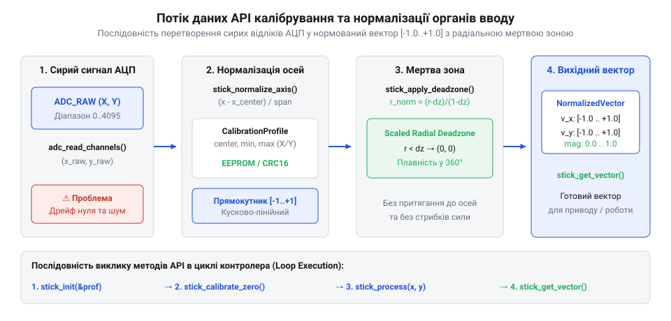

# Програмний інтерфейс бібліотеки калібрування та обробки аналогового вводу

<preknowlist>
- [KY-023 — джойстик-модуль](root:cat-hw-controls/ky-023-joystick) — Схемотехніка та принципи отримання аналогових сигналів двох осей для подальшої обробки.
- [Стік на давачах Холла (Hall Effect Gimbal)](root:cat-hw-controls/hall-effect-gimbal-joystick) — Будова безконтактного ввідного органу та параметри діапазонів напруг для калібрування.
</preknowlist>

## Призначення та архітектура модуля обробки

Вхідні аналогові сигнали від джойстиків і потенціометрів піддаються впливу шуму перетворювача (від англ. @@en|ADC noise@@ — шум АЦП), шуму квантування та механічного дрейфу нейтрального положення спокою (від англ. @@en|zero-drift@@ — зсув нуля). Без програмного фільтрування сирі значення створюють хибні спрацьовування та нелінійний відгук виконавчих органів. Модуль обробки аналогового вводу вирішує цю проблему, перетворюючи сирі апаратні вибірки АЦП на відкалібровані та нормовані вектори координат у діапазоні від `-1.0` до `+1.0`. Для забезпечення універсальності на різних платформах драйвер реалізує математичний алгоритм автовизначення апаратної розрядності АЦП (від англ. @@en|ADC resolution@@ — розрядність АЦП). При ініціалізації програма аналізує максимальний отриманий відлік `raw_max` та обчислює кількість активних бітів за формулою `N = ⌈log₂(raw_max + 1)⌉`. За результатом обчислення розрядність округлюється до стандартних апаратних меж у 8, 10, 12 або 16 біт. Бітовий зсув `16 - N` нормалізує вибірки до єдиного внутрішнього 16-бітного масштабу для однакових обчислень на будь-якому мікроконтролері. Драйвер також динамічно конфігурує розмір кільцевого буфера вибірок (від англ. @@en|circular buffer@@) під частоту опитування АЦП. На високих частотах опитування при переповненні буфера (від англ. @@en|buffer overflow@@) реалізовано стратегію перезапису за принципом першим прийшов — першим пішов (від англ. @@en|FIFO@@): найстаріший відлік витісняється найновішим значенням із одночасним корегуванням ковзної суми, що запобігає затримкам обробки та накопиченню застарілих даних без виклику виняткових ситуацій.

Програмний інтерфейс (від англ. @@en|application programming interface@@; @@en|API@@) побудований на базі двох основних структур даних: конфігурації окремої осі `input_axis_config_t` та загального профілю маніпулятора `input_profile_t`. Для отримання сигналів використовують як звичайний [поворотний потенціометр](root:cat-hw-controls/rotary-potentiometer), так і двоосьовий [KY-023 — джойстик-модуль](root:cat-hw-controls/ky-023-joystick). Для високоточних систем застосовують [стік на давачах Холла (Hall Effect Gimbal)](root:cat-hw-controls/hall-effect-gimbal-joystick).


*Послідовність виклику функцій API та зміна даних від сирого значення ADC_RAW до відфільтрованих координат [-1.0..+1.0].*

Ініціалізація модуля виконується функцією `input_init()`, яка перевіряє цілісність переданого профілю налаштувань і готує внутрішні буфери фільтрації.

:::tabs
:::code api-input-calibration-library-interface/c/input-init.c
<!-- slide -->
:::code api-input-calibration-library-interface/cpp/inputerror.cpp
:::

## Процедури калібрування нейтралі та осей

Механічні допуски та розкид параметрів пружин утримують шток джойстика [KY-023 — джойстик-модуль](root:cat-hw-controls/ky-023-joystick) у центрі із деяким зміщенням. Калібрування нейтралі (від англ. @@en|center calibration@@) послідовно зчитує вибірку з `N` аналогових відліків `raw_i` у стані спокою для обчислення середнього значення `adc_center`. Під час розрахунку процедура обов'язково перевіряє мінімально припустиму ширину вимірювального півдіапазону `span_min` та `span_max` (де `span_min = adc_center - adc_min`, а `span_max = adc_max - adc_center`), щоб виявити заклинювання потенціометра та унеможливити ділення на нуль (від англ. @@en|division by zero@@) під час подальшої нормалізації координат. Якщо ширина півдіапазону менша за безпечний апаратний поріг `SPAN_THRESHOLD`, функція перериває процес і повертає код помилки `INPUT_ERR_CALIBRATION_INVALID`. Після перевірки межі для автоматичного визначення порогу внутрішньої мертвої зони (від англ. @@en|deadzone@@ — нечутлива зона) алгоритм виконує покроковий розрахунок дисперсії шуму (від англ. @@en|variance@@) та середньоквадратичного відхилення `σ` за послідовністю формул:

```
adc_center = (∑ raw_i) ÷ N      [обчислення математичного сподівання]
σ² = (∑ (raw_i - adc_center)²) ÷ N      [обчислення дисперсії шуму спокою]
σ = √ σ²      [середньоквадратичне відхилення]
deadzone_inner = (3 × σ) ÷ (adc_max - adc_min)      [нормування порогу мертвої зони за правилом 3σ]
```

де `N` — кількість контрольних вибірок АЦП, `raw_i` — поточний відлік, `σ` — середньоквадратичне відхилення шуму нейтралі, а `adc_max - adc_min` — повний апаратний діапазон осі. Виходячи з правила трьох сигм (`3σ`), яке охоплює 99.73% усіх випадкових відхилень у гаусовому розподілі, поріг мертвої зони `deadzone_inner` автоматично встановлюється вище максимального рівня шуму спокою (від англ. @@en|noise floor@@) з потрійним коефіцієнтом запасу, що повністю виключає хибні спрацьовування при дрижанні та мікродрейфі важеля.

Калібрування крайніх меж (від англ. @@en|range calibration@@) виконується шляхом обертання рукоятки по повному колу: функція `input_calibrate_limits()` фіксує мінімальні `adc_min` та максимальні `adc_max` значення АЦП для кожної осі. Це дозволяє компенсувати асиметрію ходу та обмеження механічного упору.

:::tabs
:::code api-input-calibration-library-interface/c/input-calibrate-center.c
<!-- slide -->
:::code api-input-calibration-library-interface/cpp/inputcalibrator.cpp
:::

## Періодичне оновлення та нормалізація координат

Під час основного циклу програми функція `input_update()` приймає поточні значення відліків АЦП з осей [джойстик-модуля KY-023](root:cat-hw-controls/ky-023-joystick), здійснює віднімання зміщення центра `adc_center` та виконує базове масштабування (від англ. @@en|normalization@@ — нормалізація) в діапазон від `-1.0` до `+1.0`. Для підвищення точності мікрокоригувань біля нейтралі після лінійного розрахунку застосовують нелінійне масштабування кривих чутливості (від англ. @@en|sensitivity curve@@). Степінева гамма-корекція (від англ. @@en|gamma correction@@) обчислюється за алгебраїчною формулою `x_out = sign(x_norm) · |x_norm|^γ` з показником `γ > 1.0`, що обнуляє похідну в центрі й дає максимальне придушення мікротремтіння. Натомість експоненціальний відгук (від англ. @@en|exponential response curve@@) задається виразом `x_out = sign(x_norm) · ( (e^(a · |x_norm|) - 1) / (e^a - 1) )`: він зберігає ненульовий похідний нахил біля нуля й легше оптимізується за допомогою таблиць пошуку (LUT), обходячи високі обчислювальні витрати виклику функції `powf()` на мікроконтролерах без апаратного FPU. Це дозволяє поєднати прецизійну точність позиціонування біля центра з максимальним відкликом при повному відхиленні штока.

Залежно від конфігурації застосовують осьову (від англійського @@en|axial deadzone@@) або радіальну мертву зону (від англійського @@en|radial deadzone@@). Радіальна фільтрація обчислює полярний радіус вектора відхилення `magnitude = √(norm_x² + norm_y²)`. Якщо радіус менший або дорівнює внутрішньому порогу `deadzone_inner`, вектор примусово обнуляється до `0.0`, що повністю усуває дрижання в центрі. У кільцевому проміжку між `deadzone_inner` та `deadzone_outer` застосовують математичний розрахунок плавної перемасштабованої норми. Відносний коефіцієнт масштабування обчислюється за формулою `scale = (magnitude - deadzone_inner) / (deadzone_outer - deadzone_inner) / magnitude`. Множення вихідних компонентів на цей коефіцієнт забезпечує гладке зростання довжини вектора від `0.0` на внутрішній межі до `1.0` на зовнішній межі без скачків та розривів. Якщо підсумковий радіус перевищує зовнішній поріг `deadzone_outer`, значення вектора нормується до одиничної довжини `1.0`.

:::tabs
:::code api-input-calibration-library-interface/c/normalize-axis.c
<!-- slide -->
:::code api-input-calibration-library-interface/cpp/inputprocessor.cpp
:::

## Обробка помилок та збереження профілю

Надійність роботи системи вимагає виявлення апаратних збоїв (від англ. @@en|out-of-bounds error@@ — вихід за межі) та некоректних даних калібрування. Якщо отримані вибірки АЦП виходять за фізично можливі межі `adc_min` або `adc_max`, функція зчитування повертає від'ємний код помилки `INPUT_ERR_OUT_OF_BOUNDS`. Записуванню профілю у Flash-пам'ять властиві специфічні апаратні обмеження. Апаратне вирівнювання адрес (від англ. @@en|address alignment@@) вимагає кратності початкової адреси розміру фізичної сторінки (наприклад, 32 або 64 байти): низькорівневий контролер Flash-пам'яті виконує запис лише цілими буферами, тому перетин межі сторінки чи невирівняна адреса викликає апаратне виключення @@en|BusFault@@. Окрім вирівнювання, драйвер реалізує захист від зносу осередків (від англ. @@en|wear leveling@@ — вирівнювання зносу) неенергозалежної пам'яті (від англ. @@en|non-volatile memory@@; @@en|NVM@@). Оскільки постійне збереження профілю в одну й ту саму адресу викликає деградацію комірок (від англ. @@en|cell degradation@@) після 10 000–100 000 циклів стирання, модуль зберігання ротує робочі сектори по кільцевому буферу й виконує побайтову верифікацію після запису. У разі невідповідності зчитаного байта записаному драйвер повертає код помилки `INPUT_ERR_NVM_WRITE` та автоматично переключається на резервну адресну сторінку.

Для збереження налаштувань між перезавантаженнями модуль серіалізує структуру `input_profile_t` у неенергозалежну пам'ять (від англ. @@en|non-volatile memory@@; @@en|NVM@@) — енергонезалежну пам'ять EEPROM або внутрішню Flash. Цілісність даних контролюється ротаційним надлишковим кодом (від англ. @@en|cyclic redundancy check@@; @@en|CRC16@@). При завантаженні функція `input_profile_load()` обчислює контрольну суму та порівнює її зі збереженим значенням `crc16`. Якщо виявлено невідповідність контрольної суми або пошкодження даних у пам'яті (наприклад, при першому включенні непрограмованої Flash-пам'яті), функція повертає код помилки `INPUT_ERR_CRC_MISMATCH` і автоматично запускає процедуру відновлення заводського профілю за замовчуванням `input_profile_restore_defaults()`. Ця процедура записує у структуру конфігурації безпечні еталонні значення: очікувані геометричні центри осей (2048 відліків для 12-бітного АЦП), типові консервативні межі мертвих зон (на рівні 5%) та затиснуті крайні діапазони. Відновлений еталонний профіль одразу перезаписується в NVM з оновленою контрольною сумою `crc16`, що запобігає роботі системи з невизначеними сміттєвими даними та гарантує передбачувану поведінку органу вводу навіть після збою пам'яті.

:::tabs
:::code api-input-calibration-library-interface/c/calculate-crc16.c
<!-- slide -->
:::code api-input-calibration-library-interface/cpp/inputstorage.cpp
:::
