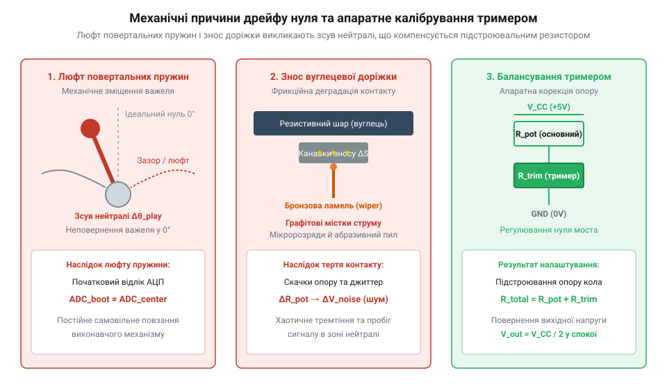
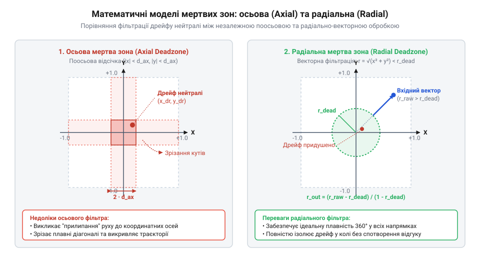

# Еволюція дрейфу нуля: від апаратного підлаштування до цифрових мертвих зон

<preknowlist>
- [Поворотний потенціометр](root:cat-hw-controls/rotary-potentiometer) — принцип розподілу напруги на струмознімальних ламелях та лінійність резистивної доріжки
- [KY-023 — джойстик-модуль](root:cat-hw-controls/ky-023-joystick) — будова двовісного механізму важеля з повертальними пружинами
- [Стік на давачах Холла (Hall Effect Gimbal)](root:cat-hw-controls/hall-effect-gimbal-joystick) — принцип вимірювання магнітного поля без механічного контакту
</preknowlist>

## Важільні маніпулятори та тримери 1970-х

У 1970-х роках перші персональні комп'ютери та ігрові системи отримали аналогові маніпулятори. Конструкція важеля спиралася на два [поворотні потенціометри](root:cat-hw-controls/rotary-potentiometer). Перпендикулярні осі передавали кут відхилення важеля на струмознімальні ламелі. У стані спокою повертальні пружини мали повертати шток у геометричний центр.

Фізична механіка пружинного центрування виявилася недосконалою. Механічний люфт штока та залишкова деформація пружин унеможливлювали точне повернення у вихідний нуль. Струмознімач зупинявся на різній відстані від електричного центру. У результаті зміна опору спричиняла небажаний дрейф нуля (від англійського @@en|zero drift@@ — зсув відносно нейтралі). Сигнал у нейтральному положенні постійно змінював своє значення.

Для компенсації зсуву розробники застосували апаратне підлаштування. Поруч із важелем встановлювали зовнішній тример (від англійського @@en|trimmer@@ — підлаштовувач). Додатковий змінний резистор опором `R_trim` вмикали послідовно з основним потенціометром `R_pot` [джойстик-модуля](root:cat-hw-controls/ky-023-joystick) у плече дільника напруги (від англійського @@en|voltage divider@@). Коли через люфт механіки шток зупинявся із відхиленням, опір основного каналу зміщувався на величину `±ΔR` від номіналу. Обертаючи ручку тримера, користувач змінював опір `R_trim` і коригував підсумковий опір кола `R_total = R_pot + R_trim`, зміщуючи вихідний потенціал моста та повертаючи електричний нуль до збігу з фізичним положенням важеля.

У перших розробках використовували найпростіше лінійне підлаштування (від англ. @@en|linear trimming@@), де тример вмикався послідовно в один із ланцюгів дільника. Проте таке рішення мало суттєвий недолік: зміна опору `R_trim` зміщувала не лише нуль, а й змінювала загальний струм гілки, що викликало нелінійне викривлення масштабу під час відхилення важеля до крайніх меж. Для усунення цієї асиметрії інженери перейшли до логометричних схем підлаштування (від англ. @@en|ratiometric trimming@@) на основі мостового включення. У логометричній схемі тримери змінювали відношення опорних напруг плечей моста, що дозволяло зміщувати точку нейтралі без порушення пропорційності відгуку в усьому діапазоні руху штока.

*Схема механічного люфту повертальних пружин та зсуву нейтралі потенціометра з ручним тримером підлаштування.*

Ручні тримери вимагали постійного повторного регулювання під час кожної ігрової сесії. Зміна температури та механічне розгойдування важеля швидко збивали налаштований рівень. Апаратне підлаштування вирішувало проблему лише тимчасово і не зупиняло подальший фізичний знос деталей.

## Опір матеріалів та деградація потенціометрів

Тривале використання аналогового маніпулятора викликає незворотні фізичні зміни у його вузлах. Основне навантаження припадає на контактну пару потенціометра. Металева струмознімальна ламель ковзає по крихкій вуглецевій доріжці під час кожного руху важеля. Механічне тертя поступово руйнує тонесенький резистивний шар.

У зоні найчастішого перебування важеля виникає абразивний знос (від латинського @@en|abrasive wear@@ — стирання). Пружна струмознімальна ламель, виготовлена із твердої фосфористої бронзи (від англ. @@en|phosphor bronze@@), під час циклічного ковзання виорює канавки у м'якшому вуглецево-полімерному покритті, яким покритий [поворотний потенціометр](root:cat-hw-controls/rotary-potentiometer). Термореактивна полімерна матриця руйнується під дією фрикційного нагріву та питомого тиску контакту, що спричиняє викришування графітових мікрочастинок. Механічна деградація супроводжується матеріалознавчими процесами під дією струму зчитування. Постійний мікрострум проходить через нестабільну контактну пляму бронзової ламелі та вуглецевої доріжки. При дрібних вібраціях важеля виникають мікроскопічні відриви контакту зі спалахами дугових мікророзрядів. Ці мікророзряди викликають електроерозію (від латинського @@en|electrical erosion@@ — роз'їдання) контакту. Висока питома густина струму на мікроскопічних виступах контакту спричиняє швидке точкове нагрівання. Вуглецево-полімерна матриця термічно деградує та окиснюється. Графітові лусочки викрошуються та втрачають електричний зв'язок. Осідаючи між контактами, продукти зносу у вигляді вуглецево-полімерного пилу утворюють паразитні струмопровідні містки, а мікроскопічні подряпини та локальні зміни товщини резистивного шару незворотно спотворюють лінійність розподілу напруги.

Знос матеріалу змінює електричні характеристики в зоні нейтралі. При зупинці важеля опір потенціометра хаотично стрибає. Металева ламель втрачає стабільний контакт із доріжкою через мікронерівності. Цей процес генерує високочастотний електричний шум і постійний дрейф нуля.

Одночасно відбувається пружинна деградація та механічний @@en|hysteresis@@ (від грецького — запізнення). При поверненні з лівого боку важіль зупиняється в одній точці, а з правого — в іншій. Повертальна пружина втрачає початкову пружність через втому металу. Традиційний тример стає повністю безсилим проти таких динамічних та хаотичних коливань опору.

## Цифрова революція та мертві зони 1990-х

У середині 1990-х років поява тривимірних ігор вимагала принципово іншої точності позиціонування. Ігрові консолі отримали контролери з вбудованими мікроконтролерами та аналогово-цифровими перетворювачами. Цифрова обробка сигналів змістила боротьбу з дрейфом нуля із галузі механіки у сферу програмних алгоритмів.

Першим алгоритмічним кроком стала автокалібрувальна центровка (англ. @@en|auto-calibration@@) під час увімкнення пристрою. Мікроконтролер зчитував поточний початковий відлік АЦП `ADC_boot` у момент подачі живлення та фіксував його як опорну точку нуля `ADC_zero = ADC_boot`. Отримане стаціонарне зміщення `ADC_offset = ADC_boot - ADC_center` (де `ADC_center` — теоретичний центр діапазону) використано для обчислення скоригованого сигналу `ADC_calibrated = ADC_raw - ADC_offset` під час подальшого опитування важеля. За відсутності касання важеля при запуску така математична корекція успішно компенсувала постійне зміщення опору потенціометра без участі людини, відновлюючи симетрію робочого поля відносно вирахуваного нуля. Проте цей метод створював критичний граничний випадок: якщо гравець випадково утримував важіль відхиленим під час увімкнення пристрою, мікроконтролер записував хибну точку спокою. Після відпускання штока справжня фізична нейтраль сприймалася як сильне протилежне відхилення, що викликало самовільний розгін персонажа чи курсора та змусило розробників додавати апаратні комбінації скидання або перевірку меж припустимого зсуву при завантаженні.

Для відсікання хаотичного шуму та малого люфту розробники створили мертву зону (від англійського @@en|deadzone@@ — зона безвідгуку). Програма ігнорувала будь-які зміни сигналу у визначеному радіусі навколо центрального положення. Значення координат у межах цієї зони примусово прирівнювалися до чистого нуля.

*Графічна карта програмної фільтрації дрейфу нуля за допомогою осьової та радіальної мертвих зон.*

Інженери розробили дві основні геометрії фільтрації: осьову та радіальну. Осьова зона обробляла кожну вісь окремо і утворювала хрестоподібний неефективний шар. Радіальна зона розраховувала довжину двовимірного вектора відхилення та зберігала природну кругову симетрію рухів. Сучасний [стік на давачах Холла](root:cat-hw-controls/hall-effect-gimbal-joystick) повністю позбавлений тертя доріжок, але досі використовує мертві зони для компенсації люфту пружин.

## Рецидив дрейфу в мініатюрних 3D-модулях

У 2000-х роках індустрія ігрових контролерів перейшла на уніфікований [джойстик-модуль](root:cat-hw-controls/ky-023-joystick). Виробники масово впровадили мініатюрні аналогові блоки з інтегрованими потенціометрами. Компактний розмір дозволив зменшити габарити геймпадів та додати внутрішні вібромотори. Проте радикальне зменшення фізичних розмірів вузла призвело до несподіваного масового рецидиву дрейфу нуля.

Зменшення радіуса `R` вуглецевої доріжки підвищило питомий механічний тиск струмознімальної ламелі (від англійського @@en|contact wiper@@ — контактний повзунок). Оскільки довжина дуги резистивного прошарку пропорційна радіусу `S = R · θ` (де `θ` — кут повороту важеля), зменшення радіуса втричі призвело до того, що фіксований кутовий розріз ламелі та мікроскопічна локальна вибоїна `ΔS` створюють утричі більшу відносну похибку зчитування `ΔE_rel = ΔS / (R · θ_total)`. У щільно закритому корпусі абразивний пил більше не висипався назовні, а накопичувався під контактом. У результаті кожен мініатюрний [поворотний потенціометр](root:cat-hw-controls/rotary-potentiometer) зношувався у кілька разів швидше, а найменший дефект доріжки викликав істотний відсотковий зсув вихідної напруги.

Накопичений усередині замкненого модуля струмопровідний вуглецевий пил створював додатковий деструктивний ефект. Під дією постійного тертя та стиснення графітові мікрочастинки пресувалися в щілинних проміжках між сусідніми мікроскопічними ділянками резистивної доріжки, утворюючи паразитні струмопровідні містки (від англ. @@en|conductive bridging@@). Тимчасові локальні мікрозамикання сусідніх витків хаотично змінювали еквівалентний опір потенціометра навіть при нерухомому важелі, спричиняючи різкі стрибки вихідного сигналу АЦП. Замість плавної зміни напруги [поворотний потенціометр](root:cat-hw-controls/rotary-potentiometer) видавав спотворений сигнал із нестабільним нулем, що призводило до непередбачуваного самовільного зсуву нейтралі.

Конструктивна деградація швидко перевершила компенсаційні можливості цифрових алгоритмів. Програмні мертві зони ефективно відсікали зсув у межах п'яти відсотків від нейтралі. Проте деформований потенціометр створював асиметричне зміщення сигналу на двадцять і більше відсотків. Розширення програмної зони позбавляло маніпулятор плавності та створювало відчутний @@en|input lag@@ (від англійського — запізнення вводу).

## Безконтактні технології та розвінчання міфів

Радикальним вирішенням проблеми контактного зносу став перехід на безконтактне зчитування координат. Інженери інтегрували у підвіс маніпулятора постійний магніт та напівпровідникові сенсори. Сучасний [стік на давачах Холла](root:cat-hw-controls/hall-effect-gimbal-joystick) вимірює зміну вектора магнітного поля без жодного фізичного тертя струмознімальних елементів. Щоб усунути вплив зовнішніх завад від електродвигунів та силових кабелів, розробники застосували диференціальний датчик Холла (від англ. @@en|differential Hall sensor@@). Парні чутливі елементи вимірюють напруженість поля у протилежних точках підвісу та обчислюють різницю сигналів, що взаємно компенсаційно відсікає зовнішнє паразитне магнітне поле (від англ. @@en|stray magnetic field@@) як синфазну заваду. Однаково суттєвим викликом залишається чутливість напівпровідників до коливань температури. Нагрівання або охолодження змінює концентрацію та рухливість носіїв заряду в кристалі. Це спричиняє температурну залежність коефіцієнта Холла (від англ. @@en|Hall coefficient@@) та зсув вихідної напруги за нерухомого важеля. Для компенсації цього дрейфу в чип інтегрують внутрішній термодатчик. Прошивка виконує програмну термокомпенсацію (від латинського @@en|thermal compensation@@ — зрівноваження) за допомогою поправкових коефіцієнтів. Завдяки цьому відсутність вуглецевих доріжок, диференціальне віднімання завад та програмна корекція повністю ліквідували електричний дрейф нуля.

Уявлення про дрейф нуля утворило поширене хибне переконання серед користувачів. Багато хто вважає дрейф виключно програмною помилкою прошивки або збоєм алгоритмів калібрування. Насправді зсув нейтралі завжди має двокомпонентну природу. Механічний знос та фрикційне руйнування контактів утворюють апаратну основу проблеми, а помилки опитування АЦП лише проявляють її у цифровому коді.

Безконтактні магнітні сенсори повністю усувають електричну деградацію, але залишають непереможеним механічний чинник. Втома металу повертальних пружин та пластиковий люфт штока з часом зберігаються у будь-якому маніпуляторі. Магнітні системи вимагають лише мінімальної програмної мертвої зони для компенсації люфту механіки. Обґрунтований вибір безконтактного маніпулятора забезпечує багаторічну стабільність нуля без втрати точності позиціонування.
