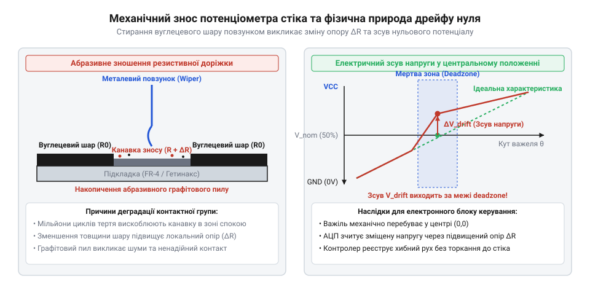
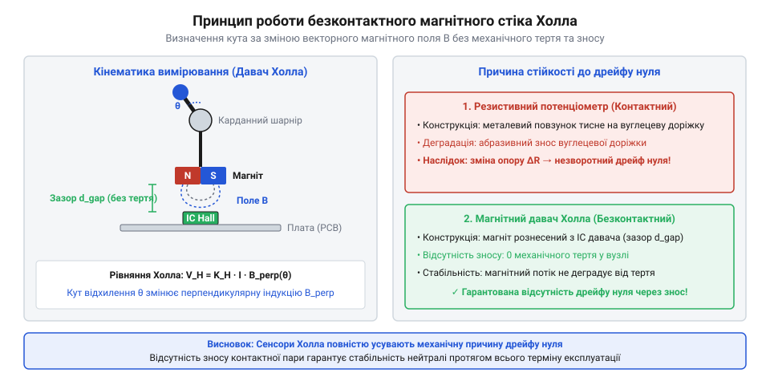

# Еволюція аналогових стіків, проблема дрейфу нуля та перехід до безконтактних сенсорів

<preknowlist>
- [Поворотний потенціометр](root:cat-hw-controls/rotary-potentiometer) — принцип зміни опору при ковзанні струмознімача по резистивному шару
- [KY-023 — джойстик-модуль](root:cat-hw-controls/ky-023-joystick) — двохвісьова конструкція механічного важеля із двома резистивними потенціометрами
- [Стік на давачах Холла (Hall Effect Gimbal)](root:cat-hw-controls/hall-effect-gimbal-joystick) — принцип вимірювання відхилення важеля за зміною магнітного поля без механічного контакту
</preknowlist>

## Обмеження дискретного вводу в маніпуляторах

Ще у 1960-х роках у військовій авіації — для керування радарними системами винищувачів та прицільними комплексами бомбардувальників — застосовувалися перші аналогові маніпулятори на основі прецизійних дротяних потенціометрів або лінійно-диференційних трансформаторів (англ. @@en|linear variable differential transformer@@, LVDT; від лат. *transformare* — перетворювати). З точки зору метрології, безконтактні LVDT-сенсори забезпечували виняткову лінійність характеристики з похибкою не більше 0.1%, тоді як дротяні й пізніші плівкові потенціометри мали неминучу похибку лінійності 0.5–2% через нерівномірність кроку намотки та товщини резистивного шару. Проте складність генерації синусоїдального опорного сигналу, необхідність фазочутливих демодуляторів, масивні габарити та висока вартість індуктивних перетворювачів робили LVDT виключно прерогативою оборонної промисловості. Коли ж у 1970-х роках виникла потреба в масовому цивільному виробництві промислових панелей керування та ігрових @@en|arcade@@-автоматів, інженери змушені були піти на спрощення конструкції, тому на ринку запанували дискретні важелі керування — джойстики (від англійського @@en|joy@@ — радість, та @@en|stick@@ — палиця; англ. @@en|joystick@@). Конструктивно такий важелевий механізм опирався на чотири механічні мікроперемикачі, розміщені по периметру основи. Відхилення рукоятки в один із боків замикало відповідну контактну групу, генеруючи бінарний сигнал наявності чи відсутності контакту. При діагональному відхиленні важеля одночасно спрацьовували два суміжні перемикачі, що давало загалом лише вісім фіксованих напрямків руху.

Головною технологічною проблемою дискретної системи була відсутність пропорційного керування (англ. @@en|proportional control@@). Швидкість переміщення об'єкта або кут повороту механізму не залежили від сили чи величини відхилення рукоятки. У перших авіаційних симуляторах, вимірювальних комплексах та складних робочих маніпуляторах бінарний ввід унеможливлював точне позиціонування та плавну зміну траєкторії.

Для подолання дискретного обмеження інженери інтегрували у вузол відхилення аналогові вимірювальні елементи. Важіль з'єднали з двома перпендикулярно розташованими поворотними компонентами, де кожен вимірював кут нахилу вздовж власної осі. Для цього застосували [поворотний потенціометр](root:cat-hw-controls/rotary-potentiometer) (від латинського @@la|potentia@@ — сила, та грецького @@el|metron@@ — міра; англ. @@en|potentiometer@@) — пристрій із плавною зміною електричного опору. Перетворення кута відхилення у безперервний потенціал напруги за двома осі координатної площини забезпечило формування пропорційного аналогового сигналу для точної навігації.

## Мініатюризація потенціометрів у масових контролерах

Наприкінці 1990-х років стрімкий розвиток тривимірної графіки вимагав масового впровадження аналогових стіків у побутові геймпади (англ. @@en|gamepad@@). Промислові важелеві маніпулятори мали великі габарити та високу вартість, що унеможливлювало їх використання у компактних пристроях. Виробникам знадобився дрібний двохвісьовий [джойстик-модуль](root:cat-hw-controls/ky-023-joystick), здатний вміститися у стандартний корпус пристрою ручного вводу. Відповіддю став компактний блок @@en|ALPS RKJXV@@, кінематика якого спиралася на розщеплення руху центрального важеля через перпендикулярну хрестовину з двох дугоподібних куліс: відхилення стіка вздовж однієї з осей повертало відповідну кулісу, яка передавала обертання на вал бічного потенціометра. Для утримання нульової точки та повернення важеля у вихідне положення застосували систему подвійних пружин повернення нейтралі з підпружиненою центрувальною чашкою, яка витискала нижній хрестоподібний шарнір у геометричний центр при знятті зусилля. При тривалій грі тепло від рук оператора прогрівало корпус маніпулятора від 20 °C до 35 °C, що впливало на вуглецеве напилення ALPS: тонкоплівковий резистивний шар мав негативний температурний коефіцієнт опору, тому радіометрична схема дільника компенсувала загальне падіння опору всієї доріжки, але локальне нерівномірне нагрівання й теплове розширення пластикової куліси спричиняли додатковий температурний зсув нейтралі.

Конструктивний прорив здійснила японська компанія @@en|ALPS Electric@@, створивши стандартизований карданний блок (англ. @@en|gimbal mechanism@@) розміром 15×15 міліметрів. У цьому модулі два мініатюрні потенціометри закріплені на бічних гранях пластикового рамкового механізму. Для забезпечення низької собівартості виробники відмовилися від дротяних резисторів на користь тонкоплівкового вуглецевого покриття, нанесеного друкованим способом на дугоподібні доріжки текстолітової платформи.

Електричний контакт із вуглецевим шаром забезпечували металеві струмознімачі (англ. @@en|wiper contacts@@) із тонкими підпружиненими вусиками. Перехід на мініатюрні вуглецеві потенціометри знизив собівартість виготовлення вузла до кількох центів і дозволив оснастити двохвісьовим аналоговим вводом мільйони ігрових контролерів. Проте це масштабування містило прихований компроміс: постійне механічне тертя металевих вусиків по тонкій вуглецевій доріжці створило умови для неминучого зносу контактної групи.

## Фізика зносу та виникнення дрейфу

У процесі щоденної експлуатації пружинні вусики струмознімача діють як абразивний інструмент, що поступово зрізає мікророни вуглецевого покриття. У місцях найчастішого контакту — особливо поблизу центрального положення важеля — товщина резистивної доріжки зменшується. Це викликає локальну зміну питомого опору та порушує лінійність вихідної напруги потенціометра. Математично опір ділянки провідного шару довжиною `L`, шириною `w` та початковою товщиною `h₀` підпорядковується закону питомого опору `ρ`. При абразивному зносі на глибину `Δh` локальний опір `R_local` зростає зворотній пропорційно залишковій товщині:

R_local
= ρ · (L / (w · (h₀ - Δh)))               [опір резистивної доріжки при зменшенні товщини h₀]

Накопичення механічного зносу підсилюється релаксацією напружень (англ. @@en|stress relaxation@@, від лат. *relaxatio* — послаблення) повертальної пружини із жорсткістю `k`. Коли через пластичну деформацію сила пружини врівноважується сухим тертям струмознімачів `F_friction`, важіль зупиняється з механічним зміщенням від геодезичної нейтралі `Δx_center`:

Δx_center
= F_friction / k                          [зміщення нейтралі через перевагу сили тертя над пружиною]

Сумісний вплив електрохімічного стоншення шару `Δh` та кінематичного люфту `Δx_center` призводить до незворотного зміщення вихідної напруги спокою [поворотного потенціометра](root:cat-hw-controls/rotary-potentiometer).

Зрізані частки вуглецевого пилу та металева стружка не залишають закритий корпус модуля. Вони накопичуються на поверхні резистивної плашки та створюють хаотичні струмопровідні містки між сусідніми ділянками доріжки. Одночасно з абразивним зносом електричної частини відбувається механічна деградація повертальної пружини та пластикових направляючих куліси, через що важіль втрачає здатність повертатися в точний геометричний центр.

*Контактна група потенціометра: механічний знос вуглецевого шару та зміщення вихідної напруги нейтрального стану.*

Поєднання деформації механізму та зміни опору викликає технологічну деградацію — стік-дрейф (від англійського @@en|stick drift@@ — зсув палиці керування; англ. @@en|stick drift@@). Вихідна напруга потенціометра у стані спокою відхиляється від заводського значення нейтральної точки. Коли цей паразитний зсув перевищує програмну мертву зону (англ. @@en|deadzone@@), обчислювальна система сприймає спокійний стік як активне відхилення й починає самовільно рухати об'єкт на екрані.

## Споживчі скандали та розвінчання міфів

Наприкінці 2010-х років масштаби деградації потенціометричних стіків досягли рівня світової споживчої кризи. Масовий вихід мобільних ігрових консолей оголив слабкість малого карданного вузла. У 2019 році в США юристи фірми @@en|Chimicles Schwartz Kriner & Donaldson-Smith@@ подали перший масовий колективний позов (англ. @@en|class action lawsuit@@) проти компанії @@en|Nintendo@@, після чого аналогічні позови охопили виробників @@en|Sony@@ та @@en|Microsoft@@. Юридичні матеріали позовів спиралися на незалежні експертизи, які довели існування фундаментального конструктивного дефекту (англ. @@en|design defect@@): лабораторні випробування виявили, що тонкі вуглецеві доріжки потенціометрів деградують і виходять за межі заводської мертвої зони (англ. @@en|deadzone@@) вже після 400 годин активної гри. Водночас спроби виробників патентувати системи автоматичного програмного розширення мертвих зон наразилися на гострі патентні суперечки щодо пріоритету раніше відомих алгоритмів цифрової фільтрації, підтвердивши, що суто апаратний знос неможливо подолати юридичними чи софтверними маневрами.

Спроби усунути стік-дрейф (англ. @@en|stick drift@@) на рівні програмного забезпечення виявилися неефективними. Виробники пропонували збільшувати мертву зону (англ. @@en|deadzone@@) в оновленнях фірмварі. Проте програмне розширення зони нечутливості знижувало точність позиціонування й лише ненадовго маскувало знос, адже в міру стирання вуглецю амплітуда паразитного сигналу неминуче перевищувала будь-які програмні пороги.

Криза розвінчала поширений міф про те, ніби дрейф зумовлений виключно пиловим забрудненням або програмними помилками. Продування стисненим повітрям чи очищення спиртом видаляють вільні графітові частки й тимчасово зменшують шуми, але не можуть відновити фізично витерту резистивну доріжку чи компенсувати люфт пластикової куліси. Фізична неминучість механічного зносу контактної групи змусила індустрію розпочати перехід на безконтактні принципи вимірювання.

## Перехід до безконтактних давачів Холла

Для повного усунення абразивного тертя інженери впровадили безконтактний метод вимірювання кута відхилення важеля. Основним рішенням для сучасних систем став [стік на давачах Холла](root:cat-hw-controls/hall-effect-gimbal-joystick) (англ. @@en|Hall effect gimbal@@). У цій конструкції на нижній рухомій частині важеля закріплено постійний магніт, а на нерухомій друкованій платі поруч встановлено напівпровідниковий давач Холла (від імені відкривача ефекту, американського фізика Едвіна Холла; англ. @@en|Hall sensor@@). Сучасні системи використовують інтегральні тривісні магнітні кодувальники 3D Hall (англ. @@en|3D Hall sensor@@), у яких єдиний напівпровідниковий кристалик одночасно вимірює вектор напруженості магнітного поля за трьома просторовими осями `B_x`, `B_y` та `B_z`, що дозволяє з високою точністю обчислювати кутове положення важеля без складної кінематики. Проте ключовим технічним компромісом безконтактних магнітних сенсорів є енергоспоживання (англ. @@en|power consumption@@): якщо класичний аналоговий потенціометр є пасивним дільником і споживає лише десятки мікроампер, то активний давач Холла з внутрішнім підсилювачем сигналу вимагає постійного живлення струмом до 3–10 мА, що скорочує час автономної роботи бездротових пристроїв.

При нахилі рукоятки магніт переміщується в просторі, змінюючи вектор та напруженість магнітного поля довкола сенсора. Давач Холла реєструє цю зміну й перетворює її у відповідний аналоговий потенціал напруги без жодного механічного дотику між вимірювальними елементами. Відсутність тертя у вимірювальному вузлі гарантує вічну стабільність вихідного нуля та усуває абразивну деградацію.

*Кінематика магнітного стіка: безконтактне вимірювання відхилення важеля за допомогою давача Холла та постійного магніту.*

Паралельно з магнітними сенсорами в промисловості та геймінгу застосовують оптичні системи, аналогічні принципам роботи модуля [KY-040](root:cat-hw-controls/ky-040-encoder) (від англійського @@en|encode@@ — кодувати; англ. @@en|optical encoders@@), де кутові координати розраховуються за перериванням світлового променя. Перехід на безконтактні технології довів, що тривала надійність органів керування досягається не програмними заплатками, а вибором фундаментально безфрикційного фізичного принципу вимірювання.
