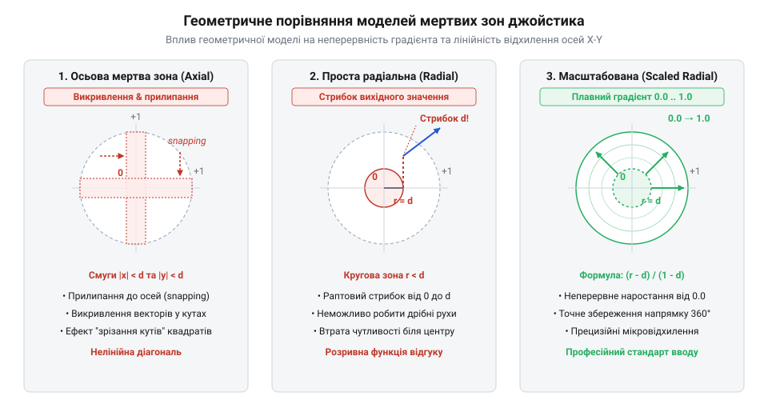
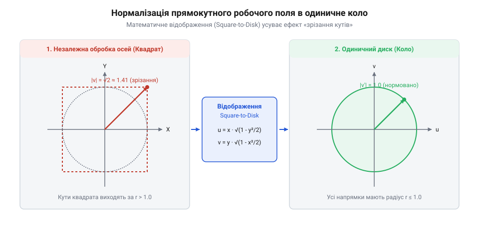

# Математичні моделі мертвих зон та нормалізації координат

<preknowlist>
- [KY-023 — джойстик-модуль](root:cat-hw-controls/ky-023-joystick) — Принцип роботи двох взаємно перпендикулярних потенціометрів та формування сирих аналогових сигналів по осях X та Y.
- [Стік на давачах Холла (Hall Effect Gimbal)](root:cat-hw-controls/hall-effect-gimbal-joystick) — Причина асиметрії вихідних сигналів АЦП та дрейфу нуля магнітних датчиків.
</preknowlist>

## Нестабільність нуля та зсув координат

Робота двох взаємно перпендикулярних потенціометрів у пристроях на кшталт [джойстик-модуля KY-023](root:cat-hw-controls/ky-023-joystick) або магнітних датчиків у [стіках на давачах Холла](root:cat-hw-controls/hall-effect-gimbal-joystick) ґрунтується на перетворенні механічного кута відхилення важеля в електричний сигнал. У стані спокою пружинний механічний повертач мусить утримувати важіль у геометричному центрі, а АЦП мікроконтролера має фіксувати рівно половину опорної напруги. Проте через технологічні допуски пружин, терморозширення матеріалів та механічний люфт важіль рідко повертається в ідеальний нуль. Окрім механічної похибки, на аналогову лінію накладається електричний шум перетворення, викликаний наводками живлення та нестабільністю резистивного шару [поворотного потенціометра](root:cat-hw-controls/rotary-potentiometer).

Сукупність цих факторів викликає дрейф нуля (від англійського @@en|stick drift@@) — постійну зміну сирих відліків АЦП (від англійського @@en|raw ADC values@@) навколо центрального значення. Додатковий деструктивний вплив створює низькочастотний джиттер АЦП (від англійського @@en|ADC jitter@@ — тремтіння амплітуди відліків), викликаний флуктуаціями живлення та тепловим шумом. Цей низькочастотний шум генерує хаотичні амплітудні сплески у зоні нейтралі навіть при нерухомому важелі. Амплітуда джиттера безпосередньо визначає мінімальну ширину динамічної мертвої зони (від англійського @@en|dynamic deadzone@@). Для двох взаємно перпендикулярних осей `X` та `Y` з однаковою піковою амплітудою джиттера `ΔADC_max` у стані спокою максимальне радіальне відхилення шуму `r_peak` від центральної точки обчислюється як векторна сума незалежних завад:

```
r_peak = √((Δx_max)² + (Δy_max)²)
       = √((ΔADC_max)² + (ΔADC_max)²)      [симетрія амплітуди шуму по осях]
       = √(2 · (ΔADC_max)²)                [винесення квадрата амплітуди]
       = √2 · ΔADC_max                     [добування квадратного кореня]
```

Звідси мінімально допустимий поріг радіуса мертвої зони `R_deadzone` виражається через максимальну амплітуду шуму з урахуванням коефіцієнта запасу `k_safe > 1`:

```
R_deadzone = k_safe · r_peak
           = k_safe · √2 · ΔADC_max        [підстановка векторного розмаху джиттера]
```

Поріг цієї зони мусить гарантовано перекривати розмах пікових відхилень шуму, тому коефіцієнт `k_safe` обирають у діапазоні `1.2…1.5` для компенсації повільного температурного вибігу. За встановлення занадто вузької межі флуктуації джиттера пробивають поріг та спричиняють хибні спрацьовування. У разі прямого транслювання сирого відліку у команди керування приводом роботизованої платформи або сервоприводом камери навіть мінімальне відхилення АЦП викликає постійний самовільний дрейф виконавчого механізму.

Для усунення цього ефекту навколо центральної позиції формують мертву зону (від англ. @@en|deadzone@@) — діапазон сирих значень, у межах якого будь-які коливання сигналу примусово пригнічуються та прирівнюються до нульового вектора відхилення.

Для математичного визначення порогу вибірки враховують, що джиттер АЦП по кожній із двох осей підпорядковується нормальному гауссовому розподілу (від німецького @@de|Gauß@@ на честь математика Карла Ґаусса; англійською @@en|Gaussian distribution@@) з нульовим середнім та стандартним відхиленням `σ_ADC` (від англійського @@en|standard deviation@@). Оскільки двоїстий шум осей `X` та `Y` є незалежним, результуючий модуль шуму радіуса `r = √((ΔX)² + (ΔY)²)` підпорядковується двовимірному розподілу Релея (від англійського @@en|Rayleigh distribution@@ на честь фізика лорда Релея). Імовірність хибного спрацьовування порогу (від англійського @@en|false positive rate@@) визначається як імовірність того, що випадковий шумовий вектор перевищить радіус мертвої зони `R_deadzone`:

```
P_false = P(r > R_deadzone)
        = exp(- (R_deadzone)² / (2 · σ_ADC²))      [інтегрування щільності радіального розподілу Релея]
```

Якщо поріг обрано на рівні класичного трьохсигмового інтервалу `R_deadzone = 3 · σ_ADC`, обчислення імовірності пробою дає:

```
P_false = exp(- (3 · σ_ADC)² / (2 · σ_ADC²))
        = exp(- 9 · σ_ADC² / (2 · σ_ADC²))         [піднесення чисельника до квадрата]
        = exp(- 4.5)                                [скорочення σ_ADC²]
        ≈ 0.0111                                   [значення експоненти]
```

Це означає, що при опитуванні АЦП із частотою 1000 Гц хибний сплеск вихідного сигналу в стані спокою траплятиметься приблизно 11 разів на секунду (1.11% від усіх відліків). Збільшення порогу до `R_deadzone = 4 · σ_ADC` кардинально знижує імовірність пробою:

```
P_false = exp(- (4 · σ_ADC)² / (2 · σ_ADC²))
        = exp(- 16 / 2)                             [скорочення та спрощення]
        = exp(- 8.0)                                [обчислення показника]
        ≈ 0.000335                                 [значення експоненти]
```

У цьому разі імовірність хибного спрацьовування падає до 0.0335% (приблизно 1 хибний відлік на 3000 замірів), що гарантує абсолютну нерухомість нейтрального стану маніпулятора без потреби зайвого розширення мертвої зони.

## Осьова та проста радіальна зони

Найпростішим способом програмної нейтралізації дрейфу нуля є осьова мертва зона (від англ. @@en|axial deadzone@@). У цій моделі кожна з осей `X` та `Y` обробляється незалежно: якщо абсолютне значення відхилення осі не перевищує порогового значення `d_min`, координата примусово обнуляється.

Геометрично осьова зона утворює хрестоподібну область уздовж осей координат. Така топологія створює суттєві викривлення напрямку руху. Під час діагонального відхилення важеля справжній фізичний вектор має кут `θ = arctan(y / x)` та евклідову довжину `r = √(x² + y²)`. За знаходження координати `y` в межах порогу `d_min` осьова модель примусово обнуляє її до 0. У результаті обчислений вихідний вектор трансформується у координату `(x, 0)`. Напрямок підсумкового вектора миттєво падає до нуля градусів. Це викликає штучний ефект магнітного притягання траєкторії до найближчої осі координат. Реальний кут прикладання сили оператора повністю втрачається. Виконавчий механізм рухається суворо прямолінійно вздовж осі замість діагонального напрямку. Лише після перевищення порогової межі `|y| ≥ d_min` напрямок вектора відновлюється з вимушеним стрибком. Окрім того, при перетині межі `d_min` вихідна величина стрибкоподібно зростає від 0 до `d_min`, викликаючи відсутність плавності та різкий поштовх у керуванні.

Математичний аналіз кутового викривлення показує фундаментальну відмінність між цими двома підходами в полярних координатах (від англійського @@en|polar coordinates@@). У моделі осьової мертвої зони (від англійського @@en|axial deadzone@@) при початковому куті відхилення важеля `θ_in = arctan2(y, x)` обнулення координати `y` при `|y| < d_min` дає вихідний кут `θ_out = 0`, що призводить до кутової помилки `Δθ = |θ_in - θ_out| = θ_in` і штучного «прилипання» напрямку до осі. Для геометричного виведення величини кутового викривлення `Δθ` розглядають відхилення важеля на полярний радіус `r = √(x² + y²)` під вхідним кутом `θ_in`. Оскільки прямокутні координати зв'язані з полярними виразами `x = r · cos(θ_in)` та `y = r · sin(θ_in)`, усередині осьової мертвої смуги `|y| < d_min` координата `y` примусово обнуляється, перетворюючи вихідний кут на `θ_out = 0`. Тоді покрокове виведення кутової помилки `Δθ` має вигляд:

```
Δθ = |θ_in - θ_out|
   = θ_in - 0                              [підстановка вихідного кута θ_out = 0 при |y| < d_min]
   = arcsin(y / r)                         [вираження кута через тригонометричну функцію arcsin]
   = arcsin((r · sin(θ_in)) / r)           [підстановка ординати y в полярних координатах]
   = θ_in                                  [скасування оберненої тригонометричної функції]
```

Максимальне кутове викривлення `Δθ_max` досягається безпосередньо на зовнішній межі осьової смуги при `y = d_min` і обчислюється за виразом:

```
Δθ_max = arcsin(d_min / r)                 [підстановка граничної ординати y = d_min]
```

З отриманої залежності видно, що гранична кутова помилка `Δθ_max` обернено пропорційна радіусу відхилення `r`: чим ближче важіль до центрального положення, тим більший сектор кутів підпадає під штучне «прилипання» траєкторії до осі. Як тільки дельта перетинає поріг `|y| ≥ d_min`, вихідний кут стрибкоподібно змінюється на `θ_out = arctan2(d_min, x)`, викликаючи нелінійну тригонометричну деформацію (від англійського @@en|trigonometric distortion@@) та скачкоподібну зміну траєкторії руху. Натомість проста радіальна мертва зона (від англійського @@en|simple radial deadzone@@) обробляє вектор скалярним порівнянням полярного радіуса `r = √(x² + y²) ≥ d_min` без зміни співвідношення компонент `x` та `y`, завдяки чому вихідний кут точно дорівнює вхідному `θ_out = arctan2(y, x) = θ_in`. Таким чином, проста радіальна зона гарантує нульову кутову помилку (`Δθ = 0`) і повністю зберігає напрямок прикладання сили оператора, однак залишає розрив другого роду за амплітудою довжини вектора.

Альтернативою є проста радіальна мертва зона (від англ. @@en|simple radial deadzone@@). Вона розраховує двовимірну евклідову відстань `r` від центрального положення:

r = √(x² + y²)

Якщо полярний радіус `r` менший за поріг `d_min`, то вектор `(x, y)` обнуляється `(0, 0)`.


*Порівняння геометричних меж та форм деформації для осьової, простої радіальної та масштабованої радіальної мертвих зон.*

Проста радіальна зона утворює коло радіуса `d_min`, усуваючи хрестоподібне викривлення діагоналей. Проте вона залишає проблему ступеня відклику: при перевищенні радіуса `r ≥ d_min` вектор відхилення повертається без змін, через що на межі `r = d_min` виникає дисконтинуїтет — скачок довжини вектора від `0` одразу до `d_min`.

## Масштабована радіальна модель мертвих зон

Стрибок величини відклику на межі простої радіальної зони усувається за допомогою масштабованої радіальної мертвої зони (від англ. @@en|scaled radial deadzone@@). Мета цієї моделі — перемасштабувати робочий діапазон відхилення так, щоб на самій межі `r = d_min` нормований радіус дорівнював нулю `0.0`, а при максимальному відхиленні `r = d_max` досягав одиниці `1.0`.

Математичний розрахунок масштабованої моделі виконується у два кроки. Спочатку обчислюється поточний радіус `r = √(x² + y²)`. Якщо `r < d_min`, вихідний вектор дорівнює `(0.0, 0.0)`. Якщо ж `r ≥ d_min`, виконується лінійна нормалізація радіуса `r_norm` з одночасним збереженням напрямного одиничного вектора `(x/r, y/r)`. Критичною функцією цієї первинної перевірки є запобігання діленню на нуль (від англ. @@en|division by zero@@) та виникненню помилок `NaN` (від англ. @@en|not a number@@): оскільки визначення напрямку потребує ділення координат на `r`, умовне відсікання `r < d_min` виступає захисним бар'єром (від англ. @@en|guard condition@@), що гарантує додатне значення знаменника `r ≥ d_min > 0` під час обчислення наступних співвідношень:

```
r_norm = (r - d_min) / (d_max - d_min)      [нормалізація радіуса в діапазоні 0.0..1.0]
v_x = (x / r) · r_norm                      [нормована координата X]
v_y = (y / r) · r_norm                      [нормована координата Y]
```

де `x` та `y` — зсунуті від центра координати АЦП, `d_min` — радіус внутрішньої мертвої зони, `d_max` — максимальний радіус робочого поля джойстика, `v_x` та `v_y` — компоненти вихідного нормованого вектора.


*Схема відображення прямокутного поля відліків АЦП в нормоване одиничне коло з масштабуванням радіуса.*

Завдяки цьому математичному перетворенню забезпечується строга безперервність функції відклику: при виході з мертвої зони вектор наростає плавно від нуля, а кут відхилення `θ = atan2(y, x)` зберігається без геометричних викривлень. Результатом нормалізації є розміщення вектора усередині одиничного диска (від англ. @@en|unit disk@@). Для подальшого налаштування динаміки вказування до лінійно нормованого радіуса `r_norm` застосовують степеневу гамма-корекцію (від англ. @@en|gamma correction@@). Введення нелінійного коефіцієнта `γ > 0` трансформує нормований радіус за співвідношенням:

```
r_gamma = (r_norm)^γ      [степеневе масштабування чутливості]
```

За показника `γ > 1.0` (найчастіше `γ = 2.0` — квадратична крива) похідна функції поблизу межі `r_norm = 0.0` прямує до нуля, створюючи пологий приріст амплітуди при малих відхиленнях важеля. Це забезпечує максимальну точність юстування та мікрокоригування біля центру без зміни зовнішньої межі `1.0`. Натомість при `γ = 1.0` маємо суто лінійне масштабування, а при `0 < γ < 1.0` відгук стає агресивно-прогресивним, прискорюючи наростання вихідного вектора на початковій ділянці ходу.

## Асиметрія важеля та нормалізація відгуку

У реальних механічних маніпуляторах, таких як [джойстик-модуль KY-023](root:cat-hw-controls/ky-023-joystick) або [стік на давачах Холла](root:cat-hw-controls/hall-effect-gimbal-joystick), геометричний центр і крайні точки ходу важеля є асиметричними. Для 12-бітного АЦП із діапазоном від 0 до 4095 теоретичний центр 2048 на практиці може зміщуватися, наприклад, до значення 2120 для осі X, а мінімальне й максимальне значення ходу становити 120 та 3980 відповідно. Це означає, що від'ємний півдіапазон `[120..2120]` містить 2000 відліків, а додатний `[2120..3980]` — лише 1860 відліків.

Пряме симетричне ділення вихідних координат призводить до того, що відхилення важеля в один бік викликає швидший відгук, ніж в інший. Для усунення цієї нелінійності застосовують роздільну нормалізацію півдіапазонів (від англ. @@en|asymmetric half-range normalization@@) на основі попереднього калібрування центрального нуля (від англ. @@en|zero-center calibration@@). Для запобігання зрізанню сигналу під час активної експлуатації систему доповнюють механізмом автомасштабування: мікроконтролер динамічно відстежує реальні екстремуми АЦП (`x_min_dyn` та `x_max_dyn`), оновлюючи межі півдіапазонів щоразу, коли фактичний відлік перевищує відкалібрований максимум або опускається нижче мінімуму. Це виключає насичення сигналу на рівні `±1.0` при сильному механічному натисканні та гарантує повну амплітуду відгуку без повторного ручного калібрування.

Утім, точне визначення точки `x_center` під час процедури калібрування в стані спокою ускладнюється випадковими амплітудними викидами АЦП та мікровібраціями важеля. Звичайне середнє арифметичне по серії з `N` відліків є нестійким: єдиний імпульсний сплеск зміщує вирахований центр і спотворює подальшу нормалізацію. Для надійного відсікання граничних завад застосовують усічене середнє (від англ. @@en|trimmed mean@@). Для масиву вибірок `x_raw` розміром `N`, впорядкованого за зростанням `x_sorted`, вилучають по `k` крайніх екстремумів з обох боків розподілу, а точне значення нуля обчислюють за формулою:

```
x_center = (1 / (N - 2k)) · ∑ x_sorted[i]      [обчислення середнього для елементів від i = k+1 до N-k]
```

де `k = ⌊N · α_trim⌋` визначається через коефіцієнт відсікання `α_trim ∈ (0, 0.25)`. Завдяки усуненню хвостів розподілу цей метод гарантує математичну стійкість точки нуля (від англ. @@en|robust statistical estimate@@) навіть за наявності поодиноких імпульсних сплесків АЦП.

Математично нормалізація сирого відліку `x_raw` для відповідної осі виконується кусково-лінійно:

```
x_norm = (x_raw - x_center) / (x_center - x_min)      [для від'ємного півдіапазону x_raw < x_center]
x_norm = (x_raw - x_center) / (x_max - x_center)      [для додатного півдіапазону x_raw >= x_center]
```

де `x_raw` — поточний відлік АЦП, `x_center` — відкаліброване центральне значення спокою, `x_min` та `x_max` — відкалібровані крайні положення важеля. Аналогічний розрахунок проводиться для осі Y. У результаті такого перетворення сирі асиметричні відліки незалежно перемасштабовуються у симетричний прямокутний діапазон `[-1.0, +1.0]`.

## Усунення зрізання кутів круговою нормалізацією

Незалежна нормалізація осей X та Y відображає відхилення важеля у прямокутну область `[-1.0, +1.0] × [-1.0, +1.0]`. Проте фізичний механічний обмежувач ходу стіка є круговим. При діагональному відхиленні важеля в крайній кут прямокутника обидві координати можуть одночасно досягати `x_norm = 1.0` та `y_norm = 1.0`, що дає довжину вектора `r = √(1² + 1²) = √2 ≈ 1.414`.

Якщо виконавча система розрахована на максимальну амплітуду сигналу 1.0, вихід вектора за межі одиничного кола спричиняє ефект зрізання кутів (від англ. @@en|corner clipping@@). Це призводить до "насичення" відклику у діагональних напрямках: джойстик досягає максимальної швидкості керування ще до повного механічного відхилення важеля, спотворюючи кругове робоче поле (від англ. @@en|circular response field@@).

Для математичного перетворення прямокутної сітки координат в одиничне коло застосовують відображення квадрата в диск (від англ. @@en|square-to-disk mapping@@). На відміну від спрощеного еліптичного граничного масштабування (від англ. @@en|elliptical grid mapping@@), яке радіально стискає вектори до меж квадрата й тим самим спотворює кутову рівномірність відхилення уздовж бісектрис `±45°`, аналітичне конформне відображення забезпечує ізометричну гладкість та зберігає природну просторову симетрію по всьому робочому диску. Воно нелінійно перераховує нормовані прямокутні координати `u` та `v` у підсумкові кругові координати `x` та `y`:

```
x = u · √(1 - v² / 2)      [перетворення координати X з квадрата в диск]
y = v · √(1 - u² / 2)      [перетворення координати Y з квадрата в диск]
```

де `u` та `v` — нормовані координати осей X та Y з попереднього етапу в діапазоні `[-1.0, +1.0]`, а `x` та `y` — підсумкові координати всередині одиничного диска.

При крайньому кутовому відхиленні `u = 1.0` та `v = 1.0` ця формула дає `x = 1 · √(1 - 0.5) ≈ 0.7071` та `y = 1 · √(1 - 0.5) ≈ 0.7071`, а підсумковий радіус вектора становить `√(0.7071² + 0.7071²) = 1.0`. Таким чином, вихідне значення плавно розпреділяється по всій окружності без насичення та без зрізання кутів. Проте обчислення двох квадратних коренів `√(1 - v²/2)` при кожному опитуванні АЦП створює значне обчислювальне навантаження для 8-бітних мікроконтролерів без апаратного блоку плаваючої коми. Для усунення програмного обчислення кореня застосовують арифметику з фіксованою комою (від англ. @@en|fixed-point arithmetic@@) та наближення ряду Тейлора `√(1 - z) ≈ 1 - z/2`. Підстановка `z = v²/2` спрощує формули до базових множень і побітових зсувів:

```
x = u · (1 - v² / 4)      [наближена Тейлорова апроксимація радикала √(1 - v²/2)]
y = v · (1 - u² / 4)      [наближена Тейлорова апроксимація радикала √(1 - u²/2)]
```

Така поліноміальна апроксимація замінює трудомістку функцію `sqrt()` на швидкий розрахунок із цілочисельними зсувами `>> 2`, зберігаючи максимальну похибку формату менше 6% при прискоренні обчислень у десятки разів. Для критичних за швидкістю застосувань залишок похибки компенсують одновимірною таблицею пошуку (від англ. @@en|lookup table@@).
