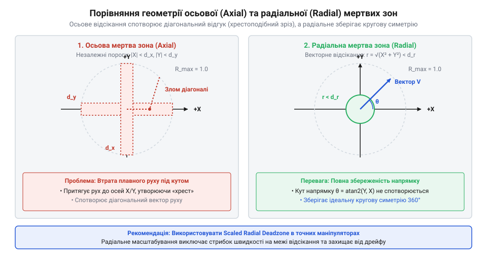
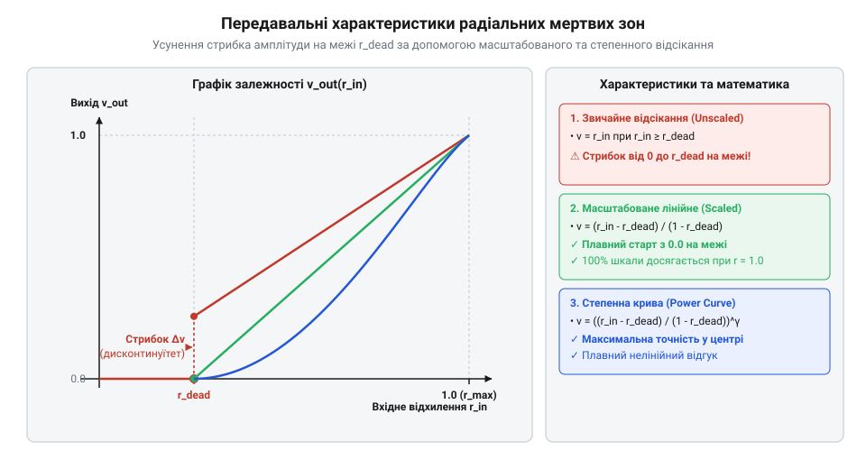

# Математичні моделі мертвих зон, радіальне нормування та фільтрація дрейфу

<preknowlist>
- [KY-023 — джойстик-модуль](root:cat-hw-controls/ky-023-joystick) — двовісні потенціометричні виходи X/Y та виникнення механічного шуму й неточності відцентрування
- [Стік на давачах Холла (Hall Effect Gimbal)](root:cat-hw-controls/hall-effect-gimbal-joystick) — безконтактне зняття координат двовісного важеля та наявність температурного дрейфу нуля
</preknowlist>

## Проблема дрейфу нуля та хибних відгуків

Аналогові важелі керування та [джойстик-модулі KY-023](root:cat-hw-controls/ky-023-joystick) спираються на механічні пружини для повернення рукоятки у центральне положення після відпускання. Через механічні допуски виготовлення, поступову деформацію пружин та знос поверхонь важіль після відпускання не повертається в ідеальний геометричний нуль. Крім того, вимірювальні потенціометри та вхідні кола давачів схильні до електричного шуму, через що квантування в @@en|analog-to-digital converter@@ розкидає координати навколо реального стану спокою. Навіть безконтактні вимірювачі у [стіках на давачах Холла](root:cat-hw-controls/hall-effect-gimbal-joystick) мають температурний дрейф нуля (від англ. *drift* — відхилення) @@en|stick drift@@.

Якщо передавати сирі координати `x_raw` та `y_raw` у програму обробки без додаткової фільтрації, система сприймає будь-яке мінімальне відхилення від нуля як активне зусилля оператора. Спонтанний зміст координат на `0.03`–`0.08` від повної шкали спричиняє мимовільний рух ігрового персонажа, повзання курсора або дрейф кута виконавчого механізму в стані спокою. Щоб виключити хибні відгуки, навколо нуля формують мертву зону (від англ. *dead zone* — нечутлива ділянка) @@en|dead zone@@ — діапазон координат, у якому будь-який сигнал примусово обнуляється.

Для вибору меж мертвої зони спочатку вимірюють геометричний радіус нестабільності в стані спокою та усувають систематичне зміщення (від грец. *systematikos* — впорядкований зміст) @@en|systematic offset@@ центру. Якщо через механічну неточність середня точка спокою за `N` відліками становить `(x_center, y_center)`, її віднімають від усіх вимірів, після чого для знаходження реального розсіювання обчислюють незміщену вибіркову дисперсію (від англ. *sample variance* — вибіркова дисперсія) @@en|sample variance@@ по кожній осі з дільником `N - 1` замість `N` для усунення систематичного заниження оцінки при малій вибірці:

s_x²
= (1 ÷ (N - 1)) · ∑ᵢ₌₁ᴺ (x_i - x_center)²    [обчислення незміщеної вибіркової дисперсії осі X]

s_y²
= (1 ÷ (N - 1)) · ∑ᵢ₌₁ᴺ (y_i - y_center)²    [обчислення незміщеної вибіркової дисперсії осі Y]

Якщо максимальні відхилення відцентрованого шуму по осях становлять `Δx_max` та `Δy_max`, то радіус геометричного дрейфу `r_drift` визначається евклідовою відстанню від скоригованого нуля:

Проте детерміноване оцінювання за поодинокими максимальними піками `Δx_max` та `Δy_max` є вразливим до випадкових поодиноких викидів АЦП. Для обґрунтованого вибору порогу застосовують статистичний розрахунок на основі середньоквадратичного відхилення (від англ. *standard deviation* — стандартне відхилення, @@en|standard deviation@@) `σ`. Спочатку визначають оцінку дисперсії (від лат. *dispersio* — розсіяння, @@en|variance@@) координат по кожній осі для `N` вибірок у стані спокою навколо середнього значення `(x̄, ȳ)`:

        σ_x²
        = (1 / N) · ∑ᵢ₌₁ᴺ (x_i - x̄)²             [обчислення дисперсії шуму вздовж осі X]

        σ_y²
        = (1 / N) · ∑ᵢ₌₁ᴺ (y_i - ȳ)²             [обчислення дисперсії шуму вздовж осі Y]

У припущенні двовимірного гаусового розподілу амплітуда радіального шуму `r` підпорядковується статистичному розподілу Релея. Щоб перекрити довірчий інтервал (від англ. *confidence interval* — довірчий інтервал, @@en|confidence interval@@) `99.9%` імовірності відсутності мимовільних спрацьовувань без зайвого заниження чутливості [джойстик-модуля KY-023](root:cat-hw-controls/ky-023-joystick), коефіцієнт довірчого масштабування обирають на рівні `k = 3.44`, а межу нечутливості `d_min` розраховують через сумарну радіальну дисперсію:

        d_min
        = k · √(σ_x² + σ_y²)                      [радіус статистичного довірчого інтервалу дрейфу]
        = 3.44 · √(σ_x² + σ_y²)                   [підстановка коефіцієнта для довірчої ймовірності 99.9%]

Такий підхід виключає хибне розширення нечутливої зони через поодинокі завади в колах живлення, зберігаючи високу точність відгуку важеля на реальне зусилля оператора.

r_drift
= √(Δx_max² + Δy_max²)      [обчислення евклідової відстані від відцентрованого нуля]

Нижню межу відсікання `d_min` вибирають так, щоб вона гарантовано перевищувала `r_drift` з урахуванням температурного вибігу та старіння механіки.

## Геометрія осьових та радіальних мертвих зон

Найпростіший підхід до формування нечутливої ділянки полягає у незалежному відсіканні осей. Така осьова мертва зона (від англ. *axial dead zone* — осьовий зріз) @@en|axial dead zone@@ перевіряє значення `x_in` та `y_in` окремо відносно порогу `d_min`:

x_out
= 0                         [якщо |x_in| ≤ d_min]
= x_in                      [якщо |x_in| > d_min]

Осьове відсікання створює квадратну мертву зону в площині координат. Цей підхід має два суттєвих математичних недоліки, які деформують відгук органу керування. По-перше, при відхиленні важеля по осі `X` координата `Y` примусово прилипає до нуля, якщо вона не перевищує `d_min`. Це створює «хрестоподібний» ефект, при якому малі діагональні рухи примусово спрямовуються вздовж основних осей. По-друге, у кутах квадрата на діагоналях реальний радіус нечутливості зростає:

Ситуація ускладнюється, коли двовісний важіль має асиметричний механічний хід або різний рівень шуму по осях, що вимагає вибору окремих порогів `d_xmin` та `d_ymin`. Незалежне осьове відсікання у такому разі формує прямокутну нечутливу ділянку, кутові вершини якої розташовані на відстані `r_corner = √(d_xmin² + d_ymin²)`, що спричиняє нерівномірне зрізання чутливості під різними кутами відхилення. Для збереження плавності відгуку геометрію спокою узагальнюють до еліптичної мертвої зони (від грец. *elleipsis* — овал) @@en|elliptical dead zone@@. Анізотропний прямокутний простір масштабують до рівностороннього одиничного кола шляхом нормування кожної координати на відповідний осьовий поріг `x_norm = x_in ÷ d_xmin` та `y_norm = y_in ÷ d_ymin`. Відносна відстань відхилення `r_ellipse` розраховується як нормована радіальна величина:

r_ellipse
= √(x_norm² + y_norm²)                        [обчислення евклідової норми у стиснутому просторі]
= √((x_in ÷ d_xmin)² + (y_in ÷ d_ymin)²)       [підстановка анізотропних масштабних коефіцієнтів]

Умова перебування в мертвій зоні зводиться до еліптичної нерівності `r_ellipse ≤ 1`. Якщо `r_ellipse ≤ 1`, обидва сигнали примусово обнуляються, що адаптує нечутливе ядро під механічний розкид конкретної конструкції без викривлення кутової траєкторії маніпулятора.

r_diag
= √(d_min² + d_min²)        [обчислення радіуса у куті квадратної зони]
= √(2 · d_min²)             [винесення квадрата за знак кореня]
= √2 · d_min                [зв'язок діагонального радіуса з осьовим порогом]
≈ 1.414 · d_min             [чисельне значення діагонального зрізу]

Внаслідок цього діагональна чутливість поблизу центра істотно падає, а кругова симетрія руху втрачається.

Для збереження однакового відгуку в усіх напрямках застосовують радіальну мертву зону (від англ. *radial dead zone* — радіальний зріз) @@en|radial dead zone@@. Вона оцінює довжину двовимірного вектора відхилення `r`:

r
= √(x_in² + y_in²)          [обчислення евклідової норми вектора координат]

Якщо вектор `r` не перевищує поріг `d_min`, обидві координати одночасно скидаються в нуль. Це гарантує ідеальну кругову симетрію зони спокою без викривлення напрямку руху.

*Порівняння осьової квадратної та радіальної кругової мертвих зон.*

## Масштабована радіальна зона та ремапінг

Просте радіальне відсікання, яке повертає сирі координати `(x_in, y_in)` щойно радіус `r` перевищує `d_min`, викликає ступінчастий розрив функції відгуку. У точці `r = d_min + ε` вихідна довжина вектора миттєво стрибає від `0` до `d_min`. Такий стрибок унеможливлює плавне точне дозування зусилля на межі зони спокою.

Для усунення розриву застосовується масштабована радіальна зона (від англ. *scaled radial dead zone* — відмасштабована зона) @@en|scaled radial dead zone@@. Вона виконує ремапінг (від англ. *remapping* — повторне відображення) @@en|remapping@@, тобто перемасштабування робочого відрізка радіуса `[d_min, d_max]` у нормований діапазон `[0, 1]`. Спочатку розраховують відносну нормовану амплітуду `r_norm`:

r_norm
= (r - d_min) ÷ (d_max - d_min)      [лінійна нормалізація активного радіального інтервалу]

Значення `r_norm` обмежують діапазоном `[0, 1]`. Після цього вихідні координати обчислюють шляхом множення одиничного напрямного вектора `(x_in ÷ r, y_in ÷ r)` на нормовану довжину `r_norm`:

x_out
= (x_in ÷ r) · r_norm       [масштабування компоненти X вздовж напрямку відхилення]
= (x_in ÷ r) · ((r - d_min) ÷ (d_max - d_min))      [підстановка нормованого радіуса]

Якщо необхідно змінити нелінійність чутливості навколо центра, до нормованого значення `r_norm` застосовують степенну інтерполяцію з показником `γ`:

На відміну від степенної гамма-корекції `r_scaled = r_norm^γ`, де похідна на верхній межі регулюється єдиним параметром `γ` і при `γ > 1` викликає надмірне зростання чутливості біля краю шкали `r_norm = 1`, кубічна сплайнова інтерполяція (англ. @@en|cubic spline interpolation@@) дає змогу незалежно налаштовувати нахил передавальної характеристики на обох межах робочого інтервалу. Задаючи кубічний поліном `S(r_norm) = a · r_norm³ + b · r_norm² + c · r_norm + d` із граничними умовами `S(0) = 0` та `S(1) = 1`, а також фіксуючи похідні на межі відсікання `S'(0) = 0` та в точці максимального відхилення `S'(1) = 1`, отримують функцію `S(r_norm) = 3 · r_norm² - 2 · r_norm³`. Порівняльний розрахунок показує, що такий кубічний сплайн забезпечує гладку нульову похідну при виході з зони спокою та лінійний нахил на краю розмаху, виключаючи ресурсомістку обчислювальну операцію піднесення до степеня `powf` і вимагаючи лише базових арифметичних множень та віднімань.

r_scaled
= r_normγ                   [степеневе перетворення амплітуди для корекції чутливості]

При `γ > 1` чутливість біля центра стає м'якшою, що зручно для точного прицілювання, а при `γ < 1` підвищується відгук на малі відхилення.

*Передавальні характеристики простого та масштабованого радіального відсікання.*

Приклад програмної реалізації масштабованої радіальної зони мовами C та C++:

:::tabs
@tab C
:::code math-deadzone-geometry-and-filtering/c/process-scaled-radial-deadzone.c
@tab C++
:::code math-deadzone-geometry-and-filtering/cpp/vector2d.cpp
:::

## Цифрова фільтрація шуму та дрейфу

Після застосування радіальної мертвої зони аналоговий сигнал важеля залишається схильним до високочастотного шуму АЦП та короткочасних імпульсних сплесків, спричинених брудом чи дребезгом контактів потенціометрів у [джойстик-модулях KY-023](root:cat-hw-controls/ky-023-joystick). Дрібне тремтіння координат координатної осі створює мікрозсуви курсора під час руху, а імпульсні викиди викликають ривки виконавчих механізмів.

Для пригнічення високочастотного флуктуаційного шуму використовують експоненційно виважене ковзне середнє (від лат. *exponere* — виставляти назовні та англ. *moving average* — ковзне середнє) @@en|exponential moving average@@ (EMA). Алгоритм обчислює відфільтровану координату `yₖ` на кроці `k` за рекурсивною формулою:

Побічним ефектом інерційності алгоритму є фазовий зсув (@@en|phase lag@@) та часова затримка відгуку (@@en|latency@@) при швидких змінах координат важеля. Математично сталість часу фільтра `τ` визначається зворотним значенням смуги пропускання `τ = 1 ÷ (2π · f_c)`. При зменшенні коефіцієнта `α` для сильнішого пригнічення шуму затримка виходу відносно реального положення стіка зростає до `N_lag ≈ (1 - α) ÷ α` періодів дискретизації. У динамічних задачах це створює ефект «в'язкості» або запізнення реакції системи, що змушує шукати компроміс між якістю фільтрації флуктуацій АЦП та мінімальним фазовим запізненням.

yₖ
= α · xₖ + (1 - α) · yₖ₋₁    [виважене поєднання нового виміру та минулого стану]
= yₖ₋₁ + α · (xₖ - yₖ₋₁)     [обчислення відхилення від попереднього значення]

Коефіцієнт згладжування `α ∈ (0, 1]` визначає смугу пропускання фільтра. Для заданої частоти дискретизації `f_s` та бажаної частоти зрізу `f_c` коефіцієнт `α` розраховується як:

α
= (2π · f_c) ÷ (2π · f_c + f_s) [обчислення коефіцієнта згладжування через частоту зрізу]

Якщо в системі виникають поодинокі екстремальні сплески амплітуди, алгоритм EMA розмазує імпульсну перешкоду на кілька наступних відліків. Для усунення викидів перед згладжуванням застосовують медіанний фільтр (від лат. *medianus* — посередині) @@en|median filter@@. Він бере ковзне вікно з непарної кількості вимірів `N` (наприклад, `N = 3`), сортує значення за зростанням і вибирає центральний елемент:

y_med
= median(xₖ₋₂, xₖ₋₁, xₖ)    [вибір центрального значення впорядкованої трійки відліків]

Медіанна фільтрація повністю вирізає поодинокі ізольовані сплески без розмивання фронту швидких свідомих рухів оператора.

## Проєктування цілісного конвеєра обробки

Для досягнення максимальної точності та стабільності органу керування окремі алгоритми компенсації об'єднують у послідовний конвеєр обробки (від англ. *pipeline* — конвеєр) @@en|processing pipeline@@. Порядок етапів у конвеєрі відіграє критичну роль у запобіганні спотворенню координат.

Правильна послідовність обробки координат важеля складається з чотирьох кроків:

1. **Калібрування нуля та віднімання зміщення**: від сирих координат АЦП віднімається виміряна точка спокою `(x_center, y_center)` для центрування системи.
2. **Медіанна фільтрація**: усуває імпульсні перешкоди й викиди до розрахунку векторної довжини, щоб не викликати хибних виходів за межі зони спокою.
3. **Радиусне масштабування зони**: обчислює евклідову норму `r = √(x² + y²)`, застосовує нижній поріг `d_min`, верхній поріг `d_max` та степенне нормування `r_scaled`.
4. **Експоненційне згладжування (EMA)**: виконує остаточне пригнічення мікрошуму на нормованому векторі для плавного відгуку.

Розміщення радіального відсікання перед підсумковим згладжуванням гарантує чітку й стабільну фіксацію геометричного нуля у стані спокою, тоді як нелінійна степенна крива забезпечує високу точність при дрібних відхиленнях.

Під час тривалої експлуатації органу керування механічний знос потенціометричних треків у [джойстик-модулях KY-023](root:cat-hw-controls/ky-023-joystick) або температурний розбаланс у [стіках на давачах Холла](root:cat-hw-controls/hall-effect-gimbal-joystick) спричиняють поступове зростання амплітуди дрейфу нуля у стані спокою. Для запобігання появі неконтрольованого відгуку при старінні механіки в конвеєр обробки впроваджують метод динамічної автоадаптації (англ. @@en|adaptive dead zone@@). Алгоритм відстежує дисперсію вибірки сигналів під час відсутності дій користувача, накопичує пікове значення радіуса спокою `r_rest` та плавно збільшує поріг `d_min = r_rest + d_margin` з фіксованим запасом безпеки `d_margin`, гарантуючи збереження нечутливості нуля без потреби в ручному перекалібруванні.

Приклад реалізації цілісного конвеєра обробки важеля мовами C та C++:

:::tabs
@tab C
:::code math-deadzone-geometry-and-filtering/c/get-median3.c
@tab C++
:::code math-deadzone-geometry-and-filtering/cpp/vector2d-2.cpp
:::
