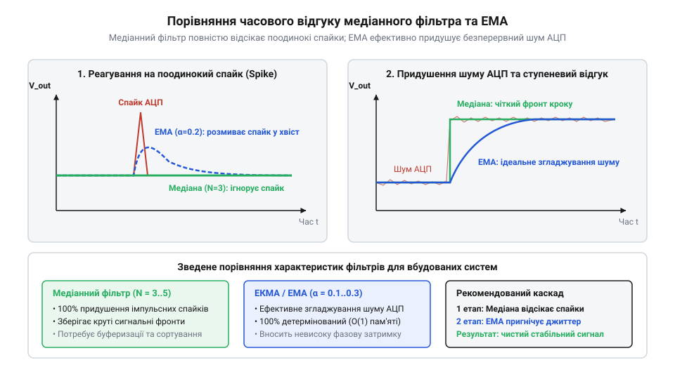

# Математичні методи фільтрації шуму й дрейфу АЦП

<preknowlist>
- [KY-023 — джойстик-модуль](root:cat-hw-controls/ky-023-joystick) — фізична будова двоосьового потенціометричного джойстика та характер електричного шуму при зсуві важеля
- [Стік на давачах Холла (Hall Effect Gimbal)](root:cat-hw-controls/hall-effect-gimbal-joystick) — принцип безконтактного зчитування напруги за допомогою давачів Холла та нелінійність шуму АЦП
- [Поворотний потенціометр](root:cat-hw-controls/rotary-potentiometer) — природа резистивного ділення напруги та походження контактного дребезгу струмознімача
</preknowlist>

## Природа шуму аналогових органів вводу

Підключення аналогового маніпулятора до мікроконтролера утворює первинне вимірювальне коло, у якому електричний сигнал неминуче спотворюється флуктуаціями. Навіть коли важіль [джойстик-модуля](root:cat-hw-controls/ky-023-joystick) перебуває у стані спокою, послідовність зчитаних відліків аналого-цифрового перетворювача (АЦП) не лишається константою. Замість стабільного числового значення система отримує тремтячий потік даних із поодинокими аномальними сплесками та повільним повзучим зсувом нейтралі.

Електричний сигнал аналогового вводу описується математичною моделлю, де спостережуваний відлік `u[n]` у дискретний момент часу `n` є сумою трьох незалежних компонент. Ключова відмінність між цими складовими полягає в їхньому спектральному розподілі частот: білий шум АЦП має рівномірну спектральну щільність потужності по всьому діапазону Найквіста від `0` до `f_s / 2` (де `f_s` — частота дискретизації), що дозволяє ефективно відсікати його високочастотну частину цифровими фільтрами низьких частот. Натомість спектральна потужність низькочастотного дрейфу зосереджена у наднизькій області частот (нижче `0.1 Гц`), де вона перекривається з повільними свідомими рухами оператора, тому її усунення вимагає не частотної фільтрації, а адаптивної корекції нуля.

u[n] = s[n] + e[n] + d[n]

Тут `s[n]` позначає істинну фізичну координату важеля, `e[n]` — високочастотний шум, а `d[n]` — низькочастотний дрейф. Високочастотна складова `e[n]` описується як білий гауссів шум (від англ. @@en|white Gaussian noise@@) із нульовим математичним сподіванням та дисперсією `σ²`. Вона виникає через теплові коливання носіїв заряду на [поворотних потенціометрах](root:cat-hw-controls/rotary-potentiometer), пульсації опорної напруги `V_ref` та шум квантування АЦП.

Окремим деструктивним чинником виступають поодинокі імпульсні завади (від англ. @@en|impulse noise@@). Вони виникають при миттєвому розриві контакту струмознімача або електромагнітних наводках від силових кіл. На відміну від гаусового шуму, амплітуда імпульсного сплеску може сягати всієї шкали АЦП. Низькочастотний дрейф нуля `d[n]` (від англ. @@en|zero drift@@) зумовлений температурним розширенням матеріалів, пружною деформацією повертальних пружин та деградацією напівпровідникових структур у [давачах Холла](root:cat-hw-controls/hall-effect-gimbal-joystick). Оскільки жоден із цих процесів не є статичним, спроба придушити шум простим відніманням фіксованого зміщення призводить до мимовільного зсуву нуля в процесі експлуатації.

## Медіанна фільтрація для відсікання сплесків

Застосування звичайних лінійних фільтрів для придушення імпульсних сплесків є неефективним: аномальний відлік високої амплітуди розмазується по суміжних відліках, спотворюючи траєкторію сигналу. Для усунення аномалій застосовують нелінійний медіанний фільтр (від лат. @@en|median filter@@ — серединний фільтр).

Медіанна фільтрація працює за принципом ковзного вікна непарної довжини `K = 2m + 1`. На кожному кроці дискретизації `n` фільтр формує вектор із `K` останніх зчитаних відліків `[u[n-m], ..., u[n], ..., u[n+m]]`, впорядковує їх за зростанням та обирає елемент, що опиняється посередині ранжованого списку:

y[n] = med(u[n-m], ..., u[n], ..., u[n+m])

Розглянемо обчислення медіани для вікна `K = 3` при виникненні поодинокого імпульсного сплеску.

**Умова:** послідовність сирих відліків `u = [2048, 2050, 4095, 2049, 2051]`, де значення `4095` є помилковим сплеском відсікача АЦП.

u_window = [2050, 4095, 2049]
u_sorted = [2049, 2050, 4095]      [ранжування елементів за зростанням]
y[2] = 2050                        [вибір центрального значення]

Завдяки ранжуванню викид `4095` переміщується в кінець масиву й повністю відсікається. Значення сигналу `y[2] = 2050` зберігає фактичну координату без імпульсного спотворення.

Розмір вікна `K` визначає компроміс між фільтруючою здатністю, часовою затримкою та обчислювальною складністю мікроконтролера. Вікно `K = 3` вносить затримку всього в `1` відлік і гарантовано знищує поодинокі сплески. Збільшення розміру вікна до `K = 5` дозволяє придушувати парні імпульсні завади, проте спричиняє заокруглення гострих піків корисного руху маніпулятора. Обчислювальна вартість алгоритму суттєво знижується при використанні методу швидкого вибору (від англ. @@en|Quickselect@@): замість повного сортування масиву зі складністю `O(K · log K)` пошук медіани у вікні `K = 3` вимагає лише `3` порівняння, а для `K = 5` — максимум `6` порівняльних операцій у фіксованій мережі, що робить медіанну обробку придатною для виконання безпосередньо у перериваннях АЦП.

## Ковзне та експоненційне згладжування сигналу

Після усунення імпульсних сплесків медіанним фільтром потік даних містить високочастотну гаусову складову. Для її придушення застосовують згладжувальні фільтри. Просте ковзне середнє (від англ. @@en|Simple Moving Average@@, SMA) обчислює середнє арифметичне за вікном з `N` відліків:

y[n] = (1 / N) · ∑ u[n-i]

Основним недоліком SMA є необхідність зберігання кільцевого буфера з `N` елементів та висока чутливість до довжини вікна. Більш ефективним для мікроконтролерів є експоненційне згладжування (від англ. @@en|Exponential Moving Average@@, EMA). Фільтр EMA зберігає лише одне попереднє значення стану `y[n-1]` і обчислюється за формулою:

y[n] = α · x[n] + (1 - α) · y[n-1]

де `α ∈ (0, 1]` — ваговий коефіцієнт згладжування, а `x[n]` — вхідний відлік після медіанної обробки. Для мінімізації операцій множення на мікроконтролері вираз перегруповують до вигляду:

y[n] = y[n-1] + α · (x[n] - y[n-1])      [перегруповування для зменшення множень]

Коефіцієнт `α` визначає частоту зрізу фільтра `f_c` при частоті дискретизації АЦП `f_s`. Наближений зв'язок описується співвідношенням `α ≈ 2π · f_c / f_s`. Чим менше значення `α`, тим сильніше придушується шум, проте зростає часове запізнення відгуку. Причину такої інерційності пояснює рекурсивне розгортання рівняння фільтра `y[n] = α · x[n] + (1 - α) · y[n-1]`. Якщо послідовно підставити значення попередніх станів `y[n-1]` та `y[n-2]`, поточний вихід виражається через нескінченну суму минулих вхідних відліків:

```
y[n] = α · x[n] + (1 - α) · y[n-1]
     = α · x[n] + (1 - α) · (α · x[n-1] + (1 - α) · y[n-2])      [підстановка розгортання y[n-1]]
     = α · x[n] + α · (1 - α) · x[n-1] + α · (1 - α)² · x[n-2] + …  [розкриття дужок для наступних станів]
     = α · ∑ (1 - α)^k · x[n-k]                                     [згортання у суму для k від 0 до ∞]
```

З отриманого ряду видно, що відлік `x[n-k]`, виміряний `k` тактів тому, входить у поточний результат із ваговим коефіцієнтом `w_k = α · (1 - α)^k`. Оскільки `α ∈ (0, 1]`, множник `(1 - α)` строго менший за одиницю, тому вага старих вимірювань згасає за експоненційним законом (геометричною прогресією). Сума всіх вагових коефіцієнтів дорівнює одиниці `α · ∑ (1 - α)^k = α / α = 1`, що забезпечує точну передачу постійної складової сигналу без зсуву рівня, але залишкова вага давніх відліків створює запізнення при різких змінах координати.


*Порівняльний графік часового відгуку медіанного фільтра та експоненційного згладжування EMA при відсіканні поодинокого імпульсного сплеску та придушенні високочастотного шуму АЦП.*

## Динамічні мертві зони та адаптивний поріг

Навіть після EMA-фільтрації залишковий флуктуаційний шум та температурний дрейф не дозволяють координатам точно зафіксуватися в нулі при відпущеному важелі. Фіксована мертва зона (від англ. @@en|deadzone@@) із жорстко заданим порогом вирішує проблему лише частково: при сильному нагріві чи зносі пружин дрейф виходить за межі порогу, викликаючи самовільний рух.

Для надійної фіксації нейтралі використовують адаптивну мертву зону, поріг якої обчислюється на основі статистичної дисперсії шуму спокою `σ²`:

σ² = (1 / N) · ∑ (x[i] - x̄)²

Поріг відсічки `R_dead` встановлюють за правилом трьох сігм: `R_dead = 3 · σ`. Це гарантує, що `99.73 %` флуктуацій у стані спокою потрапляють у мертву зону й анулюються.

Щоб запобігти стрибку вихідного значення при виході маніпулятора з мертвої зони, застосовують плавну нормовану характеристику перетворення:

z[n] = 0, якщо |y[n]| ≤ R_dead
z[n] = sign(y[n]) · ( (|y[n]| - R_dead) / (1 - R_dead) ), якщо |y[n]| > R_dead

Таке відтворення гарантує, що при перевищенні порогу `R_dead` вихідне значення `z[n]` плавно зростає від `0` до `±1.0` без сходинкового стрибка швидкості.

## Компроміс між фазовим запізненням і згладжуванням

Головним обмеженням лінійних фільтрів є фазове запізнення (від англ. @@en|phase lag@@). Для фільтра EMA еквівалентна часова затримка `τ` виражається через коефіцієнт `α` та період дискретизації `T_s`:

τ ≈ T_s · (1 - α) / α

При великому згладжуванні (мале `α`) затримка `τ` досягає десятків мілісекунд, що створює ефект «в'язкості» або спізнення відгуку маніпулятора під час швидких маневрів.

Для розв'язання цього конфлікту застосовують адаптивну фільтрацію (від англ. @@en|adaptive filtering@@). Її суть полягає у динамічній зміні коефіцієнта `α` залежно від швидкості зміни вхідного сигналу `Δx = |x[n] - x[n-1]|`:

1. У стані спокою та при повільному русі (`Δx` мале) коефіцієнт дорівнює `α_min`, забезпечуючи максимальне придушення шуму та стабільність нуля.
2. При швидкому відхиленні важеля (`Δx` перевищує поріг динаміки) коефіцієнт стрибкоподібно зростає до `α_max ≈ 1.0`, що тимчасово вимикає фільтрацію й усуває фазову затримку.

Такий каскад із медіанного фільтра `K = 3`, адаптивного EMA та плавної мертвої зони забезпечує повну відсутність дрейфу у спокої та миттєвий відгук при динамічному керуванні.
