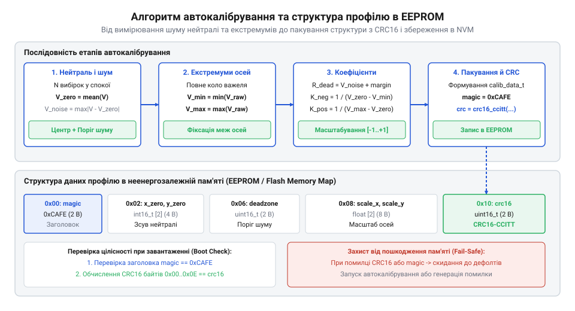

# Автоматичне калібрування джойстика та збереження профілю нейтралі в EEPROM

<preknowlist>
- [Поворотний потенціометр](root:cat-hw-controls/rotary-potentiometer) — Принцип роботи аналогового дільника напруги та залежність опору від кута повороту
- [KY-023 — джойстик-модуль](root:cat-hw-controls/ky-023-joystick) — Двоосьова конструкція з виходами АЦП X та Y
- [Стік на давачах Холла (Hall Effect Gimbal)](root:cat-hw-controls/hall-effect-gimbal-joystick) — Принцип роботи безконтактного магнітного вимірювача положення
</preknowlist>

## Проблема температурного дрейфу та шуму АЦП

У робототехнічних системах, безпілотних літальних апаратах та промислових маніпуляторах точність позиціонування органів керування прямо визначає безпеку виконання технологічних операцій. Використання [двоосьових потенціометричних джойстиків KY-023](root:cat-hw-controls/ky-023-joystick) або безконтактних [стіків на датчиках Холла](root:cat-hw-controls/hall-effect-gimbal-joystick) супроводжується фізичним явищем зміщення нейтрального положення — дрейфом нуля (від @@en|stick drift@@: з англ. @@en|stick@@ — важіль та @@en|drift@@ — зсув). Внаслідок температурних коливань навколишнього середовища, пружної релаксації повертальних пружин підвісу та абразивного зносу резистивних доріжок аналоговий сигнал відпущеного важеля відхиляється від номінального значення центра.

Додатковим дестабілізуючим фактором є шуми АЦП (від @@en|ADC noise@@: з англ. @@en|noise@@ — шум). Високочастотні наводки в аналоговому колаживленні, пульсації опорної напруги та неминучий квантувальний шум (від англ. @@en|quantization noise@@, від лат. @@la|quantitas@@ — кількість), що виникає при округленні неперервної напруги до дискретних рівнів, створюють постійне тремтіння молодших розрядів АЦП у стані спокою. У типових 12-бітних перетворювачах з роздільною здатністю 4096 відліків допустимий рівень тремтіння становить `±2–5` розрядів @@en|LSB@@ (від англ. @@en|least significant bit@@ — найменший значущий біт), що відповідає випадковому розмаху шуму в `4–10` відліків. Якщо прошивка мікроконтролера не виконує адаптивної компенсації, навіть такий мінімальний зсув викликає самовільний повільний рух («поповзання») привода при повністю відпущеному ручному маніпуляторі. Для усунення цього ефекту розробляють конвеєр автокалібрування, який вимірює рівень шуму спокою, розраховує адаптивну мертву зону (від @@en|deadzone@@: з англ. @@en|dead@@ — мертвий та @@en|zone@@ — зона) та нормалізує сирі відліки АЦП у діапазон від `-1.0` до `+1.0`.

## Алгоритм автовизначення нейтралі та крайніх меж

Для автоматичного розрахунку нульового зсуву під час подачі живлення або при вході в режим юстування драйвер виконує збір статичної вибірки з `N` послідовних відліків АЦП у стані спокою. Математичний центр осей `adc_center_x` та `adc_center_y` обчислюється як середнє арифметичне значення вибірки. Щоб запобігти збереженню викривлених параметрів, якщо користувач випадково торкнувся важеля під час ініціалізації, виконують перевірку дисперсії (від @@en|variance check@@: з лат. @@en|variantia@@ — зміна). Якщо розмах відхилень перевищує допустимий поріг шуму, калібрування скасовується.

Після визначення центрального положення здійснюється асиметричне масштабування осей відносно фізичних екстремумів ходу `[adc_min, adc_max]`. Для виключення ступенчастого стрибка чутливості на межі мертвої зони застосовують алгоритм радіального перемасштабування (@@en|Scaled Radial Deadzone@@). Спочатку координати нормуються до симетричного інтервалу `[-1.0, 1.0]`, після чого обчислюється евклідова відстань (англ. @@en|Euclidean distance@@) початкового вектора `r = √(norm_x² + norm_y²)`. Якщо радіус `r` перевищує заданий поріг мертвої зони `d`, скоригована амплітуда перераховується за формулою `scaled_r = (r - d) / (1.0 - d)` з обмеженням до `1.0`. Підсумкові вихідні компоненти вектора формуються множенням одиничного напрямку на нову амплітуду: `out_x = (norm_x / r) · scaled_r` та `out_y = (norm_y / r) · scaled_r`. Завдяки цьому евклідовий радіус відхилення вектора перераховується так, щоб значення `0.0` відповідало межі мертвої зони, а значення `1.0` — максимальному фізичному нахилу важеля, що ґарантує гладкий перехід від нульового стану без втрати чутливості на мікровідхиленнях.

*Конвеєр автокалібрування: від вимірювання статичного шуму АЦП до пакування структури та запису в EEPROM.*

## Структура даних профілю та контроль CRC16

Усі обчислені під час автокалібрування параметри — центральні зсуви, граничні виміряні амплітуди та радіус мертвої зони — пакуються в бінарну структуру (від @@en|calibration profile@@: з франк. @@en|calibre@@ — вимір та італ. @@en|profilo@@ — обрис). Для гарантії цілісності даних при зчитанні з пам'яті до структури додають поле циклічного надлишкового коду (від @@en|cyclic redundancy check@@ — @@en|CRC16@@: з лат. @@en|cyclus@@ — коло та @@en|redundantia@@ — надлишковість).

Обчислення контрольної суми виконують за стандартом CRC16-CCITT з поліномом `0x1021` по всьому байтовому масиву структури, за винятком самого поля `crc16`. Нижче наведено оголошення структур профілів та інтерфейсу в C та C++:

Покроковий обчислювальний процес оновлення контрольної суми полягає в послідовній обробці кожного байта даних: початковий 16-бітний регістр ініціалізують значенням `0xFFFF`, після чого черговий вхідний байт зсувають на 8 бітів вліво та побітово об'єднують оператором XOR зі старшим байтом регістра. Для кожного з 8 бітів цього значення перевіряють найстарший біт: якщо він дорівнює `1`, регістр зсувається вліво на 1 біт із додаванням побітового XOR з генераторним поліномом `0x1021` (від англ. @@en|polynomial@@: з дав.-гр. πολύς — численний та лат. @@la|nomen@@ — ім'я), а якщо найстарший біт дорівнює `0` — виконується лише зсув вліво.

        crc_0 = 0xFFFF                                              [початковий стан регістра]
        crc_1 = crc_0 ^ (byte_i ≪ 8)                                [XOR вхідного байта зі старшим байтом]
        crc_out = (crc_1 ≪ 1) ^ 0x1021                              [зсув та XOR з поліномом при MSB = 1]

При обчисленні контрольної суми над бінарними структурами пам'яті критично враховувати апаратне вирівнювання байтів структури (від англ. @@en|structure padding@@: з англ. @@en|padding@@ — наповнення). За замовчуванням компилятор вставляє невидимі заповнювальні байти між полями структури для її вирівнювання в пам'яті (від англ. @@en|byte alignment@@), значення яких може бути довільним сміттям. Якщо обчислювати CRC16 безпосередньо по покажчику структури в пам'яті, випадковий вміст цих байтів призведе до розбіжності контрольної суми на різних компіляторах і платформах. Для усунення цієї проблеми структуру профілю пакують без вирівнювальних байтів (від англ. @@en|packed structure@@: `#pragma pack(push, 1)` у C++ або `__attribute__((packed))` у C) або попередньо обнуляють увесь її обсяг за допомогою функції `memset` перед заповненням значень.

:::tabs
@tab C
:::code proj-auto-calibration-and-eeprom-profile/c/stick_calibration.h 21-40
@tab C++
:::code proj-auto-calibration-and-eeprom-profile/cpp/include/joystick_calibrator.hpp 10-27
:::

## Збереження та відновлення профілю з EEPROM

Збереження сформованого профілю здійснюють у неенергозалежній пам'яті @@en|EEPROM@@ (від англ. @@en|Electrically Erasable Programmable Read-Only Memory@@ — електрично стирана програмована пам'ять лише для зчитування) або в зарезервованому секторі @@en|Flash@@-пам'яті (від англ. @@en|flash@@ — спалах). Під час кожного включення живлення пристрою прошивка зчитує профіль з пам'яті та повторно розраховує контрольне значення @@en|CRC16@@.

Якщо обчислене значення @@en|CRC16@@ збігається зі збереженим у структурі, профіль вважається валідним і застосовується для обробки осей. У разі виявлення розбіжності (наприклад, через збій живлення під час запису або знос комірок EEPROM) спрацьовує механізм аварійного повернення (від @@en|fallback@@: з англ. @@en|fall@@ — падати та @@en|back@@ — назад): система відхиляє пошкоджені дані та завантажує безпечний фабричний профіль із розширеною мертвою зоною.

Нижче наведено реалізацію перевірки контрольної суми та обробки осей мовами C та C++:

:::tabs
@tab C
:::code proj-auto-calibration-and-eeprom-profile/c/stick_calibration.c 76-139
@tab C++
:::code proj-auto-calibration-and-eeprom-profile/cpp/src/joystick_calibrator.cpp 37-58
:::code proj-auto-calibration-and-eeprom-profile/cpp/src/joystick_calibrator.cpp 103-145
:::

Для роботи з носієм пам'яті застосовують спеціалізовані драйверні модулі читання/запису блоків:

:::code proj-auto-calibration-and-eeprom-profile/c/eeprom_driver.h 14-28

Алгоритм зчитування й відновлення профілю під час завантаження пристрою виконується у суворій послідовності: прошивка послідовно читає бінарний блок з обраного зміщення @@en|EEPROM@@ у тимчасовий буфер @@en|RAM@@, розраховує контрольне значення @@en|CRC16@@ для корисного навантаження (усіх полів до зміщення самої контрольної суми) та здійснює санітарну перевірку геометрії меж (відповідність умов `min < center < max` та допустимий діапазон мертвої зони). Якщо контрольна сума або геометрія порушені, спрацьовує аварійний фолбек (англ. @@en|fallback@@; від англ. *fall* — падати, та *back* — назад) — драйвер відхиляє блок і завантажує безпечний дефолтний профіль. Для збереження оновленого профілю критичним є захист осередків неенергозалежної пам'яті від ресурсового зносу (зазвичай комірки @@en|EEPROM@@ мають обмеження у `100 000–1 000 000` циклів перезапису). З цією метою застосовують алгоритм вибіркового перезапису (англ. @@en|selective write@@ або @@en|write-if-changed@@): перед фізичним поданням напруги програмування на комірку драйвер попередньо зчитує її поточний байт і здійснює операцію запису лише тоді, коли новий байт відрізняється від наявного (`buffer[i] != existing_byte`). При повторному збереженні незмінених коефіцієнтів калібрування цей механізм зводить кількість циклів стирання до нуля, продовжуючи строк служби плати.

## Інтеграція та випробування системи в роботі

Для підтвердження надійності розробленого модуля проводиться серія комплексних випробувань у реальному часі. Перевірка включає симуляцію статичного дрейфу нуля, поштовхів усередині мертвої зони, граничних діагональних відхилень важеля та апаратних обривів провідників АЦП (`0` або `4095`). Порівняно з нерегульованими [поворотними потенціометрами](root:cat-hw-controls/rotary-potentiometer) та [багатопозиційними галетними перемикачами](root:cat-hw-controls/rotary-selector-switches), цифровий конвеєр з автокалібруванням повністю нейтралізує механічні та температурні похибки підвісу.

Повний демонстраційний цикл виконання тестових сценаріїв та перевірки аварійного захисту показано у вихідному коді:

:::tabs
@tab C
:::code proj-auto-calibration-and-eeprom-profile/c/main.c 28-82
@tab C++
:::code proj-auto-calibration-and-eeprom-profile/cpp/src/main.cpp 24-96
:::
